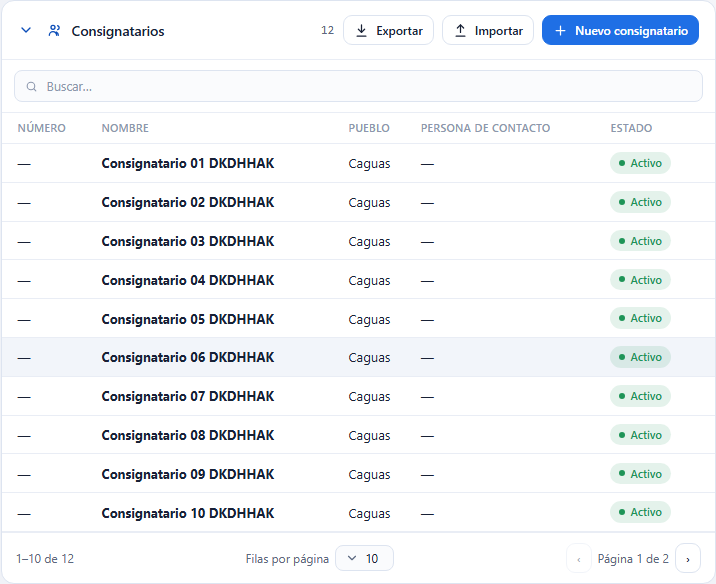
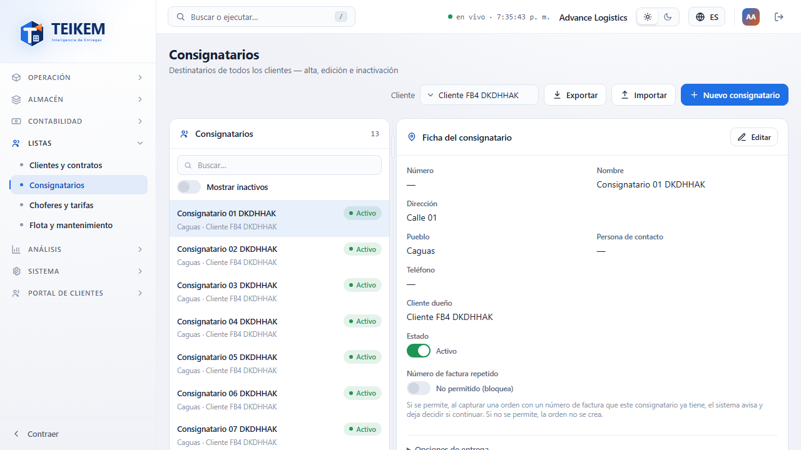
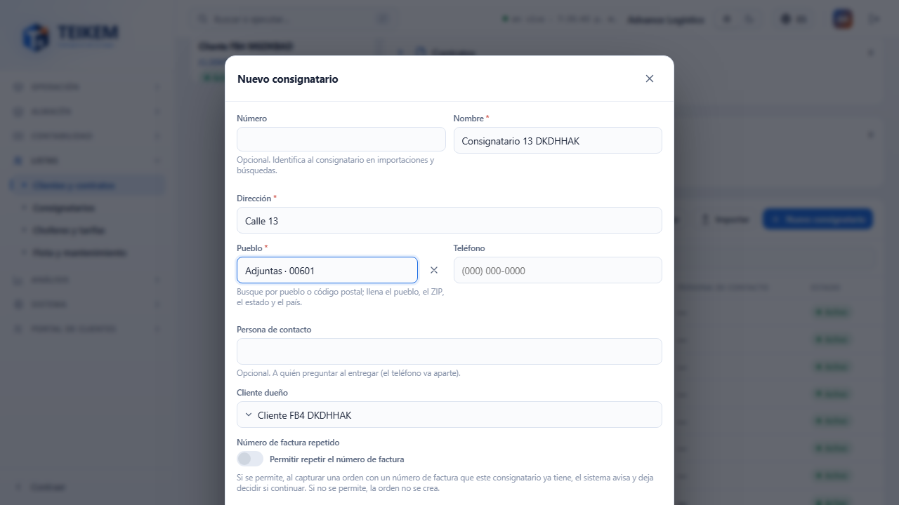
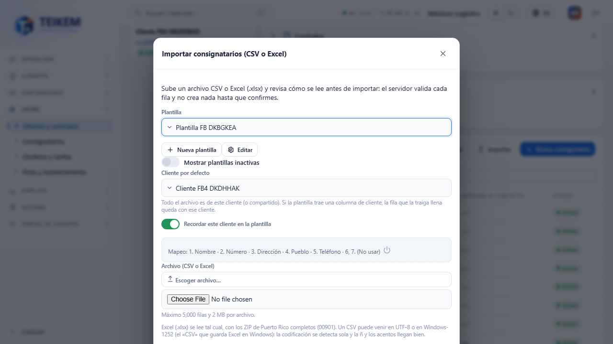
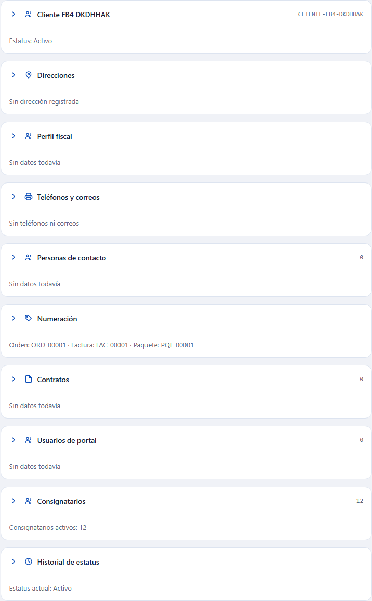
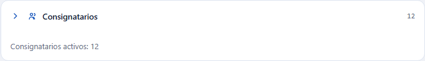

# Consignatarios dentro de la ficha del cliente, y Exportar (Lote F-B4)

Esta guía explica cómo ver, buscar, exportar, importar y crear **los consignatarios de un cliente sin salir de su ficha**, y cómo **exportar** desde la pantalla Consignatarios. Es para quien atiende clientes y para soporte. Las demás funciones de Consignatarios (alta, edición, baja, importación con plantilla) siguen en [fb-consignatarios.md](fb-consignatarios.md), [fb2-importacion-consignatarios.md](fb2-importacion-consignatarios.md) y [fb3-variantes-y-codigos-postales.md](fb3-variantes-y-codigos-postales.md).

## 1. Qué hay de nuevo

1. En **Listas → Clientes y contratos**, al elegir un cliente, la ficha tiene un panel nuevo, **Consignatarios**. Va **al final**, justo antes del **Historial de estatus**.
2. En **Listas → Consignatarios**, la cabecera trae, juntos y en este orden, **Exportar**, **Importar** y **Nuevo consignatario** (después del filtro **Cliente**), igual que en el panel de la ficha del cliente.
4. En **Listas → Consignatarios**, la lista de la izquierda arranca **más ancha** (unos 10 caracteres más) y entre la lista y la ficha hay una **barra para cambiar el ancho**: arrástrela con el ratón o el dedo, o use las flechas ← y → con la barra seleccionada; **doble clic** (o Enter) vuelve al ancho de inicio. El navegador recuerda el ancho que dejó. En pantallas angostas (menos de 900 px) la ficha queda debajo de la lista y no hay barra.
3. Los paneles de la ficha del cliente son **desplegables** y, cerrados, dan un **resumen** (sección 6).

## 2. Quién puede hacerlo

| Acción | Permiso | Módulo |
|---|---|---|
| Ver el panel Consignatarios y **Exportar** | `locations.read` | Listas |
| **Importar** y **Nuevo consignatario** | `locations.create` | Listas |

Sin `locations.read` el panel **no aparece** en la ficha del cliente (no es un error). Sin `locations.create` se ven la tabla y **Exportar**, pero no **Importar** ni **Nuevo consignatario**.

## 3. El panel de la ficha del cliente

1. Entre a **Listas → Clientes y contratos** y escoja un cliente.
2. Baje hasta el panel **Consignatarios**. El número junto al título es **cuántos consignatarios** cumplen el buscador (todos, no solo los que se ven).
3. La tabla muestra **10 filas por página**: Número, Nombre, Pueblo, Persona de contacto y Estado. Si hay más, el pie de la tabla trae la **paginación** (página anterior y siguiente, y «Filas por página»), así que se recorre todo **sin salir de la ficha**.
4. Solo salen los consignatarios **propios de ese cliente** que están **activos**. Los compartidos con todos los clientes y los inactivos se ven en la pantalla Consignatarios.
5. **Buscar:** escriba en la casilla. Busca por número, nombre, dirección, pueblo, ZIP, persona de contacto y estado, **entre todos** los consignatarios del cliente (no solo entre las 10 filas visibles).
6. Un clic en una fila abre ese consignatario en la pantalla **Consignatarios**.

## 4. Exportar

1. Pulse **Exportar** y escoja **Excel**, **CSV** o **PDF**.
2. El archivo trae **exactamente lo que el panel tiene filtrado**: sin buscador, todos los consignatarios del cliente; con una búsqueda, solo los que coinciden. **No se limita a las 10 filas visibles.**
3. Columnas: Número, Nombre, Cliente, Dirección 1, Dirección 2, Pueblo, Estado, Código postal, País, Persona de contacto y Estado del registro. **El teléfono no va en el archivo.**
4. El menú dice cuántas filas se exportan.

En **Listas → Consignatarios**, el botón **Exportar** está arriba, en la cabecera, antes de **Importar** y **Nuevo consignatario**. Exporta **lo que la lista tiene a la vista**: respeta el filtro **Cliente**, **Mostrar inactivos** y el buscador.

## 5. Importar y Nuevo consignatario, sin salir de la ficha

- **Nuevo consignatario** abre la misma ventana de la pantalla Consignatarios, con **este cliente ya escogido como dueño**. Al guardar, la ventana se cierra, **usted sigue en la ficha del cliente** y la tabla se refresca sola (el contador sube).

- **Importar** abre la misma ventana de importación, con este cliente como **cliente por defecto**. Al terminar, vuelve a la ficha y la tabla se actualiza con lo importado.

Todo lo demás de esas ventanas (plantillas, vista previa, avisos, errores) funciona igual que en la pantalla Consignatarios.

## 6. Paneles desplegables

Todos los paneles de la ficha del cliente (Perfil, Teléfonos y correos, Personas de contacto, Numeración, Campos personalizados, Contratos, Usuarios de portal, Consignatarios e Historial de estatus) se pueden **cerrar y abrir**:

- Pulse la **flecha** a la izquierda del título, o un clic en la cabecera (fuera de los botones). Cerrado, el panel **muestra un resumen de una línea** de lo que tiene, y se esconden sus botones. Por ejemplo, «Consignatarios activos: 12» o «Teléfonos: 2 · Correos: 1».
- Lo que estaba escribiendo en un panel no se pierde al cerrarlo.
- Los paneles **arrancan cerrados** cada vez que abre un cliente o recarga la página: no se recuerda cómo los dejó.
- La cabecera del cliente (nombre, estatus y «Dar de baja») también se cierra; cerrada dice solo el estatus.

La pantalla Consignatarios también abre ya filtrada por un cliente con la dirección `/catalog/consignees?client=<id del cliente>`.

## 7. Mensajes del panel

| Mensaje | Cuándo sale | Qué hacer |
|---|---|---|
| «Este cliente todavía no tiene consignatarios. Use «Nuevo consignatario» o «Importar».» | El cliente no tiene consignatarios activos. | Cree uno o importe un archivo. Si ya tenía y los dio de baja, revise **Mostrar inactivos** en Consignatarios. |
| «Ningún consignatario de este cliente coincide con la búsqueda.» | El buscador no encuentra nada. | Borre o cambie lo escrito. |
| El título del error del servidor (en rojo) | Falló la carga de la lista. | Recargue la página; si sigue, avise a soporte con el texto. |

Los mensajes de **Nuevo consignatario** y de **Importar** son los de [fb-consignatarios.md](fb-consignatarios.md) y de [fb2](fb2-importacion-consignatarios.md) / [fb3](fb3-variantes-y-codigos-postales.md).

## 8. Casos frecuentes

- **No veo el panel Consignatarios.** Su usuario no tiene `locations.read`, o el módulo Listas está apagado. Pídalo a un administrador.
- **No veo Importar ni Nuevo consignatario.** Falta `locations.create`.
- **Creé un consignatario y no sale en la tabla.** Solo se ven los **activos** y que **cumplan el buscador**: borre lo escrito en la casilla. Si el contador subió pero la fila no está en la primera página, pase a la página siguiente.
- **El archivo exportado tiene más filas que la página.** Es lo correcto: la tabla enseña 10 por página; el archivo trae todas las filtradas.
- **Falta el teléfono en el archivo.** El teléfono se guarda aparte y no se exporta en esta versión.
