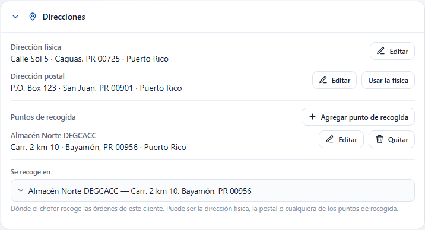
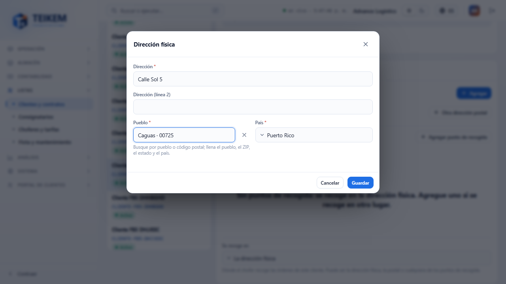
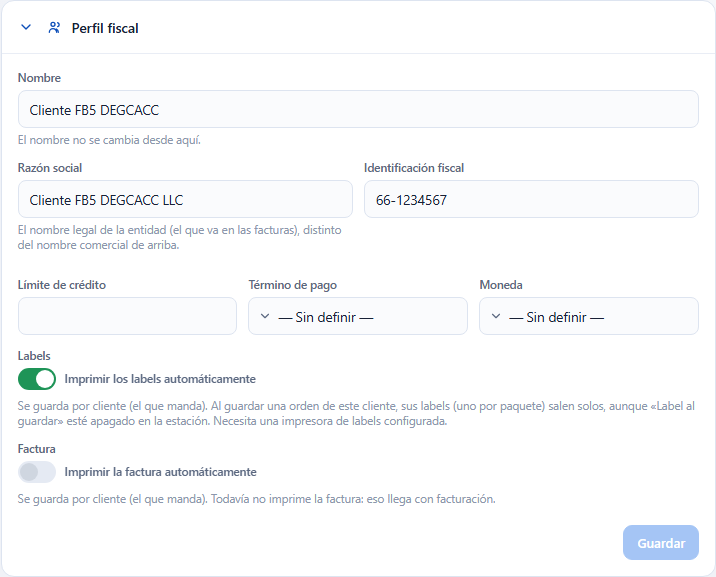
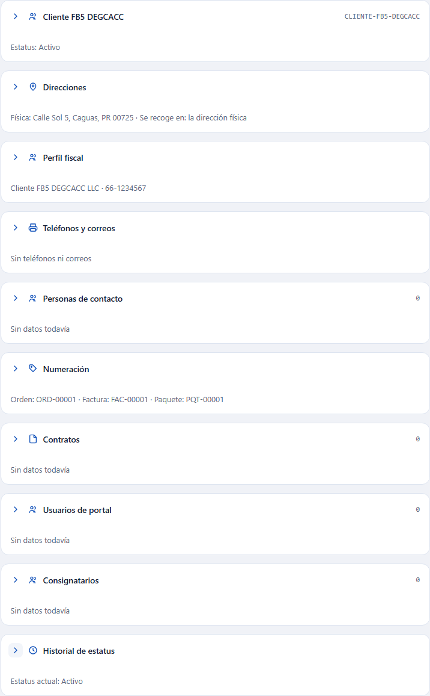

# Direcciones, Perfil fiscal y paneles con resumen en la ficha del cliente (Lote F-B5)

Esta guía explica cómo registrar **dónde está el cliente y dónde se le recoge**, qué cambió en el **Perfil fiscal** (nuevo nombre del antiguo «Perfil del cliente»), el interruptor **Imprimir los labels automáticamente**, y cómo se ve cada panel de la ficha cuando está **cerrado**. Es para quien atiende clientes y para soporte. Los paneles desplegables y el de Consignatarios están en [fb4](fb4-consignatarios-en-la-ficha-del-cliente.md).

Ficha del cliente: **Listas → Clientes y contratos** y escoja un cliente.

## 1. Qué hay de nuevo

1. Un panel nuevo, **Direcciones**, **justo debajo de la cabecera del cliente** y antes del Perfil fiscal.
2. «Perfil del cliente» se llama ahora **Perfil fiscal**: habla de la entidad fiscal (razón social, identificación fiscal, crédito, término de pago y moneda). Las direcciones salieron de ahí.
3. En el Perfil fiscal hay un interruptor nuevo, **Imprimir los labels automáticamente**, antes de **Imprimir la factura automáticamente**.
4. La cabecera del cliente también se puede cerrar, y todos los paneles cerrados dan un resumen (sección 5).

## 2. El panel Direcciones

Un cliente tiene:

- **Dirección física**: una sola (la corporativa).
- **Dirección postal**: una sola. Mientras no tenga la suya dice **«Igual a la dirección física»**. Si es distinta (por ejemplo un P.O. Box), use **Otra dirección postal**. **Usar la física** vuelve a «igual a la física».
- **Puntos de recogida**: los que quiera (almacenes u otros lugares donde se recoge). Cada uno lleva un **nombre** que lo identifica en el despacho.
- **Se recoge en**: dónde el chofer recoge las órdenes de este cliente. Puede ser **la dirección física, la postal o cualquiera de los puntos de recogida**. Por omisión es la física. Se guarda al escoger.

Así, si el punto de recogida no es ni la física ni la postal, se agrega como **otro punto** y se escoge en «Se recoge en». También puede recogerse en la postal, o la postal y la física pueden ser la misma y haber un tercer punto de recogida.

### Cómo agregar o editar una dirección

1. Pulse **Agregar** (física), **Otra dirección postal**, **Agregar punto de recogida** o **Editar** en la dirección que quiera cambiar.
2. Escriba la **dirección (línea 1)** y, si hace falta, la línea 2.
3. En **Pueblo** busque por pueblo o por código postal y escoja de la lista: se llenan solos el **estado**, el **código postal** y el **país**. La física y los puntos de recogida solo ofrecen códigos postales **de entrega**; la **postal** acepta también **P.O. Box**.
4. En un punto de recogida escriba su **nombre** (por ejemplo «Almacén Norte»).
5. **Guardar**. Aparece «Dirección guardada.» y el panel se actualiza.

### Quitar

- **Quitar** (punto de recogida): pide confirmación. El punto deja de existir para este cliente; las órdenes ya creadas no cambian. Si era el punto por defecto, se vuelve a recoger en la dirección física. Mensaje: «Punto de recogida quitado.»
- **Usar la física** (postal): la postal propia se da de baja y la postal pasa a ser la física. Mensaje: «La dirección postal es ahora la física.»
- La dirección física no se quita; se edita.

## 3. Quién puede hacerlo

| Acción | Permiso |
|---|---|
| Ver el panel | `clients.read` |
| **Agregar** direcciones y puntos de recogida | `locations.create` |
| **Editar** y **Quitar** | `locations.update` |
| Escoger **Se recoge en** | `clients.update` |

Sin esos permisos los botones no aparecen y «Se recoge en» queda de solo lectura.

## 4. Perfil fiscal e imprimir labels automáticamente

- **Razón social** es el **nombre legal** de la entidad, el que va en las facturas; el **Nombre** de la cabecera es el nombre comercial. Junto va la **Identificación fiscal**.
- **Imprimir los labels automáticamente** (apagado por omisión): al guardar una orden de **este cliente** en la pantalla de órdenes, sus labels (uno por paquete) salen solos, aunque el interruptor **Label al guardar** de la estación esté apagado. Necesita la impresora de labels configurada en la estación ([Impresoras y labels](fg1-impresoras.md)); si no la hay o falla, la orden queda guardada y se avisa.
- **Imprimir la factura automáticamente**: sigue siendo solo la preferencia; la factura todavía no se imprime.
- **Guardar** se activa solo cuando hay cambios.

## 5. Paneles cerrados: qué dice cada resumen

| Panel | Resumen cuando está cerrado |
|---|---|
| Cabecera | `Estatus: Activo` (o `Estatus: Suspendido`, si está en un desvío; con `· Inactivo` si el cliente está dado de baja) |
| Direcciones | `Física: Calle Sol 5, Caguas, PR 00725 · Se recoge en: la dirección física` (o el nombre del punto) |
| Perfil fiscal | razón social · identificación fiscal · moneda · término de pago |
| Teléfonos y correos | `Teléfono: (787) 555-0100 · Correo: info@acme.com · +2` (el principal de cada uno y cuántos más hay) |
| Personas de contacto | la principal y hasta tres más: `Ana Pérez (principal), Luis, María, Pedro +2` |
| Numeración | `Orden: ORD-00001 · Factura: FAC-00001 · Paquete: PQT-00001` (ejemplos) |
| Campos personalizados | `Campo: valor · Campo: valor · +2` (con valor), o cuántos campos hay sin valor |
| Contratos | `Contratos: 2 · vigente: ACME-001 · Contrato marco` |
| Usuarios de portal | `Usuarios de portal: 3` |
| Consignatarios | `Consignatarios activos: 12` |
| Historial de estatus | `Estatus actual: Activo` |

## 6. Mensajes

| Mensaje | Cuándo sale | Qué hacer |
|---|---|---|
| `Sin dirección registrada` | El cliente no tiene la dirección física (o postal). | Pulse **Agregar**. |
| `Igual a la dirección física` | No hay dirección postal propia. | Si es otra, **Otra dirección postal**. |
| `Escriba el nombre del punto.` | Un punto de recogida sin nombre. | Escriba el nombre. |
| `La dirección (línea 1) es obligatoria.` / `La ciudad es obligatoria.` / `El país es obligatorio.` | Falta ese dato. | Complételo (el pueblo se escoge de la lista). |
| `Máximo N caracteres.` | Texto demasiado largo. | Acórtelo. |
| `El cliente ya tiene una dirección corporativa activa; desactívela o edítela.` (409) | Se intentó crear una segunda física. | Edite la que existe. |
| `El cliente ya tiene una dirección postal (facturación) activa; desactívela o edítela.` (409) | Se intentó crear una segunda postal. | Edite la que existe o use **Usar la física**. |
| `El punto de recogido debe ser una dirección activa del cliente: la física, la postal o un punto de recogida.` (400) | El «Se recoge en» elegido ya no es válido. | Vuelva a abrir la ficha y escoja otro. |
| `El registro fue modificado por otro usuario; recargue e intente de nuevo.` (409) | Otra persona guardó antes. | Recargue la ficha y repita. |

## 7. Casos frecuentes

- **No veo dónde escribir la dirección del cliente.** Está en el panel **Direcciones** (antes estaba solo como lectura en el Perfil). Si no ve **Agregar**, falta el permiso `locations.create`.
- **La postal y la física son la misma.** No hace falta crear nada: deje «Igual a la dirección física».
- **Se recoge en un tercer lugar.** Agregue un **punto de recogida** y escójalo en **Se recoge en**.
- **No encuentro el código postal de un P.O. Box.** Solo la dirección **postal** los admite; la física y los puntos de recogida ofrecen códigos de entrega.
- **Activé los labels automáticos y no salen.** Revise que la estación tenga una impresora de labels; la orden se guardó igual y el aviso dice el motivo.
