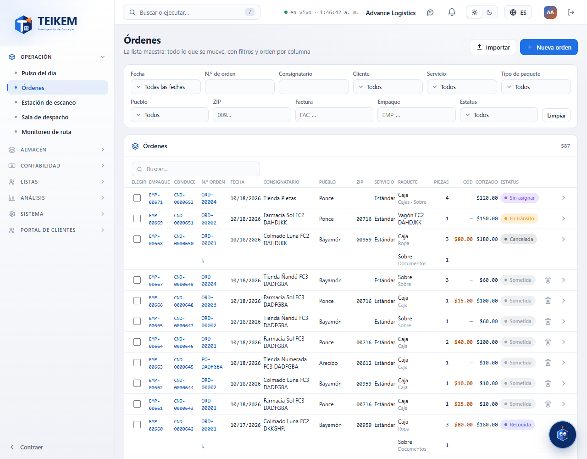
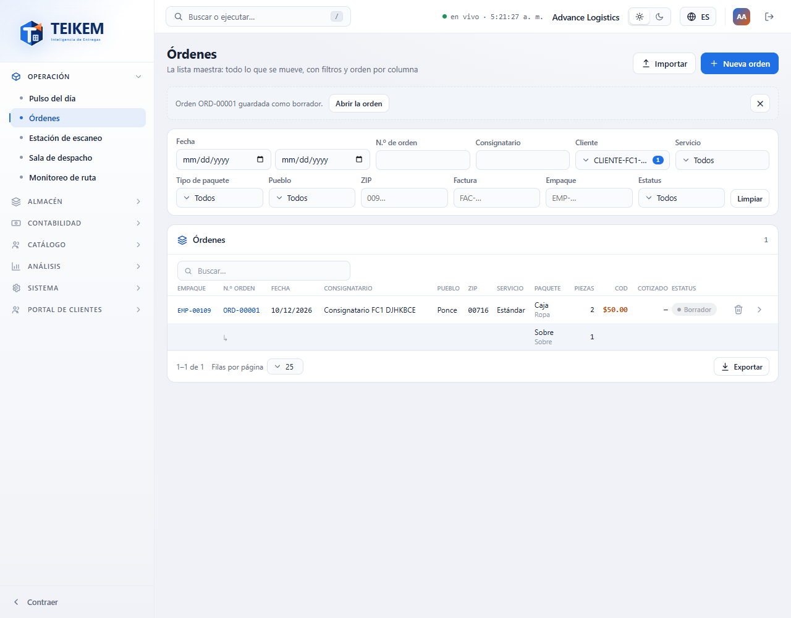
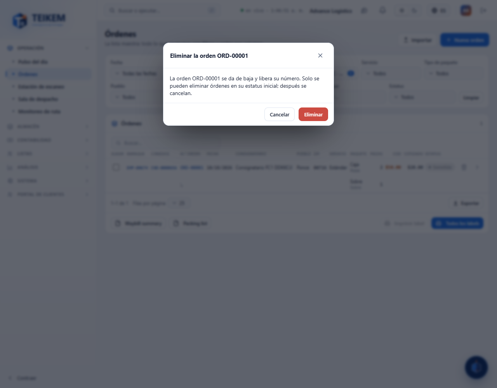
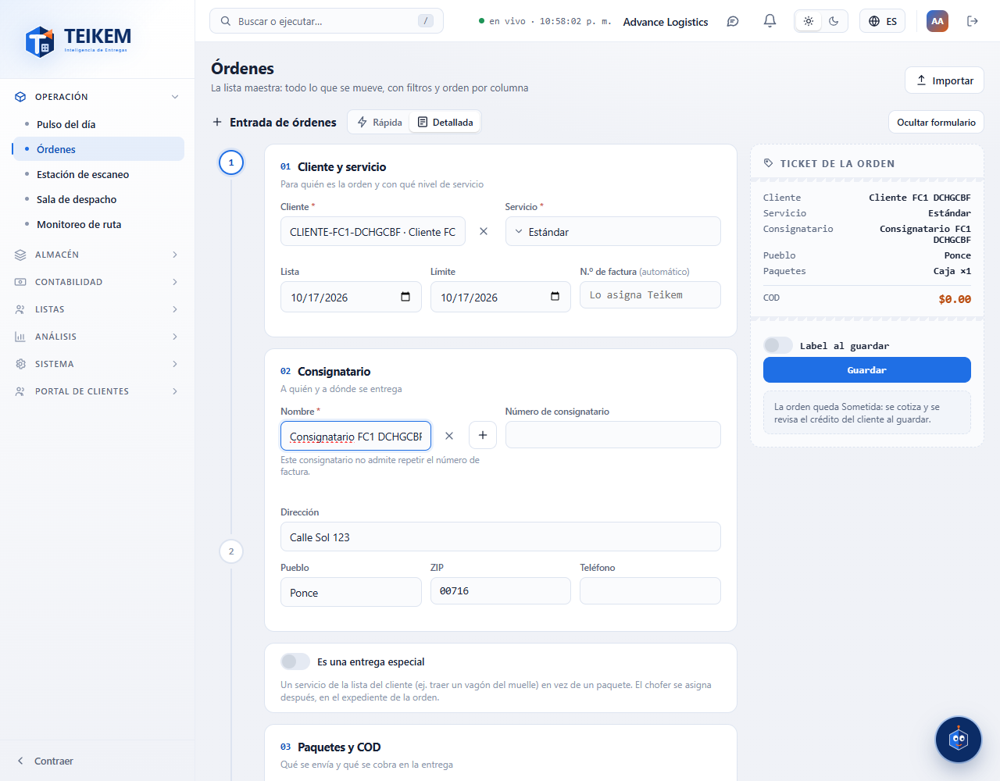
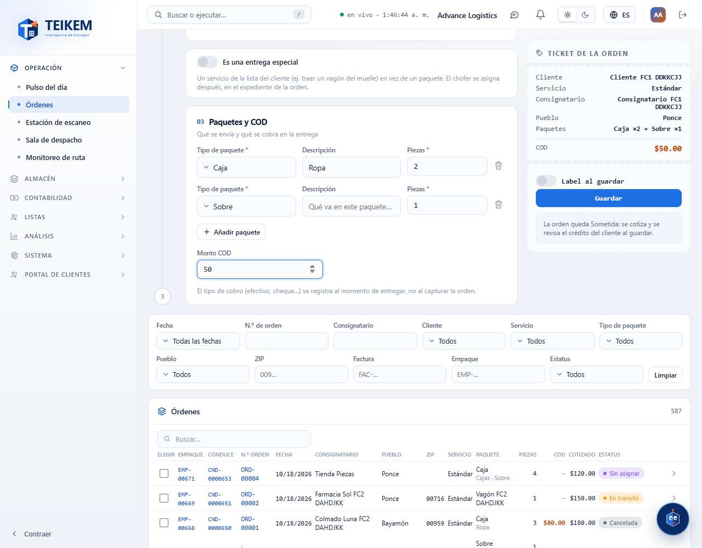
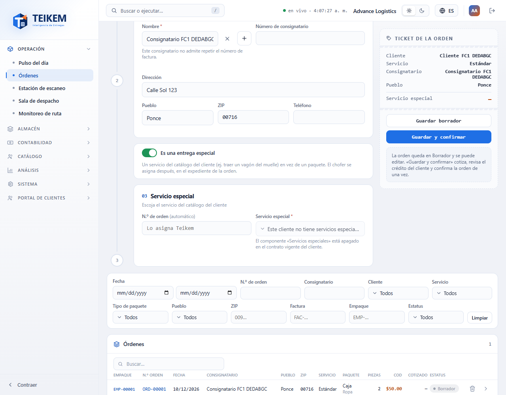
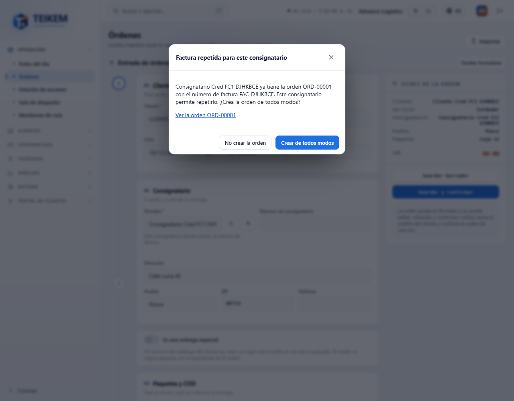
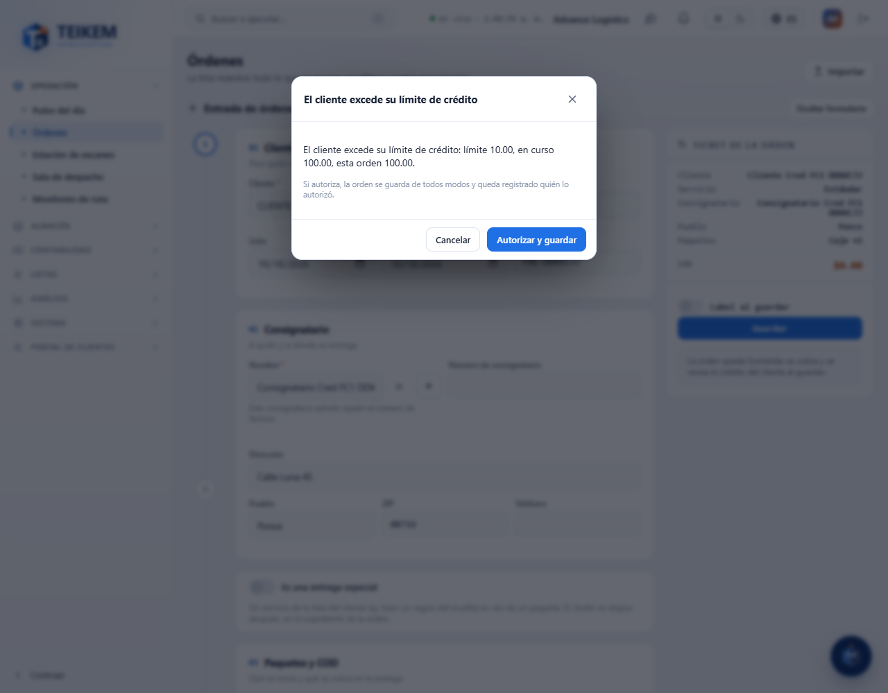

# Órdenes: buscar órdenes y crear una nueva

Pantalla **Operación → Órdenes**. Aquí usted puede:

- **Buscar** cualquier orden de transporte con filtros (por fecha, cliente, consignatario, pueblo, estatus…), ordenar la lista y exportarla.
- **Crear una orden nueva** con un formulario: elige el cliente, el consignatario, los paquetes y el cobro al entregar (COD), y la guarda como borrador o la confirma de una vez.
- **Crear una entrega especial** (un servicio de la lista del cliente en vez de paquetes).
- **Eliminar** una orden que todavía no se ha confirmado.

Editar una orden, confirmarla después, cancelarla, re-cotizarla y asignarle chofer se hace en su expediente (al abrirla), explicado en [Órdenes: el expediente de la orden](fc2-ordenes-expediente.md). Por ahora esta pantalla **no** tiene la entrada rápida ni la importación de órdenes desde un archivo CSV; eso llegará en la próxima entrega. Lo que ocurre con el precio, el crédito y los estatus en el servidor está explicado en el capítulo «03 — Órdenes de transporte» de este manual.

## Permisos necesarios

Para ver la pantalla hace falta el permiso `orders.view`. El módulo «Última milla terrestre» (LTL_GROUND) siempre está encendido. Cada botón aparece solo si usted tiene su permiso; si no lo tiene, el botón no se muestra. Si falta un permiso, pídaselo al administrador de su compañía (Sistema → Roles).

| Permiso | Qué permite |
|---|---|
| `orders.view` | Ver la lista de órdenes y abrir una orden. |
| `orders.create` | Usar el botón **Nueva orden** y los botones **Guardar borrador** y **Guardar y confirmar**. |
| `orders.cancel` | Eliminar una orden con la papelera (mientras está en su estatus inicial). |
| `orders.credit_override` | Autorizar una orden cuyo cliente excede su límite de crédito, al usar **Guardar y confirmar**. |
| `orders.view_price` | Ver el precio de las órdenes (columna **Cotizado**). Sin este permiso la columna no aparece. |
| `clients.read` | Buscar y elegir el cliente en el formulario y en el filtro **Cliente**. |
| `locations.read` | Buscar y elegir el consignatario, y llenar las opciones del filtro **Pueblo**. |
| `locations.create` | Usar el botón **+** para crear un consignatario desde la orden. |
| `contracts.read` | Usar el interruptor **Es una entrega especial** (además, el módulo Listas debe estar encendido). |

---

## 1. Buscar órdenes en la lista

**Ejemplo.** Quiero ver las órdenes de Bayamón que están en el estatus inicial y que son de un cliente en particular.

1. Entre a **Operación → Órdenes**.
2. En **Cliente**, abra la lista, escriba parte del nombre y marque el cliente. Puede marcar varios.
3. En **Pueblo**, marque «Bayamón».
4. En **Estatus**, marque el estatus inicial «Borrador».
5. La lista se actualiza sola. Para empezar de nuevo, pulse **Limpiar**.

### Filtros

Todos los filtros se combinan: la lista muestra solo las órdenes que cumplen **todos** los que usted llenó. Dentro de un filtro de selección puede marcar varios valores y basta con que la orden cumpla **uno** (por ejemplo, Pueblo = Bayamón y Ponce trae las órdenes de cualquiera de los dos). Las listas de selección tienen buscador y los botones **Todos** y **Ninguno**.

| Filtro | Qué hace |
|---|---|
| **Fecha** (**Desde** / **Hasta**) | Órdenes creadas entre esas fechas. El día de **Hasta** sí se incluye. |
| **N.º de orden** | Busca por el número de orden (o parte de él). |
| **Consignatario** | Busca por el nombre del consignatario (o parte de él). |
| **Cliente** | Uno o varios clientes. |
| **Servicio** | Uno o varios tipos de servicio. |
| **Tipo de paquete** | Una o varias clases de paquete. Entra la orden que tenga **alguno** de esos tipos. |
| **Pueblo** | Uno o varios pueblos. Las opciones son los pueblos de los consignatarios registrados. Sin el permiso `locations.read` la lista de pueblos sale vacía. |
| **ZIP** | El código postal **empieza con** lo que escriba: `009` trae `00901`, `00961`… |
| **Factura** | Busca por el número de factura (o parte de él). |
| **Empaque** | Busca por el número de empaque (o parte de él). |
| **Estatus** | Uno o varios estatus. |
| **Limpiar** | Quita todos los filtros. |

Los filtros de texto (N.º de orden, Consignatario, ZIP, Factura y Empaque) se aplican un instante después de que usted deja de teclear. El buscador de la tabla (**Buscar…**) busca a la vez en el número de orden, la factura, el empaque y el consignatario.

### Qué muestra la tabla

Columnas: **Empaque**, **N.º orden**, **Fecha**, **Consignatario**, **Pueblo**, **ZIP**, **Servicio**, **Paquete** (con la descripción debajo), **Piezas**, **COD** y **Estatus**. Si usted tiene `orders.view_price`, también sale **Cotizado** (el precio de la orden). Sin ese permiso la columna no aparece; el COD se ve siempre porque es lo que se cobra al entregar, no un precio.

- **Ordenar.** Pulse el encabezado de una columna. El orden vale para **todas** las órdenes que cumplen el filtro, no solo para las que se ven en la página.
- **Una fila por tipo de paquete.** Si una orden lleva una caja y un sobre, ocupa **dos filas**: la primera trae todos los datos de la orden; la segunda solo trae «↳», el otro tipo de paquete y sus piezas. Sigue siendo **una** orden: el contador («N órdenes») y las páginas cuentan órdenes, y al pulsar cualquiera de sus filas se abre la orden.
- **Celular.** En una pantalla angosta cada orden es una tarjeta con todos sus tipos de paquete.
- **Exportar** (al pie de la tabla): genera un archivo Excel, CSV o PDF con **todas** las órdenes del filtro (no solo la página). Además de las columnas de la tabla incluye el **Cliente** y la **Factura**.

### Abrir una orden

Pulse la flecha de la primera fila de la orden (**Abrir la orden**), o pulse la fila.

### Eliminar una orden

**Ejemplo.** Capturé una orden por error y todavía no la confirmé.

1. Busque la orden en la lista.
2. Pulse la papelera de su primera fila (**Eliminar la orden**).
3. En la ventana «Eliminar la orden …» pulse **Eliminar** (o **Cancelar** para dejarla).
4. Sale el aviso «Orden … eliminada.» y el número de orden queda libre para volver a usarse.

La papelera solo aparece si la orden está en su **estatus inicial** y usted tiene `orders.cancel`. Una orden eliminada no se borra: se da de baja y queda en el historial. Si el servidor no la deja eliminar, el motivo aparece en la misma ventana (ver «Mensajes» más abajo).

---

## 2. Crear una orden nueva

**Ejemplo.** Quiero crear una orden para el cliente «Farmacia Las Marías»: dos cajas y un sobre con documentos, para un consignatario que ya existe, cobrando 50.00 al entregar.

1. Pulse **Nueva orden** (arriba a la derecha). El formulario se abre sobre los filtros. Para cerrarlo sin guardar, pulse **Ocultar formulario**.
2. **01 Cliente y servicio.** En **Cliente** escriba «Farmacia» y elija el cliente. Revise **Servicio** (viene con el servicio predeterminado de la compañía, si hay uno).
3. **02 Consignatario.** En **Nombre** escriba parte del nombre del consignatario y elíjalo de la lista. Se llenan solos (solo para leer) el número, la dirección, el pueblo, el ZIP y el teléfono.
4. **03 Paquetes y COD.** En la primera línea elija el **Tipo de paquete** «Caja», escriba **Piezas** = 2. Pulse **Añadir paquete**, elija «Sobre», **Descripción** = «Documentos», **Piezas** = 1. En **Monto COD** escriba 50.
5. Revise el **Ticket de la orden** (a la derecha): debe decir, por ejemplo, «Caja ×2 + Sobre ×1» y el COD.
6. Pulse **Guardar borrador** o **Guardar y confirmar** (ver «Guardar» más abajo).

Los pasos 01, 02 y 03 aparecen a la izquierda; el **Ticket de la orden** a la derecha (en pantallas angostas, debajo). El ticket resume lo capturado: cliente, servicio, consignatario, pueblo, paquetes y COD. **No muestra precio.** El precio se ve después, en la lista y en la ficha de la orden, y solo con `orders.view_price`.

### 01 Cliente y servicio

| Campo | Qué escribir | Reglas |
|---|---|---|
| **Cliente** | Busque por código o nombre y elija. | Obligatorio. Al cambiarlo se borran el consignatario, el servicio especial y la factura. |
| **Servicio** | Elija el tipo de servicio. | Obligatorio. Viene el servicio predeterminado de la compañía, si lo hay. |
| **Lista** | Fecha en que la orden está lista. | Por omisión, hoy. |
| **Límite** | Fecha límite de entrega. | Por omisión, hoy. No puede ser anterior a **Lista**. |
| **N.º de factura** | Número de factura del cliente. | Si dice «(automático)», el campo está bloqueado: Teikem asigna la numeración de ese cliente. Solo se puede escribir cuando el cliente asigna sus propias facturas. Máximo 40 caracteres. |

### 02 Consignatario

| Campo | Qué escribir | Reglas |
|---|---|---|
| **Nombre** | Busque por nombre, dirección o pueblo y elija. | Obligatorio. Hay que elegir uno del directorio; no se puede escribir un nombre suelto. Salen los consignatarios del cliente y los compartidos (los de todos los clientes). Los que admiten repetir la factura dicen «admite factura repetida». Primero hay que elegir el cliente. |
| Número, **Dirección**, **Pueblo**, **ZIP**, **Teléfono** | Se llenan solos al elegir el consignatario. | Solo lectura. Para cambiarlos, edite el consignatario en Listas → Consignatarios. El teléfono solo aparece si usted puede ver los datos de contacto. |
| Aviso bajo el consignatario | — | Dice si ese consignatario admite o no repetir el número de factura. |

**Crear un consignatario desde la orden.** Si no existe, pulse **+** (necesita `locations.create` y haber elegido el cliente). Se abre el mismo formulario de «Nuevo consignatario» del Lista (ver el capítulo «F-B — Consignatarios»). El nuevo consignatario queda con el cliente de la orden como dueño y **queda elegido** en la orden. Ojo: crear el consignatario **no guarda la orden**; todavía debe pulsar uno de los botones de guardar.

### 03 Paquetes y COD

| Campo | Qué escribir | Reglas |
|---|---|---|
| **Tipo de paquete** | Elija la clase de paquete. | Obligatorio en cada línea. Viene el tipo predeterminado de la compañía, si lo hay. |
| **Descripción** | Qué lleva el paquete. | Opcional. Máximo 200 caracteres. |
| **Piezas** | Cantidad de piezas. | Número entero, mínimo 1. |
| **Añadir paquete** | Agrega otra línea. | Cada tipo distinto sale como una fila distinta en la lista. |
| Bote de basura | Quita la línea. | Siempre queda al menos una línea. |
| **Monto COD** | Lo que se cobra al entregar. | Opcional; no puede ser negativo. El tipo de cobro (efectivo, cheque…) se registra al entregar, no al capturar la orden. |

### Guardar

| Botón | Qué hace |
|---|---|
| **Guardar borrador** | Crea la orden en su estatus inicial «Borrador», donde todavía se puede editar. **No** calcula el precio ni revisa el crédito del cliente. |
| **Guardar y confirmar** | Crea la orden, calcula su precio con la tarifa del contrato del cliente, revisa el crédito y la confirma, todo en una sola operación. Si algo falla, la orden **no se crea**. |

Cuando se guarda bien:

- El formulario se cierra y se limpia.
- Sale el aviso «Orden … guardada.» y, sobre los filtros, «Orden … guardada como borrador.» o «Orden … guardada y confirmada.», con el botón **Abrir la orden**. Pulse **Cerrar aviso** para quitarlo.

Cuando algo falla, el formulario **sigue abierto con todo lo que usted había capturado**; lea el mensaje, corríjalo y vuelva a guardar. Si el formulario sigue abierto con un error, la orden **no** se creó (tampoco con **Guardar y confirmar**); puede reintentar sin miedo a duplicarla.

### Entrega especial

Una entrega especial es un servicio de la lista del cliente (por ejemplo, traer un vagón del muelle) en vez de paquetes.

**Ejemplo.** Quiero registrar una entrega especial para un cliente.

1. Pulse **Nueva orden** y elija el **Cliente**.
2. Active el interruptor **Es una entrega especial**.
3. La sección 03 cambia a «Servicio especial». En **Servicio especial** elija el servicio (se muestra «nombre · tarifa»).
4. Si el cliente asigna sus propios números de orden, el campo **N.º de orden** estará habilitado; si no, dice «(automático)».
5. Pulse **Guardar borrador** o **Guardar y confirmar**.

La orden se crea **sin paquetes, sin COD y sin chofer**; el chofer se asigna después. El ticket muestra «Servicio especial» en lugar de «Paquetes» y no muestra COD.

Si el interruptor está deshabilitado, falta el permiso `contracts.read` (la pantalla lo explica). Si el cliente no tiene servicios especiales, la pantalla dice «Este cliente no tiene servicios especiales configurados»; si dice que el componente «Servicios especiales» está apagado en el contrato, hay que encenderlo en el modelo de facturación del contrato del cliente (Clientes → Contrato).

---

## 3. Estatus de la orden

El estatus inicial de una orden se llama **Borrador** (su compañía puede haberlo renombrado en Sistema → Listas). Esta pantalla hace tres cosas con el estatus:

| De → a | Cómo | Quién puede | Qué se valida | Qué pasa |
|---|---|---|---|---|
| (orden nueva) → **Borrador** | **Guardar borrador** | `orders.create` | Datos obligatorios; el cliente no puede estar suspendido ni dado de baja. | La orden se crea y se puede seguir editando. No se calcula el precio ni se revisa el crédito. |
| (orden nueva) → **Confirmada** (la primera etapa que la compañía tenga habilitada después de la inicial) | **Guardar y confirmar** | `orders.create`; si el crédito se excede, también `orders.credit_override` | Que exista tarifa vigente, que el cliente no esté suspendido ni dado de baja y que su crédito alcance. | Se calcula y se congela el precio, se revisa el crédito y la orden queda confirmada. Si algo falla, no se crea. Si se autoriza un crédito excedido, queda registrado quién lo autorizó. |
| **Borrador** → eliminada | Papelera | `orders.cancel` | Que la orden siga en su estatus inicial. | Se da de baja y su número de orden queda libre. |

Qué se puede hacer según el estatus:

| Estatus | Eliminar con la papelera | Qué más |
|---|---|---|
| **Borrador** | Sí (con `orders.cancel`) | Todavía se puede editar y confirmar, desde el expediente de la orden (ver [el expediente](fc2-ordenes-expediente.md)). |
| **Confirmada** y siguientes | No. Aparece «Solo se puede eliminar una orden en su estatus inicial; use la cancelación.» | Una orden confirmada no se elimina: se cancela. La cancelación todavía no está en esta pantalla. |

---

## 4. Mensajes

### Al llenar el formulario

La pantalla revisa estos datos antes de enviar y los marca bajo el campo. Si el servidor los recibiera, daría el mismo mensaje con código 400.

| Campo | Regla | Mensaje | Código |
|---|---|---|---|
| Cliente | Obligatorio. | `El cliente es obligatorio.` | 400 |
| Servicio | Obligatorio. | `El tipo de servicio es obligatorio.` | 400 |
| Consignatario | Obligatorio; elegirlo del directorio. | `El consignatario es obligatorio: elija uno del directorio o capture uno nuevo.` | 400 |
| Paquetes | Al menos una línea (orden normal). | `Indique al menos una línea de paquete.` | 400 |
| Tipo de paquete | Obligatorio en cada línea. | `El tipo de paquete es obligatorio.` | 400 |
| Piezas | Entero de 1 en adelante. | `La cantidad de piezas debe ser al menos 1.` | 400 |
| Monto COD | No negativo. | `El monto COD no puede ser negativo.` | 400 |
| N.º de factura / N.º de orden | Máximo 40 caracteres. | `El número no puede exceder 40 caracteres.` | 400 |
| Descripción | Máximo 200 caracteres. | `Máximo 200 caracteres.` | Solo pantalla |
| Lista y Límite | El límite no puede ir antes que la fecha lista. | `La fecha límite no puede ser anterior a la fecha lista.` | Solo pantalla |
| Servicio especial | Obligatorio en una entrega especial. | `El servicio especial es obligatorio en una entrega especial.` | 400 |

### Al guardar (los dice el servidor)

El texto aparece tal cual sobre el formulario (o bajo el campo, cuando se indica). Qué hacer en cada caso:

| Mensaje | Código | Qué significa | Qué hacer |
|---|---|---|---|
| Ventana **Factura repetida para este consignatario** | 409 | Usted escribió un número de factura que otra orden activa de ese consignatario ya usa, y ese consignatario sí admite repetirlo. | Pulse **No crear la orden** para revisar el número (**Ver la orden …** abre la que ya lo usa) o **Crear de todos modos** para crearla con el número repetido. |
| `El consignatario 'X' no permite facturas repetidas: la orden N ya usa el número F.` (sale bajo **N.º de factura**) | 409 | Ese consignatario no admite facturas repetidas y el número ya está en otra orden. | Cambie el número de factura o elija otro consignatario. La orden no se crea. |
| `El cliente excede su límite de crédito: límite X, en curso Y, esta orden Z.` | 422 | Solo con **Guardar y confirmar**: el crédito del cliente no alcanza para esta orden. | Si tiene `orders.credit_override`, pulse **Autorizar y confirmar** (la orden se crea y se confirma, y queda registrado quién autorizó). Si no, la pantalla dice «La orden no se creó. Pida a alguien con el permiso de autorizar crédito excedido (orders.credit_override) que la capture o la confirme.»: pida ese favor, o use **Guardar borrador**. |
| `El cliente excede su límite de crédito.` | 422 | Es el mismo caso; usted no tiene `orders.view_price`, por eso no se muestran las cifras. | Igual que el anterior. |
| `No hay tarifa vigente para X/Y; configure la tarifa en el contrato del cliente antes de confirmar.` | 422 | El contrato del cliente no tiene tarifa para ese servicio y tipo de paquete. La orden no se creó. | Configure la tarifa (Clientes → Contrato → Tarifas) o use **Guardar borrador** y confirme después. |
| `El cliente está suspendido; no se pueden crear ni confirmar órdenes.` | 422 | El cliente está suspendido. | Reactive al cliente desde su ficha o elija otro. |
| `El cliente está dado de baja; solo se consulta su historial.` | 409 | El cliente está dado de baja. | Reactive al cliente desde su ficha o elija otro. |
| `Consignatario está inactivo; reactívelo o elija otro.` | 400 | El consignatario fue dado de baja. | Reactívelo en Listas → Consignatarios o elija otro. |
| `El número de factura lo asigna Teikem para este cliente; déjelo en blanco.` | 400 | Se envió un número de factura, pero este cliente usa la numeración automática. | Deje la factura en «(automático)». |
| `El número de orden lo asigna Teikem para este cliente; déjelo en blanco.` | 400 | Igual, con el número de orden. | Deje el número de orden vacío. |
| `El servicio especial no está vigente para este cliente.` | 400 | El servicio elegido ya se cerró. | Elija otro servicio especial. |
| `El componente 'Servicios especiales' está apagado en el contrato vigente del cliente; enciéndalo en el modelo de facturación o capture una orden normal.` | 409 | El contrato del cliente no admite servicios especiales. | Encienda el componente en el contrato del cliente o capture una orden normal. |
| `Cliente no encontrado.` / `Consignatario no encontrado.` | 404 | El cliente o el consignatario ya no existe en su compañía. | Recargue la pantalla y elíjalo de nuevo. |

### Al eliminar una orden

| Mensaje | Código | Qué significa | Qué hacer |
|---|---|---|---|
| `Solo se puede eliminar una orden en su estatus inicial; use la cancelación.` | 422 | Alguien confirmó la orden mientras usted tenía la lista abierta; ya no se puede eliminar. | Recargue la lista. Si la orden debe anularse, cancélela. |

---

## 5. Casos frecuentes

- **No veo el botón «Nueva orden».** Falta el permiso `orders.create`. Sin él tampoco salen **Guardar borrador** ni **Guardar y confirmar**.
- **No veo la columna «Cotizado».** Falta `orders.view_price`. Es normal para el personal que no maneja precios.
- **No me deja elegir consignatario y dice «Elija primero un cliente».** Elija primero el **Cliente**.
- **Dice «No se pudo leer el directorio de consignatarios».** Su usuario no tiene `locations.read`.
- **No sale el botón «+» junto al consignatario.** Falta `locations.create`, o todavía no eligió el cliente.
- **Mi orden ocupa varias filas.** Es una fila por tipo de paquete; es una sola orden.
- **No puedo escribir el número de factura.** Dice «(automático)»: Teikem lo asigna para ese cliente.
- **La orden no se guardó y el formulario sigue abierto.** Correcto: no se creó. Corrija el mensaje y vuelva a guardar.
- **Buscando por Pueblo no encuentro una orden.** El filtro compara el pueblo completo del consignatario (da igual mayúsculas y tildes: «bayamon» encuentra «Bayamón»). Si el consignatario tiene el pueblo escrito distinto, pruebe con el filtro **ZIP**.

Las preguntas y respuestas de cada mensaje también están en las [Preguntas frecuentes](../faq.md) (secciones «Lote 39» y «Lote F-C1»).
