# Órdenes: el expediente de la orden

> **Lote 106 (2026-10-17): nuevo flujo de estatus.** Ya no hay Borrador ni Confirmada: la orden nace **Sometida**, **Confirmar** pasó a llamarse **Marcar como recogido**, cancelar pide una **razón** y hay un botón nuevo, **Reabrir**. Ya no existen En espera ni Parcial: queda **Intento fallido**. Detalle en el [capítulo 03, sección 4](../03-ordenes-de-transporte.md#4-estatus-y-transiciones).

El **expediente** es la pantalla que se abre al pulsar una orden en **Operación → Órdenes** (la flecha **Abrir el envío**, o la fila). Desde ahí usted puede:

- **Corregir los datos** de una orden que todavía está Sometida (consignatario, paquetes, COD, comentario, prioridad y fechas) con un solo botón **Guardar cambios**.
- **Marcar como recogido** la orden, **re-cotizarla**, **cancelarla** (con razón), **reabrirla** o **eliminarla**.
- Registrar que la orden tuvo un **Intento fallido**, y devolverla a la etapa de la que salió.
- **Asignar o reasignar el chofer** de una entrega especial.
- Ver la **cotización**, el **COD**, el **historial**, el chofer asignado, y llenar los **campos personalizados** y los **contactos** de la orden.

Esta pantalla **no** tiene botones para imprimir la etiqueta ni para el comprobante de entrega: eso llegará en otra entrega.

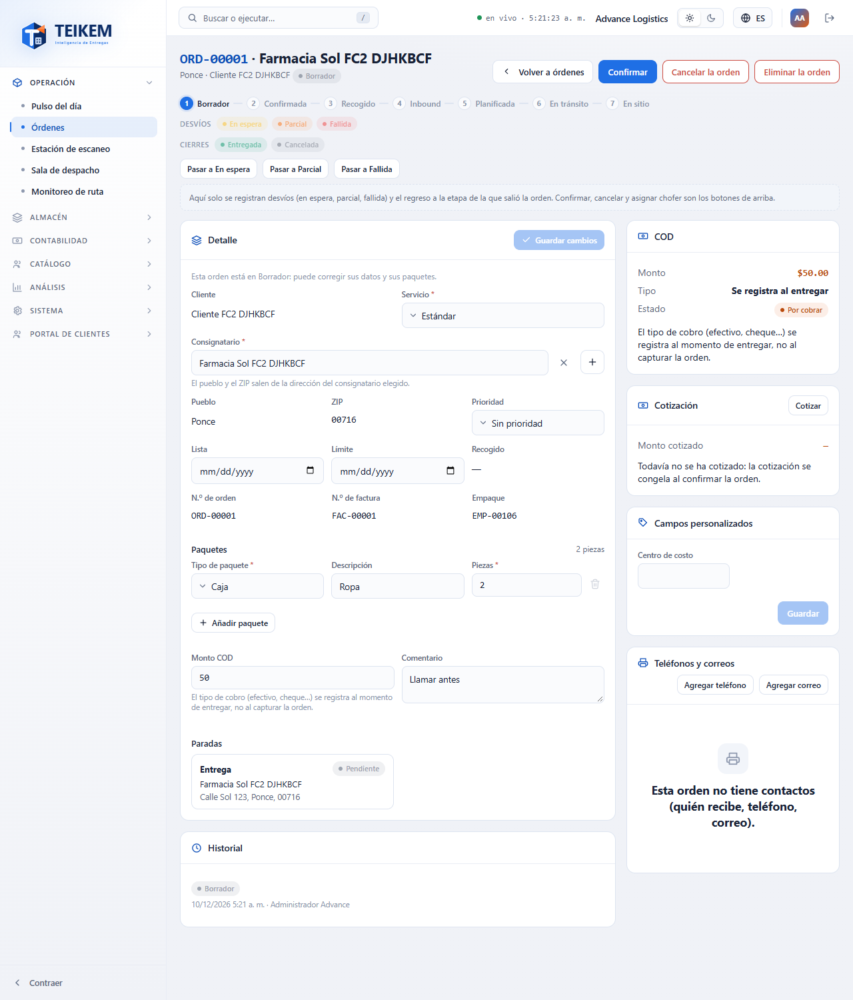

## Permisos necesarios

Cada botón aparece solo si usted tiene su permiso y, además, si la orden está en un estatus que lo permite. Si falta un permiso, pídaselo al administrador de su compañía (Sistema → Roles).

| Permiso | Qué permite |
|---|---|
| `orders.view` | Abrir el expediente (verlo todo). |
| `orders.edit` | **Guardar cambios**, **Marcar como recogido**, **Re-cotizar** y los botones de estatus (Intento fallido y volver). También llenar los campos personalizados y los contactos (los contactos piden además `contacts.manage`). |
| `orders.cancel` | **Cancelar el envío** y **Eliminar el envío**. |
| `orders.reopen` | **Reabrir** una orden Entregada, Cancelada o En almacén. Lo trae el rol Admin de compañía; otro rol necesita que se lo agreguen. |
| `orders.credit_override` | Autorizar una orden cuyo cliente excede su límite de crédito. |
| `orders.view_price` | Ver el panel **Cotización** y el botón **Cotizar**. Sin este permiso el panel no aparece. |
| `trips.dispatch` | **Asignar chofer** / **Reasignar chofer** (el módulo Listas debe estar encendido). |
| `fleet.view` | Ver la lista de choferes al asignar uno. |
| `contacts.manage` | Agregar, editar y quitar teléfonos y correos de la orden. |

## Qué botones salen según el estatus

| Estatus del envío | Botones de arriba |
|---|---|
| **Sometida** (el estatus inicial) | **Marcar como recogido**, **Cancelar el envío**, **Eliminar el envío**, y **Re-cotizar** si ya está cotizada; el **Detalle** se puede editar. En una entrega especial, también **Asignar chofer**. |
| **Recogida**, **Sin asignar**, **Asignada**, **En tránsito** | **Cancelar el envío** (mientras la compañía lo permita). El Detalle queda como referencia. |
| **En tránsito** (entrega especial) | **Reasignar chofer** y **Cancelar el envío**. |
| **Intento fallido** | **Cancelar el envío** y, en la barra de estatus, **Volver a** la etapa de la que salió. |
| **Entregada**, **Cancelada** o **En almacén** | **Reabrir** (solo con `orders.reopen`). Nada más: la orden se consulta. |

Debajo de los botones está la barra de estatus de la orden. Los botones pequeños de esa barra son solo para el **desvío** «Intento fallido» y para el **regreso**; marcar como recogida, cancelar, reabrir y asignar chofer son los botones de arriba.

## 1. Corregir los datos de una orden

Mientras la orden está Sometida, el panel **Detalle** muestra campos que se pueden cambiar. Lo que no se puede cambiar se ve como texto: el **cliente**, el **N.º de envío**, el **N.º de factura** y el **Empaque**.

1. Abra la orden.
2. Cambie lo que necesite: **Servicio**, **Consignatario**, **Prioridad**, **Lista** y **Límite** (las fechas), los **Paquetes** (tipo, descripción y piezas), el **Monto COD** y el **Comentario**.
   - Para otro consignatario, búsquelo en el campo **Consignatario** (salen los del cliente y los compartidos). El **Pueblo** y el **ZIP** cambian solos según la dirección elegida.
   - Para añadir un paquete, pulse **Añadir paquete**; para quitarlo, la papelera de su línea (siempre debe quedar al menos uno).
   - Para quitar el COD, deje **Monto COD** vacío.
3. Pulse **Guardar cambios**. El botón se enciende solo cuando usted cambia algo.

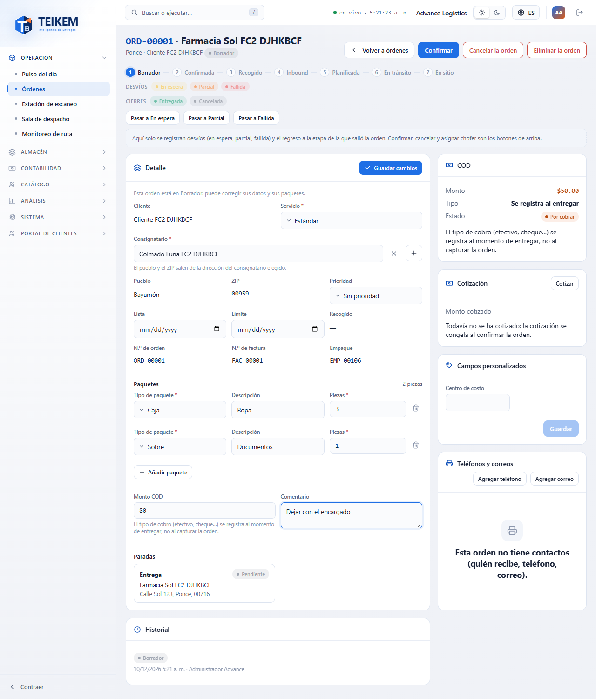

Teikem guarda únicamente lo que usted cambió. Una **entrega especial** no tiene paquetes ni COD, así que esos campos no aparecen.

Si la orden ya no está Sometida, el panel dice «Esta orden ya avanzó de Sometida: sus datos se muestran como referencia, ya no se editan aquí.» y no hay botón **Guardar cambios**. Si su usuario no tiene `orders.edit`, dice «Su usuario no tiene permiso para editar envíos: los datos se muestran como referencia.»

### Si otra persona cambió la orden mientras usted la editaba

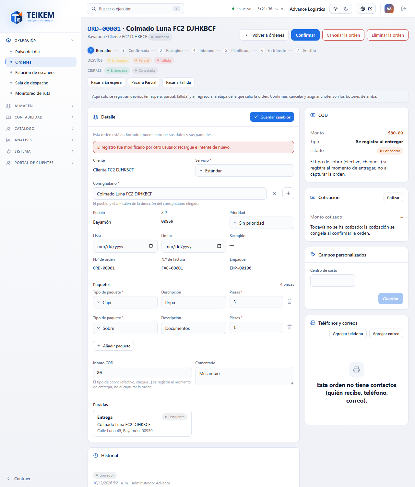

Aparece el aviso «El registro fue modificado por otro usuario; recargue e intente de nuevo.» La pantalla vuelve a leer la orden y **conserva lo que usted escribió**. Revise los datos nuevos y pulse **Guardar cambios** otra vez.

## 2. Marcar la orden como recogida

1. Pulse **Marcar como recogido** (arriba a la derecha).
2. Lea el aviso y pulse **Marcar como recogido**. Teikem cotiza la orden de nuevo con las tarifas del contrato (si falta la tarifa, avisa y la orden no cambia), revisa el crédito del cliente y la pasa de Sometida a Recogida.

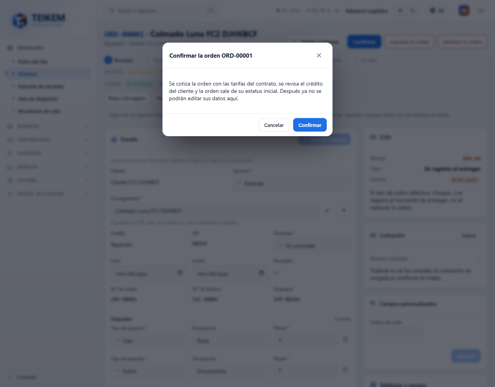

Después de marcarla como recogida, los datos del Detalle ya no se editan aquí.

### Crédito excedido

Si el cliente pasa su límite de crédito, aparece la ventana **El cliente excede su límite de crédito** con el mensaje del servidor. Con el permiso `orders.view_price` el mensaje trae las cifras (límite, en curso y esta orden); sin él dice solo «El cliente excede su límite de crédito.».

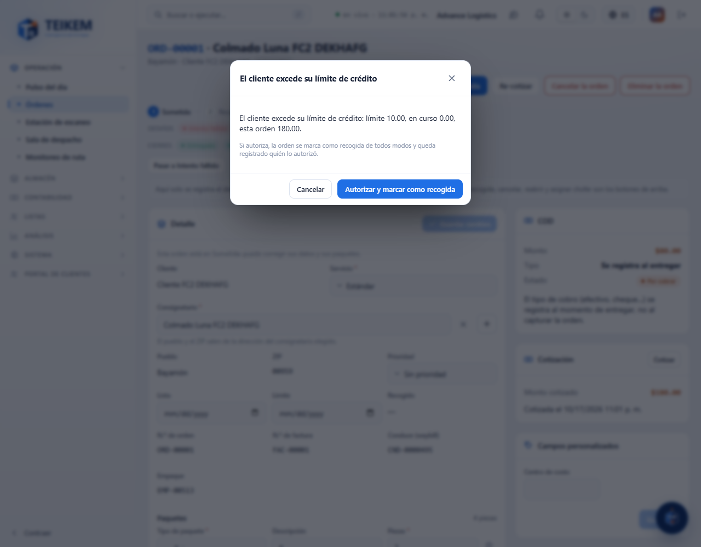

- Si usted tiene `orders.credit_override`, pulse **Autorizar y marcar como recogido**: la orden pasa a Recogida de todos modos y en el historial queda quién lo autorizó.
- Si no lo tiene, la orden sigue Sometida. Avise a Facturación o a quien pueda autorizar, o pida que suban el límite del cliente.

Si su usuario solo tiene `orders.credit_override` (sin `orders.edit`), el botón **Marcar como recogido** abre una ventana que ofrece **Autorizar y marcar como recogido** directamente: ese permiso solo sirve para autorizar el exceso de crédito.

## 3. Ver la cotización

El panel **Cotización** (solo con `orders.view_price`) muestra el **Monto cotizado** y cuándo se cotizó. La orden se cotiza al crearla si el cliente tiene contrato y tarifa; el precio se congela al marcarla como recogida. Si todavía no se cotizó dice «Todavía no se ha cotizado: se cotiza al crear la orden si el cliente tiene contrato y tarifa; si no, al marcarla como recogida.»

Pulse **Cotizar** para ver una **vista previa** con las tarifas vigentes: las líneas, el **Despacho**, el **Cargo por COD**, el **Total** y el **Crédito del cliente** (límite, en curso, esta orden y disponible, con el aviso «Excede el crédito» o «Dentro del límite»). La vista previa **no guarda nada**.

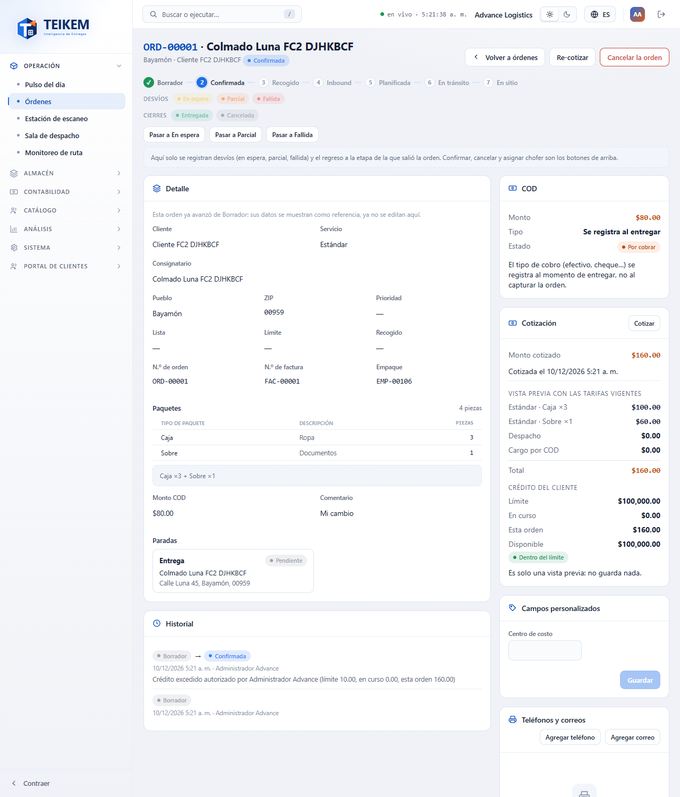

## 4. Re-cotizar

Si las tarifas del contrato cambiaron, pulse **Re-cotizar** en una orden Sometida ya cotizada y confirme (después de marcarla como recogida el botón ya no sale). Teikem calcula de nuevo el monto con las tarifas vigentes; el estatus no cambia.

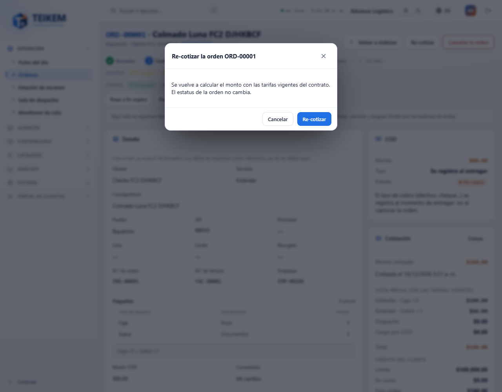

## 5. Intento fallido y el regreso

El botón pequeño bajo la barra de estatus registra el desvío **Pasar a Intento fallido**. Se abre una ventana con un comentario opcional (máximo 500 caracteres); pulse **Cambiar estatus**. El intento fallido se documenta también como un intento de entrega.

Estando en Intento fallido, el único regreso es **Volver a** la etapa exacta de la que salió la orden (por ejemplo «Volver a En tránsito»). No hay botones para avanzar, ni para cancelar por ahí.

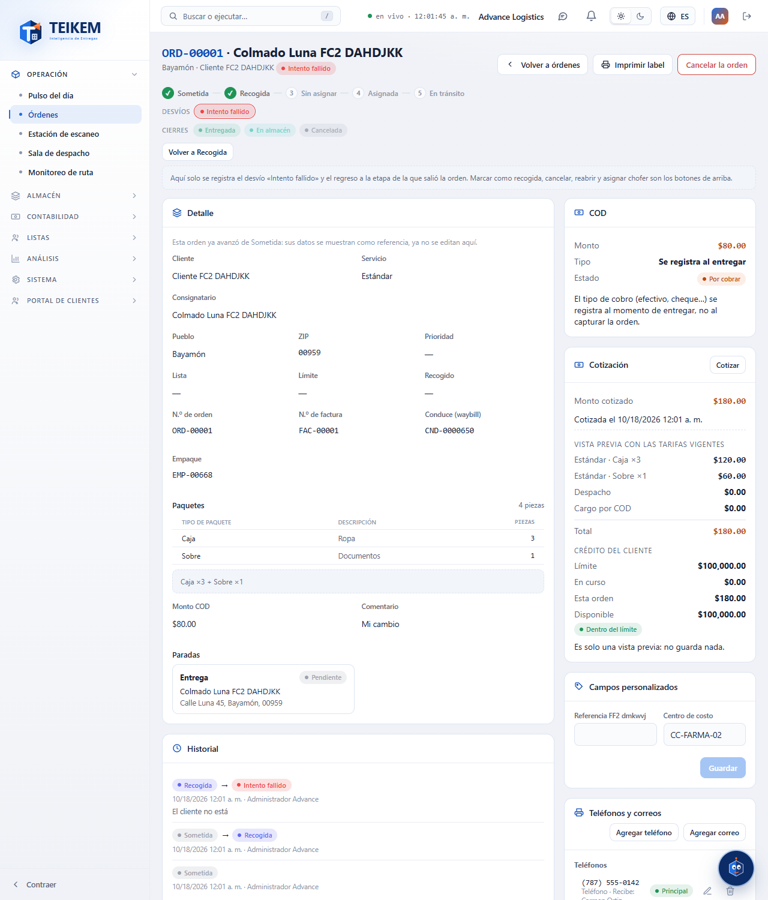

## 6. Cancelar el envío

1. Pulse **Cancelar el envío**.
2. Escriba la **Razón de la cancelación** (obligatoria, máximo 500 caracteres). Si la deja vacía, la ventana dice «Indique la razón de la cancelación.» y no cancela.
3. Pulse **Cancelar el envío** en la ventana. El botón **Volver** cierra la ventana sin cancelar.

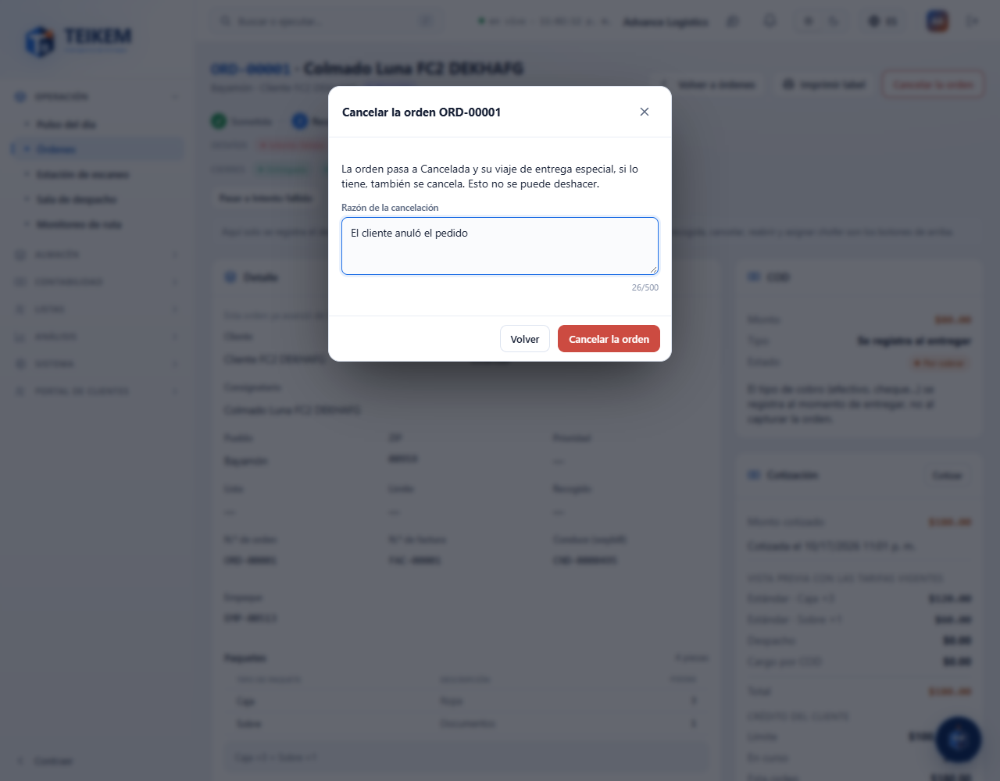

La orden pasa a **Cancelada** y la razón queda en el **Historial**. Si era una entrega especial con chofer, su viaje también se cancela. No se puede deshacer.

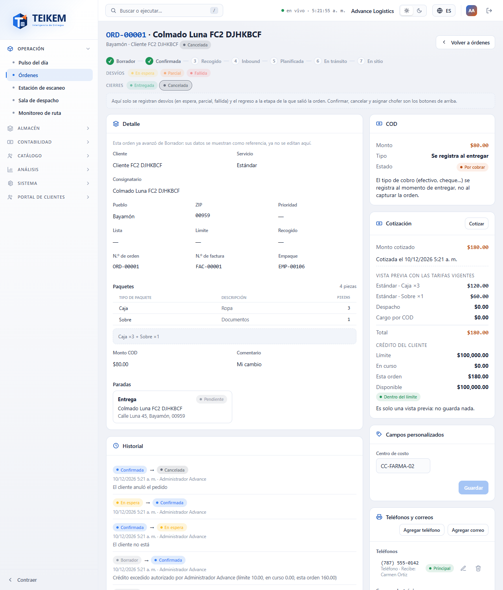

## 6b. Reabrir una orden en estatus final

Una orden **Entregada**, **Cancelada** o **En almacén** se puede reabrir si usted tiene el permiso `orders.reopen`.

1. Pulse **Reabrir**.
2. En **Estatus destino** deje «El último en que estuvo» (vuelve al último estatus en curso que tuvo la orden) o elija otro estatus en curso.
3. Escriba la **Razón para reabrir** (obligatoria, máximo 500 caracteres). Vacía, la ventana dice «Indique la razón para reabrir el envío.»
4. Pulse **Reabrir el envío**. Sale «Orden … reabierta.»

La orden vuelve al flujo, la razón queda en el **Historial** y en la bitácora de seguridad. Reabrir **no** vuelve a cotizar ni a medir el crédito.

## 7. Eliminar el envío

Solo una orden **Sometida** se elimina (con `orders.cancel`). Pulse **Eliminar el envío**, confirme con **Eliminar** y la pantalla vuelve a la lista. Una orden ya recogida no se elimina: se cancela.

## 8. Asignar el chofer de una entrega especial

Solo las **entregas especiales** se asignan aquí (las demás órdenes pasan por Sala de despacho).

1. Abra la entrega especial y pulse **Asignar chofer**.
2. En **Chofer**, busque y elija uno (solo salen los choferes activos). Escriba un comentario si quiere.
3. Pulse **Asignar chofer**.

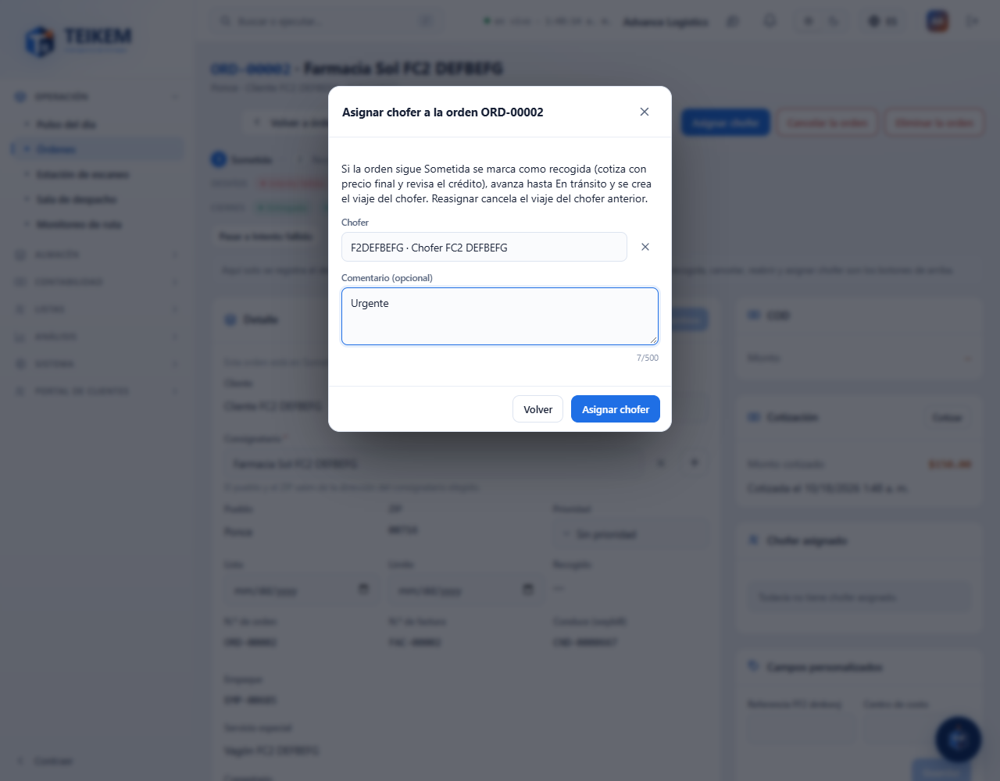

Si la orden todavía estaba Sometida, Teikem la marca como recogida (cotiza y revisa el crédito), la avanza hasta **En tránsito** y crea el viaje del chofer. En el panel **Chofer asignado** aparece el chofer.

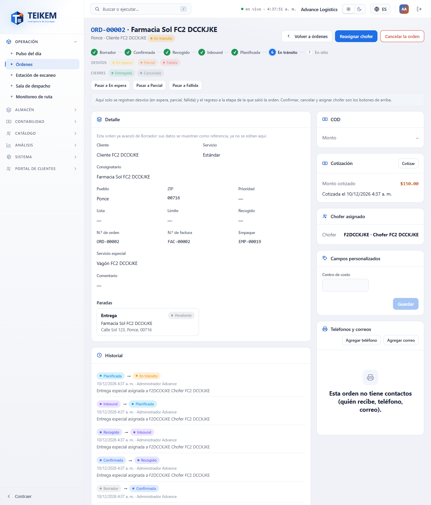

Mientras la orden esté **En tránsito** el botón pasa a **Reasignar chofer**: al elegir otro chofer, el viaje del anterior se cancela. Si elige el mismo, el sistema avisa «El envío ya está asignado a ese chofer.»

Si al asignar el cliente excede su crédito, el aviso lo explica; quien tiene `orders.credit_override` ve el botón **Autorizar y asignar**. Si su usuario no tiene `fleet.view`, la ventana avisa que no puede consultar los choferes.

## 9. Los paneles de la derecha

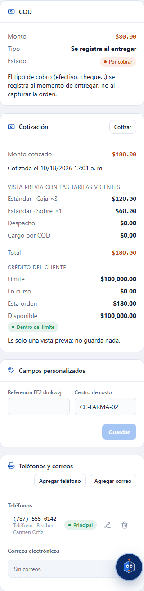

- **COD.** Solo se consulta: el **Monto**, su **Estado** y el **Tipo**. El tipo de cobro (efectivo, cheque…) se registra al entregar, no antes. Para cambiar el monto use el Detalle.
- **Chofer asignado.** El chofer (y el viaje, cuando lo hay) de la orden.
- **Campos personalizados.** Los campos que la compañía definió para las órdenes (por ejemplo «Centro de costo»). Llénelos y pulse **Guardar**. El panel no aparece si la compañía no definió campos. Requiere `orders.edit`.
- **Teléfonos y correos.** Quién recibe y cómo contactarlo. **Agregar teléfono** y **Agregar correo** abren una ventana (el rótulo, por ejemplo «Recibe: Carmen Ortiz», va en **Etiqueta**); el lápiz edita y la papelera quita. Requiere `contacts.manage` y `orders.edit`.
- **Historial.** Cada cambio de estatus, con quién, cuándo y el comentario.

## Mensajes y qué hacer

| Mensaje | Qué significa | Qué hacer |
|---|---|---|
| `El registro fue modificado por otro usuario; recargue e intente de nuevo.` (409) | Otra persona guardó la orden antes que usted. | La pantalla ya la recargó y conserva lo que escribió: revise y vuelva a **Guardar cambios**. |
| `La fecha no se puede quitar; elija otra.` | Una fecha ya capturada (Lista o Límite) no se puede dejar vacía. | Elija otra fecha. |
| `La fecha límite no puede ser anterior a la fecha lista.` | **Límite** va antes de **Lista**. | Corrija una de las dos. |
| `La cantidad de piezas debe ser al menos 1.` | Una línea de paquete tiene 0 piezas. | Escriba un número entero desde 1. |
| `El tipo de paquete es obligatorio.` / `El tipo de servicio es obligatorio.` / `El consignatario es obligatorio: elija uno del directorio o capture uno nuevo.` | Falta ese dato. | Elíjalo. |
| `El monto COD no puede ser negativo.` | **Monto COD** menor que cero. | Déjelo vacío o en 0 si no hay cobro. |
| `Indique al menos una línea de paquete.` | Quitó todos los paquetes. | Añada uno. |
| `Una entrega especial no lleva líneas de paquete ni COD.` (400) | Se intentó poner paquetes o COD a una entrega especial. | No se pueden: cambie solo los demás datos. |
| `El estatus actual no permite la acción 'EDIT_CARGO'.` (422) | La orden ya salió del estatus en que se edita. | Recargue; ya no se edita aquí. |
| `El estatus actual no permite la acción 'REPRICE'.` (422) | La orden no está en un estatus que permita re-cotizar. | Solo se re-cotiza una orden Sometida y cotizada. |
| `El cliente excede su límite de crédito: límite X, en curso Y, esta orden Z.` (422) | El crédito no alcanza. Sin `orders.view_price` el mensaje no trae cifras. | Con `orders.credit_override`: **Autorizar y marcar como recogido**. Si no, avise a Facturación. |
| `El cliente está suspendido; no se pueden crear ni confirmar envíos.` (422) | El cliente está suspendido. | Reactive al cliente o avise a quien lo administra. |
| `No hay tarifa vigente para X/Y; configure la tarifa en el contrato del cliente antes de confirmar.` (422) | El contrato no tiene tarifa para ese servicio y paquete. La orden se guardó sin cotizar y ahora no se puede marcar como recogida. | Configure la tarifa en Clientes → Contrato → Tarifas y vuelva a intentarlo. |
| `Solo se confirma un envío en su estatus inicial.` (422) | La orden ya no está Sometida (alguien la marcó como recogida antes). | Recargue la pantalla. |
| `Solo se puede eliminar un envío en su estatus inicial; use la cancelación.` (422) | La orden ya no está Sometida. | Use **Cancelar el envío**. |
| `Indique la razón de la cancelación.` (400) | Se intentó cancelar sin escribir la razón. | Escriba por qué se cancela y pulse de nuevo. |
| `Indique la razón para reabrir el envío.` (400) | Se intentó reabrir sin razón. | Escriba por qué se reabre. |
| `Solo se reabre un envío en estatus final.` (422) | La orden ya no está en un estatus final (alguien la reabrió antes). | Recargue la pantalla. |
| `Un envío reabierto debe quedar en una etapa en curso.` (422) | Se escogió como destino un estatus final. | Escoja un estatus en curso o deje «El último en que estuvo». |
| `El envío no tiene un estatus anterior al que volver; indique el estatus destino.` (422) | La orden nunca estuvo en un estatus en curso al que volver. | Escoja el **Estatus destino**. |
| `Falta el permiso 'orders.reopen'.` (403) | Su usuario no puede reabrir. | Pida el permiso al administrador (Sistema → Roles). |
| `El comentario admite como máximo 500 caracteres.` | El comentario es demasiado largo. | Acórtelo. |
| `Factura repetida para este consignatario` | El nuevo consignatario ya tiene otra orden con ese número de factura y admite repetirlas. | Pulse **Guardar de todos modos** o cancele. Si no las admite, el servidor lo rechaza y debe elegir otro consignatario. |
| `Chofer no encontrado.` (404) | El chofer ya no existe. | Elija otro. |
| `El chofer no está disponible para despacho: …` (409) | El chofer tiene una licencia vencida, está inactivo u otro motivo (se lista en el mensaje). | Elija otro chofer o corrija el motivo en Flota → Choferes. |
| `El envío ya está asignado a ese chofer.` (409) | Eligió el mismo chofer que ya tiene. | Elija otro o pulse **Volver**. |
| `El envío ya tiene un viaje vigente; recargue e intente de nuevo.` (409) | Dos personas asignaron a la vez. | Recargue y vuelva a intentar. |
| `Solo las entregas especiales se asignan a un chofer desde aquí; las demás envíos pasan por Sala de despacho.` (422) | La orden no es entrega especial. | Use Sala de despacho. |
| `La entrega especial ya llegó a destino o terminó; no se puede asignar ni reasignar el chofer.` (422) | La orden ya pasó de En tránsito, o está en un desvío o terminada. | Ya no se puede cambiar el chofer. |
| `Falta el permiso '…'.` (403) | Su usuario no tiene ese permiso. | Pídaselo al administrador. |
