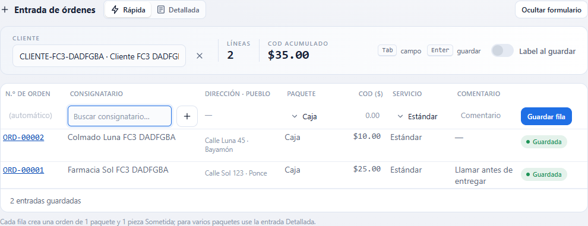
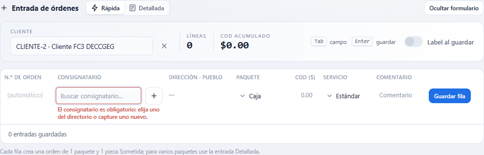
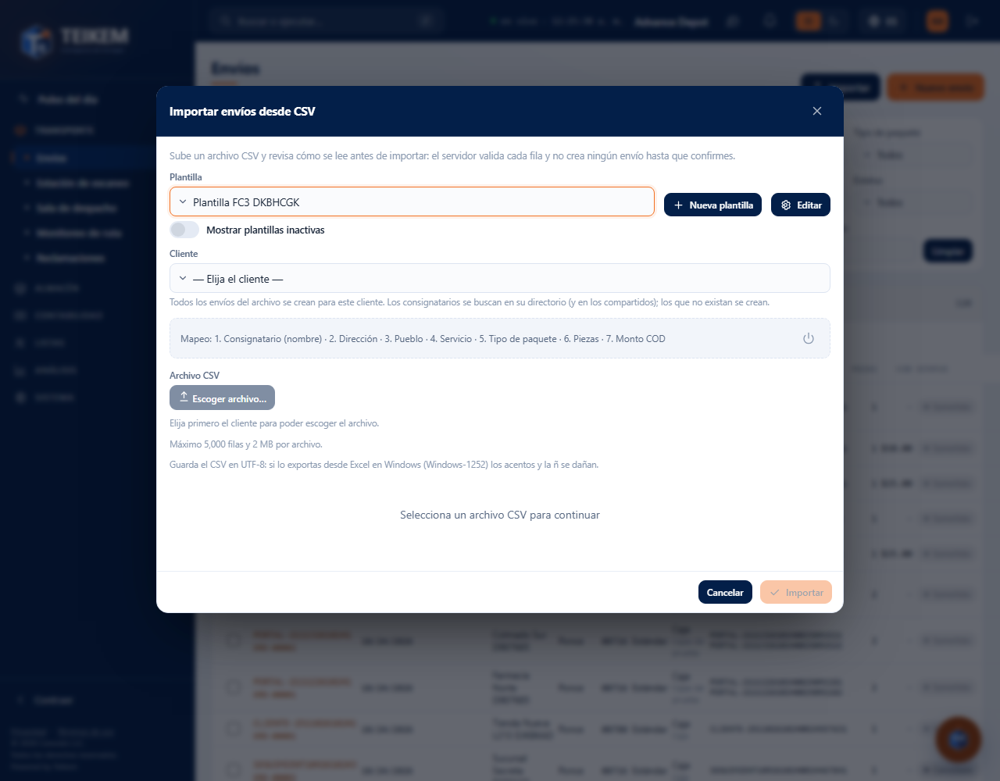
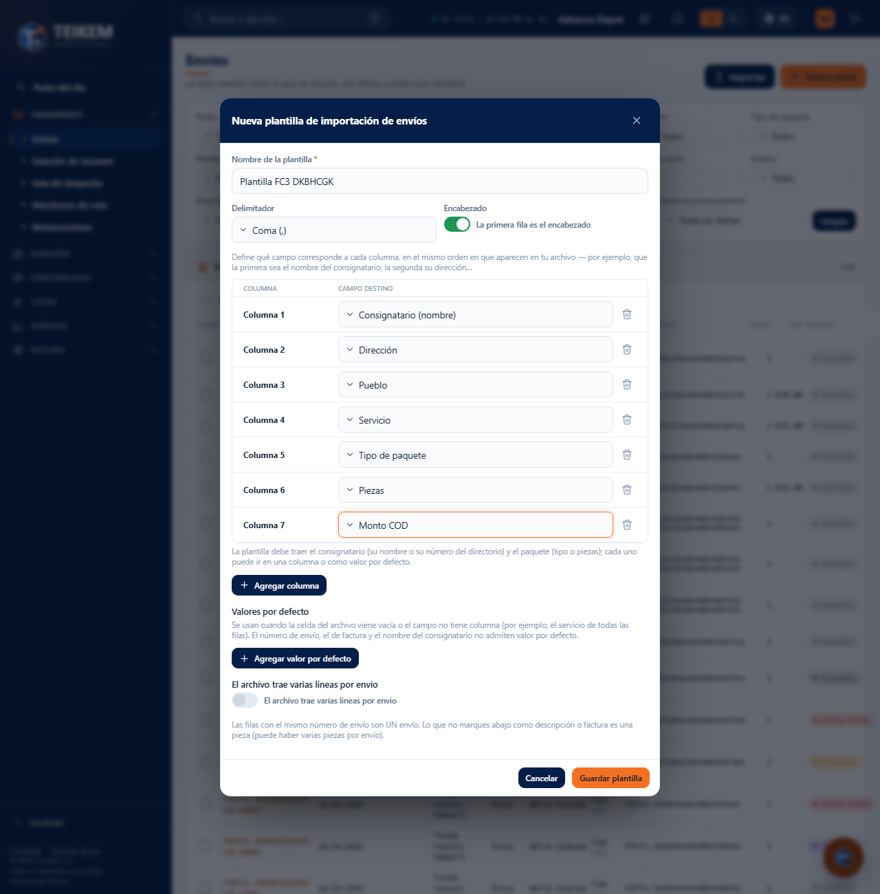
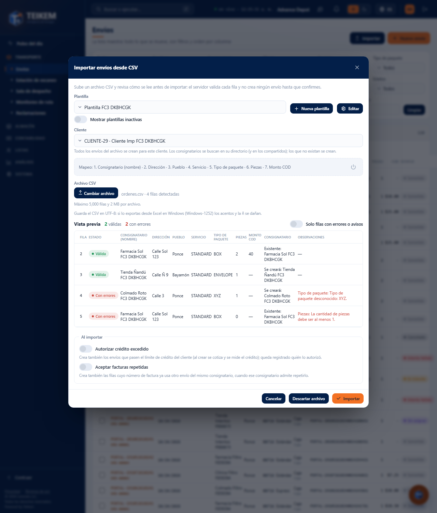
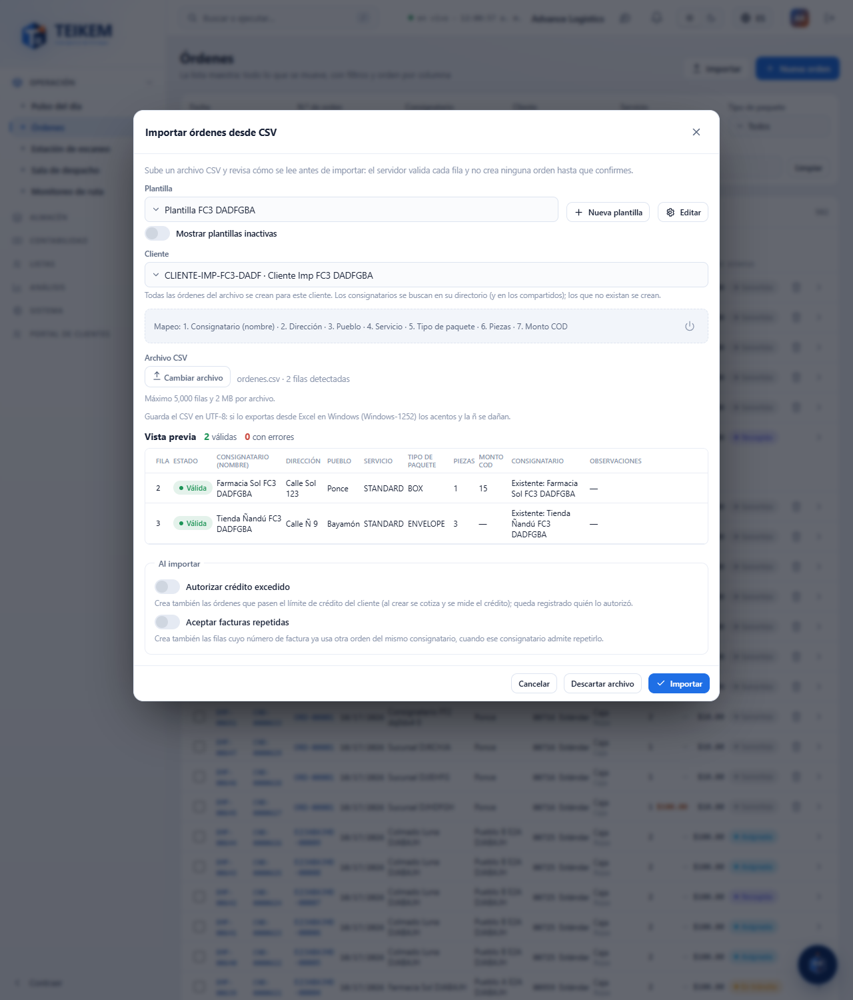
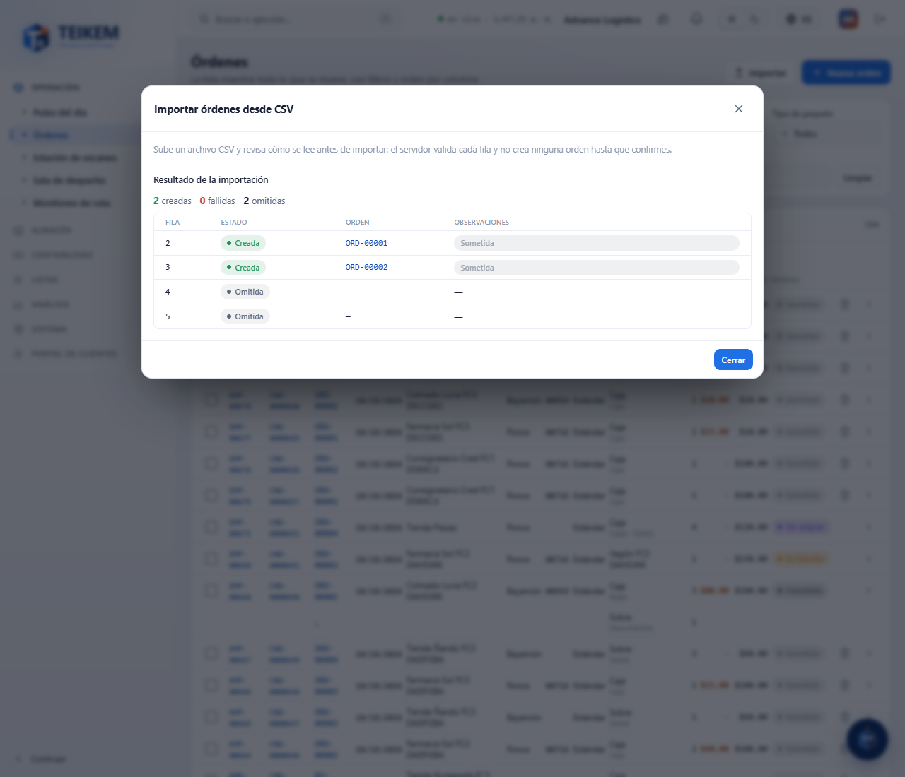
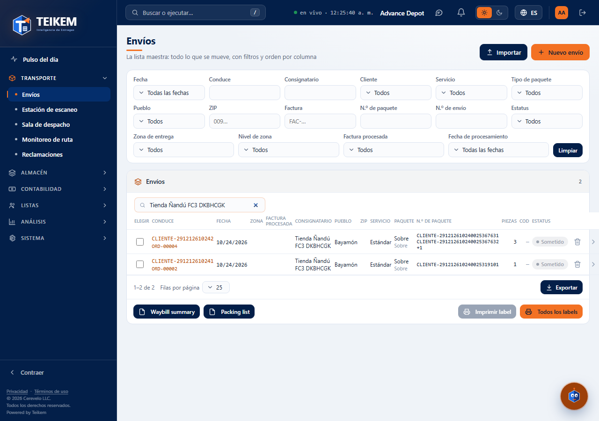

# Órdenes: entrada rápida e importación desde CSV

En **Operación → Órdenes**, el botón **Nueva orden** abre la entrada de órdenes, que tiene dos modos (el interruptor **Rápida / Detallada** de arriba): la **Rápida**, para capturar muchas órdenes seguidas, y la **Detallada**, para una orden con varios paquetes (ver [Alta detallada](fc1-ordenes-alta.md)). Junto a **Nueva orden** está el botón **Importar**, que crea órdenes desde un archivo CSV.

La pantalla recuerda su última elección: si la dejó en **Detallada**, la próxima vez abre en **Detallada**. La primera vez abre en **Rápida**.

El interruptor **«Label al guardar»** (en la leyenda, junto a «Enter guardar») imprime el label de cada pieza de la orden que se acaba de
guardar por la impresora de labels de esta estación (ver [F-G2 — Labels y documentos](fg2-labels-y-documentos.md)). Viene encendido si la
compañía tiene «Imprimir labels directo a la impresora» y la estación no se excluyó; se puede cambiar mientras se captura.

## Permisos necesarios

| Permiso | Qué permite |
|---|---|
| `orders.create` | Ver y usar **Nueva orden** (Rápida y Detallada) y el botón **Importar**: validar el archivo, importar y descartar. |
| `orders.edit` | Elegir, crear, editar, desactivar y reactivar las **plantillas** de importación. |
| `orders.credit_override` | Ver la casilla **Autorizar crédito excedido** al importar. |
| `locations.create` | Ver el botón **+** para crear un consignatario desde la entrada rápida. |
| `clients.read` | Elegir el cliente (en la entrada rápida y al importar). |

Si falta un permiso, pídaselo al administrador de su compañía (Sistema → Roles).

## Entrada rápida

Cada **fila** de la rejilla es **una orden de 1 paquete y 1 pieza**. Se guarda como **Borrador**, sin cotizar: para confirmarla, ábrala desde la lista (botón **Confirmar** del expediente). Si necesita varios paquetes en una orden, use **Detallada**.

### Cómo se usa

1. Pulse **Nueva orden**. Si no abre en **Rápida**, pulse **Rápida**.
2. En **Cliente** elija el cliente de las órdenes (es obligatorio y vale para todas las filas).
3. En la fila vacía:
   - **N.º de orden**: solo se puede escribir si el cliente asigna sus propios números; si no, dice **(automático)** y Teikem lo asigna.
   - **Consignatario**: busque por nombre, número, dirección o pueblo. Aparecen los del cliente y los compartidos. Debajo, **Dirección · Pueblo** muestra a dónde irá. Con el botón **+** puede crear un consignatario nuevo sin salir de la pantalla.
   - **Paquete**, **COD ($)** (opcional), **Servicio** y **Comentario** (opcional).
4. Pulse **Enter** en cualquier campo (o el botón **Guardar fila**). La orden se crea y la fila queda guardada, con su número de orden, en gris y sin poder editarse.
5. Arriba aparece una **fila nueva**: el cliente y el servicio se quedan como estaban, y el cursor queda en el consignatario. Repita.

**Tab** pasa de un campo al siguiente. Arriba, **Líneas** cuenta las órdenes guardadas y **COD acumulado** suma su COD.

Si la lista de consignatarios está abierta, **Enter** elige el que está resaltado y **no** guarda la fila: pulse **Enter** otra vez para guardar.

### Si algo falla

Los mensajes salen debajo del campo o debajo de la fila, y **lo que usted escribió se queda** para corregirlo y volver a pulsar **Enter**. La orden no se crea mientras haya un error.

| Mensaje | Qué significa y qué hacer |
|---|---|
| El cliente es obligatorio. | Elija el cliente en la barra de arriba. |
| El consignatario es obligatorio: elija uno del directorio o capture uno nuevo. | Elija uno de la lista o créelo con **+**. |
| El tipo de paquete es obligatorio. | Elija el **Paquete**. La compañía no tiene un paquete predeterminado. |
| El tipo de servicio es obligatorio. | Elija el **Servicio**. La compañía no tiene un servicio predeterminado. |
| El monto COD debe ser un número. | Escriba solo cifras (por ejemplo 25 o 25.50). |
| El monto COD no puede ser negativo. | Escriba un monto de 0 en adelante. |
| El número no puede exceder 40 caracteres. | Acorte el N.º de orden. |
| El cliente está suspendido; no se pueden crear ni confirmar órdenes. | El cliente no puede recibir órdenes nuevas. Consulte con quien lo administra. |
| El cliente está dado de baja; solo se consulta su historial. | Elija otro cliente. |
| Consignatario está inactivo; reactívelo o elija otro. | Elija otro o reactívelo en Catálogo → Consignatarios. |
| Tipo de paquete desconocido: X. / Tipo de servicio desconocido: X. | Ese valor ya no existe en el catálogo; elija otro de la lista. |
| Ya existe una orden con ese número para este cliente. | El N.º de orden que escribió ya se usó; escriba otro o déjelo vacío si es automático. |

Si se corta la conexión mientras guarda, aparece un error en la fila; al pulsar **Enter** de nuevo se reintenta **sin duplicar** la orden.

## Importar órdenes desde CSV

Sirve para crear muchas órdenes a la vez desde un archivo de Excel guardado como CSV. El proceso tiene dos pasos y **no crea nada** hasta que usted lo confirma.

### Antes de empezar

- El archivo debe ser **CSV en UTF-8**. Si lo guarda desde Excel en Windows, elija «CSV UTF-8»; con el formato «CSV (delimitado por comas)» normal los acentos y la ñ salen dañados.
- Máximo **5,000 filas** y **2 MB** por archivo.
- Cada **fila** del archivo es una orden con **un tipo de paquete**. Cada fila debe indicar el consignatario (su nombre con la dirección, o su número del directorio) y el paquete (tipo o piezas).

### Plantillas

Una **plantilla** le dice a Teikem qué hay en cada columna de su archivo. Se hace una vez y se reutiliza.

1. Pulse **Importar**.
2. Si no hay plantillas, pulse **Crear «Formato estándar»**: trae consignatario, dirección, pueblo, servicio, tipo de paquete, piezas y monto COD, en ese orden. O pulse **Nueva plantilla** para armar la suya.
3. En la ventana de la plantilla escriba el **Nombre de la plantilla**, elija el **Delimitador** (coma, punto y coma, tabulador o barra vertical) y si la primera fila es el encabezado.
4. Para cada **Columna** elija el **Campo destino** («— no importar —» ignora esa columna). Use **Agregar columna** para más columnas.
5. Opcional: **Agregar valor por defecto** para un valor que se usa cuando la celda viene vacía o el campo no tiene columna (por ejemplo, el servicio de todas las filas). El número de orden, el de factura y el nombre del consignatario no admiten valor por defecto.
6. Pulse **Guardar plantilla**.

**Campos que puede usar:** N.º de orden, N.º de factura, Servicio, Consignatario (nombre), Consignatario (número), Dirección, Dirección (línea 2), Pueblo, Estado o región, ZIP, País, Teléfono de contacto, Tipo de paquete, Piezas, Peso (kg), Volumen (m³), Descripción, Monto COD, Fecha solicitada, Notas y Referencia.

| Mensaje al guardar la plantilla | Qué significa y qué hacer |
|---|---|
| El nombre de la plantilla es obligatorio. | Escriba un nombre. |
| Indique al menos una columna. | Elija un campo destino en alguna columna. |
| La plantilla debe incluir consigneeName o consigneeCode. | Falta el consignatario: asigne «Consignatario (nombre)» o «Consignatario (número)» a una columna. |
| La plantilla debe indicar el paquete: packageType o pieces, en una columna o en defaults. | Asigne «Tipo de paquete» o «Piezas» a una columna, o póngalo como valor por defecto. |
| El campo X está repetido. | Cada campo solo puede estar en una columna. |
| El campo X no admite valor por defecto. | Quítelo de los valores por defecto. |
| Ya existe una plantilla de importación con ese nombre. | Use otro nombre. |

Una plantilla no se borra: **Desactivar esta plantilla** (el icono de apagado junto al mapeo) la deja de ofrecer; con **Mostrar plantillas inactivas** la ve y puede **Reactivar esta plantilla**.

### Paso 1: elegir cliente y archivo, y revisar

1. Elija la **Plantilla** y el **Cliente**. Todas las órdenes del archivo se crean para ese cliente. Hasta que elija el cliente, el archivo no se puede escoger.
2. Pulse **Escoger archivo…** y elija el CSV. Teikem lo revisa fila por fila y muestra la **Vista previa**.

En la vista previa cada fila dice si está **Válida**, **Con aviso** o **Con errores**, lo que se leyó en cada columna, el **Consignatario** (**Existente: …** si ya está en el directorio del cliente o compartido, **Se creará: …** si es nuevo) y las **Observaciones** con el error o el aviso. Las filas con errores **no se importan**; las demás sí. **Solo filas con errores o avisos** deja ver únicamente las que hay que revisar.

Si cambia el cliente o la plantilla, el archivo se revisa de nuevo.

| Mensaje | Qué significa y qué hacer |
|---|---|
| El archivo supera el límite de 5.000 filas o 2 MB. | Divida el archivo en partes. |
| El archivo no tiene filas de datos. | El archivo está vacío o solo trae el encabezado. |
| Indique el consignatario: nombre (con dirección) o código del directorio. | En esa fila falta el consignatario. |
| Tipo de paquete desconocido: X. / Tipo de servicio desconocido: X. | Use un valor del catálogo (por ejemplo STANDARD, BOX). |
| La cantidad de piezas debe ser al menos 1. / La cantidad de piezas debe ser un número entero. | Corrija las piezas. |
| El monto COD debe ser un número. / El monto COD no puede ser negativo. | Corrija el COD. |
| La fecha solicitada no es válida; use yyyy-MM-dd. | Escriba la fecha como 2026-10-15. |
| No existe un consignatario con el código 'X' para este cliente. | Corrija el número o use el nombre y la dirección. |
| El cliente está suspendido; no se pueden crear ni confirmar órdenes. | Ese cliente no puede recibir órdenes ahora. |

### Paso 2: importar o descartar

Antes de importar, la sección **Al importar** tiene tres casillas:

| Casilla | Qué hace |
|---|---|
| **Confirmar las órdenes al importar** | Cotiza, revisa el crédito del cliente y confirma cada orden. Si no la marca, las órdenes quedan en **Borrador**. |
| **Autorizar crédito excedido** | Solo aparece con `orders.credit_override` y solo se puede marcar junto con la casilla anterior. Confirma también las órdenes que pasen el límite de crédito; queda registrado quién lo autorizó. |
| **Aceptar facturas repetidas** | Crea también las filas cuyo número de factura ya usa otra orden del mismo consignatario, cuando ese consignatario admite repetirlo. |

- **Importar** crea una orden por cada fila válida. Si una falla, las demás se crean igual.
- **Descartar archivo** borra la revisión sin crear nada y le deja escoger otro archivo.
- **Cancelar** descarta y cierra la ventana.

Al terminar verá el **Resultado de la importación**: cuántas quedaron **creadas**, **fallidas** y **omitidas** (las filas con errores), y por fila el **número de orden** (con enlace a la orden) o el motivo del fallo.

| Mensaje al importar | Qué significa y qué hacer |
|---|---|
| El lote ya fue confirmado; valide un archivo nuevo para importar más órdenes. | Ese archivo ya se importó. Escoja el archivo otra vez si necesita otro lote. |
| El lote fue descartado; valide el archivo de nuevo. | Vuelva a escoger el archivo. |
| El cliente excede su límite de crédito. | Esa fila no se creó. Pida a quien tenga `orders.credit_override` que importe con **Autorizar crédito excedido**, o importe sin confirmar. |
| Falta el permiso 'orders.credit_override'. | No puede autorizar crédito; desmarque esa casilla. |

Las órdenes importadas aparecen en la lista de **Órdenes**.

