# Choferes y tarifas

La pantalla **Catálogo → Choferes y tarifas** es el maestro de sus choferes: quiénes son, en qué zona trabajan, si están disponibles, qué licencias tienen y **cuánto se les paga** por entrega, por intento y por viaje. Desde ahí usted puede:

- **Crear** un chofer, **corregir sus datos** y **eliminarlo**.
- Marcarlo **No disponible**, o apagar su casilla **Activo**.
- Llevar sus **licencias y certificaciones**, con aviso de cuáles vencen.
- Definir sus **tarifas** (por entrega, por intento y por viaje), con fechas y con historial.
- Elegir la **fórmula de pago** de la compañía y ver una **vista previa** del pago.
- Registrar y cancelar **viajes pagados**.
- Ver sus **dispositivos**, sus **teléfonos y correos**, sus **campos personalizados** y el **historial** de estatus.

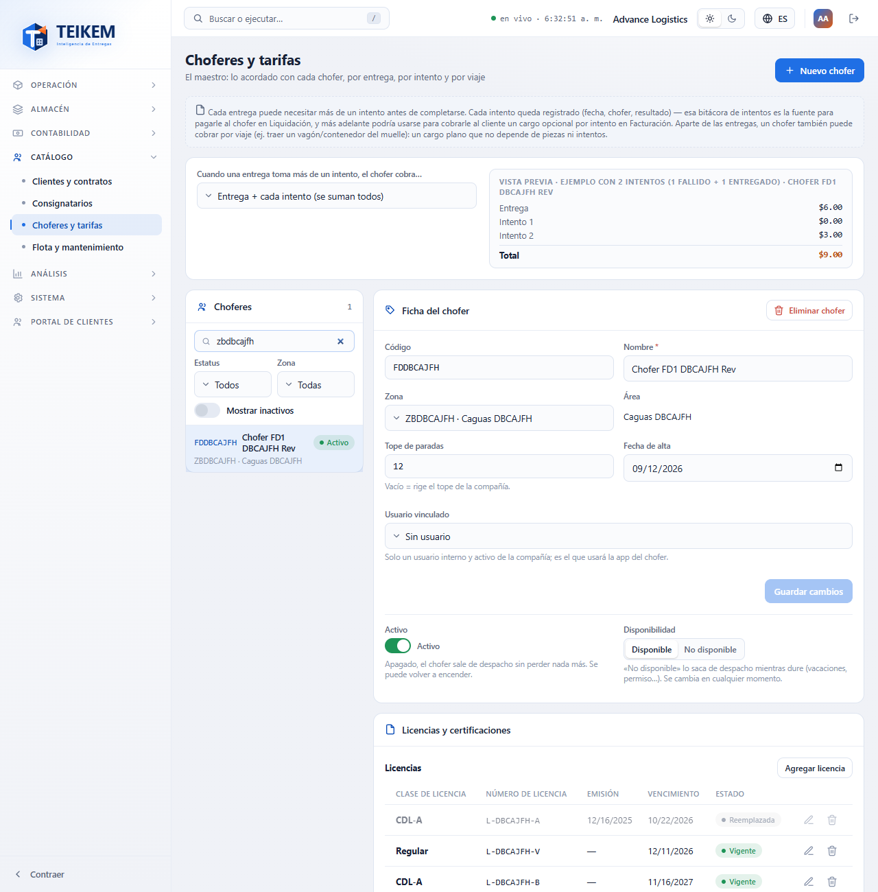

## Permisos necesarios

Cada botón aparece solo si usted tiene su permiso. Si falta alguno, pídaselo al administrador de su compañía (Sistema → Roles).

| Permiso | Qué permite |
|---|---|
| `fleet.view` | Entrar a la pantalla y ver choferes, licencias, certificaciones y dispositivos. |
| `fleet.manage` | **Nuevo chofer**, **Guardar cambios**, **Disponibilidad**, **Activo**, **Eliminar chofer**, licencias, certificaciones, quitar dispositivos, campos personalizados y contactos (los contactos piden además `contacts.manage`). |
| `admin.users` | Elegir o quitar el **Usuario vinculado** del chofer (además de `fleet.manage`). |
| `driverpay.view` | Ver la **fórmula de pago**, la vista previa, las **tarifas** y los **viajes pagados**. Sin este permiso esos paneles no aparecen. |
| `driverpay.manage` | Cambiar la fórmula, agregar, editar y cerrar tarifas, **+ Agregar intento**, **Registrar viaje** y **Cancelar viaje**. |

El módulo **Catálogo** debe estar encendido para su compañía.

## 1. La lista de choferes

A la izquierda está el panel **Choferes**. Cada fila muestra el código, el nombre, un chip y la **zona · área**. El chip puede decir **Activo**, **No disponible**, **Inactivo** o **Eliminado**.

- **Buscar…** filtra por código, nombre y zona.
- **Estatus** y **Zona** filtran la lista.
- **Mostrar inactivos** agrega los choferes inactivos y los eliminados.
- Pulse una fila para ver su ficha a la derecha. En el celular la ficha queda debajo de la lista.

## 2. Crear un chofer

1. Pulse **Nuevo chofer** (arriba a la derecha).
2. Escriba el **Código** y el **Nombre**. El código se guarda en mayúsculas y **no se puede cambiar después**.
3. Si quiere, elija la **Zona**, escriba el **Tope de paradas** (si lo deja vacío rige el de la compañía), la **Fecha de alta** y, si tiene permiso, el **Usuario vinculado**.
4. Pulse **Guardar**.

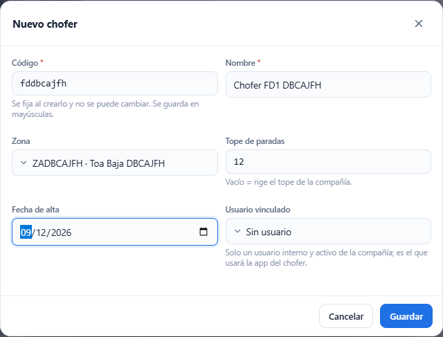

El chofer nuevo queda elegido y empieza sin tarifas. Si ya existe un chofer con ese código (aunque esté eliminado) aparece «Ya existe un chofer con ese código.» y la ventana sigue abierta.

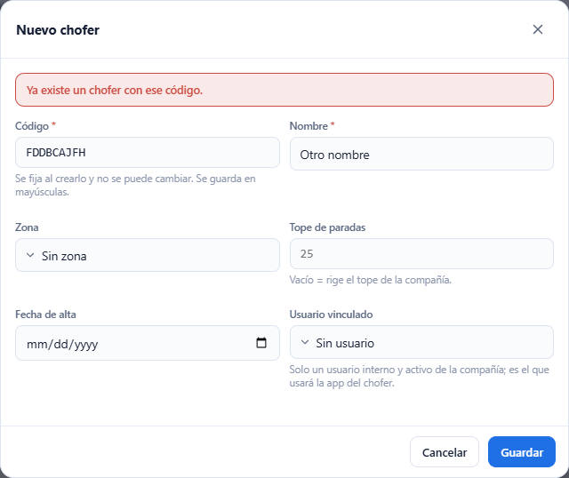

## 3. La ficha del chofer

La ficha muestra el **Código** (fijo), el **Nombre**, la **Zona**, el **Área** (es el nombre de la zona elegida; no se escribe), el **Tope de paradas**, la **Fecha de alta** y el **Usuario vinculado**.

1. Cambie lo que necesite.
2. Pulse **Guardar cambios**. El botón se enciende solo cuando usted cambia algo.

Para quitar la zona, elija **Sin zona**. Para quitar el tope propio, deje el campo vacío. La **Fecha de alta** de un chofer que ya la tiene no se puede quitar: elija otra.

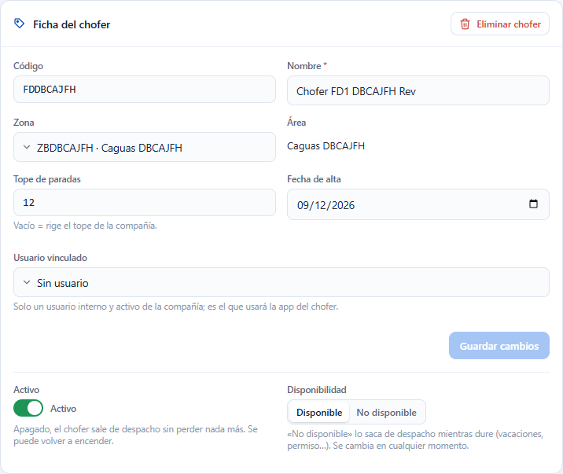

### Si otra persona cambió al chofer mientras usted lo editaba

Aparece «El registro fue modificado por otro usuario; recargue e intente de nuevo.» La pantalla vuelve a leer al chofer y **conserva lo que usted escribió**. Revise y pulse **Guardar cambios** otra vez.

### Usuario vinculado

Es el usuario de Teikem que usará la app del chofer. Solo se ofrecen usuarios internos, activos y de su compañía. Si el usuario ya está con otro chofer, aparece «El usuario ya está vinculado a otro chofer.» Sin el permiso `admin.users` el usuario se ve pero no se cambia.

## 4. Activo, Disponibilidad y Eliminar chofer: tres cosas distintas

| Control | Para qué sirve | Se puede deshacer |
|---|---|---|
| **Activo** (interruptor) | Saca al chofer de despacho sin tocar nada más. Para verlo en la lista active **Mostrar inactivos**. | Sí: vuelva a encenderlo. |
| **Disponibilidad** (**Disponible** / **No disponible**) | Lo saca de despacho mientras dure algo temporal (vacaciones, permiso). | Sí: pulse **Disponible**. |
| **Eliminar chofer** (botón rojo) | Baja definitiva. | **No.** |

Al pulsar **Eliminar chofer** la ventana le explica qué pasa: se desvincula su usuario, sus dispositivos quedan inactivos, pierde su zona, sus tarifas abiertas se cierran hoy y sus viajes pagados se conservan para pagarle lo pendiente. Puede escribir un **Comentario (opcional)**.

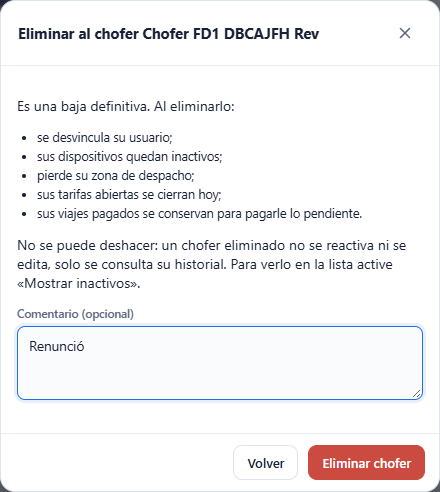

Un chofer eliminado ya no aparece en la lista (use **Mostrar inactivos** para verlo, con el chip **Eliminado**) y su ficha, sus tarifas y sus viajes **solo se consultan**: «El chofer fue eliminado; solo se consulta su historial.»

## 5. Licencias y certificaciones

En el panel **Licencias y certificaciones** cada documento lleva un chip:

| Chip | Significa |
|---|---|
| **Vigente** | Faltan más de 30 días. |
| **Vence en N días** / **Vence hoy** | Vence dentro de los próximos 30 días. |
| **Vencida hace N días** | Ya venció. |
| **Sin vencimiento** | No tiene fecha de vencimiento. |
| **Reemplazada** | Hay otro documento del mismo tipo que vence después; este ya no cuenta. |

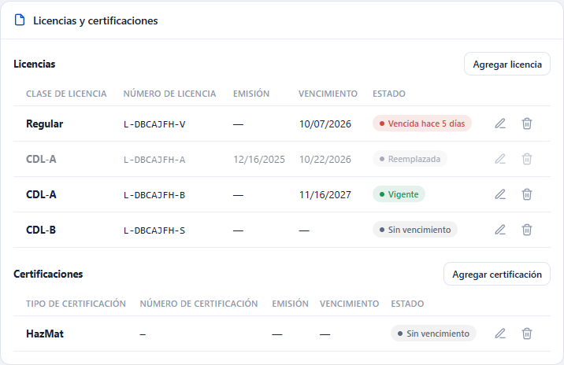

**Agregar:** pulse **Agregar licencia** o **Agregar certificación**, elija la clase o el tipo, escriba el número (en la licencia es obligatorio), las fechas de **Emisión** y **Vencimiento** (si no vence, déjela vacía) y pulse **Guardar**. El vencimiento no puede ser anterior a la emisión.

**Editar** (el lápiz) cambia los datos. **Quitar** (la papelera) saca el documento de la lista y lo conserva en el historial.

## 6. Tarifas del chofer

Las tarifas se llevan **por fechas**: nunca se pisa una tarifa vieja. Si cambia una, la anterior se cierra en la fecha que usted elija y la nueva empieza ahí. Si quita una, se **cierra** (no se borra).

Un chofer nuevo **no tiene ninguna tarifa**. «**Sin tarifa**» no es lo mismo que **$0.00**: sin tarifa significa que todavía no se configuró; $0.00 es una tarifa que usted puso a propósito.

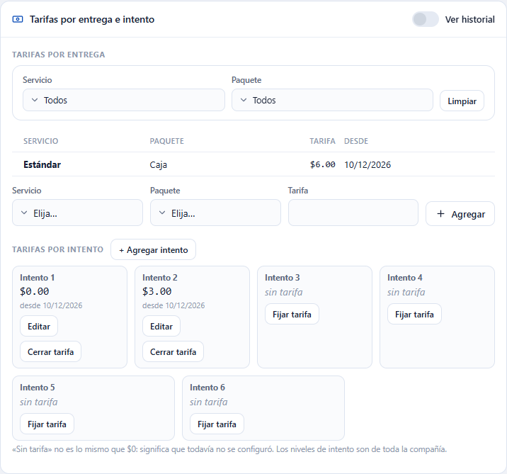

### Tarifas por entrega

1. En la fila de abajo elija el **Servicio**, el **Paquete** y escriba la **Tarifa**.
2. Pulse **Agregar**.

Para ver solo algunas, use los filtros **Servicio** y **Paquete** y **Limpiar**.

Para **cambiar** una tarifa pulse el lápiz: escriba la **Tarifa** nueva y **Vigente desde** (por omisión hoy; puede ser una fecha futura, nunca una pasada). Para **quitarla** pulse **Cerrar tarifa** y confirme.

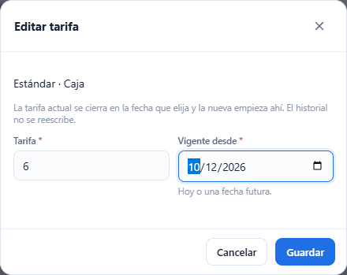

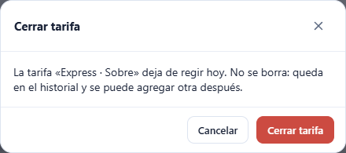

Solo se pueden cambiar o cerrar las tarifas que siguen abiertas: una tarifa que ya tiene fecha de cierre se ve, pero no tiene botones.

### Ver historial

Active **Ver historial** para ver también las tarifas cerradas y las que empiezan más adelante, con sus columnas **Desde** y **Hasta**. «Hasta» es el día en que la tarifa deja de regir. Las filas que ya no rigen se ven atenuadas.

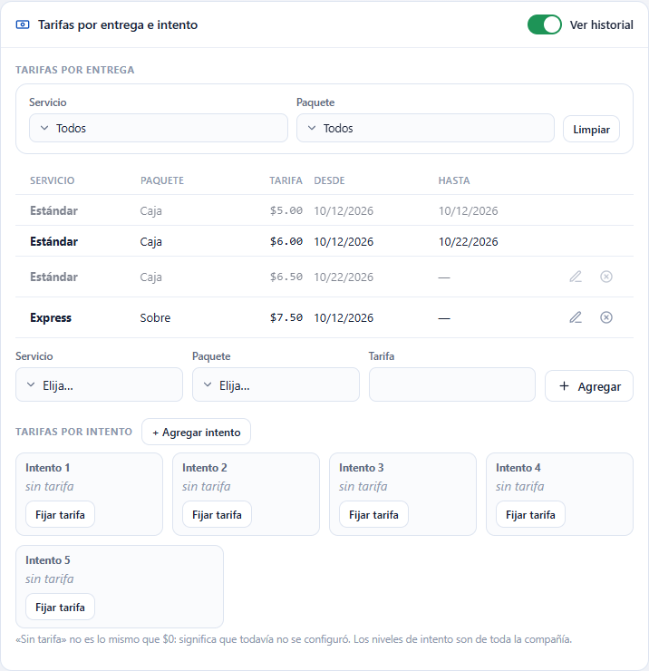

### Tarifas por intento

Cada entrega puede necesitar varios intentos. Hay una celda por cada **Intento**: **Fijar tarifa** cuando no tiene, o **Editar** y **Cerrar tarifa** cuando sí. **+ Agregar intento** agrega un nivel (Intento 3, 4…) para **toda la compañía**; hay un máximo de 20 y no se pueden quitar. Agregar un nivel no crea tarifas: queda «sin tarifa».

### Tarifas por viaje

Un viaje es un cargo fijo que no depende de piezas ni intentos (por ejemplo, traer un vagón del muelle). En el panel **Tarifas por viaje** elija el **Tipo de viaje**, escriba la **Tarifa** y pulse **Agregar**. Los tipos salen de los servicios especiales de la compañía; si no hay ninguno dice «Sin servicios especiales — agréguelos en Clientes y contratos».

### Sin permiso para escribir

Con `driverpay.view` pero sin `driverpay.manage` las tarifas se ven sin botones. Sin `driverpay.view` los paneles de tarifas, viajes y fórmula no aparecen.

## 7. Fórmula de pago y vista previa

Arriba de la pantalla, **Cuando una entrega toma más de un intento, el chofer cobra…** define cómo se combinan la tarifa de entrega y las de intento. Es **una sola fórmula para toda la compañía**. Tiene tres opciones:

- **Entrega + cada intento (se suman todos).**
- **La entrega incluye el 1er intento (solo los intentos extra se pagan aparte).**
- **Cada intento fallido cobra su tarifa; el que logra entregar cobra la tarifa de entrega.**

A la derecha, la **Vista previa** calcula un ejemplo con 2 intentos (1 fallido y 1 entregado) con las tarifas del chofer elegido. Se vuelve a calcular al cambiar la fórmula o una tarifa. Una línea sin tarifa dice «(sin tarifa configurada)» y suma $0.

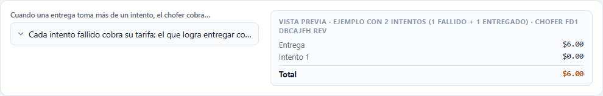

## 8. Viajes pagados

El panel **Viajes pagados** lista los viajes del chofer: fecha, tipo, monto, orden, estatus y notas. Por omisión se ven los **vigentes**; use los filtros de **Fechas** y de **Estatus** (por ejemplo, **Cancelado**) y **Limpiar**.

**Registrar viaje:** pulse **Registrar viaje**, elija el **Tipo de viaje**, la **Fecha** (hoy por omisión; no puede ser futura) y, si quiere, **Notas**. El monto se **congela** con la tarifa por viaje vigente ese día. Si el chofer no tenía tarifa, el viaje queda en $0.00 con el chip **Sin tarifa**.

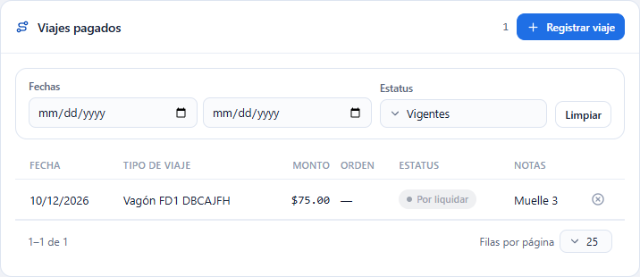

**Cancelar viaje:** pulse la **X** de la fila, escriba un comentario si quiere y pulse **Cancelar viaje**. Un viaje que nació de una **entrega especial** no se cancela aquí: aparece «El viaje nace de una entrega especial; cancele la orden o reasigne el chofer.» Su número de orden es un enlace a la orden.

## 9. Dispositivos, contactos, campos personalizados e historial

- **Dispositivos:** los registra la app del chofer. Se ve la plataforma, la versión de la app, la última conexión y si tiene notificaciones. **Desactivar** deja de enviarle notificaciones. Nunca se muestra el código secreto del dispositivo.
- **Teléfonos y correos:** los medios de contacto del chofer.
- **Campos personalizados:** aparece solo si su compañía definió campos para choferes.
- **Historial de estatus:** quién cambió el estatus del chofer, cuándo y con qué comentario.

## Errores que puede ver

| Mensaje | Qué significa | Qué hacer |
|---|---|---|
| Ya existe un chofer con ese código. | El código ya lo tiene otro chofer (aunque esté eliminado). | Use otro código. |
| El código del chofer es obligatorio. / El nombre del chofer es obligatorio. | Falta un dato. | Escríbalo. |
| El código no puede exceder 30 caracteres. | Código demasiado largo. | Acórtelo. |
| El tope de paradas debe ser mayor o igual a 1. | Escribió 0 o menos. | Escriba 1 o más, o déjelo vacío. |
| La zona de despacho está inactiva. | La zona elegida ya no se usa. | Elija otra zona. |
| El registro fue modificado por otro usuario; recargue e intente de nuevo. | Alguien guardó antes que usted. | Revise lo nuevo y guarde otra vez. |
| El usuario ya está vinculado a otro chofer. | Ese usuario ya es de otro chofer. | Elija otro usuario. |
| El chofer fue eliminado; solo se consulta su historial. | El chofer ya se dio de baja. | No se puede editar; cree uno nuevo si hace falta. |
| El chofer fue eliminado; no se puede reactivar. | Intentó reactivar a un chofer eliminado. | Cree uno nuevo. |
| El chofer fue eliminado; sus tarifas y viajes solo se consultan. | Intentó cambiar tarifas o viajes de un chofer eliminado. | No se puede. |
| El chofer ya tiene una tarifa vigente para … ; edite esa tarifa o ciérrela antes de agregar otra. | Ya hay una tarifa abierta para ese servicio y paquete (o intento, o tipo de viaje). | Edítela, o ciérrela y agregue otra. |
| La tarifa ya está cerrada; agregue una nueva si necesita volver a pagarla. | Intentó cambiar una tarifa que ya tiene fecha de cierre. | Agregue una tarifa nueva. |
| La fecha no puede ser anterior a hoy: el historial de tarifas no se reescribe. | Eligió una vigencia pasada. | Elija hoy o una fecha futura. |
| La tarifa no puede ser negativa. | Escribió un monto menor que 0. | Escriba 0 o más. |
| El valor admite como máximo 4 decimales y debe ser menor que 100,000,000,000,000. | Demasiados decimales o un monto enorme. | Corríjalo. |
| Se alcanzó el máximo de 20 niveles de intento. | Ya no se pueden agregar más intentos. | Use los que hay. |
| Sin servicios especiales — agréguelos en Clientes y contratos | La compañía no tiene tipos de viaje. | Cree un servicio especial en Clientes y contratos. |
| La fecha del viaje no puede ser futura. | Eligió un día que no ha llegado. | Elija hoy o una fecha pasada. |
| El viaje nace de una entrega especial; cancele la orden o reasigne el chofer. | Ese viaje pertenece a una orden. | Cancele la orden o reasigne el chofer desde la orden. |
| La fecha de vencimiento no puede ser anterior a la de emisión. | Fechas al revés en una licencia o certificación. | Corríjalas. |
| El número de licencia es obligatorio. / La clase de licencia es obligatoria. | Falta un dato de la licencia. | Complételo. |
| Falta el permiso '…'. | Su usuario no tiene ese permiso. | Pídalo al administrador. |

Las preguntas frecuentes están en la sección «Lote F-D1» del [FAQ](../faq.md).
