# Flota y mantenimiento: vehículos, documentos y disponibilidad

La pantalla **Catálogo → Flota y mantenimiento** es el registro de sus vehículos. Tiene cuatro pestañas:

- **Vehículos**: crear, corregir, marcar en mantenimiento, desactivar o dar de baja un vehículo, y llevar sus documentos (registro, seguro, inspección y permiso).
- **Documentos por vencer**: una sola lista con los documentos de vehículos y las licencias y certificaciones de choferes que ya vencieron o vencen pronto.
- **Zonas de despacho**: las zonas donde trabajan sus choferes.
- **Disponibilidad**: para una fecha, qué choferes y vehículos pueden salir a ruta y por qué no.

Arriba hay dos tarjetas: **Vehículos activos** y **Documentos por vencer (≤ 30 d)**. Al pulsar una, se abre su pestaña. El mantenimiento preventivo, las órdenes de trabajo y el combustible llegarán en un lote posterior.

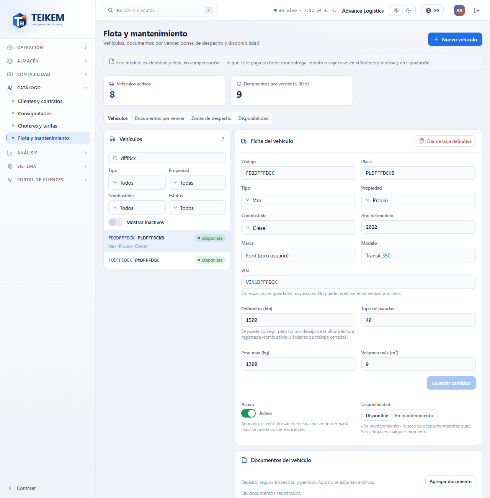

## Permisos necesarios

Cada botón aparece solo si usted tiene su permiso. Si falta alguno, pídaselo al administrador de su compañía (Sistema → Roles).

| Permiso | Qué permite |
|---|---|
| `fleet.view` | Entrar a la pantalla y ver vehículos, documentos, zonas y disponibilidad. |
| `fleet.manage` | **Nuevo vehículo**, **Guardar cambios**, **Disponibilidad**, **Activo**, **Dar de baja definitiva**, documentos, campos personalizados, contactos (estos piden además `contacts.manage`) y las acciones de las zonas. |

El módulo **Catálogo** debe estar encendido para su compañía.

## 1. La lista de vehículos

A la izquierda está el panel **Vehículos**. Cada fila muestra el código, la placa, un chip y, debajo, el tipo, la propiedad y el combustible. El chip puede decir **Disponible**, **En mantenimiento**, **Inactivo** o **Baja definitiva**.

- **Buscar…** filtra por código, placa, VIN, marca, modelo, tipo, propiedad y combustible.
- **Tipo**, **Propiedad**, **Combustible** y **Estatus** filtran la lista.
- **Mostrar inactivos** agrega los vehículos inactivos y los dados de baja.
- Pulse una fila para ver su ficha a la derecha. En el celular la ficha queda debajo de la lista.

## 2. Crear un vehículo

1. Pulse **Nuevo vehículo** (arriba a la derecha).
2. Escriba el **Código**. Se guarda en mayúsculas y **no se puede cambiar después**.
3. Si quiere, complete **Placa**, **Tipo**, **Propiedad**, **Combustible**, **Año del modelo**, **Marca**, **Modelo**, **VIN**, **Odómetro (km)**, **Tope de paradas**, **Peso máx (kg)** y **Volumen máx (m³)**.
4. Pulse **Guardar**.

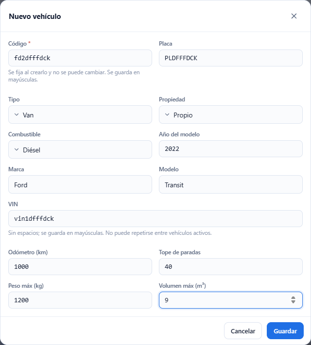

El vehículo nuevo queda elegido. Si el código ya existe (aunque ese vehículo esté dado de baja) aparece «Ya existe un vehículo con ese código.» y la ventana sigue abierta. Si el VIN ya lo tiene otro vehículo activo aparece «Ya existe un vehículo activo con ese VIN.»

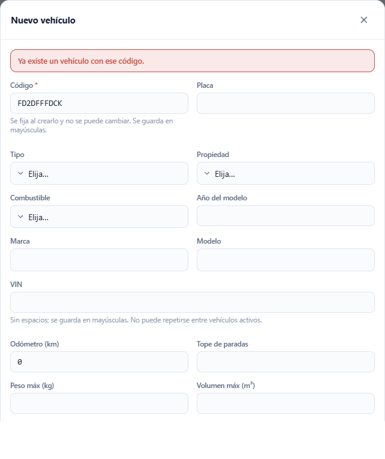

## 3. La ficha del vehículo

La ficha muestra el **Código** (fijo) y todos los datos del vehículo.

1. Cambie lo que necesite.
2. Pulse **Guardar cambios**. El botón se enciende solo cuando usted cambia algo.

Para borrar un texto (placa, marca, modelo, VIN) déjelo vacío. Un número que ya tiene valor (año, capacidades, tope de paradas, odómetro) no se puede dejar vacío: cámbielo por otro. El **Odómetro** se puede corregir, pero no por debajo de la última lectura registrada.

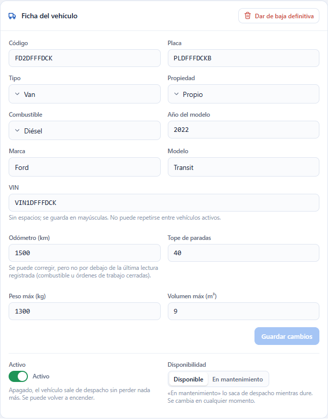

### Si otra persona cambió el vehículo mientras usted lo editaba

Aparece «El registro fue modificado por otro usuario; recargue e intente de nuevo.» La pantalla vuelve a leer el vehículo y **conserva lo que usted escribió**. Revise y pulse **Guardar cambios** otra vez.

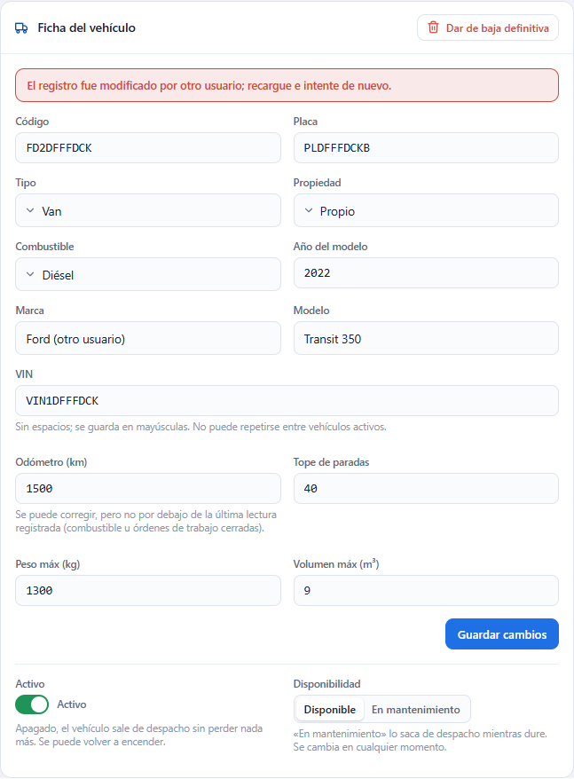

## 4. Activo, Disponibilidad y Dar de baja definitiva: tres cosas distintas

| Control | Para qué sirve | Se puede deshacer |
|---|---|---|
| **Activo** (interruptor) | Saca al vehículo de despacho sin tocar nada más. Para verlo en la lista active **Mostrar inactivos**. | Sí: vuelva a encenderlo. |
| **Disponibilidad** (**Disponible** / **En mantenimiento**) | Lo saca de despacho mientras dure algo temporal. | Sí: pulse **Disponible**. |
| **Dar de baja definitiva** (botón rojo) | Baja definitiva. No se borra: su historial y sus documentos se conservan. | **No.** |

Al pulsar **Dar de baja definitiva** la ventana le explica qué pasa y puede escribir un **Comentario (opcional)**.

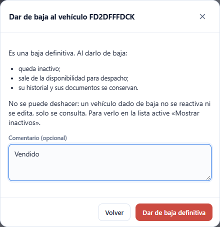

Un vehículo dado de baja aparece con el chip **Baja definitiva** (use **Mostrar inactivos** para verlo) y su ficha y sus documentos **solo se consultan**: «El vehículo fue dado de baja; solo se consulta su historial.»

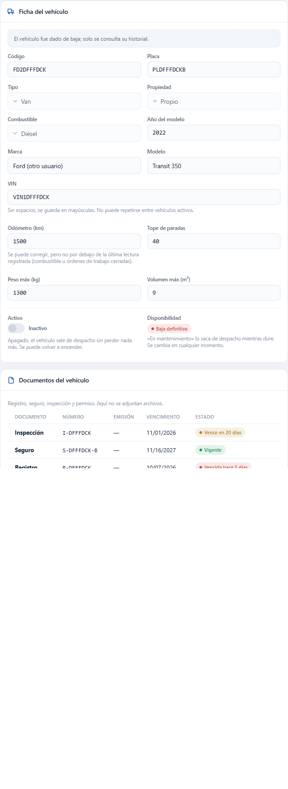

## 5. Documentos del vehículo

En el panel **Documentos del vehículo** cada documento (registro, seguro, inspección o permiso) lleva un chip:

| Chip | Significa |
|---|---|
| **Vigente** | Faltan más de 30 días. |
| **Vence en N días** / **Vence hoy** | Vence dentro de los próximos 30 días. |
| **Vencida hace N días** | Ya venció. |
| **Sin vencimiento** | No tiene fecha de vencimiento. |
| **Reemplazada** | Hay otro documento del mismo tipo que vence después; este ya no cuenta. |

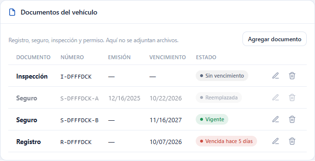

**Agregar:** pulse **Agregar documento**, elija el **Documento**, escriba el **Número** (opcional) y las fechas de **Emisión** y **Vencimiento** (si no vence, deje el vencimiento vacío) y pulse **Guardar**. Aquí no se adjuntan archivos.

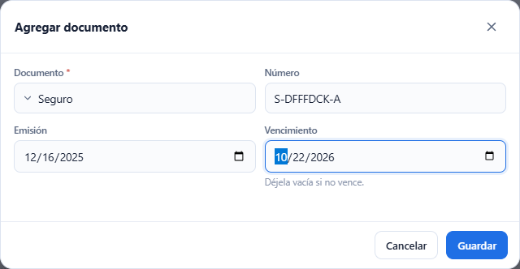

**Editar** (el lápiz) cambia los datos. **Quitar** (la papelera) saca el documento de la lista y lo conserva en el historial. Renovar un documento no obliga a quitar el viejo: al agregar uno más nuevo del mismo tipo, el anterior queda **Reemplazada**.

## 6. Documentos por vencer

La pestaña **Documentos por vencer** reúne en una lista los documentos de vehículos activos y las licencias y certificaciones de choferes activos que ya vencieron o vencen dentro de la ventana. Un documento ya renovado (otro más nuevo del mismo tipo) no aparece.

- **Documento** y **Entidad** (Vehículo / Chofer) permiten elegir varios valores. **Limpiar** los quita todos y vuelve a 30 días.
- **Dentro de (días)** define la ventana (30 por omisión, de 0 a 365).
- **Incluir vencidos** (encendido por omisión) agrega los que ya vencieron.
- **Buscar…** filtra por código, nombre, documento o número.
- Las columnas se ordenan al pulsar su encabezado. El chip de **Días** dice **Vencido** (rojo), de 0 a 14 días (azul), de 15 a 30 (gris) o más (verde).
- Pulse una fila para abrir el vehículo o el chofer.

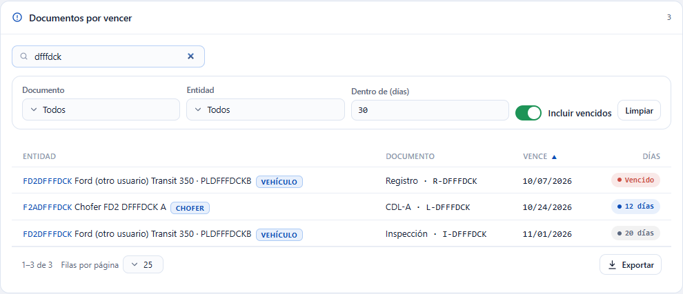

Si no hay nada, dice «Sin documentos por vencer».

## 7. Zonas de despacho

En la pestaña **Zonas de despacho** cada zona muestra su **Código**, su **Nombre**, cuántos **Choferes** la tienen como zona primaria y su **Estado**. El nombre de la zona es el **Área** que se ve en la ficha del chofer. Los municipios y códigos postales de cada zona se arman en Despacho (lote posterior).

- **Nueva zona:** escriba el **Código** (se guarda en mayúsculas y no se cambia después) y, si quiere, el **Nombre**. Si el código ya existe aparece «Ya existe una zona de despacho con ese código.»

- **Editar** (el lápiz): solo se cambia el nombre.
- **Inactivar** (el botón de apagado): la zona deja de ofrecerse al asignar choferes y no se borra. Si la zona todavía tiene choferes aparece «La zona tiene choferes asignados; reasígnelos antes de inactivarla.» Cámbieles la zona en **Choferes y tarifas** y vuelva a intentar.

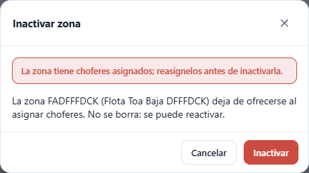

- **Reactivar:** active **Mostrar inactivas** y pulse el botón de la fila.

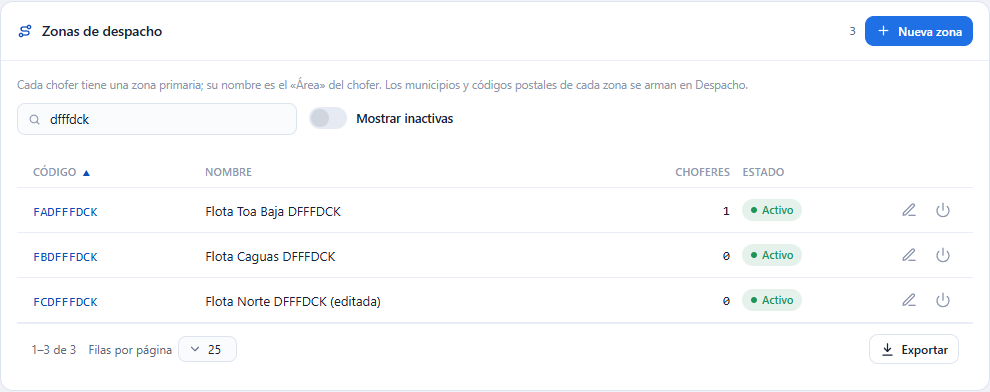

## 8. Disponibilidad

La pestaña **Disponibilidad** responde, para una **Fecha** (hoy por omisión), qué choferes y vehículos pueden salir a ruta. Con **Solo disponibles** se ven únicamente los que sí pueden. **Buscar…** filtra las dos tablas. Aquí solo se consulta: lo que falte se arregla en la ficha del chofer o del vehículo (pulse la fila para abrirla).

Cada fila trae un chip **Disponible** o **No disponible** y sus **Motivos**:

- **Bloquea**: impide despachar. Por ejemplo: «El chofer está inactivo.», «El chofer está en estatus «No disponible».», «Sin licencia vigente.», «Su licencia venció el …», «El vehículo está inactivo.», «El vehículo está en estatus «En mant.».», «Registro vencido el …» (o el documento que sea) y «Tiene la orden de trabajo … en proceso.»
- **Aviso**: conviene revisarlo, pero no impide despachar. Por ejemplo: «Licencia … vence el …», «Certificación … vencida el …» y «El vehículo no tiene documentos registrados.»

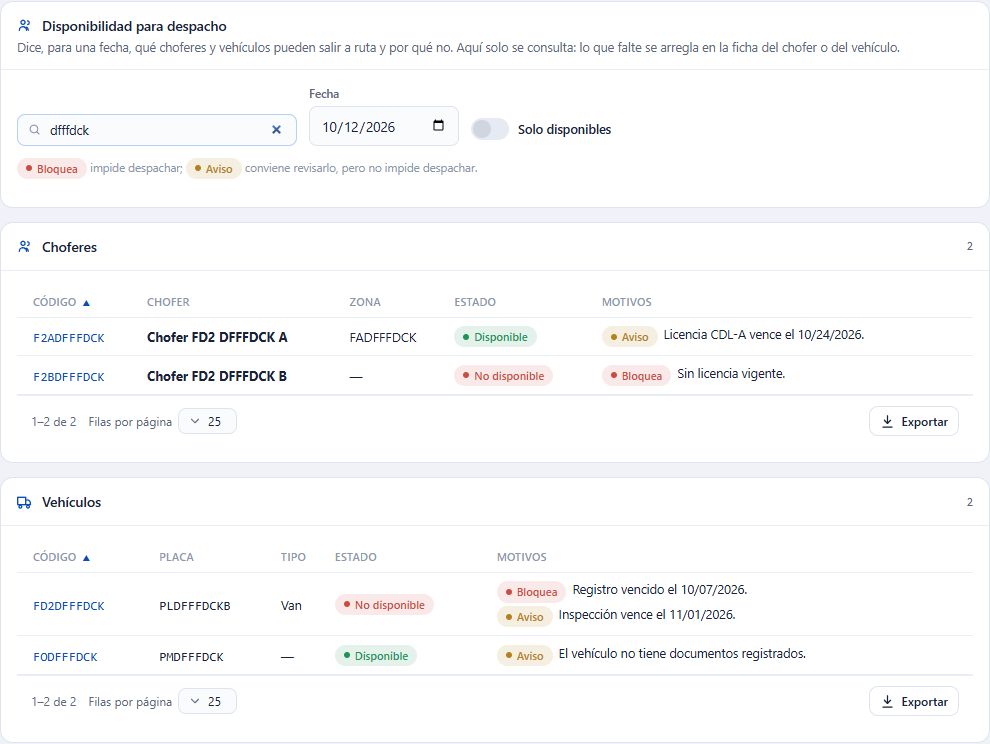

Los vehículos dados de baja ya no se muestran. El mantenimiento preventivo vencido no se evalúa aquí.

## 9. Campos personalizados, contactos e historial

- **Campos personalizados:** aparece solo si su compañía definió campos para vehículos.
- **Teléfonos y correos:** los medios de contacto del vehículo (por ejemplo, el del tercero que lo arrienda).
- **Historial de estatus:** quién cambió el estatus del vehículo, cuándo y con qué comentario.

## Errores que puede ver

| Mensaje | Qué significa | Qué hacer |
|---|---|---|
| El código del vehículo es obligatorio. | Falta el código. | Escríbalo. |
| El código no puede exceder 30 caracteres. | Código demasiado largo (en zonas, 20). | Acórtelo. |
| Ya existe un vehículo con ese código. | Otro vehículo usa ese código (aunque esté dado de baja). | Use otro código. |
| Ya existe un vehículo activo con ese VIN. | Otro vehículo activo tiene el mismo VIN. | Revise el VIN; si es el mismo vehículo, edítelo en vez de crear otro. |
| El VIN admite como máximo 40 caracteres. | VIN demasiado largo. | Corríjalo. |
| No puede exceder 20 / 60 caracteres. | Placa, marca o modelo demasiado largos. | Acórtelo. |
| La capacidad no puede ser negativa. | Peso o volumen menor que 0. | Escriba 0 o más. |
| El tope de paradas debe ser mayor o igual a 1. | Escribió 0 o menos. | Escriba 1 o más. |
| El odómetro no puede ser negativo. | Kilometraje menor que 0. | Corríjalo. |
| El odómetro no puede ser menor que la última lectura registrada (… km el …). | Intentó bajar el odómetro por debajo de una carga de combustible u orden de trabajo ya registrada. | Escriba esa lectura o una mayor. |
| El año del modelo debe estar entre 1900 y … | Año fuera de rango. | Corríjalo. |
| El valor admite como máximo N decimales y debe ser menor que … | Demasiados decimales o un valor enorme. | Corríjalo. |
| Este valor no se puede dejar vacío una vez guardado; escriba otro. | Intentó vaciar un número ya guardado. | Escriba otro valor. |
| El registro fue modificado por otro usuario; recargue e intente de nuevo. | Alguien guardó antes que usted. | Revise lo nuevo y guarde otra vez. |
| El vehículo está dado de baja definitiva; solo se consulta su historial. | Intentó cambiar un vehículo o sus documentos después de la baja. | No se puede; cree otro vehículo si hace falta. |
| El vehículo está dado de baja definitiva; no se puede reactivar. | Intentó reactivarlo. | No se puede. |
| El tipo de documento es obligatorio. | Falta elegir el documento. | Elíjalo. |
| La fecha de vencimiento no puede ser anterior a la de emisión. | Fechas al revés. | Corríjalas. |
| El código de la zona es obligatorio. / Ya existe una zona de despacho con ese código. | Falta el código o ya lo usa otra zona. | Escríbalo o use otro. |
| La zona tiene choferes asignados; reasígnelos antes de inactivarla. | La zona aún es la zona primaria de algún chofer. | Cambie la zona de esos choferes y vuelva a intentar. |
| La zona tiene rutas abiertas; ciérrelas o cámbielas de zona antes de inactivarla. | Hay rutas sin cerrar en la zona. | Ciérrelas o cámbielas de zona. |
| Escriba un número entero entre 0 y 365. | «Dentro de (días)» fuera de rango. | Corríjalo; mientras tanto se muestra la última ventana válida. |
| Falta el permiso '…'. | Su usuario no tiene ese permiso. | Pídalo al administrador. |

Las preguntas frecuentes están en la sección «Lote F-D2» del [FAQ](../faq.md).
