# Mantenimiento, órdenes de trabajo y combustible

En **Catálogo → Flota y mantenimiento** hay tres pestañas para cuidar sus vehículos:

- **Mantenimiento**: qué vehículos están al día, por vencer o vencidos en su mantenimiento preventivo, y los **programas** que definen cada cuánto toca el servicio.
- **Órdenes de trabajo**: el registro de cada servicio o reparación (tareas, proveedor y costos), con sus pasos **Iniciar**, **Cerrar orden** y **Cancelar orden**.
- **Combustible**: la bitácora de cargas de combustible, con el rendimiento (Km/L) y el costo por kilómetro.

Arriba de las pestañas hay cuatro tarjetas. Dos son de este capítulo: **Mantenimiento preventivo (vencidos)** cuenta los programas vencidos y **Órdenes de trabajo (abiertas)** cuenta las órdenes que todavía no se cierran ni se cancelan. Al pulsar una tarjeta se abre su pestaña.

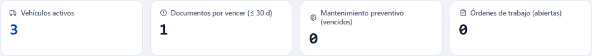

## Permisos necesarios

Cada botón aparece solo si usted tiene su permiso. Si falta alguno, pídaselo al administrador de su compañía (Sistema → Roles).

| Permiso | Qué permite |
|---|---|
| `fleet.view` | Entrar a la pantalla y consultar programas, órdenes, tareas y combustible. |
| `fleet.maintenance` | **Nuevo programa**, editar, **Desactivar** y **Reactivar** programas; **Nueva orden de trabajo**, **Guardar cambios**, tareas, **Iniciar**, **Cerrar orden** y **Cancelar orden**; **Registrar carga**, **Editar** y **Quitar** cargas de combustible. |

El módulo **Catálogo** debe estar encendido para su compañía. Nada de lo que se hace aquí borra información: lo que se quita queda en el historial.

## 1. Mantenimiento preventivo

El panel **Mantenimiento preventivo** muestra, por cada programa y cada vehículo al que aplica:

| Columna | Qué dice |
|---|---|
| **Vehículo** | La placa y, en una etiqueta, el código. |
| **Programa** | El nombre del programa. |
| **Base** | **Kilometraje**, **Tiempo** o **Ambos**. |
| **Próximo** | El kilómetro o la fecha del próximo servicio y, debajo, cuánto falta («Faltan 4,500 km», «Vencido hace 10 días»). |
| **Estado** | **Al día**, **Por vencer** (queda el 10 % o menos del intervalo), **Vencido** o **Sin historial**. |

**Sin historial** quiere decir que falta el último servicio o la lectura del odómetro del vehículo: el sistema no tiene con qué calcular. Con base **Ambos** manda el peor de los dos conteos.

Lo más urgente sale primero. Puede filtrar por **Estado** y por **Vehículo**, buscar con **Buscar…** y pulsar **Limpiar** para quitar los filtros.

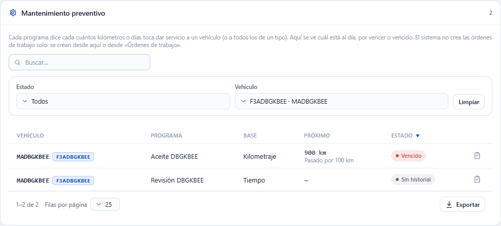

**Crear la orden de trabajo de un programa:** pulse el ícono **Crear orden de trabajo** al final de la fila. Se abre **Nueva orden de trabajo** con el vehículo y el programa ya elegidos (vea la sección 3). El sistema no crea órdenes solo.

### Programas de mantenimiento

Debajo está el panel **Programas de mantenimiento**. Un programa aplica a **un vehículo** o a **un tipo de vehículo** (por ejemplo, todas las Van), nunca a los dos.

**Crear un programa**

1. Pulse **Nuevo programa**.
2. Escriba el **Nombre**.
3. En **Aplica a** elija **Un vehículo** o **Un tipo de vehículo** y elija cuál.
4. Elija el **Disparador**: **Kilometraje**, **Tiempo** o **Ambos**.
5. Escriba **Cada (km)** y/o **Cada (días)** según el disparador.
6. En un programa de un vehículo puede indicar el **Último servicio (km)** y la **Fecha del último servicio**: son el punto de partida del conteo. En un programa por tipo no existen: el sistema usa las órdenes de trabajo cerradas de cada vehículo.
7. Pulse **Guardar**.

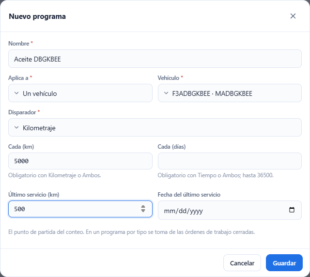

**Editar:** pulse el lápiz de la fila, cambie lo que necesite y pulse **Guardar**. Si no cambió nada, no se envía nada. Para quitar un intervalo (por ejemplo, los días de un programa que pasa a Kilometraje) deje el campo vacío. El último servicio que ya tiene valor no se puede dejar vacío: cámbielo por otro.

**Desactivar y reactivar:** **Desactivar** saca el programa del panel de vencimientos (pide confirmación y no borra nada). Active **Mostrar inactivos** para verlo y pulse **Reactivar** para devolverlo.

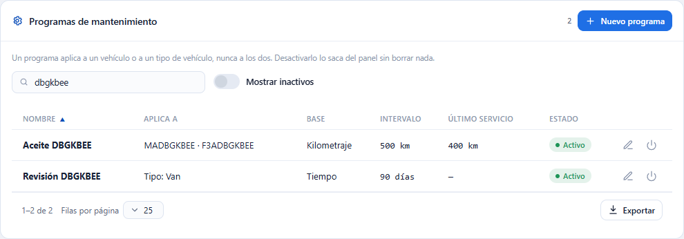

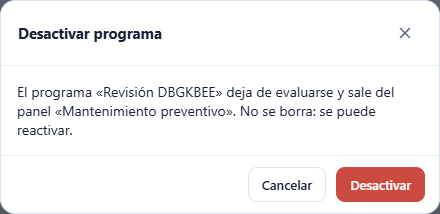

### Mensajes de error de los programas

| Mensaje | Qué significa y qué hacer |
|---|---|
| «El nombre del programa es obligatorio.» | Escriba un nombre. |
| «El nombre del programa admite como máximo 150 caracteres.» | Acorte el nombre. |
| «Indique el vehículo o el tipo de vehículo del programa, no ambos.» | Elija un vehículo o un tipo de vehículo (uno solo). |
| «El disparador del programa es obligatorio.» | Elija Kilometraje, Tiempo o Ambos. |
| «Un programa por kilometraje exige un intervalo en km mayor que 0.» | Con Kilometraje o Ambos escriba **Cada (km)** mayor que 0. |
| «Un programa por tiempo exige un intervalo en días mayor que 0.» | Con Tiempo o Ambos escriba **Cada (días)** mayor que 0. |
| «El intervalo en km debe ser mayor que 0.» / «El intervalo en días debe ser mayor que 0.» | Un intervalo escrito siempre debe ser mayor que 0; si no lo usa, déjelo vacío. |
| «El intervalo en días admite como máximo 36500.» | Escriba 36500 días o menos. |
| «El intervalo en días debe ser un número entero.» | Escriba días completos, sin decimales. |
| «La lectura del último servicio no puede ser negativa.» | Escriba 0 o más. |
| «La fecha del último servicio no puede ser futura.» | Use una fecha de hoy o anterior. |
| «El valor admite como máximo 1 decimales y debe ser menor que 100,000,000,000.» | Los kilómetros admiten un solo decimal. |
| «Este valor no se puede dejar vacío una vez guardado; escriba otro.» | El último servicio ya guardado solo se cambia por otro valor. |

## 2. Órdenes de trabajo: la lista

La pestaña **Órdenes de trabajo** muestra todas las órdenes con **Orden**, **Vehículo**, **Tipo** (Preventivo o Correctivo), **Proveedor**, **Fecha**, **Labor**, **Partes**, **Total** y **Estado**.

Los estados son **Abierta**, **En proceso**, **Cerrada** y **Cancelada**. Se puede filtrar por **Estado** (uno o varios), **Tipo**, **Vehículo** y **Fechas**, y buscar por número, placa, proveedor o estado. Si usted ordena una columna, se ordenan **todas** las órdenes del filtro, no solo las que se ven. **Exportar** saca todas las del filtro.

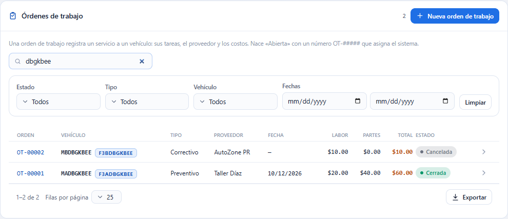

Pulse una fila (o el ícono **Ver orden**) para abrir su ficha arriba de la lista.

## 3. Crear una orden de trabajo

1. Pulse **Nueva orden de trabajo** (o el ícono **Crear orden de trabajo** de un programa).
2. Elija el **Vehículo**. Solo se ofrecen vehículos activos.
3. Elija el **Tipo de mantenimiento**, o un **Programa preventivo** de ese vehículo: con programa la orden es preventiva.
4. Si quiere, indique **Fecha programada**, **Odómetro (km)**, **Proveedor**, **Labor**, **Partes** y **Notas**. Si va a agregar tareas, deje Labor y Partes vacíos: se calculan con las tareas.
5. Pulse **Guardar**.

El sistema asigna el número **OT-#####** y la orden nace **Abierta**. Se abre su ficha automáticamente.

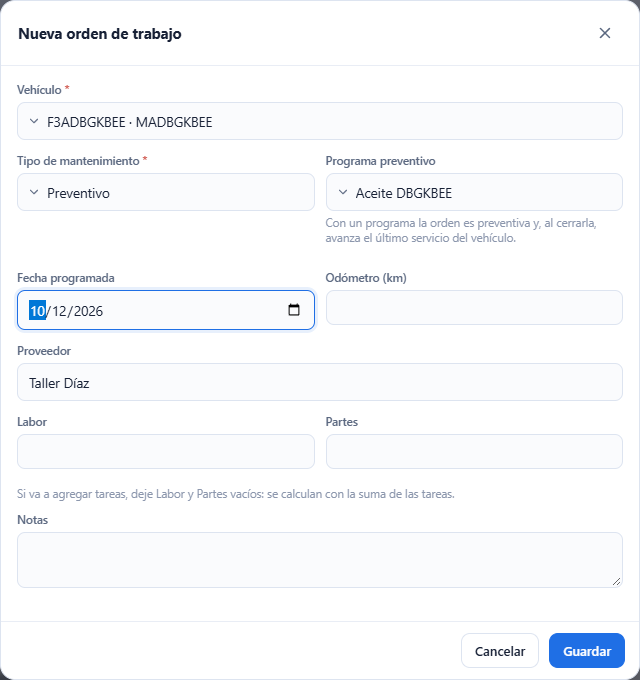

| Mensaje | Qué significa y qué hacer |
|---|---|
| «El vehículo de la orden de trabajo es obligatorio.» | Elija el vehículo. |
| «El tipo de mantenimiento es obligatorio.» | Elija el tipo o un programa. |
| «Una orden correctiva no se asocia a un programa preventivo.» | Con programa el tipo debe ser Preventivo: cambie el tipo o quite el programa. |
| «El programa de mantenimiento no aplica a este vehículo.» | El programa es de otro vehículo o de otro tipo. |
| «El programa de mantenimiento está inactivo.» | Reactívelo en **Programas de mantenimiento** o elija otro. |
| «El vehículo está inactivo; reactívelo para registrar órdenes de trabajo o cargas de combustible.» | Reactive el vehículo en su ficha. Un vehículo dado de baja no admite órdenes. |
| «Los costos no pueden ser negativos.» | Escriba 0 o más. |
| «El proveedor admite como máximo 150 caracteres.» | Acorte el texto. |

## 4. La ficha de la orden

Arriba de la lista se ven el estado, el vehículo, el tipo y el programa, los botones de acción y los datos de la orden: **Fecha programada**, **Odómetro (km)**, **Proveedor**, **Labor**, **Partes**, **Total** y **Notas**.

- Los datos se editan con un solo **Guardar cambios**, que se enciende cuando usted cambia algo.
- Mientras la orden tenga **tareas**, **Labor** y **Partes** son la suma de las tareas y no se capturan aquí. Si la orden tenía costos escritos a mano y usted agrega su primera tarea, esos costos se reemplazan por los de la tarea.
- Una orden **Cerrada** o **Cancelada** solo se consulta: «Esta orden está en estatus «Cerrada» y solo se consulta.»
- **Cerrar ficha** la oculta.

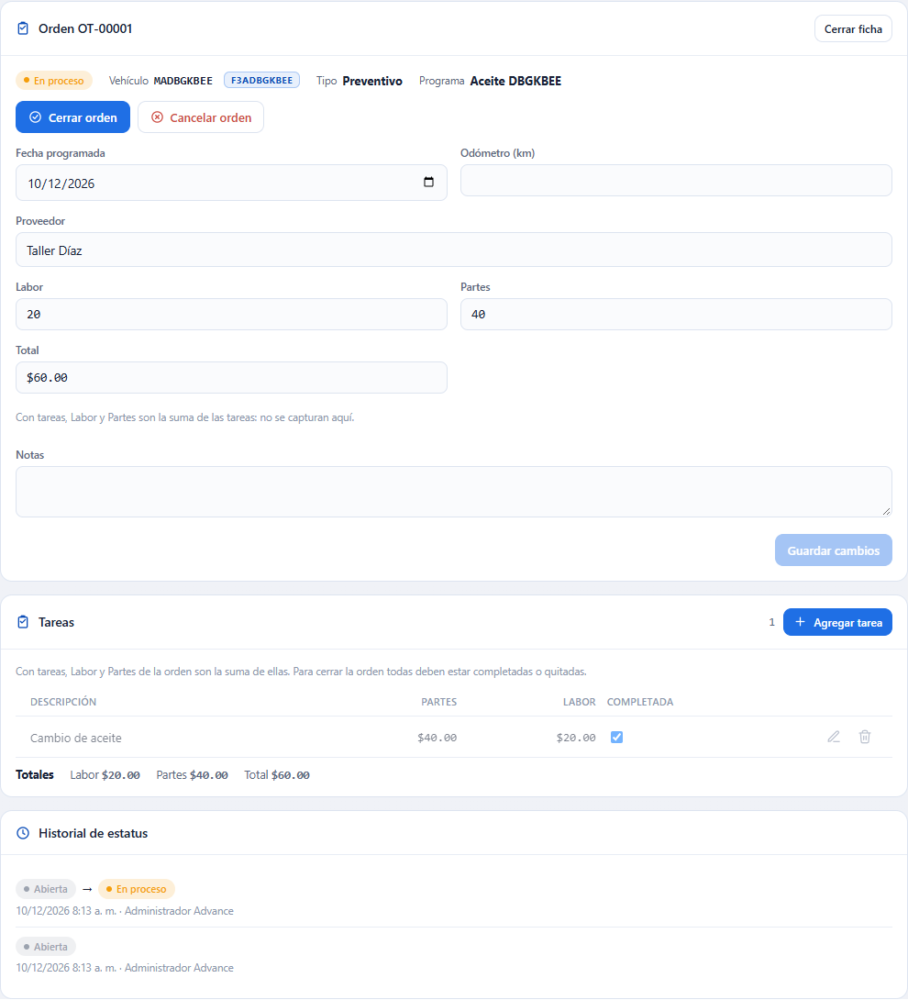

Si otra persona cambió la orden mientras usted la editaba aparece «El registro fue modificado por otro usuario; recargue e intente de nuevo.» y se conserva lo que usted escribió: revise y pulse **Guardar cambios** otra vez.

### Tareas

1. Pulse **Agregar tarea**.
2. Escriba la **Descripción** y, si quiere, **Partes** y **Labor**.
3. Pulse **Guardar**.

La casilla **Completada** marca una tarea como hecha. El lápiz la edita y **Quitar** la saca de la orden (pide confirmación; los costos de esa tarea dejan de sumar). Debajo de la tabla ve los **Totales**.

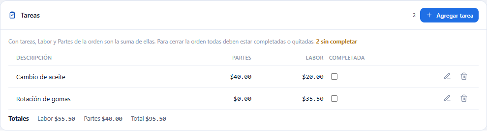

| Mensaje | Qué significa y qué hacer |
|---|---|
| «La descripción de la tarea es obligatoria.» | Escriba qué se hace. |
| «La descripción de la tarea admite como máximo 250 caracteres.» | Acórtela. |
| «Los costos no pueden ser negativos.» | Escriba 0 o más. |
| «La orden tiene tareas: los costos de labor y partes se calculan con la suma de sus tareas.» | No escriba Labor ni Partes en la orden: cámbielos en las tareas. |
| «El estatus actual no permite la acción 'EDIT_WORK_ORDER'.» | La orden está cerrada o cancelada y ya no se edita. |

## 5. Iniciar, cerrar y cancelar

| Botón | Cuándo aparece | Qué hace |
|---|---|---|
| **Iniciar** | Orden **Abierta** | Pasa a **En proceso**. El vehículo pasa a **En mantenimiento** y sale de la disponibilidad para despacho. |
| **Cerrar orden** | Abierta o En proceso | Pasa a **Cerrada**. El vehículo vuelve a **Disponible** si no tiene otra orden en proceso, su odómetro sube a la lectura de cierre y, si el programa es de un solo vehículo, avanza su último servicio. |
| **Cancelar orden** | Abierta o En proceso | Pasa a **Cancelada**. El vehículo vuelve a **Disponible** si estaba en mantenimiento por esa orden. |

Ninguno de los tres se puede deshacer.

**Iniciar** pide confirmar y le explica el efecto en el vehículo.

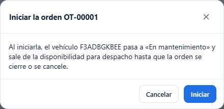

Con la orden en proceso, en **Disponibilidad** el vehículo sale **No disponible** con el motivo «Tiene la orden de trabajo OT-… en proceso.»

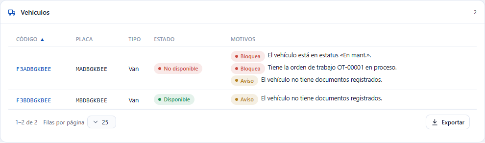

**Cerrar orden** abre una ventana con la **Fecha de cierre** (hoy por omisión), el **Odómetro al cerrar (km)** y un **Comentario (opcional)**. Si el programa de la orden es por kilometraje (o Ambos), el odómetro es obligatorio. Antes de cerrar, todas las tareas deben estar completadas o quitadas.

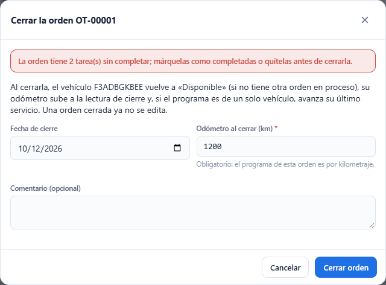

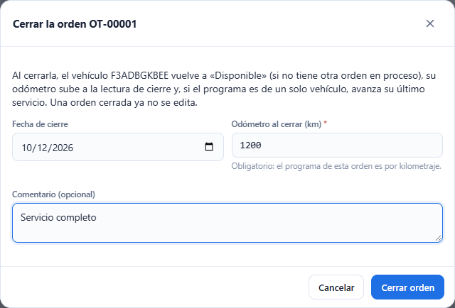

Una orden cerrada queda de solo lectura.

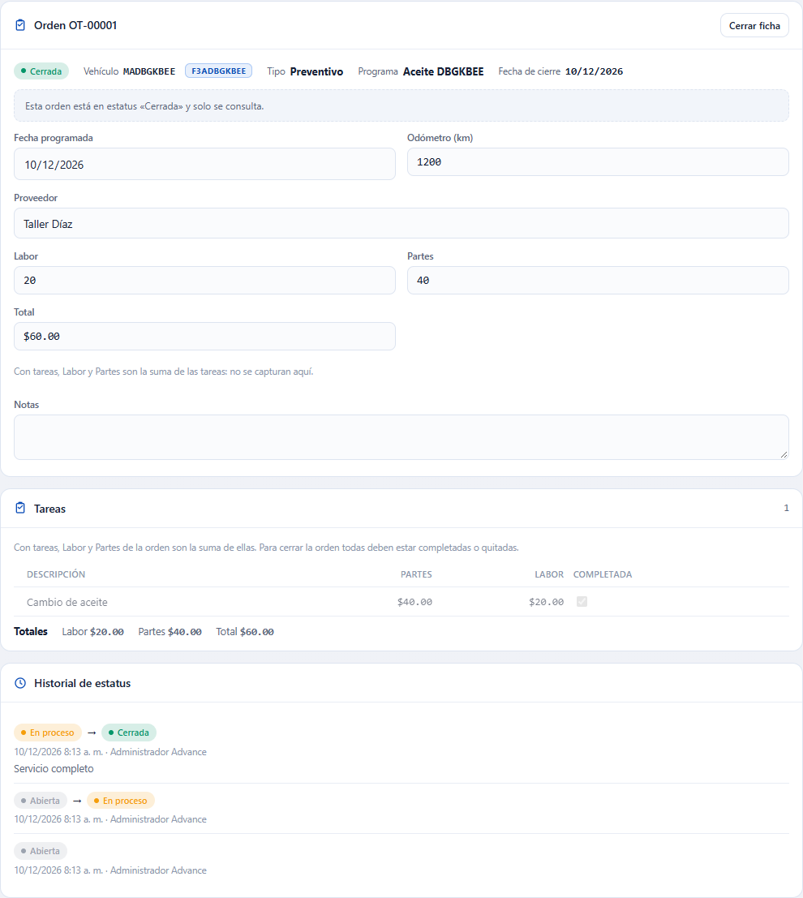

**Cancelar orden** pide confirmar y admite un **Comentario (opcional)**.

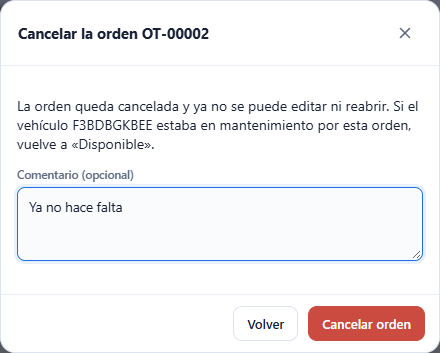

| Mensaje | Qué significa y qué hacer |
|---|---|
| «La orden tiene N tarea(s) sin completar; márquelas como completadas o quítelas antes de cerrarla.» | Marque **Completada** o **Quitar** esas tareas y cierre de nuevo. |
| «Indique la lectura de odómetro para cerrar una orden de un programa por kilometraje.» | Escriba el **Odómetro al cerrar (km)**. |
| «La fecha de cierre no puede ser futura.» | Use hoy o una fecha anterior. |
| «El odómetro no puede ser negativo.» | Escriba 0 o más. |
| «El comentario admite como máximo 500 caracteres.» | Acórtelo. |

## 6. Combustible

La pestaña **Combustible** tiene la bitácora de cargas y, debajo, el **Resumen por vehículo**.

La tabla muestra **Fecha**, **Vehículo**, **Chofer**, **Estación**, **Litros**, **Costo**, **Km recorridos**, **Km/L** y **Costo/km**. Los tres últimos **no se escriben**: el sistema compara cada carga con la anterior que tenga odómetro del mismo vehículo. La primera carga de un vehículo no tiene con qué compararse y muestra «—». Las cargas sin odómetro suman sus litros y su costo al tramo siguiente.

Puede filtrar por **Vehículo**, **Chofer** y **Fechas** (el último día entra completo). La tabla se pagina de a 25, 50 o 100; si ordena una columna se ordenan **todas** las cargas del filtro, y **Exportar** saca todas.

El **Resumen por vehículo** suma todas las cargas del filtro (no solo las de la página): cargas, litros, costo, km recorridos, Km/L y Costo/km.

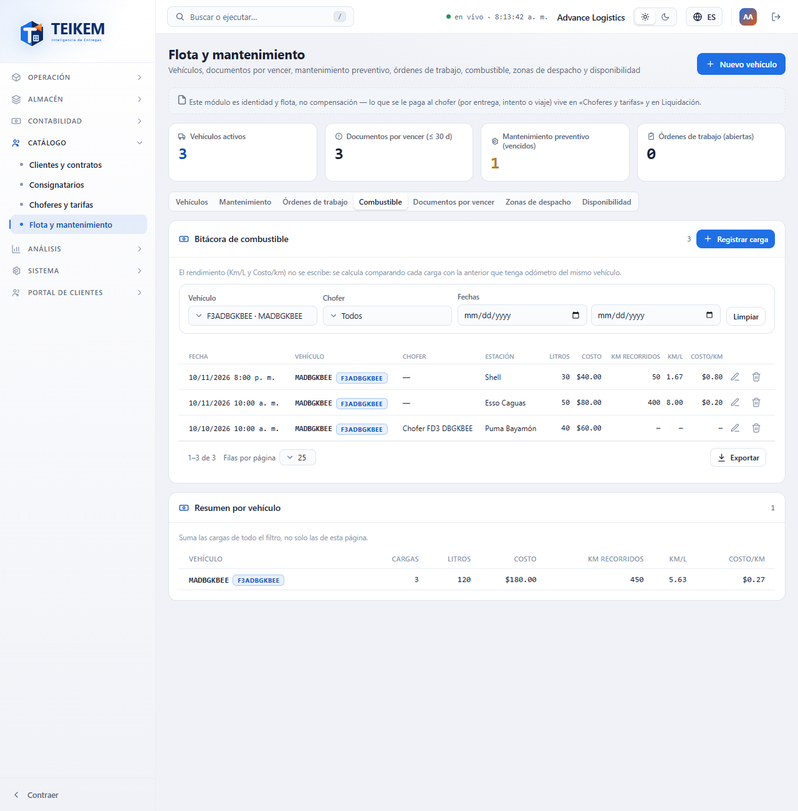

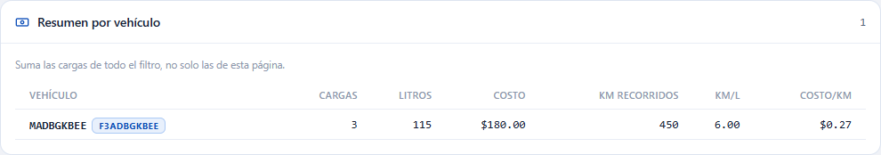

### Registrar una carga

1. Pulse **Registrar carga**.
2. Elija el **Vehículo** (si filtró por uno, ya viene elegido).
3. Indique la **Fecha** y la **Hora** (hora de su compañía; por omisión, ahora).
4. Escriba los **Litros** y el **Costo total**.
5. Si quiere, el **Odómetro (km)**, el **Chofer** y la **Estación**.
6. Pulse **Guardar**.

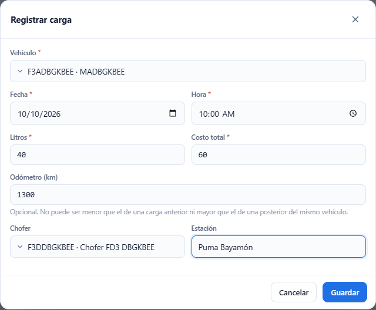

El **Odómetro** debe ser coherente con las demás cargas del vehículo: no puede ser menor que el de una carga anterior ni mayor que el de una posterior. Si no lo es, el mensaje sale bajo el campo y la ventana sigue abierta.

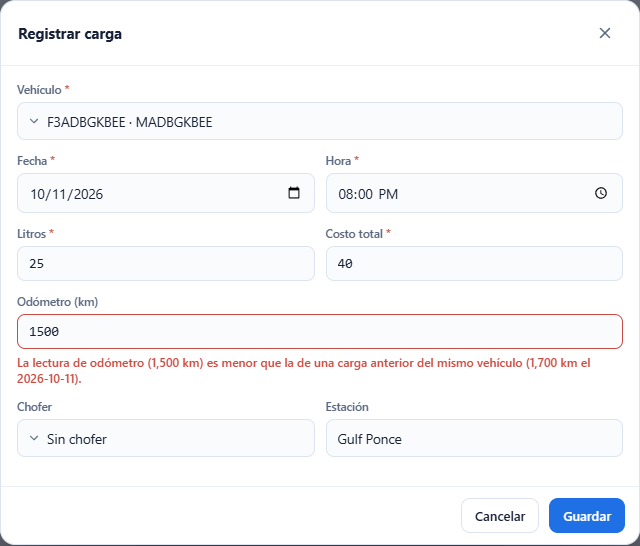

Cada carga con odómetro sube el odómetro del vehículo si la lectura es mayor; nunca lo baja. Esa lectura puede adelantar un vencimiento del mantenimiento.

**Editar** corrige una carga (el **Vehículo** no se puede cambiar: quite la carga y registre otra). **Quitar** pide confirmación, saca la carga de la bitácora y del rendimiento y **no** baja el odómetro del vehículo.

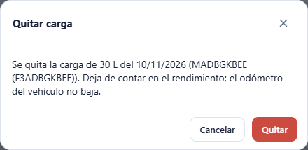

| Mensaje | Qué significa y qué hacer |
|---|---|
| «El vehículo de la carga es obligatorio.» | Elija el vehículo. |
| «La fecha de la carga es obligatoria.» / «La hora de la carga es obligatoria.» | Indique la fecha y la hora. |
| «La fecha de la carga no puede ser futura.» | Use ahora o una fecha anterior (se toleran 5 minutos). |
| «Los litros deben ser mayores que 0.» | Escriba los litros cargados. |
| «Indique el costo total de la carga.» | Escriba el costo (puede ser 0). |
| «El costo total no puede ser negativo.» | Escriba 0 o más. |
| «El odómetro no puede ser negativo.» | Escriba 0 o más. |
| «La lectura de odómetro (1,500 km) es menor que la de una carga anterior del mismo vehículo (1,700 km el 2026-10-11).» | Revise la lectura; debe estar entre la anterior y la posterior del vehículo. |
| «La lectura de odómetro (… km) es mayor que la de una carga posterior del mismo vehículo (… km el …).» | Igual: la lectura es mayor que la de una carga más reciente. |
| «La estación admite como máximo 150 caracteres.» | Acórtela. |
| «La carga de combustible está inactiva; no se puede corregir.» | La carga ya fue quitada. |
| «El vehículo está inactivo; reactívelo para registrar órdenes de trabajo o cargas de combustible.» | Reactive el vehículo en su ficha. |

## Si algo no sale como espera

Las preguntas más comunes están en las [preguntas frecuentes](../faq.md), sección «Lote F-D3 — Mantenimiento y combustible». La referencia completa del servidor está en el [capítulo 04](../04-flota-choferes-mantenimiento.md).
