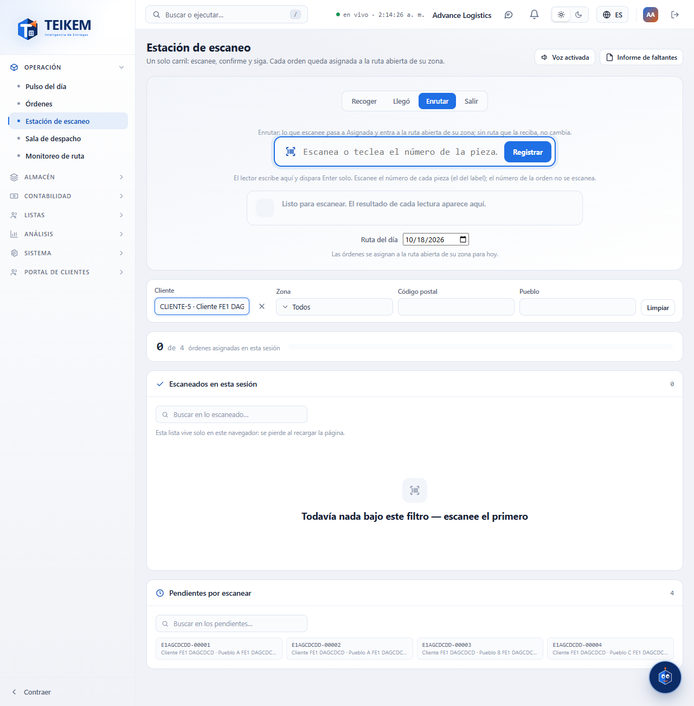
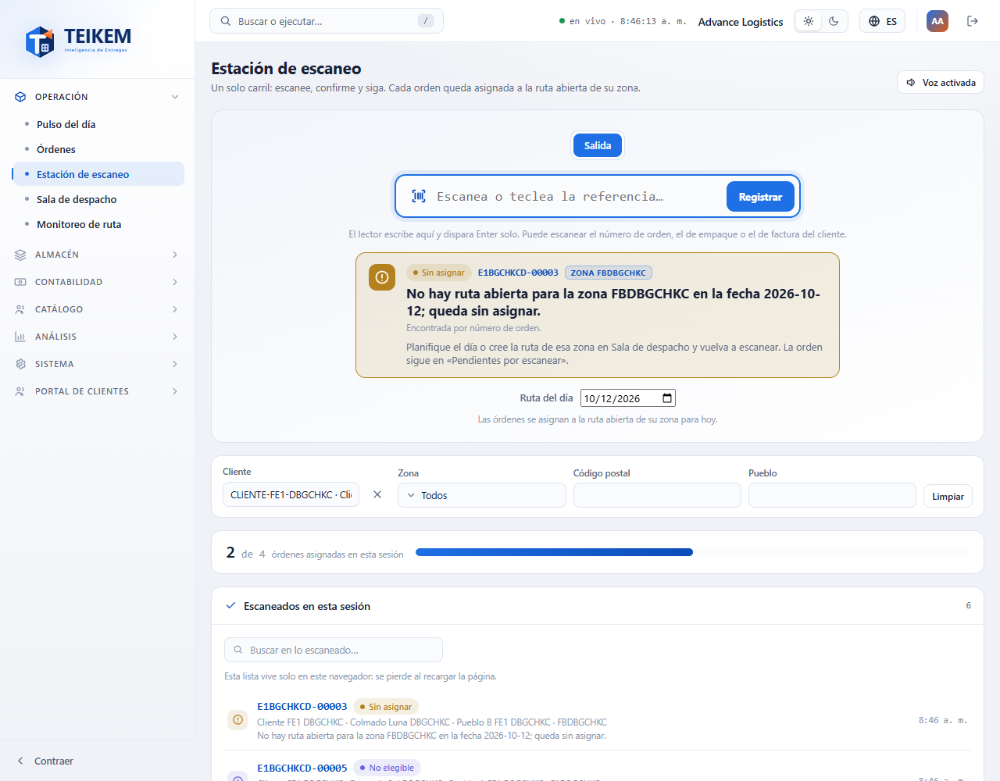
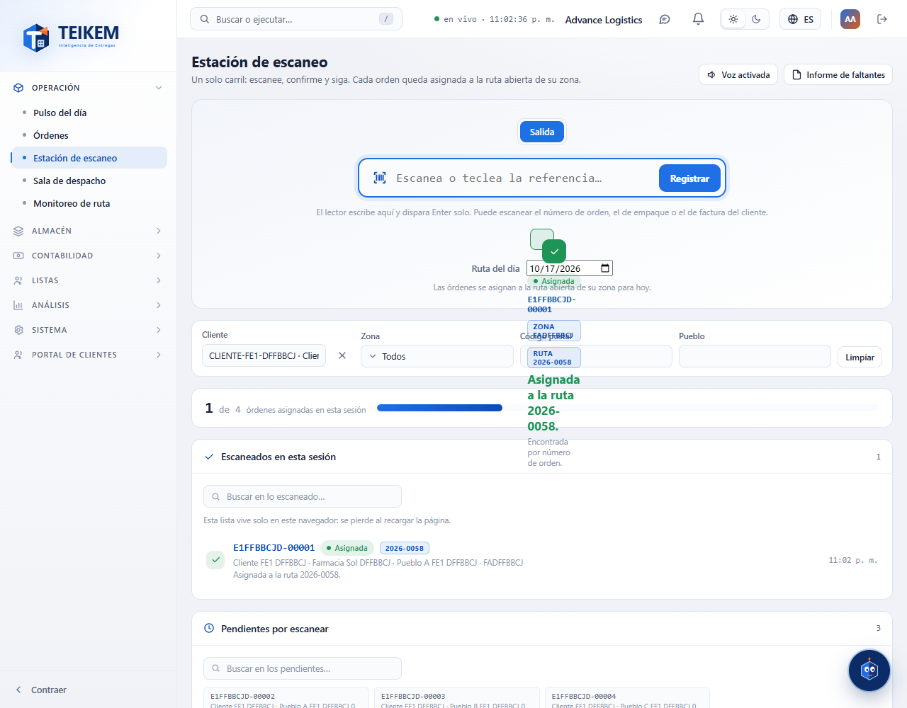
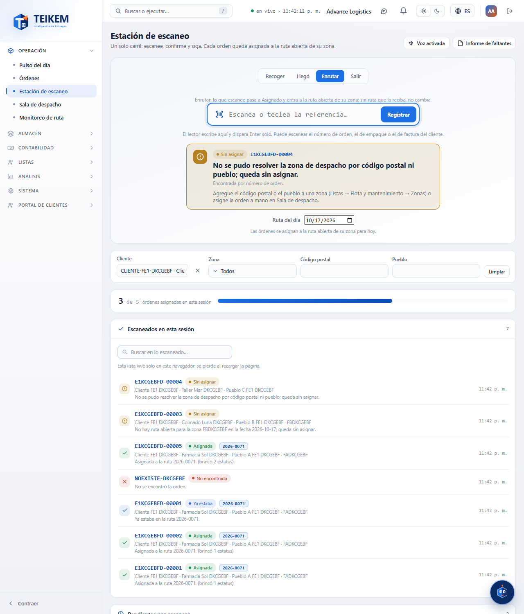
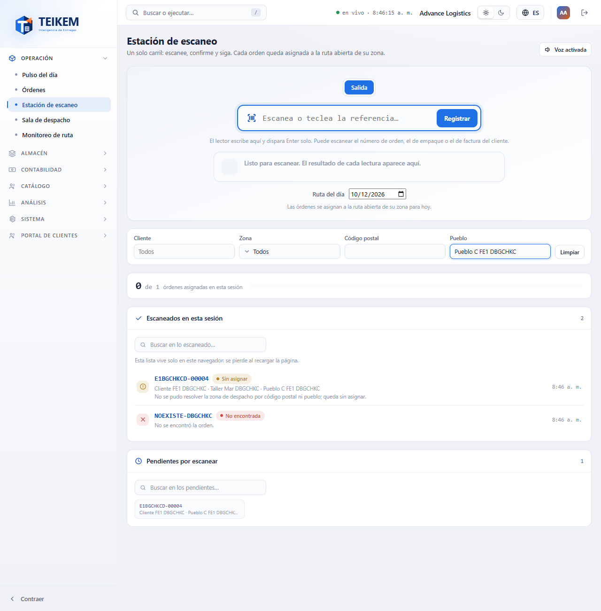
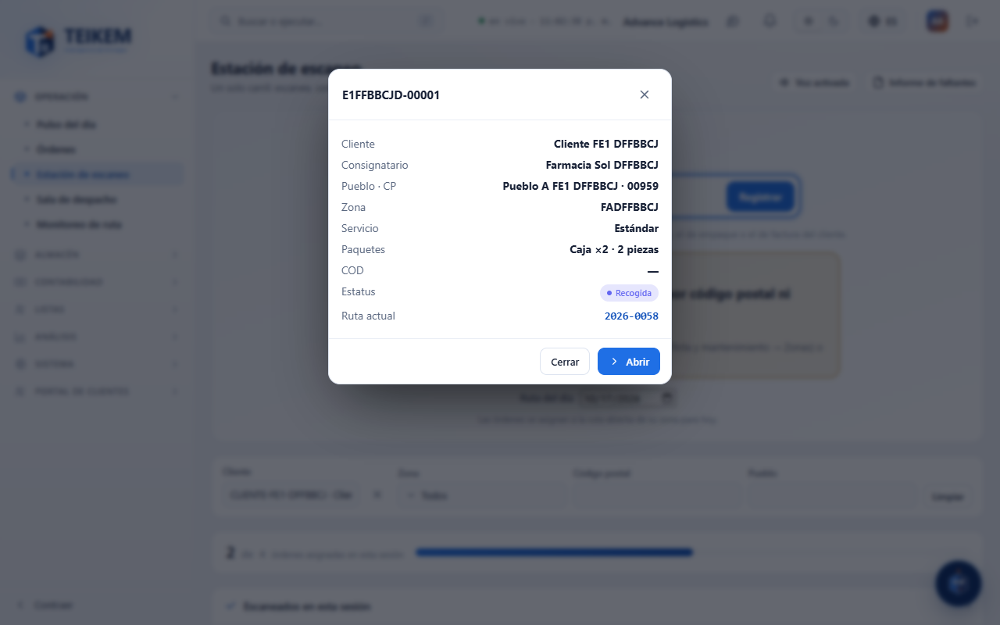

# Estación de escaneo (salida)

La **Estación de escaneo** (menú Operación → **Estación de escaneo**) sirve para pasar cada paquete por el lector y dejar su orden asignada a la ruta del día de su zona, sin abrir una orden por una. Escanea, mira el resultado y sigue con el siguiente.

Lo que hace y lo que **no** hace: asigna la orden a una ruta que **ya existe y está abierta**. No crea rutas, no cambia el chofer ni el vehículo y no cambia el estatus de la orden.

## Quién puede usarla

| Para… | Permiso | Módulo |
|---|---|---|
| Entrar a la pantalla y escanear | `trips.scan` | Operación de carga (LTL) |
| Ver «Pendientes por escanear», los filtros y el medidor «N de M» | `trips.view` | Operación de carga (LTL) |
| Filtrar por **Zona** | `fleet.view` | Lista |
| Filtrar por **Cliente** | `clients.read` | Lista |
| Ver los datos de la orden en la ventana y usar **Abrir** | `orders.view` | Operación de carga (LTL) |

Sin `trips.view` la pantalla sigue escaneando: solo desaparecen los pendientes y los filtros, y el medidor muestra únicamente cuántas llevas. Un filtro al que le falta permiso simplemente no aparece.

## Escanear

1. Entra a **Estación de escaneo**. El cursor ya está en la casilla grande («Escanea o teclea la referencia…»).
2. Escanea con el lector (escribe el código y pulsa Enter solo) o teclea el código y pulsa **Enter** o el botón **Registrar**.
3. Mira el resultado grande que aparece debajo de la casilla. Si el sonido está activo, la estación dice «Sí», «No» o «Ya».
4. El cursor vuelve solo a la casilla: escanea el siguiente.

Puedes escanear el **número de orden**, el **número de empaque** o el **número de factura del cliente** (se busca en ese orden). Si varios lectores llegan juntos, cada lectura se registra en el orden en que llegó.

### Ruta del día

Bajo la casilla está **Ruta del día**: por omisión es hoy. Las órdenes se asignan a la ruta abierta de su zona **para esa fecha**. Para trabajar con las rutas de otro día elige la fecha; **Hoy** vuelve a la de hoy.

### Qué significa cada resultado

| Resultado | Qué dice la pantalla | Qué significa y qué hacer |
|---|---|---|
| **Asignada** (verde) | `Asignada a la ruta {código}.` | La orden quedó en la ruta de su zona. Siga con la siguiente. |
| **Ya estaba** (azul) | `Ya estaba en la ruta {código}.` | La orden ya tenía ruta. No hace falta hacer nada. |
| **No encontrada** (rojo) | `No se encontró la orden.` | Ningún número de orden, empaque ni factura coincide. Revise el código o escanee el empaque. |
| **No encontrada** (rojo) | `Hay varias órdenes con ese código; escanee el empaque.` | El número lo comparten órdenes de distintos clientes. Escanee el número del empaque, que es único. |
| **No elegible** (morado) | El motivo (ver abajo) | La orden no puede ir en una ruta todavía. Arregle su estatus en **Órdenes** y escanee de nuevo. |
| **Sin asignar** (ámbar) | `No se pudo resolver la zona de despacho por código postal ni pueblo; queda sin asignar.` | La dirección no pertenece a ninguna zona. Agregue su código postal o pueblo a una zona (Listas → Flota y mantenimiento → Zonas) o asigne la orden a mano en **Sala de despacho**. |
| **Sin asignar** (ámbar) | `El código postal o pueblo pertenece a varias zonas ({códigos}); queda sin asignar.` | Deje esa dirección en una sola zona o asigne la orden a mano en **Sala de despacho**. |
| **Sin asignar** (ámbar) | `No hay ruta abierta para la zona {código} en la fecha {fecha}; queda sin asignar.` | Planifique el día o cree la ruta de esa zona en **Sala de despacho** y escanee de nuevo. La orden sigue en «Pendientes por escanear». |

Motivos de **No elegible** (mensaje exacto del servidor):

- `La orden ya salió a ruta o terminó; no se puede asignar a otra ruta.` — la orden ya va en camino, terminó o está inactiva.
- `Las entregas especiales se asignan al chofer desde la orden; no pasan por Sala de despacho.` — asígnele el chofer desde la orden.
- `La orden está en Entrada; confírmela antes de asignarla a una ruta.` — confirme la orden.
- `La orden está en '{estatus}'; regrésela al pipeline antes de asignarla a una ruta.` — la orden está en un estatus lateral (por ejemplo, En espera); devuélvala a su flujo normal.
- `El estatus actual no permite la acción 'ASSIGN_TRIP'.` — el estatus de la orden no admite asignarla a una ruta.
- `La orden no tiene una parada de entrega pendiente.` — la orden no tiene entrega por hacer.

### Avisos del código

Estos avisos salen en el mismo recuadro y **no** registran nada:

| Aviso | Qué hacer |
|---|---|
| `Escanee o escriba un código.` | Escribió Enter con la casilla vacía. Escanee o teclee el código. |
| `El código no puede exceder 40 caracteres.` | El código es demasiado largo; revise que sea el correcto. |

Si el servidor o la red fallan, el recuadro dice **No se registró** con el motivo; la lectura no queda en la lista y puede volver a escanearla.

## Medidor «N de M»

Muestra cuántas órdenes **distintas** asignó en esta sesión (N) contra ese total más las que siguen pendientes con el filtro actual (M), con una barra de avance. Volver a escanear una orden que ya estaba no suma.

## Escaneados en esta sesión

Lista de cada lectura de esta sesión, la más reciente arriba: referencia, resultado, cliente, consignatario, pueblo, zona, ruta y hora. El buscador filtra por cualquiera de esos datos. Pulse una fila para ver la orden.

- La lista vive **solo en este navegador**: se pierde al recargar la página, al cerrar sesión o al cambiar de compañía. No hay historial de escaneos guardado.
- Abrir una orden y volver con «Atrás» **no** la borra.
- Un código que no era de ninguna orden se queda en la lista aunque haya filtros activos.

## Pendientes por escanear

Son las órdenes sin ruta que el escaneo puede asignar. Cada recuadro muestra el número de la orden, el cliente, el pueblo con su código postal y la zona (o «Sin zona» / «Zona ambigua»). Pulse uno para ver la orden. El buscador filtra lo que se ve. Si hay más de 500, avisa cuántas se muestran: use los filtros.

### Filtros

| Filtro | Qué hace |
|---|---|
| **Cliente** | Solo órdenes de ese cliente (necesita `clients.read`). |
| **Zona** | Una zona, o **Sin zona** (necesita `fleet.view`). |
| **Código postal** | Códigos que empiezan con lo escrito. |
| **Pueblo** | Pueblo escrito (sin importar acentos ni mayúsculas). |

**Limpiar** quita todos. Los filtros acotan también el medidor y la lista de la sesión.

## Ver la orden

Pulse una fila de la sesión o un pendiente: se abre una ventana con cliente, consignatario, pueblo y código postal, zona, servicio, paquetes, COD, estatus y la ruta actual. **Abrir** (solo con `orders.view`) lleva al expediente de la orden. Sin ese permiso la ventana muestra solo lo que ya se sabía de la orden.

## Sonido

El botón **Voz activada / Voz silenciada** (arriba a la derecha) enciende o apaga la voz: «Sí» cuando la orden se encontró, «No» cuando no se encontró o no es elegible y «Ya» cuando ya estaba. Se recuerda en este navegador. Si el navegador no sabe hablar, el botón dice **Voz no disponible** y los resultados se ven igual en pantalla.

## Qué no incluye

Esta pantalla solo tiene el modo **Salida**. Los modos de entrada y de cuadre de cobros y los filtros «¿Con COD?» y «Ruta» de la maqueta no
existen todavía. El **Informe de faltantes** sí (botón junto a la voz, desde F-G2): ver [F-G2 — Labels y documentos](fg2-labels-y-documentos.md).
Desde F-G2 también se puede escanear el **número de paquete** que trae el label de cada pieza.

## Preguntas frecuentes

Ver la sección «Lote F-E1» de [faq.md](../faq.md).
