# Sala de despacho

La **Sala de despacho** (menú Operación → **Sala de despacho**) sirve para armar las rutas del día: decidir qué órdenes van en cada ruta, quién las lleva y en qué vehículo, ordenar las paradas, optimizar, despachar, dar la salida y cerrar la ruta cuando todo terminó.

La ruta activa muestra un **plano esquemático** con sus paradas numeradas, y el orden de las paradas se cambia **arrastrando** o con los botones ▲ y ▼. Cuando a una parada le falta la ubicación (o está mal), se le puede **poner un pin manual**. El plano no es un mapa con calles: muestra dónde queda cada parada con respecto a las demás. El seguimiento en vivo de las rutas en camino llegará con el Monitoreo.

## Quién puede usarla

| Para… | Permiso | Módulo |
|---|---|---|
| Entrar a la pantalla y **Despachar ruta**, **Iniciar ruta** | `trips.dispatch` | Operación de carga (LTL) |
| Ver rutas, el plano de la ruta, órdenes sin asignar y el avance | `trips.view` | Operación de carga (LTL) |
| **Planificar el día**, **Nueva ruta**, **Reasignar por zona**, añadir, quitar y reordenar órdenes (arrastrando o con ▲ ▼), **Poner pin** y **Mover pin**, cambiar chofer o vehículo, **Eliminar ruta** | `trips.plan` | Operación de carga (LTL) |
| **Optimizar** | `trips.optimize` | Operación de carga (LTL) |
| **Cerrar ruta** | `trips.close` | Operación de carga (LTL) |
| Elegir chofer, vehículo y zona; ver el panel **Choferes** | `fleet.view` | Lista |
| Filtrar por **Cliente** | `clients.read` | Lista |

Un botón que no es suyo simplemente no aparece. Si le falta `fleet.view`, la pantalla funciona igual: el chofer y el vehículo se ven como texto, y se le explica que no puede cambiarlos desde aquí.

## La pantalla

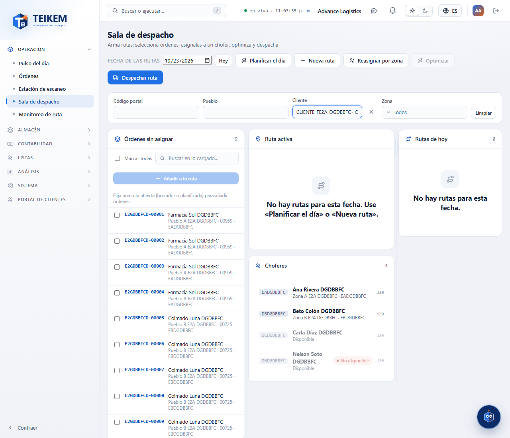

Arriba están la **Fecha de las rutas** (hoy por omisión; **Hoy** vuelve a hoy) y los botones. Debajo, los filtros de las órdenes sin asignar y tres columnas:

- **Envíos sin asignar** (izquierda): las órdenes ya recogidas (no las Sometidas) que todavía no tienen ruta.
- **Ruta activa** (centro): la ruta que está trabajando, con su chofer, vehículo, avisos y órdenes. Debajo, el panel **Choferes**.
- **Rutas de hoy** (derecha): una tarjeta por ruta de la fecha. Toque una para hacerla la ruta activa.

En un celular las columnas se apilan una sobre otra. En una pantalla ancha puede arrastrar las barras entre columnas para cambiar su ancho.

La ruta que está viendo y la fecha quedan en la dirección de la página: puede recargar o copiar el enlace y vuelve a lo mismo.

## Planificar el día

1. Pulse **Planificar el día**.
2. Elija la **Fecha**. En **Zonas** elija las que quiere planificar; si no elige ninguna, se planifican todas las zonas activas.
3. Si quiere que se cree la ruta de cada zona aunque no tenga órdenes (para que la estación de escaneo tenga destino desde temprano), active **Crear rutas vacías**.
4. Pulse **Planificar**.

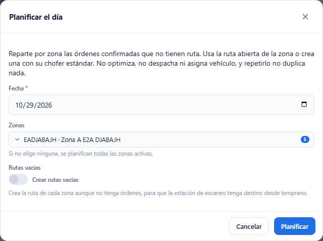

El sistema reparte por zona las órdenes ya recogidas que no tienen ruta. Usa la ruta abierta de la zona o crea una con el **chofer estándar** de la zona. **No** optimiza, **no** despacha y **no** asigna vehículo, y repetirlo no duplica nada.

Al terminar verá el resumen: **Rutas creadas**, **Envíos asignados**, **Envíos omitidos** y **Envíos sin zona**, y por cada zona sus avisos (por ejemplo, una orden que no se pudo asignar y por qué). Las órdenes sin zona o con zona ambigua no se tocan: arregle la zona en la lista.

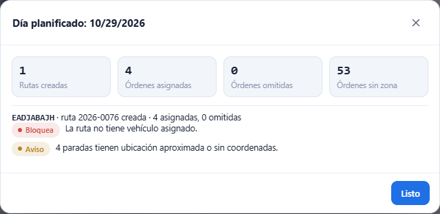

## Crear una ruta a mano

1. Pulse **Nueva ruta**.
2. Elija la **Fecha de la ruta** (desde ayer hasta 60 días adelante).
3. Opcionalmente elija **Zona de despacho**, **Chofer**, **Vehículo** y **Hora de salida**. Sin chofer, se usa el chofer estándar de la zona. Sin hora de salida, sale a las 12:00 UTC (8:00 a. m. en Puerto Rico).
4. Pulse **Crear ruta**. La ruta nueva queda como la ruta activa.

En la lista de choferes y vehículos, los que no están disponibles en esa fecha dicen **no disponible**. Si elige uno, el sistema le contesta con el motivo y no crea la ruta.

## Añadir órdenes a la ruta

1. Elija la ruta activa en **Rutas de hoy**. Debe estar en **Borrador** o **Planificado**.
2. En **Envíos sin asignar** marque las órdenes (o **Marcar todas**). Puede reducir la lista con los filtros **Código postal**, **Pueblo**, **Cliente** y **Zona**, y con el buscador.
3. Pulse **Añadir a la ruta (N)**. Se añaden todas o ninguna.

Cada fila muestra el número de la orden, el consignatario y «pueblo · código postal · zona». Una orden sin zona dice **Sin zona**.

Se piden hasta 500 órdenes; si hay más, la pantalla lo avisa y puede afinar los filtros. Se pueden añadir hasta 200 por vez y una ruta admite hasta 300 paradas.

Si alguna orden no se puede asignar, no se añade ninguna y verá cada número con su motivo. La selección se conserva: quite las que fallaron y pulse otra vez.

### Mensajes al añadir

| Mensaje | Qué significa y qué hacer |
|---|---|
| `Hay envíos que no se pueden asignar a la ruta.` y, debajo, `{orden}: {motivo}` | Una o más órdenes no son elegibles. El motivo dice por qué (por ejemplo `El envío está en Sometida; márquelo como recogido antes de asignarlo a una ruta.` o `El estatus actual no permite la acción 'ASSIGN_TRIP'.`). Corrija la orden o quítela de la selección. |
| `El envío ya está en esta ruta.` | Esa orden ya estaba en la ruta. |
| `La orden ya está asignada a la ruta {código}.` | Otra persona la asignó antes que usted. Se actualiza la lista. |
| `Una ruta admite como máximo 300 paradas.` | La ruta está llena. Use otra ruta. |
| `Agregue como máximo 200 envíos por solicitud.` | Marcó más de 200. Añada en dos tandas. |
| `La ruta {código} ya fue despachada; no se puede editar ni eliminar.` | La ruta ya salió del borrador: su contenido está congelado. |

## El plano de la ruta

Arriba de la ruta activa, debajo del título, está el **plano de la ruta**.

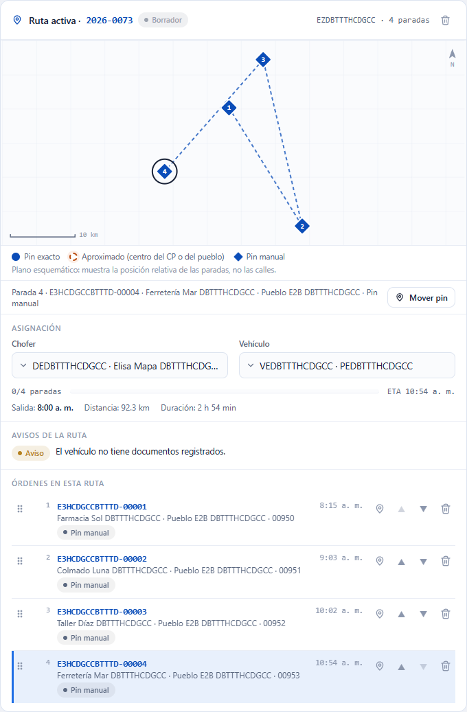

- Cada parada que tiene ubicación es un **pin numerado** con su lugar en la secuencia (1, 2, 3…). Una línea punteada une los pines en el orden de la ruta.
- El **tipo de pin** dice qué tan segura es la ubicación:
  - **Pin exacto**: círculo lleno. La dirección se ubicó con precisión.
  - **Aproximado**: círculo punteado con halo. Se usó el centro del código postal o del pueblo, así que la parada puede estar en otro lugar de ese pueblo.
  - **Pin manual**: rombo. Alguien puso la ubicación a mano.
- Abajo a la izquierda está la **escala** (por ejemplo, 5 km) y arriba a la derecha el **norte**.
- Las paradas que **no tienen ubicación** no se dibujan; se listan debajo del plano como **Sin ubicación: N**, y siguen apareciendo en la lista de órdenes.
- Cuando una ruta ya está en camino, los pines cambian de color según la parada: **Entregada** (verde), **Fallida** (rojo) y **En curso** (azul oscuro con aro). La leyenda solo nombra los que aparecen.
- Es un plano **esquemático**: no tiene calles ni imagen de satélite. Sirve para ver cómo quedan las paradas unas respecto a otras, no para saber cómo llegar.

Si **ninguna** parada tiene ubicación todavía, el plano lo dice:

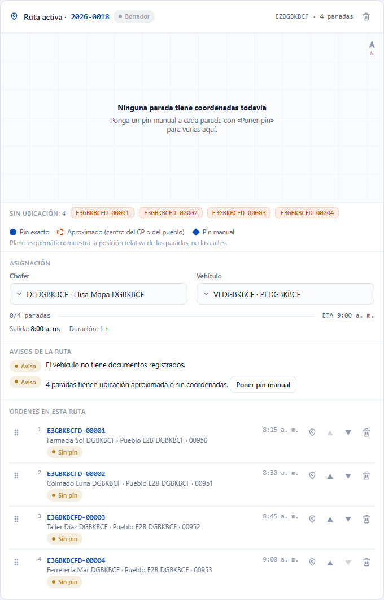

> **Ninguna parada tiene coordenadas todavía.** Ponga un pin manual a cada parada con «Poner pin» para verlas aquí.

Si usted no puede poner pines (le falta el permiso `trips.plan`), el mensaje le pide que se lo pida a quien planifica la ruta.

### Elegir una parada

Pulse un pin (o pulse **Tab** hasta llegar a él y **Enter** o la barra espaciadora) para elegir esa parada: el pin se rodea con un aro, su orden se resalta en **Envíos en esta ruta** y debajo del plano aparece un resumen («Parada 4 · número de envío · consignatario · pueblo · tipo de pin»). También funciona al revés: al pulsar una orden de la lista se resalta su pin. Las paradas de **Sin ubicación** también se pueden elegir pulsando su número de envío.

Si varias órdenes van a la misma dirección, sus pines se abren en abanico para que todos se vean.

## Ordenar y quitar órdenes

En **Envíos en esta ruta** cada orden tiene un **asa** (seis puntos) a la izquierda y, a la derecha, un pin, ▲, ▼ y una papelera:

- **Arrastrar**: sostenga el asa, mueva la orden hasta la posición que quiere y suéltela. Mientras arrastra, la orden de origen se atenúa y una línea azul marca dónde caerá. Funciona con el ratón y con el dedo.
- **Con el teclado**: lleve el foco al asa con **Tab** y pulse **↑** o **↓**.
- **▲ Subir** y **▼ Bajar** mueven la orden una posición.
- La papelera **Quitar la orden … de la ruta** la saca de la ruta y vuelve a **Envíos sin asignar** (su estatus no cambia).

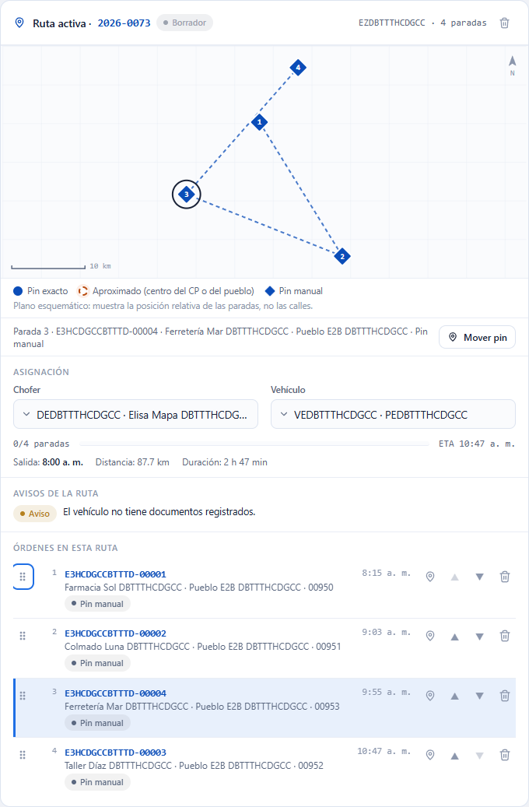

Puede mover varias órdenes seguidas sin esperar: los cambios se ven al instante y el sistema los guarda en orden, de uno en uno. El cambio se ve de inmediato en la lista y en el plano (los pines se renumeran y la línea sigue el nuevo orden) y se guarda en el sistema; las horas estimadas de llegada se recalculan. Si el sistema no acepta el cambio, la lista **vuelve al orden anterior** y aparece el mensaje del sistema arriba de la ruta.

Solo se puede reordenar mientras la ruta está en **Borrador** o **Planificado** y si usted tiene `trips.plan`. En una ruta despachada, en curso o cerrada no hay asa, ▲, ▼ ni papelera.

| Mensaje | Qué significa y qué hacer |
|---|---|
| `La secuencia debe incluir exactamente las paradas de la ruta vigente, sin repetir.` | La ruta cambió mientras la ordenaba (por ejemplo, alguien quitó o añadió una orden). La lista vuelve a su orden anterior y se actualiza; vuelva a ordenar. |
| `El registro fue modificado por otro usuario; recargue e intente de nuevo.` | Otra persona cambió la ruta. La pantalla se actualiza sola; vuelva a ordenar. |
| `La ruta {código} ya fue despachada; no se puede editar ni eliminar.` | Alguien despachó la ruta mientras trabajaba. Ya no se puede ordenar. |

Cada orden lleva marcas: **Llega tarde** indica que la hora estimada pasa del fin de su ventana; **Ubicación aproximada** que su pin es el centro del código postal o del pueblo; **Pin manual** que su ubicación se puso a mano; **Sin pin** que todavía no tiene ubicación.

## Poner un pin manual

Use el pin manual cuando una parada **no tiene ubicación** (**Sin pin**) o cuando la que tiene está mal o es solo aproximada. Se puede hacer solo mientras la ruta está en **Borrador** o **Planificado** y con el permiso `trips.plan`.

1. Pulse el botón del pin de la orden (**Poner pin a la orden …**, o **Mover el pin de la orden …** si ya tenía), o elija la parada en el plano y pulse **Poner pin** / **Mover pin** en el resumen de debajo del plano. Si la ruta tiene el aviso de pines aproximados, ese aviso trae el botón **Poner pin manual**, que abre la primera parada aproximada.
2. Escriba la **Latitud** (entre -90 y 90, por ejemplo 18.4655) y la **Longitud** (entre -180 y 180, por ejemplo -66.1057). Puede usar punto o coma para los decimales.
3. Pulse **Guardar pin**.

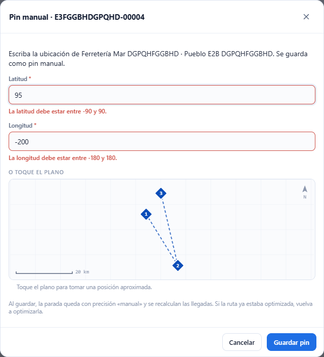

**Atajo: tomar la posición del plano.** Si ya hay otras paradas con ubicación, la ventana muestra un plano de referencia con ellas. Toque el lugar donde cree que está la parada: se llenan la latitud y la longitud y aparece el aviso **Posición aproximada tomada del plano: revise la latitud y la longitud antes de guardar.** El plano no tiene calles, así que esa posición es solo una aproximación: revise los números antes de guardar. Una marca roja muestra dónde quedará el pin.

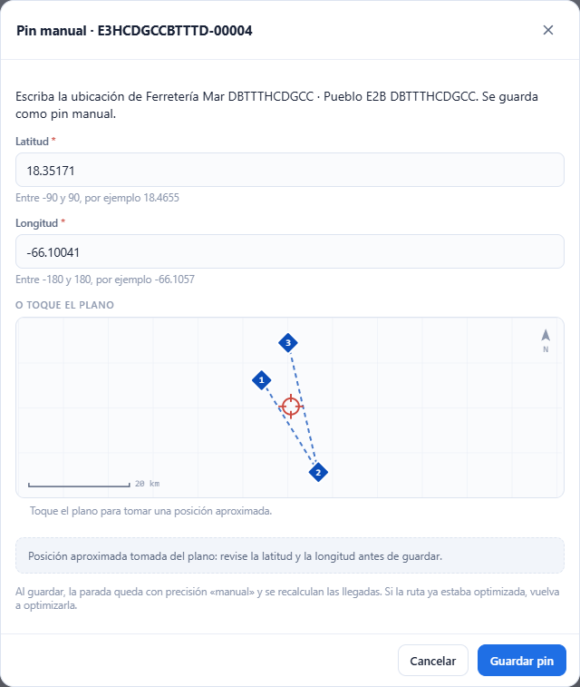

Al guardar, la parada queda con **Pin manual**, el plano la dibuja como rombo y el sistema recalcula las horas de llegada. Si la ruta ya estaba optimizada, vuelva a pulsar **Optimizar** para que el orden aproveche la nueva ubicación.

| Mensaje | Qué significa y qué hacer |
|---|---|
| `Indique la latitud y la longitud.` | Falta uno de los dos números (o los dos). Escríbalos. |
| `La latitud debe estar entre -90 y 90.` | La latitud está fuera del rango. Revise el número (¿puso la longitud en el campo de latitud?). |
| `La longitud debe estar entre -180 y 180.` | La longitud está fuera del rango. Revise el número. |
| `La latitud debe ser un número, por ejemplo 18.4655.` / `La longitud debe ser un número, por ejemplo -66.1057.` | Escribió letras o símbolos (como «18°»). Use solo cifras, el signo menos y un punto o una coma. |
| `Parada no encontrada en esta ruta.` | La parada ya no está en la ruta (la quitaron o la ruta se optimizó). Cierre la ventana; la pantalla se actualiza. |
| `La ruta {código} ya fue despachada; no se puede editar ni eliminar.` | La ruta ya salió: no se puede cambiar la ubicación. |
| `El registro fue modificado por otro usuario; recargue e intente de nuevo.` | Otra persona cambió la ruta. Cierre la ventana, revise y vuelva a intentarlo. |

Los errores se muestran dentro de la ventana, que no se cierra, para que corrija y pruebe otra vez.

### Una ruta despachada

Cuando la ruta ya está despachada, en curso o cerrada, el plano se sigue viendo y se pueden elegir paradas, pero no hay asa, pin, ▲, ▼ ni papelera.

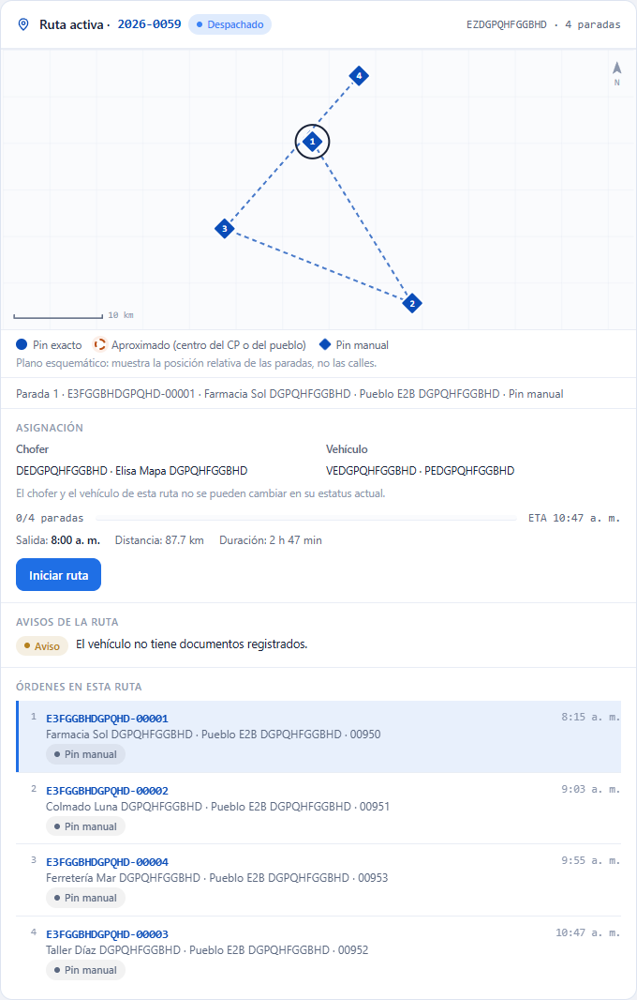

## Chofer y vehículo

En **Asignación** elija el **Chofer** y el **Vehículo** de la ruta; se guarda al elegir. Las opciones «no disponible» se pueden elegir, pero el sistema las rechazará con el motivo:

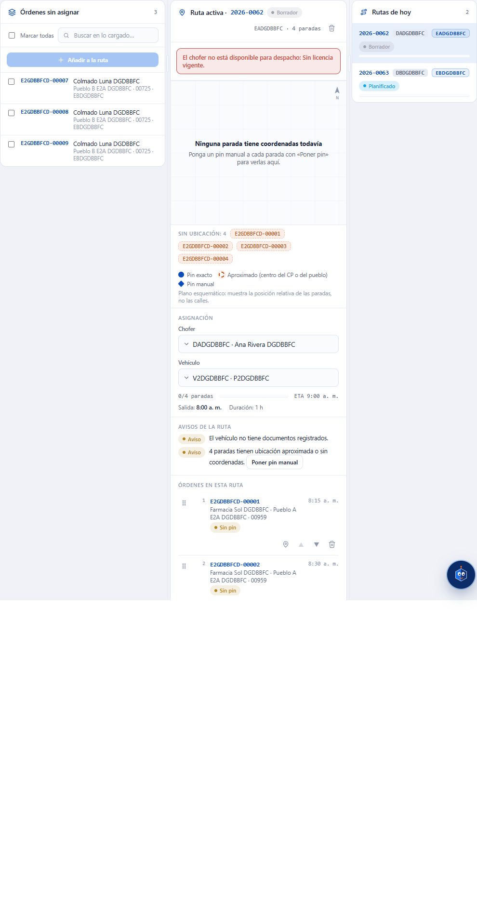

- `El chofer no está disponible para despacho: {motivos}.` / `El vehículo no está disponible para despacho: {motivos}.`: el chofer o el vehículo tiene un impedimento (licencia vencida, mantenimiento…). Elija otro o resuelva el impedimento en **Choferes** o **Flota**.
- `El registro fue modificado por otro usuario; recargue e intente de nuevo.`: otra persona cambió la ruta. La pantalla se actualiza sola; vuelva a intentarlo.
- En una ruta ya despachada solo se pueden cambiar si su compañía lo permite, y nunca se pueden quitar.

## Avisos y bloqueantes de la ruta

Bajo **Avisos de la ruta** el sistema lista lo que puede estorbar el despacho. **Bloquea** (rojo) impide despachar; **Aviso** (ámbar) no lo impide.

| Bloquea | Mensaje |
|---|---|
| Sí | `La ruta no tiene chofer asignado.` / `El chofer no está disponible para despacho: {motivos}.` |
| Sí | `La ruta no tiene vehículo asignado.` / `El vehículo no está disponible para despacho: {motivos}.` |
| Sí | `La ruta no tiene paradas.` y `Orden {número}: {motivo}` por cada orden que dejó de ser elegible |
| No | `La ruta tiene {n} paradas y el máximo del chofer es {m}.` / `…el vehículo admite {m}.` |
| No | La carga o el volumen exceden la capacidad del vehículo |
| No | `{n} paradas llegan después del fin de su ventana.` |
| No | `La ruta no tiene hora de salida; no se calculan las ETAs.` |
| No | `{n} paradas tienen ubicación aproximada o sin coordenadas.` |
| No | `El chofer también está en la ruta {códigos} ese mismo día.` (igual con el vehículo) |

Si la ruta pasa del máximo de paradas, además aparece arriba un aviso rojo: «{código} sobrepasa el máximo de paradas: N > M», que dice si el máximo es el **default de la compañía** o el **override del chofer**; la tarjeta de la ruta lleva ⚠.

## Optimizar

Con la ruta activa en **Borrador** o **Planificado** y con paradas, pulse **Optimizar**. El sistema reordena la ruta (por zona, ventana y código postal) respetando paradas, peso y volumen del vehículo. Una ruta en borrador pasa a **Planificado**.

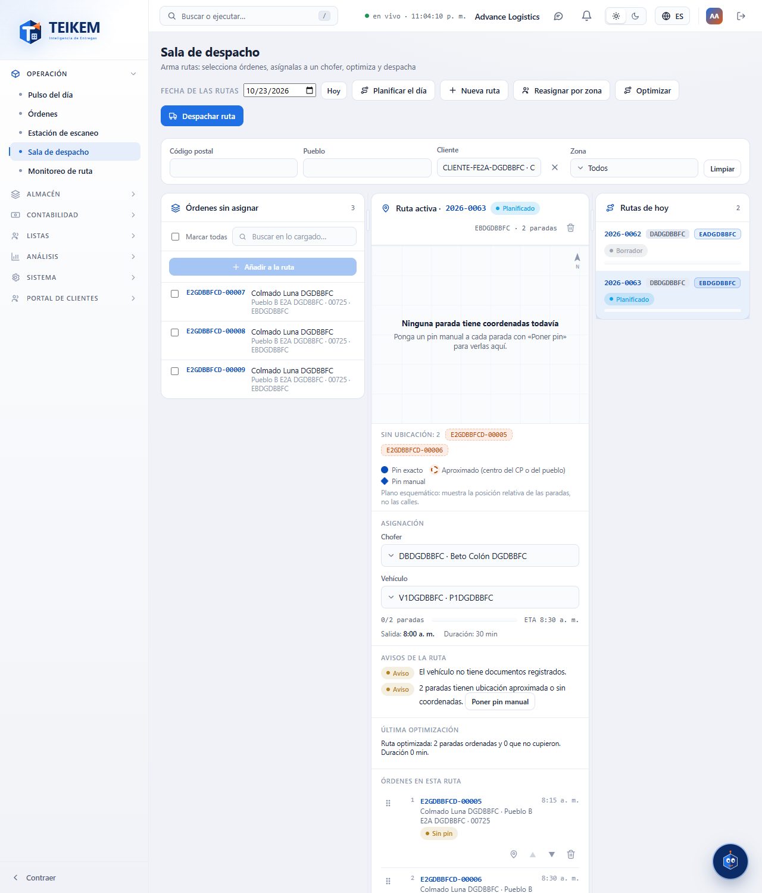

El resultado queda en **Última optimización**: cuántas paradas quedaron ordenadas y cuántas **no cupieron**. Lo que no cupo vuelve a **Envíos sin asignar** y se ve en **No cupieron** con su motivo: cambie de vehículo o asígnelas a otra ruta. Si ya había una optimización anterior, se compara la distancia y la duración («Distancia -12 % contra la corrida anterior»); la primera vez no hay con qué comparar y lo dice. Sin coordenadas en las direcciones no hay distancia y solo se compara la duración.

Mensajes: `La ruta no tiene paradas que optimizar.` (el botón está deshabilitado sin paradas); `La ruta cambió mientras se optimizaba; vuelva a optimizar.`; `El optimizador no pudo calcular la ruta; la corrida quedó registrada con error.`

## Reasignar por zona

1. Pulse **Reasignar por zona**.
2. Elija la **Fecha**, las **Zonas** y el **Nuevo chofer**, y pulse **Reasignar**.

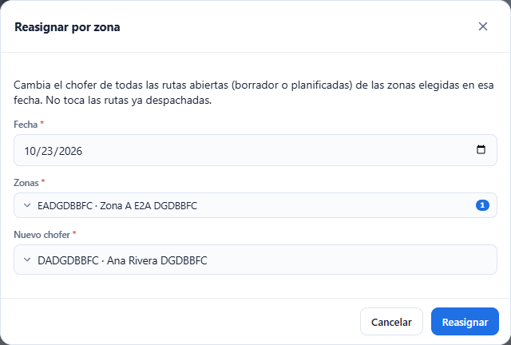

Todas las rutas abiertas (borrador o planificadas) de esas zonas ese día pasan al chofer elegido; las ya despachadas no se tocan. Si no había ninguna, verá `No había rutas abiertas en esas zonas y fecha; no se cambió nada.`; no es un error. Si el chofer queda en más de una ruta ese día, se muestra el aviso.

## Despachar rutas

1. Pulse **Despachar ruta**. Se abre **Rutas por despachar** con las rutas en borrador o planificadas de la fecha. La ruta activa viene marcada si se puede despachar.
2. Marque las rutas (o **Seleccionar todas**). Las que tienen un **Bloquea** no se pueden marcar: arregle el motivo primero. Las que solo tienen **Aviso** sí.
3. Pulse **Despachar seleccionadas (N)**. Si alguna trae avisos, el sistema le pide confirmar: el botón pasa a **Despachar con avisos (N)**; revíselos y púlselo otra vez.
4. Opcionalmente escriba un comentario (hasta 500 caracteres).

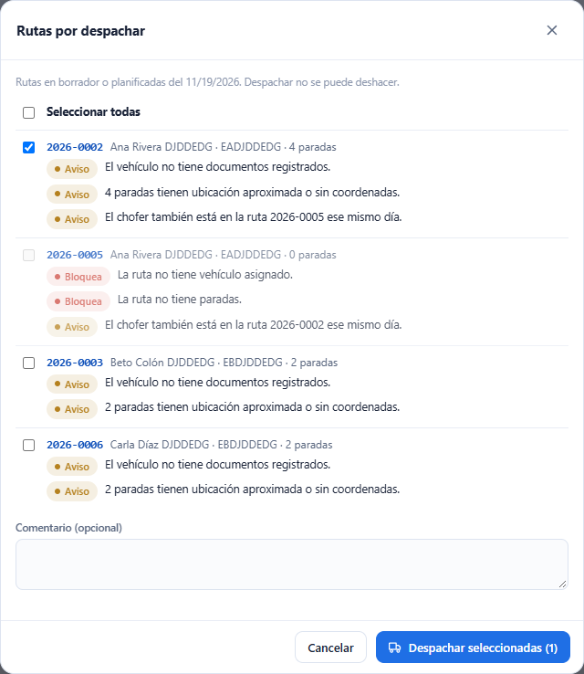

Verá el resultado de cada ruta: **despachada** o el mensaje exacto de por qué no (la ruta que falla no impide las demás).

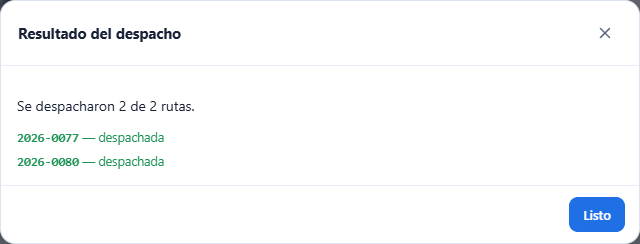

**Despachar no se puede deshacer.** La ruta queda en **Despachado**: su contenido se congela y las órdenes avanzan.

| Mensaje | Qué significa y qué hacer |
|---|---|
| `La ruta {código} no se puede despachar: {motivos}.` | Hay bloqueantes. Corríjalos en la ruta y vuelva a intentar. |
| `Seleccione al menos una ruta.` / `Máximo 50 rutas por despacho.` | Marque entre 1 y 50 rutas. |
| `La ruta {código} ya fue despachada; no se puede editar ni eliminar.` | Alguien la despachó antes. |
| `Ruta no encontrada.` | La ruta ya no existe. |

## Iniciar y cerrar la ruta

- **Iniciar ruta** (ruta en **Despachado**): registra la salida del chofer; la ruta pasa a **En curso** y sus órdenes salen a ruta. Puede dejar un comentario.

  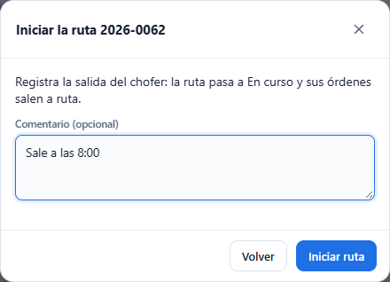

- **Cerrar ruta** (ruta **En curso**, permiso `trips.close`): solo se puede cerrar cuando **todas** sus órdenes terminaron (entregadas, canceladas o con intento fallido). Si no, el mensaje dice cuáles faltan y la ruta sigue abierta:

  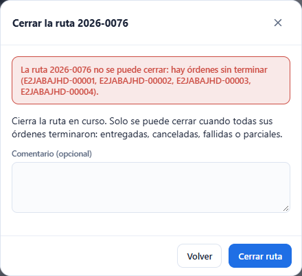

| Mensaje | Qué hacer |
|---|---|
| `La ruta {código} no se puede cerrar: hay órdenes sin terminar ({números}).` | Registre la entrega o el intento fallido de esas órdenes y cierre de nuevo. |
| `La ruta {código} no está despachada; despáchela antes de registrar su salida.` | Despache primero. |
| `La ruta {código} ya salió.` / `La ruta {código} ya está cerrada.` | Ya se hizo; actualice la pantalla. |

## Eliminar una ruta

La papelera junto al nombre de la ruta (**Eliminar ruta**) solo aparece en rutas **Borrador** o **Planificado**. Pide un comentario opcional (hasta 500 caracteres). La ruta pasa a **Cancelado** y sus órdenes vuelven a **Envíos sin asignar** con el mismo estatus.

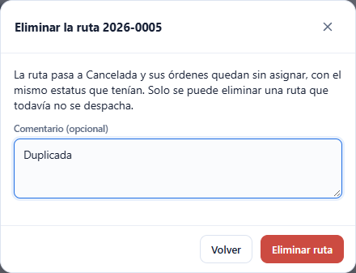

## Qué no hace esta pantalla (todavía)

- El plano es **esquemático**: no tiene calles, nombres de lugares ni imagen de satélite, y no hay conmutador 2D / Satélite. Para ver calles reales haría falta un servicio de mapas externo, que esta pantalla no usa.
- La línea del plano une las paradas en orden en línea recta; no sigue las calles.
- No muestra el último punto GPS del chofer ni el seguimiento en vivo.
- No muestra el cobro contra entrega (COD) de las órdenes: el sistema de rutas no maneja montos.

## Preguntas frecuentes

Las preguntas y respuestas están en las secciones «Lote F-E2a — Sala de despacho» y «Lote F-E2b — Plano de ruta, arrastrar y pin manual» del [archivo de preguntas frecuentes](../faq.md).
