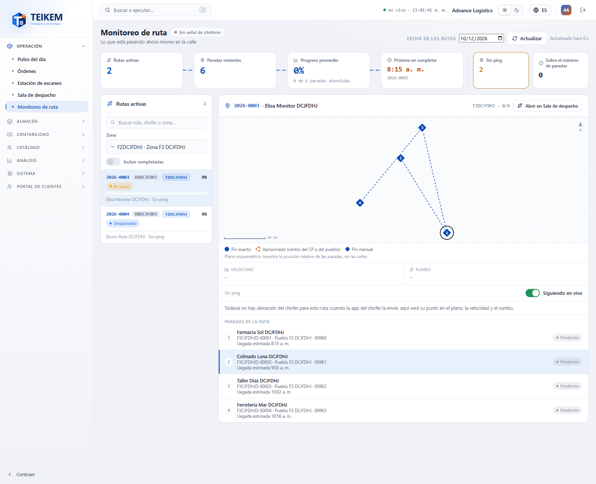
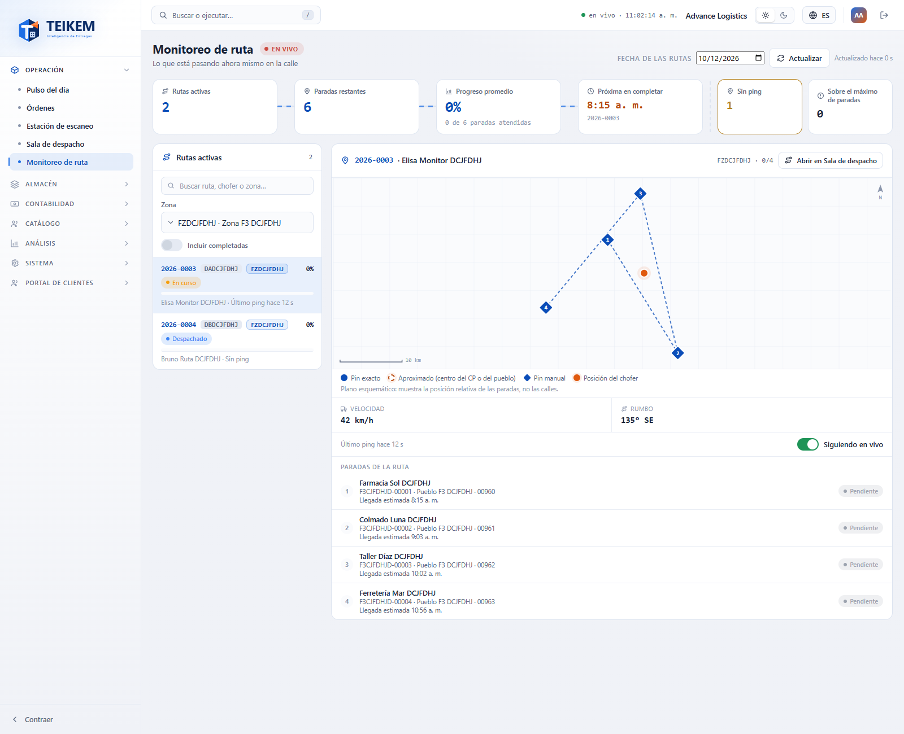
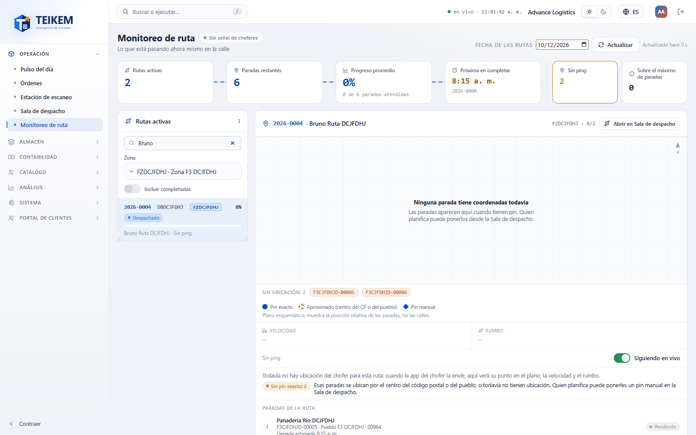
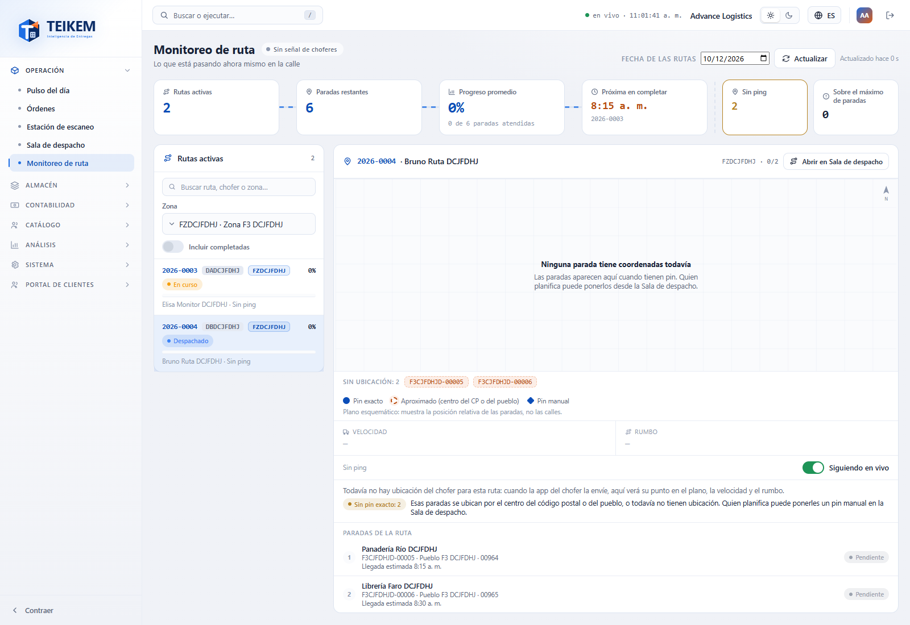
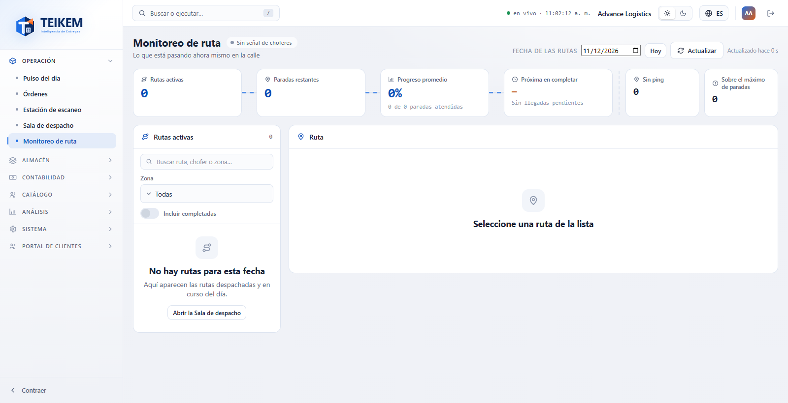

# Monitoreo de ruta

**Monitoreo de ruta** (menú Operación → **Monitoreo de ruta**) muestra lo que pasa con las rutas del día: cuántas hay en la calle, cuántas paradas faltan, qué tanto se ha avanzado y, para la ruta que usted elija, el plano con sus paradas, la última posición del chofer y el estado de cada parada.

Es una pantalla **de solo lectura**: aquí no se despacha, no se cambia el chofer ni se mueven paradas. Para eso está la **Sala de despacho**, a la que esta pantalla lo lleva con un enlace.

## Qué se ve hoy y qué llegará con la app del chofer

Hoy las rutas se arman y se despachan desde la web, pero **la app del chofer todavía no envía su ubicación ni marca las paradas**. Por eso, mientras esa app no esté en uso:

- Todas las rutas dicen **Sin ping** y la insignia del título dice **Sin señal de choferes**.
- En el plano no hay punto del chofer, y **Velocidad** y **Rumbo** muestran «—».
- Todas las paradas figuran **Pendiente** y el avance de cada ruta es 0 %.

Cuando la app del chofer empiece a enviar su posición y a registrar entregas, la misma pantalla mostrará, **sin que usted haga nada distinto**: la insignia **EN VIVO**, «Último ping hace N s», el punto del chofer en el plano, su velocidad y rumbo, y las paradas pasando a **En camino**, **Llegó**, **Completada** o **Fallida**, con el avance subiendo. La **señal GPS** y la **batería** del teléfono aún no se muestran porque el sistema todavía no recibe esos datos.

La imagen siguiente es un **ejemplo con datos de prueba simulados** (se le puso un ping de hace 12 segundos a la primera ruta) para que vea cómo se verá cuando llegue la app del chofer:

## Quién puede usarla

| Para… | Permiso | Módulo |
|---|---|---|
| Entrar a la pantalla y ver rutas, plano y paradas | `trips.view` | Operación de carga (LTL) |
| Ver el enlace **Abrir en Sala de despacho** | `trips.dispatch` | Operación de carga (LTL) |
| Filtrar por **Zona** | `fleet.view` | Catálogo |

Sin `fleet.view` la pantalla funciona igual, pero no ofrece el filtro de zona y lo explica. Sin `trips.dispatch` no aparece el enlace a la Sala de despacho. La pantalla no muestra teléfonos ni datos de contacto del chofer, ni montos.

## Cómo está organizada

1. **Título e insignia.** **EN VIVO** (roja) aparece solo si alguna de las rutas mostradas tiene un ping de hace menos de 2 minutos. Si no, dice **Sin señal de choferes**.
2. **Fecha de las rutas.** Por omisión es hoy. Elija otra fecha para ver las rutas de ese día; **Hoy** vuelve.
3. **Actualizar** y «Actualizado hace N s» (ver más abajo).
4. **El «río» de totales** (las tarjetas de arriba), calculadas por el sistema para la fecha y la zona:

| Tarjeta | Qué cuenta |
|---|---|
| **Rutas activas** | Rutas despachadas o en curso de la fecha (con **Incluir completadas** pasa a **Rutas (con completadas)**). |
| **Paradas restantes** | Paradas que todavía no están entregadas ni fallidas. |
| **Progreso promedio** | Paradas atendidas (entregadas o fallidas) sobre el total de paradas, con la cuenta debajo («2 de 7 paradas atendidas»). Una ruta con más paradas pesa más. |
| **Próxima en completar** | La hora de llegada planeada más próxima entre las rutas mostradas, y de qué ruta es. «—» si ninguna tiene llegadas pendientes. |
| **Sin ping** | Rutas que todavía no tienen ninguna posición del chofer. |
| **Sobre el máximo de paradas** | Rutas con más paradas de las que admite su chofer. |

Los totales **no cambian cuando usted busca**: buscar solo acorta la lista. (La excepción es **Próxima en completar**, que se calcula con las rutas que se están mostrando.)

5. **Rutas activas** (a la izquierda; en pantallas angostas queda arriba) y **la ruta elegida** (a la derecha).

## Rutas activas (la lista)

1. Escriba en **Buscar ruta, chofer o zona…**. La lista se actualiza sola un instante después de dejar de escribir.
2. Si su usuario puede ver zonas, elija una en **Zona** para ver solo esa zona (los totales también se limitan a ella).
3. Active **Incluir completadas** para ver también las rutas ya cerradas del día.
4. Pulse una tarjeta para elegir la ruta. La elegida queda en la dirección de la página, así que puede copiar el enlace.

Cada tarjeta muestra el código de la ruta, el chofer, la zona, el porcentaje de avance con su barra, el estatus de la ruta (**Despachado**, **En curso**, **Completado**), el nombre del chofer y **«Último ping hace N s»** o **Sin ping**. Si el último ping tiene más de 2 minutos, ese texto se pone en color de aviso. Un triángulo rojo ⚠ indica que la ruta **sobrepasa el máximo de paradas**.

## La ruta elegida

- **Plano.** Muestra cada parada con su número según el orden de la ruta. El plano es **esquemático**: muestra la posición relativa de las paradas, no las calles. El pin es un círculo (exacto), un círculo punteado (aproximado: centro del código postal o del pueblo) o un rombo (pin manual). Los colores indican el estado: azul pendiente, verde entregada, rojo fallida. El punto naranja es el chofer. Las paradas sin ubicación se listan debajo como **Sin ubicación: N**. Si ninguna tiene coordenadas, el plano lo dice: **Ninguna parada tiene coordenadas todavía**.
- **Velocidad y Rumbo.** Vienen del último ping del chofer. El rumbo se da en grados y con su punto cardinal (por ejemplo «135° SE»). Sin ping muestran «—».
- **Último ping.** «Último ping hace N s» (o min, h, d). Sin ping dice **Sin ping**. Si pasaron más de 2 minutos aparece **Sin señal reciente**. Si el ping es del chofer pero no viene marcado con esta ruta, la pantalla lo avisa.
- **Siguiendo en vivo.** Interruptor del refresco automático (ver abajo).
- **Avisos.** **Sin pin exacto: N** (paradas aproximadas o sin ubicación) y **Sobrepasa el máximo de paradas**.
- **Paradas de la ruta.** Cada parada con su número, consignatario, orden, pueblo y código postal, la ventana de entrega, la llegada estimada (o «Llegó a las…» cuando ya llegó), **Llega tarde** si aplica y su estado con el nombre que usa su compañía. Pulse una parada para marcarla en el plano; pulse un pin del plano para marcarla en la lista.
- **Abrir en Sala de despacho** (solo con `trips.dispatch`): abre la Sala de despacho en la misma fecha y con esta ruta elegida.

## Actualizar y seguir en vivo

- La pantalla **se actualiza sola cada 30 segundos** mientras la pestaña esté a la vista y **Siguiendo en vivo** esté encendido. Con la pestaña oculta no consulta; al volver la actualiza enseguida si ya pasó más de 30 segundos.
- Pulse **Actualizar** para pedir los datos al instante. Al lado dice «Actualizado hace N s».
- Apague **Siguiendo en vivo** para detener la actualización automática (**Actualizar** sigue funcionando). La pantalla recuerda su elección en este navegador.
- Si una actualización falla (por ejemplo, se cayó la conexión), la pantalla **no se vacía**: sigue mostrando lo último que recibió y lo avisa arriba. Se vuelve a intentar sola.

## Cuando no hay rutas

Si la fecha no tiene rutas despachadas o en curso, la lista dice **No hay rutas para esta fecha** y, con `trips.dispatch`, ofrece **Abrir la Sala de despacho**. Si hay rutas pero la búsqueda no encuentra ninguna, dice **Ninguna ruta coincide con la búsqueda.**

## Mensajes de la pantalla

| Mensaje | Qué significa y qué hacer |
|---|---|
| `Su usuario no tiene acceso para consultar las rutas. Pídalo a su administrador.` | Le falta el permiso `trips.view`. Pida que se lo den. |
| `No hay rutas para esta fecha` | Ninguna ruta despachada o en curso en esa fecha (y zona). Cambie la fecha o despache rutas en la Sala de despacho. |
| `Ninguna ruta coincide con la búsqueda.` | Cambie o borre el texto de búsqueda. |
| `No se pudieron cargar las rutas.` | La primera carga falló. Pulse **Reintentar**. |
| `No se pudo actualizar. Se muestra lo último que se recibió, a las {hora}; se volverá a intentar.` | Falló una actualización. Lo que ve es lo último recibido. Revise la conexión; se reintenta solo, o pulse **Actualizar**. |
| `No se pudo cargar la ruta.` | Falló la carga de la ruta elegida. Pulse **Reintentar**. |
| `Su usuario no puede consultar las zonas, así que no se ofrece el filtro por zona.` | Le falta `fleet.view`: la pantalla funciona sin el filtro. |
| `Seleccione una ruta de la lista` | No hay ruta elegida; pulse una tarjeta. |
