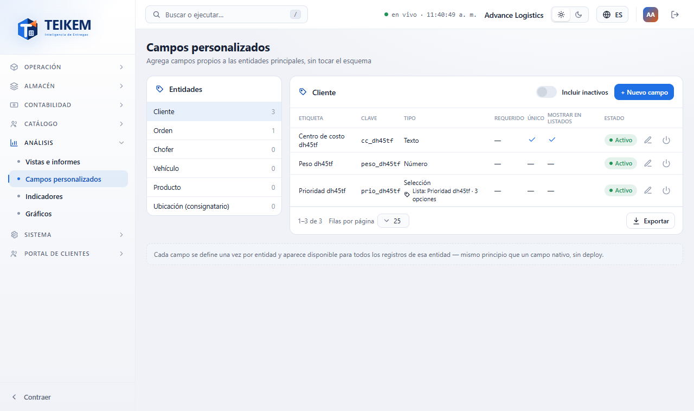
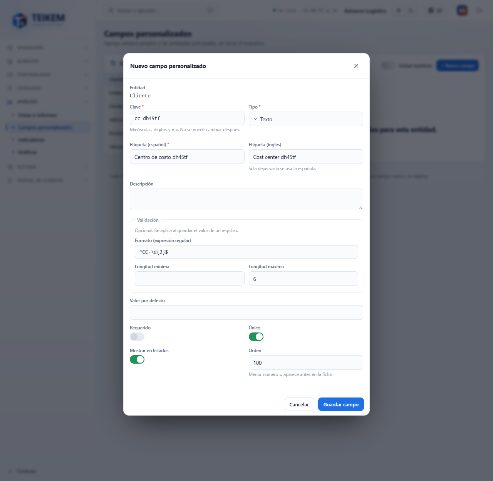
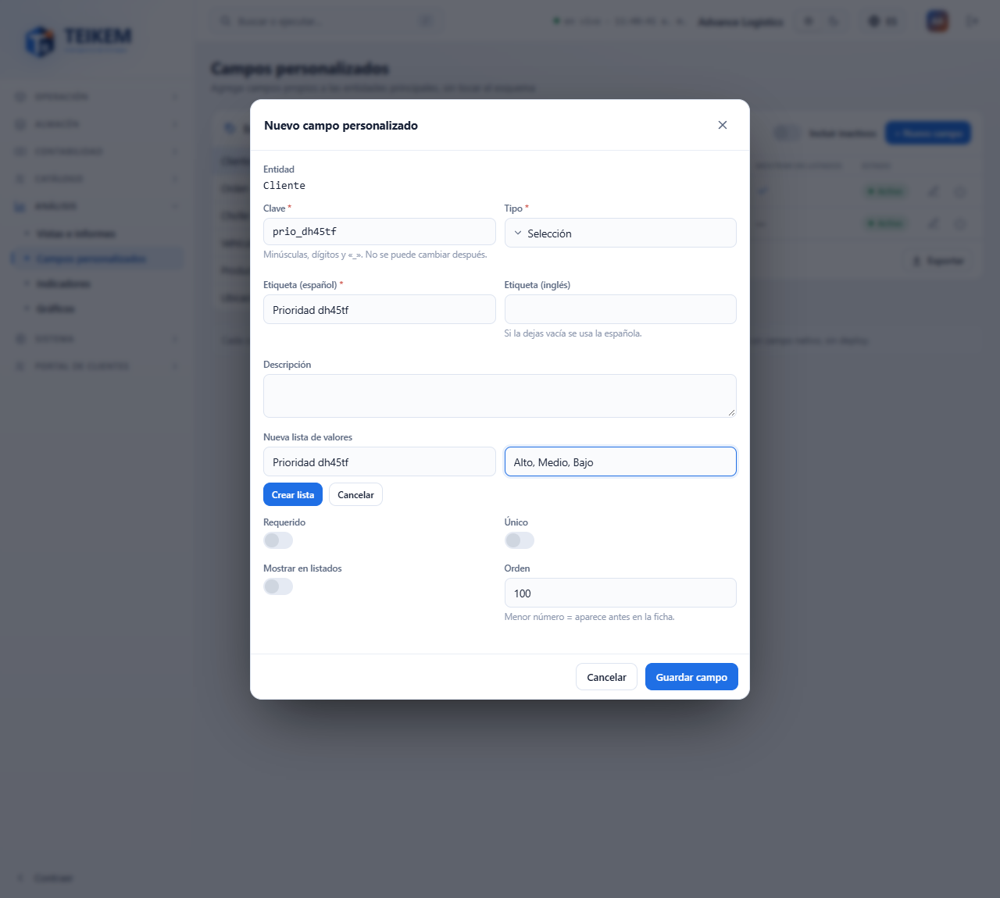
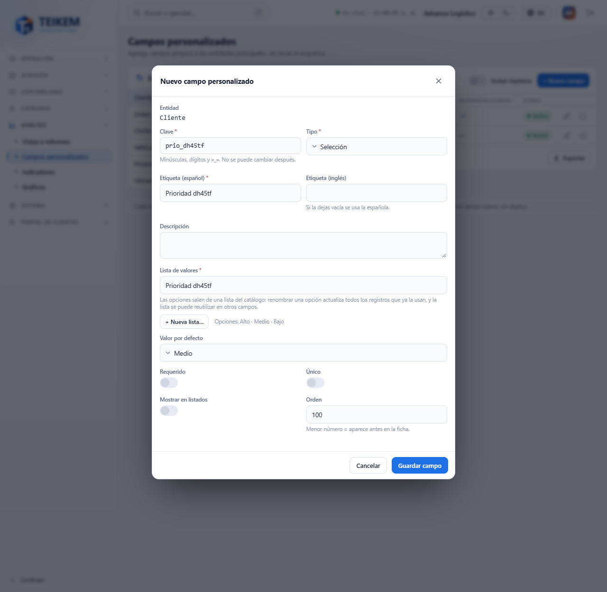
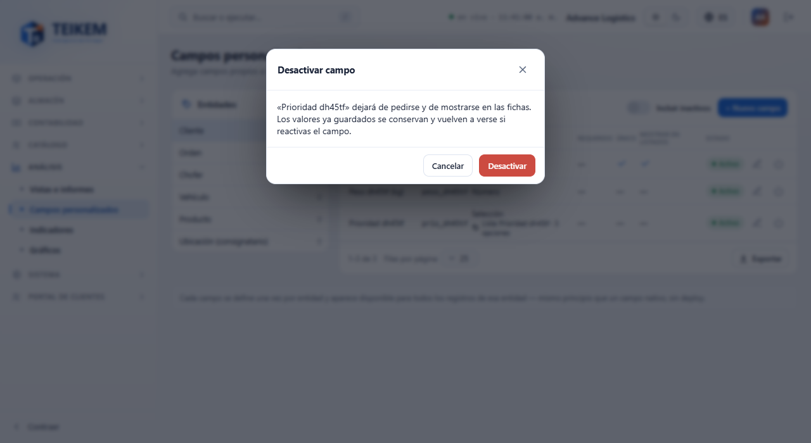
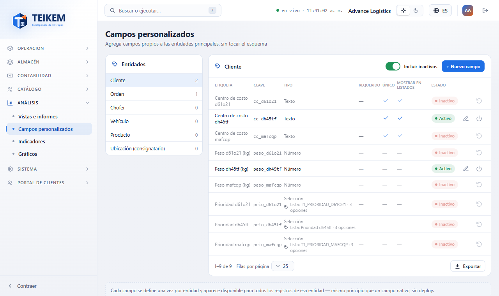
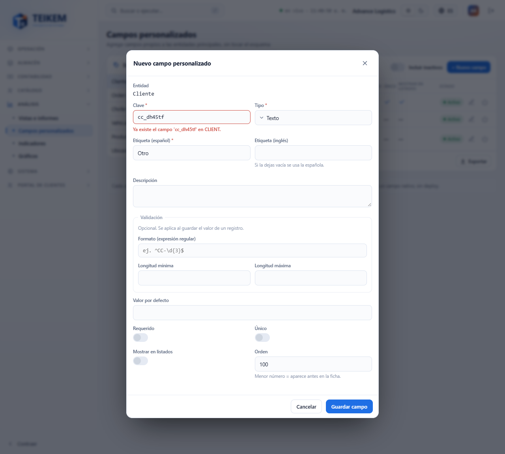
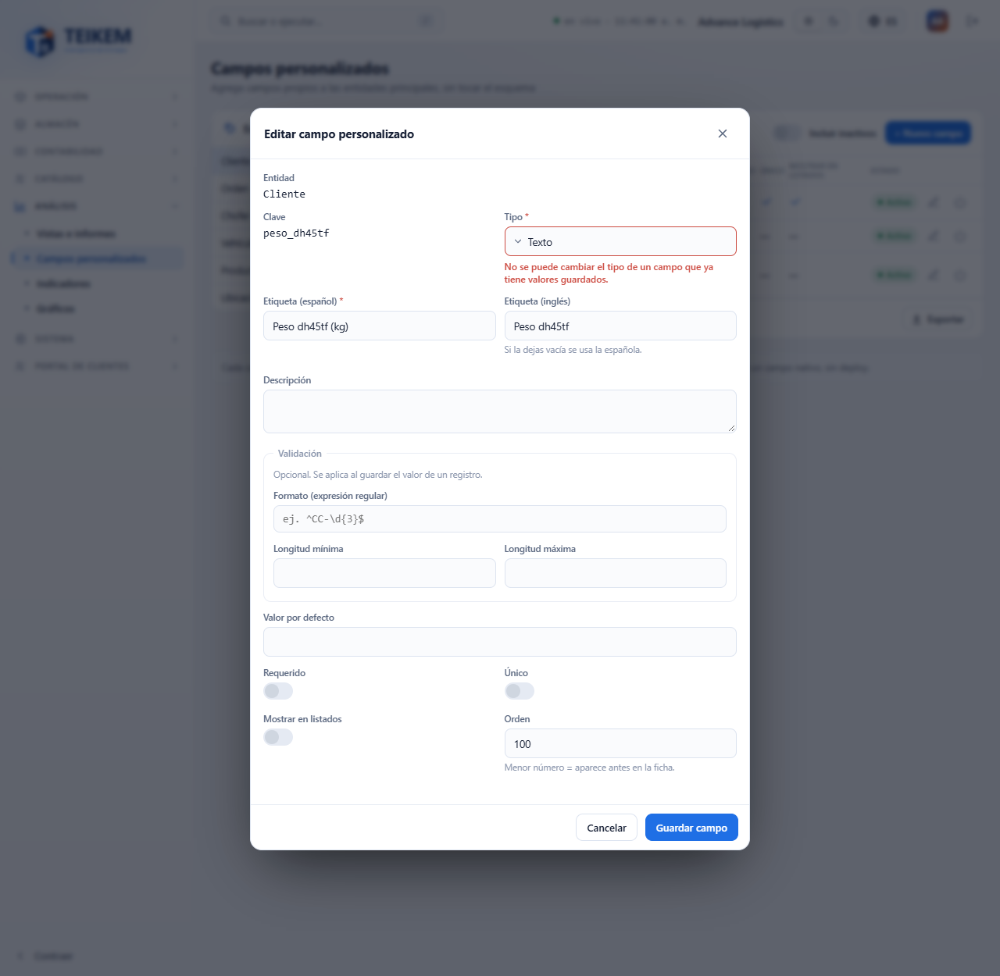

# Campos personalizados

**Campos personalizados** (menú Análisis → **Campos personalizados**) sirve para agregar a sus registros los datos propios que su compañía necesita y que el sistema no trae de fábrica: un centro de costo en el cliente, el peso máximo de un vehículo, la prioridad de una orden. Usted define el campo una sola vez y aparece en la ficha de **todos** los registros de esa entidad.

Esta pantalla **define** los campos. Los **valores** (por ejemplo, «CC-123» en un cliente) se escriben en la ficha de cada registro, en el panel **Campos personalizados**.

## Quién puede usarla

| Para… | Permiso | Módulo |
|---|---|---|
| Entrar a la pantalla, crear, editar, desactivar y reactivar campos | `admin.customfields` | Campos personalizados |
| Crear una **Nueva lista…** de valores desde un campo de selección | `admin.catalogs` | Sistema |
| Escribir el valor de un campo en la ficha de un registro | el permiso de edición de esa ficha (por ejemplo, `clients.update` en Clientes) | el de la ficha |

Sin `admin.catalogs` puede escoger una lista que ya exista, pero el botón **Nueva lista…** no aparece y la pantalla le dice que pida a un administrador que cree la lista.

## Cómo está organizada

1. **Entidades** (a la izquierda; en el teléfono, arriba): Cliente, Orden, Chofer, Vehículo, Producto y Ubicación (consignatario). El número a la derecha es la cantidad de campos **activos** de esa entidad.
2. **La tabla de la entidad elegida**: Etiqueta, Clave, Tipo, Requerido, Único, Mostrar en listados y Estado. En los campos de selección, bajo el tipo se ve la lista que usan y cuántas opciones tiene.
3. **Incluir inactivos**: muestra también los campos desactivados (atenuados).
4. **Nuevo campo** y, en cada fila, **Editar**, **Desactivar** o **Reactivar**.

Solo se ofrecen las entidades que hoy tienen una ficha donde escribir los valores. Si una entidad no tiene campos, la tabla dice «Todavía no hay campos personalizados para esta entidad.»

## Crear un campo

1. Elija la entidad y pulse **Nuevo campo**.
2. Escriba la **Clave**: es el nombre interno del campo, solo minúsculas, dígitos y «_», empieza con letra (por ejemplo `cost_center`). **No se puede cambiar después.**
3. Elija el **Tipo** (ver la tabla de abajo).
4. Escriba la **Etiqueta (español)**, que es lo que verán sus usuarios. La **Etiqueta (inglés)** es opcional: si la deja vacía se usa la española.
5. Si quiere, escriba una **Descripción** y la **Validación** que corresponda al tipo.
6. Marque **Requerido**, **Único** o **Mostrar en listados** si aplica, y el **Orden** (menor número = aparece antes en la ficha; por omisión 100).
7. Pulse **Guardar campo**. Aparece el aviso «Campo creado» y el campo se ve de inmediato en la ficha de los registros.

| Tipo | Qué guarda | Validación que se puede pedir | Valor por defecto |
|---|---|---|---|
| Texto | Letras y números libres | Formato (expresión regular), longitud mínima y máxima | Un texto |
| Número | Un número | Valor mínimo y máximo | Un número |
| Fecha | Un día | Mínimo y máximo **en días desde hoy** (−30 = hasta 30 días atrás; 0 = hoy) | Una fecha |
| Fecha y hora | Un día con hora (hora de la compañía) | Igual que Fecha | Fecha y hora |
| Sí/No | Marcado o sin marcar | — | Marcado por defecto |
| Selección | Una opción de una lista | — | Una opción de la lista |
| Selección múltiple | Varias opciones de una lista | — | Varias opciones |
| Referencia a lista | Una opción de una lista de valores | — | Una opción de la lista |

No tiene que escribir nada técnico: el formato (por ejemplo `^CC-\d{3}$`, que significa «CC-» y tres dígitos) es lo único que usa una expresión regular, y es opcional.

### Requerido, Único y Mostrar en listados

- **Requerido**: la ficha no deja guardar el registro sin ese valor.
- **Único**: no puede haber dos registros de la entidad con el mismo valor.
- **Mostrar en listados**: marca el campo para mostrarse en las listas.

## Campos de selección: la lista de valores

Los campos de selección **no guardan opciones sueltas**: apuntan a una **lista de la lista**. Así, si más adelante se renombra una opción en **Sistema → Listas de valores**, todos los registros que ya la usan se actualizan, y la misma lista sirve para otros campos.

1. Elija **Selección**, **Selección múltiple** o **Referencia a lista**.
2. En **Lista de valores** escoja una lista (las propias de su compañía salen primero; se puede buscar escribiendo). Debajo se ven sus opciones.
3. Si la lista que necesita no existe, pulse **Nueva lista…**, escriba el **nombre de la lista** y las **opciones separadas por coma** (por ejemplo «Alto, Medio, Bajo») y pulse **Crear lista**. La lista queda escogida.
4. Opcional: elija el **Valor por defecto** entre las opciones.

Los campos creados antes por otras vías pueden traer **opciones propias** («Opciones propias · 2» en la tabla). Al editarlos se conservan; si escoge una lista de valores, la lista reemplaza a esas opciones.

## Editar un campo

1. En la fila del campo pulse **Editar** (el lápiz).
2. Cambie lo que necesite. La **Clave** se ve pero no se cambia.
3. Pulse **Guardar campo** («Campo actualizado»).

Los registros que ya tienen valor lo conservan. **El tipo no se puede cambiar si el campo ya tiene valores guardados** (ver errores).

## Desactivar y reactivar

- **Desactivar** (el botón de apagado) pide confirmación. El campo **deja de pedirse y de mostrarse** en las fichas, pero **sus valores se conservan**. No existe el borrado definitivo.
- **Reactivar**: active **Incluir inactivos** y pulse **Reactivar** en la fila. El campo vuelve a las fichas con los valores que tenía.

## Dónde se escriben los valores

Abra la ficha de un registro (por ejemplo, un cliente): el panel **Campos personalizados** muestra los campos activos de su entidad en el orden indicado. Un valor que no cumple la validación se rechaza bajo el campo, por ejemplo «No cumple el formato requerido.»

## Mensajes de error

| Mensaje | Qué significa | Qué hacer |
|---|---|---|
| «Clave inválida: minúsculas, dígitos y '_' (2-60), empezando por letra.» | La clave tiene mayúsculas, espacios, guiones o empieza con número | Use por ejemplo `centro_costo` |
| «Ya existe el campo '…' en …» | Esa clave ya la tiene otro campo de la entidad, **también uno desactivado** | Use otra clave, o active **Incluir inactivos** y **Reactive** el campo viejo |
| «No se puede cambiar el tipo de un campo que ya tiene valores guardados.» | Hay registros con valor en ese campo | Deje el tipo; si de verdad lo necesita, desactive este campo y cree otro con otra clave |
| «La etiqueta es obligatoria.» | Falta la etiqueta en español | Escríbala |
| «Escoge o crea una lista de valores» | Un campo de selección no tiene lista | Escoja una lista o use **Nueva lista…** |
| «La lista '…' no existe.» | La lista escogida ya no está disponible, o no es una lista de valores | Escoja otra lista |
| «Ponle nombre a la lista y al menos una opción» | Falta el nombre o las opciones al crear la lista | Complételos |
| «Ya existe una lista con la clave '…'.» | Ya hay una lista con ese nombre | Use otro nombre o escoja la lista existente |
| «No se puede armar un código con: …» | Una opción solo tiene símbolos o es demasiado larga | Escríbala con letras o números (máximo 40) |
| «La expresión regular no es válida.» | El formato escrito está mal formado | Corríjalo o déjelo vacío |
| «La entidad '…' aún no admite campos personalizados (su módulo no está construido).» | La entidad no tiene registros donde guardar valores | No se puede; use una de las entidades de la lista |
| «ValidationJson no es JSON válido.» | Solo se ve si el campo se creó con una herramienta externa | Corrija la validación desde esta pantalla |

Si el servidor rechaza el campo por una razón que no corresponde a un control concreto, el mensaje sale arriba del formulario.
