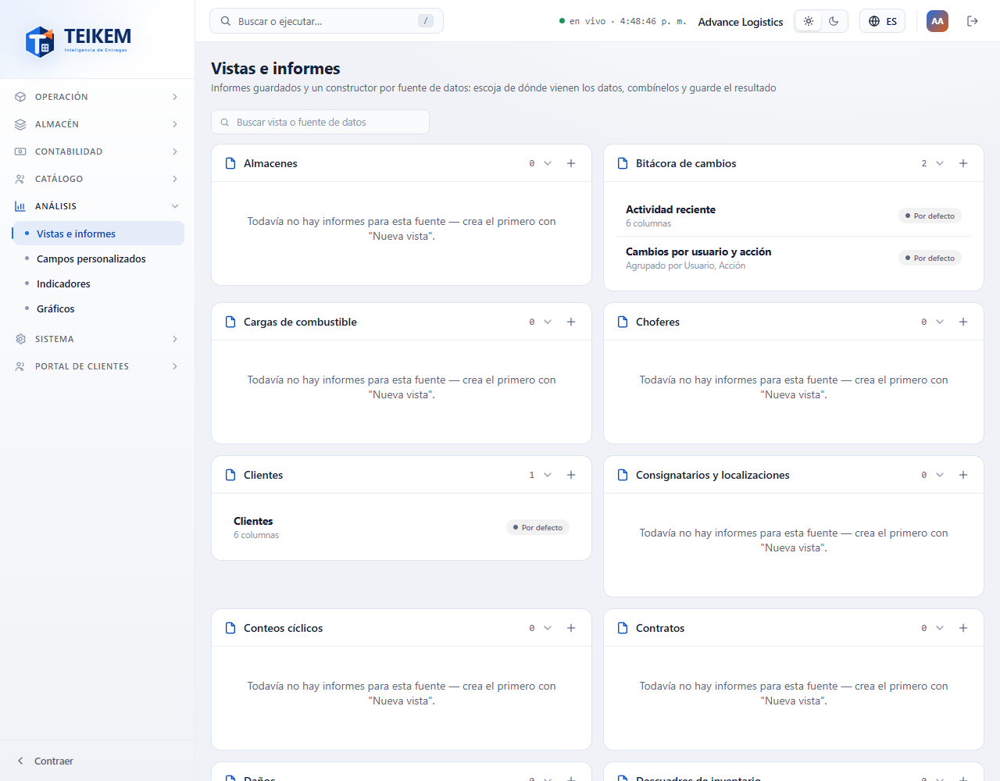
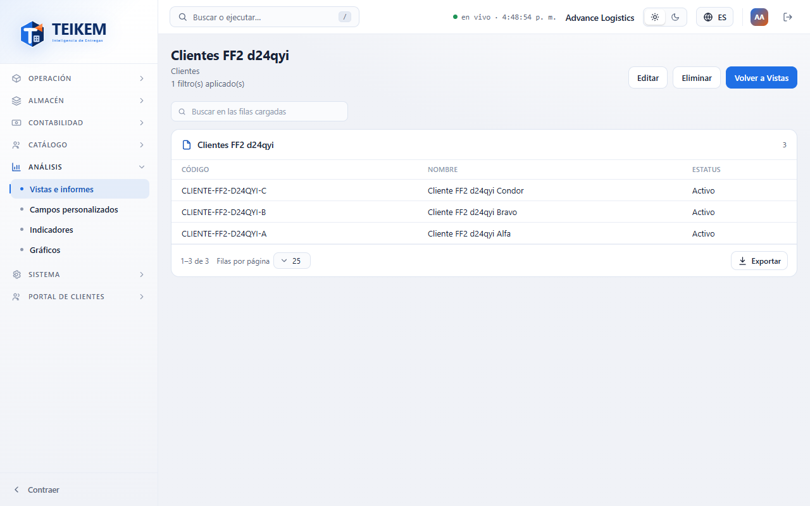
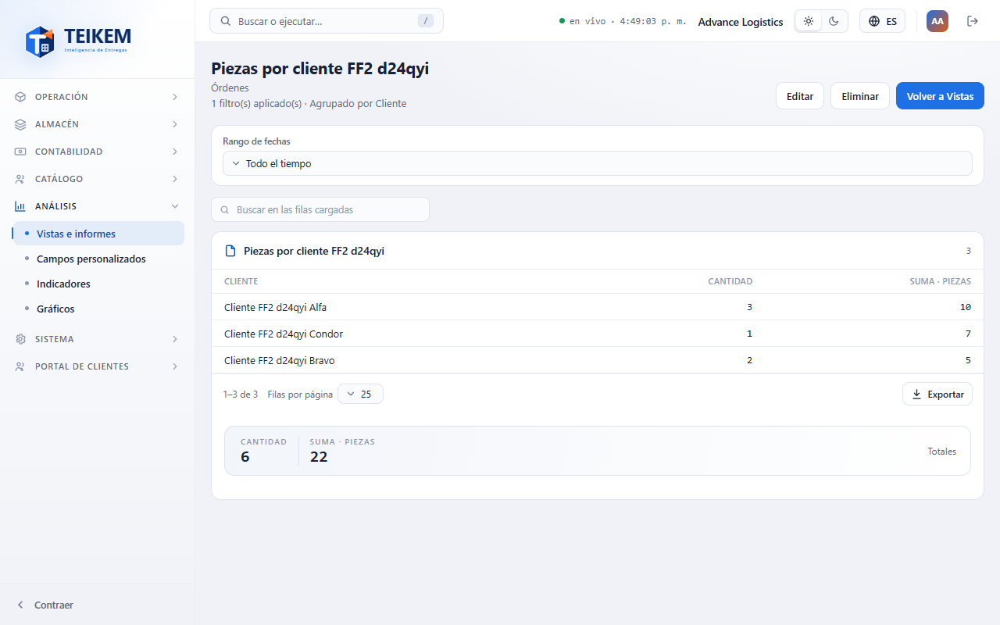
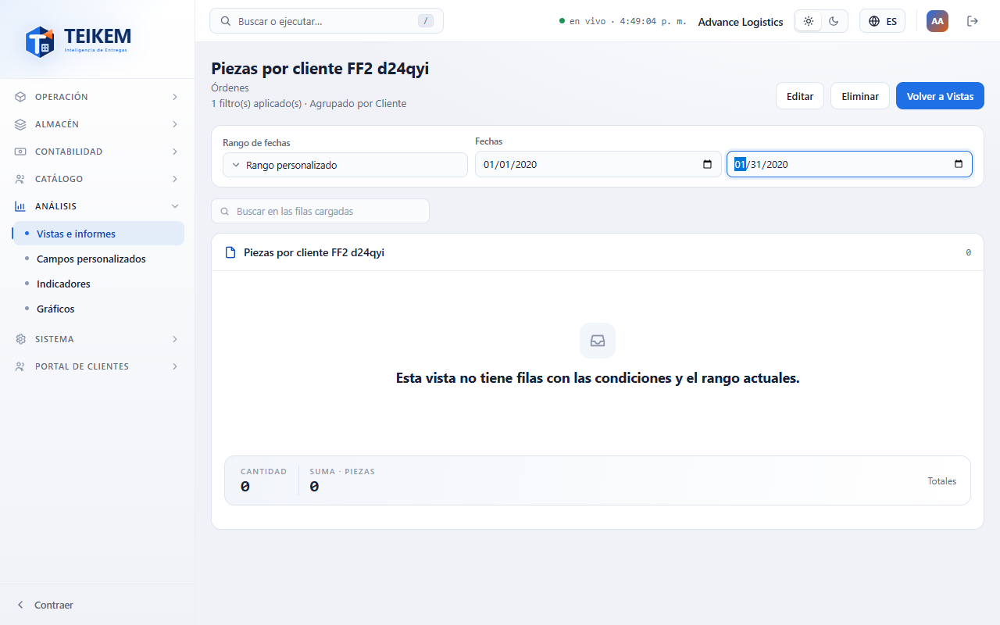
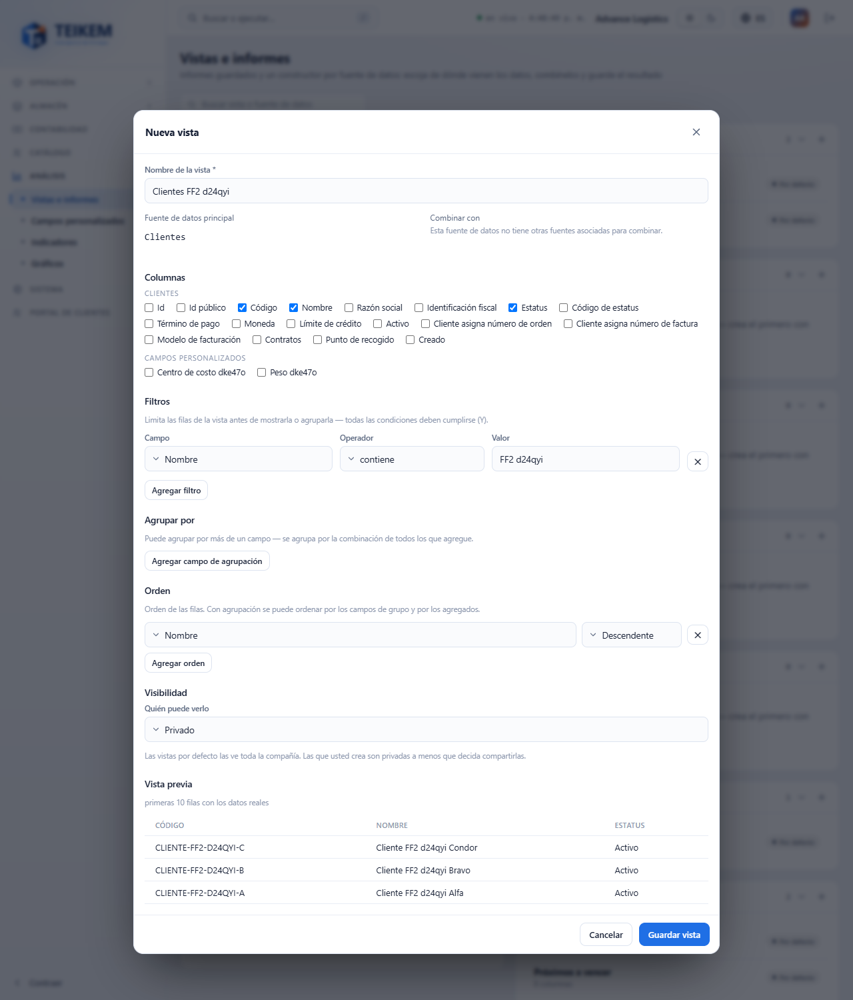
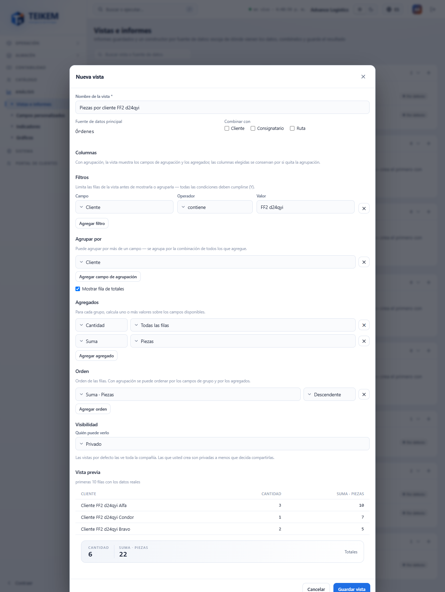
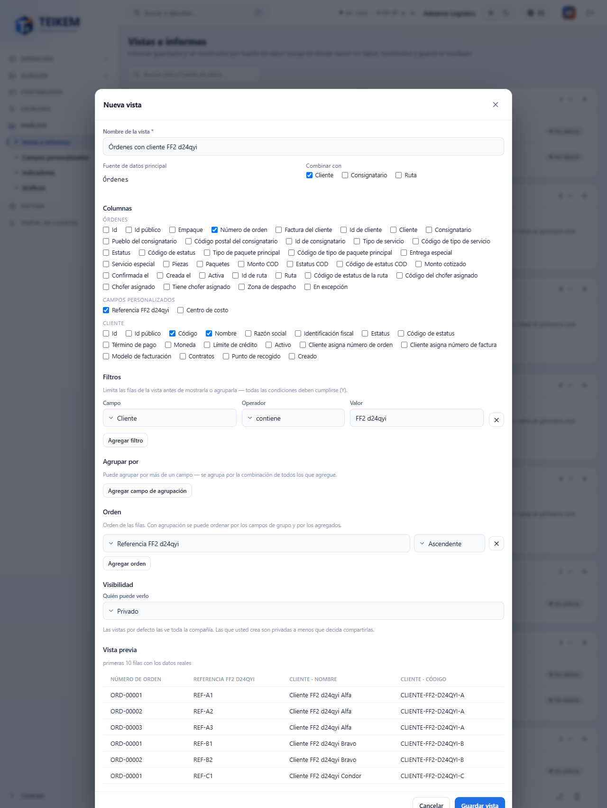
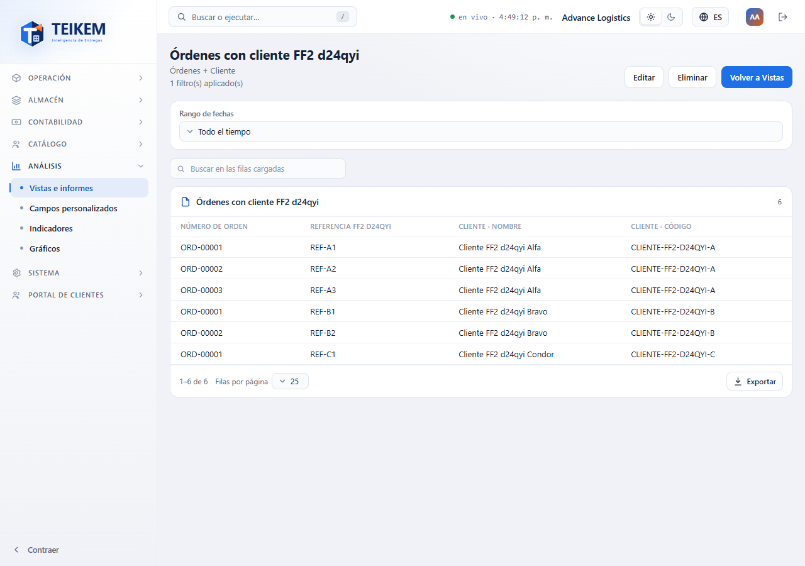
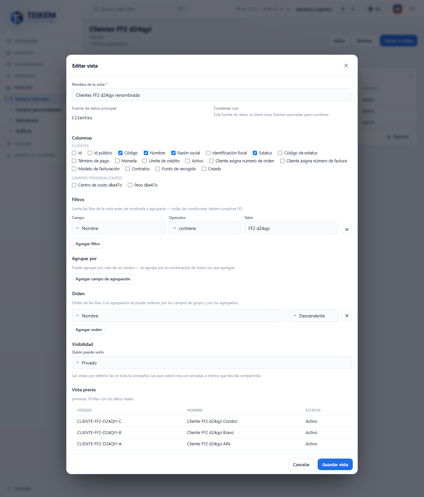

# Vistas e informes

**Vistas e informes** (menú Análisis → **Vistas e informes**) sirve para armar tablas con los datos de su compañía —clientes, órdenes, inventario, rutas, choferes…—, guardarlas con un nombre y volver a abrirlas cuando las necesite. Cada **vista** parte de **una fuente de datos** (por ejemplo, Órdenes), puede **combinarse** con otra fuente relacionada (por ejemplo, el Cliente de cada orden), filtrarse, agruparse con totales y ordenarse. Una vista se **ve y se exporta** con el mismo botón **Exportar** del resto de las pantallas.

## Quién puede usarla

| Para… | Permiso | Módulo |
|---|---|---|
| Entrar, abrir una vista, buscar en ella, cambiar el rango de fechas y exportar | `analytics.view` | Análisis |
| Crear, editar y eliminar vistas (botones **+**, **Editar** y **Eliminar**) | `analytics.manage` | Análisis |
| Compartir una vista con **personas específicas** | `admin.users` (para poder elegirlas en la lista) | Sistema |
| Ver las fuentes de datos de un módulo (por ejemplo, Rentas o Inventario) | el permiso de ver ese módulo | el de esa fuente |

Sin `analytics.manage` la pantalla es solo de consulta: no aparecen ni el **+** ni **Editar** ni **Eliminar**. Cada persona solo ve las fuentes de datos de los módulos que su compañía tiene encendidos y que su usuario puede consultar.

## La galería

1. Hay **un panel por fuente de datos**, dos por fila (uno solo en el teléfono). Todos arrancan **abiertos**; pulse el título de un panel para cerrarlo o abrirlo.
2. A la derecha del título está el **número de informes** de esa fuente y el botón **+** (**Nueva vista**), que abre el constructor con esa fuente ya decidida.
3. Cada informe muestra su **nombre** y debajo «N columnas» o «Agrupado por …», más «+ Cliente» si está combinado con otra fuente.
4. La insignia **Por defecto** marca los informes que trae la plataforma (no se pueden editar ni eliminar). **Creada por …** marca los de otra persona. Los que usted creó no llevan insignia y muestran los íconos de **Editar** y **Eliminar**.
5. Una fuente sin informes dice: «Todavía no hay informes para esta fuente — crea el primero con "Nueva vista".»
6. El buscador de arriba filtra por el nombre de la vista o de la fuente; mientras escribe, los paneles con coincidencias se muestran abiertos.

Pulse el nombre de un informe para abrirlo.

## Abrir una vista

1. El título es el nombre de la vista; debajo, la fuente (y las combinadas) y la insignia. Si la vista tiene filtros o agrupación, una línea lo resume: «1 filtro(s) aplicado(s) · Agrupado por Cliente».
2. **Rango de fechas**: aparece solo si la fuente tiene una fecha (por ejemplo, la fecha de creación de la orden). Por omisión es **Todo el tiempo**. Puede elegir **Últimos 7 días**, **Últimos 30 días**, **Este mes** o **Rango personalizado** (entonces escriba **Desde** y **Hasta**). El rango **no se guarda** en la vista: sirve solo para esta consulta.
3. **Buscar en las filas cargadas**: escriba una o varias palabras; quedan las filas que las contienen (sin distinguir mayúsculas ni acentos) en cualquier columna, tal como se ven en pantalla.
4. **Ordenar**: pulse el encabezado de una columna (en el teléfono, use «Ordenar por»). Pulse otra vez para invertir.
5. **Exportar** (abajo a la derecha de la tabla): Excel, CSV o PDF con **lo que está cargado** y en el orden en que lo ve, con la búsqueda aplicada.
6. Si la vista tiene **fila de totales**, los totales aparecen en una franja debajo de la tabla.
7. **Editar** y **Eliminar** (si puede) y **Volver a Vistas** están arriba a la derecha.

**Cuántas filas se cargan.** Se cargan hasta **5000 filas**. Si la vista tiene más, un aviso dice «Se muestran las primeras N de M filas…»; **la exportación y la búsqueda trabajan con esas N**. Acote la vista con un filtro o con un rango de fechas para ver el resto.

## Crear una vista

1. En el panel de la fuente que le interesa pulse **+** (**Nueva vista**).
2. Escriba el **Nombre de la vista** (obligatorio, hasta 150 letras).
3. **Fuente de datos principal** muestra la fuente elegida y no se puede cambiar. En **Combinar con** marque las fuentes relacionadas que quiera agregar (por ejemplo, **Cliente** en una vista de Órdenes). Si la fuente no tiene otras relacionadas, dice «Esta fuente de datos no tiene otras fuentes asociadas para combinar.»
4. **Columnas**: marque las casillas de los campos que quiere ver. Hay un bloque por fuente; los **campos personalizados** que su compañía definió salen en su propio bloque. Las columnas de una fuente combinada se rotulan «Cliente · Nombre».
5. **Filtros** (opcional): pulse **Agregar filtro**; elija el **Campo**, el **Operador** (es igual a, es distinto de, mayor que, mayor o igual que, menor que, menor o igual que, contiene, empieza con, termina con, está en, no está en, entre, está vacío, no está vacío, es verdadero, es falso) y el **Valor**. Con «está en» y «no está en» separe los valores con coma; con «entre» escriba dos valores. **Todas las condiciones deben cumplirse** (se unen con «Y»).
6. **Agrupar por** (opcional): pulse **Agregar campo de agrupación**; puede agrupar por varios campos. Al agrupar:
   - la vista muestra los campos de agrupación y los **Agregados** (**Cantidad**, **Suma**, **Promedio**, **Mínimo**, **Máximo**). Pulse **Agregar agregado**; **Cantidad** puede contar «Todas las filas»; las demás funciones necesitan un campo numérico;
   - marque **Mostrar fila de totales** para ver el total de cada agregado;
   - las columnas que marcó antes se guardan pero no se muestran mientras haya agrupación.
7. **Orden** (opcional): **Agregar orden**, elija el campo y **Ascendente** o **Descendente**. Con agrupación puede ordenar por los campos de grupo y por los agregados («Suma · Piezas»). Puede poner varios; se aplican en ese orden.
8. **Visibilidad**: **Privado** (solo usted), **Toda la organización** o **Personas específicas**. Con **Personas específicas** elija personas (necesita `admin.users`) y/o roles; marque «Las personas elegidas también pueden editar la vista» si quiere que ellas puedan cambiarla.
9. **Vista previa**: se actualiza sola con los datos reales (las primeras 10 filas) mientras arma la vista. Si falta algo, dice «Escoja al menos una columna o un campo de agrupación para ver la vista previa.»
10. Pulse **Guardar vista**. Aparece «Vista guardada — disponible para uso futuro: …».

Ejemplo de una vista combinada: «Órdenes con cliente» (fuente **Órdenes**, combinada con **Cliente**) con las columnas Número de orden, Referencia (campo personalizado), Cliente · Nombre y Cliente · Código.

## Editar y eliminar

1. Abra la vista y pulse **Editar** (o el ícono de lápiz en la galería). El constructor trae todo lo guardado: columnas, filtros, agrupación, agregados, orden y visibilidad. La fuente principal no se puede cambiar.
2. Cambie lo que necesite y pulse **Guardar vista**: «Vista actualizada: …».
3. **Eliminar** pide confirmación: «Se eliminará la vista «…». Los datos no se tocan: solo desaparece el informe guardado.» Después de eliminar, el nombre queda libre para usarlo en otra vista.

Las vistas **Por defecto** solo se ven y se exportan; las de otras personas solo las puede cambiar quien las creó o quien recibió permiso de editar.

## Mensajes que puede ver

| Mensaje | Qué significa | Qué hacer |
|---|---|---|
| Ponle un nombre a la vista | Falta el nombre. | Escriba el nombre y guarde. |
| Escoge al menos una columna | La vista no tiene columnas ni agrupación. | Marque una columna o agregue un campo de agrupación. |
| La función Suma requiere un campo. (igual con Promedio, Mínimo y Máximo) | Un agregado distinto de Cantidad no tiene campo. | Elija un campo numérico en ese agregado. |
| Ya existe una vista '…' para …. (409) | Ya hay otra vista con ese nombre en la misma fuente (puede ser una que usted no ve, por ejemplo una privada de otra persona). | Use otro nombre. |
| Una vista necesita al menos una columna o una agrupación. (400) | El servidor recibió una vista vacía. | Marque columnas o agrupe. |
| La fuente … no se combina con '…'. (400) | Se pidió combinar con una fuente que no está relacionada. | Quite esa combinación; en la pantalla solo se ofrecen las válidas, así que suele pasar si la configuración cambió mientras la editaba. |
| FilterJson no es JSON válido. (400) | El filtro llegó dañado. | Vuelva a armar el filtro y guarde. |
| El nombre es obligatorio. (400) | El servidor recibió un nombre vacío. | Escriba el nombre. |
| Los elementos por default de la plataforma no se editan ni se eliminan. (403) | Intentó cambiar una vista **Por defecto**. | Cree una vista propia con **+**. |
| Solo el dueño puede editar o eliminar este elemento. (403) | La vista es de otra persona y no le dio permiso de editar. | Pídale que la edite, o que la comparta con edición. |
| Vista '…' no encontrado. (404) | La vista ya no existe, fue eliminada o dejó de estar compartida con usted. | Vuelva a **Vistas** y abra otra. |
| Desde no puede ser mayor que Hasta. / El rango personalizado necesita Desde y Hasta. | Rango de fechas incompleto o invertido. | Corrija las fechas. |
| Vista no encontrado (pantalla) | El enlace apunta a una vista que no existe o no puede ver. | Pulse **Volver a Vistas**. |

## Preguntas frecuentes

**¿Por qué una fuente no aparece en la galería?** Porque su compañía no tiene encendido ese módulo o su usuario no tiene permiso de consultarlo.

**¿Se guarda el rango de fechas con la vista?** No. Cada vez que abre la vista empieza en **Todo el tiempo**; el rango es solo para la consulta.

**¿Puedo programar el envío de una vista por correo?** Todavía no. Hoy una vista se abre y se exporta a mano.

**¿Por qué la exportación no trae todas las filas?** Se exporta lo que está cargado (hasta 5000 filas). Acote la vista con filtros o con un rango de fechas.

**¿Por qué la columna de un campo personalizado sale vacía en algunas filas?** Porque ese registro no tiene valor en ese campo.

**Cambié un campo personalizado y mi vista dejó de mostrarlo.** Si el campo se desactivó, su columna sale vacía en todas las filas; reactívelo en **Campos personalizados** o quite la columna de la vista.
