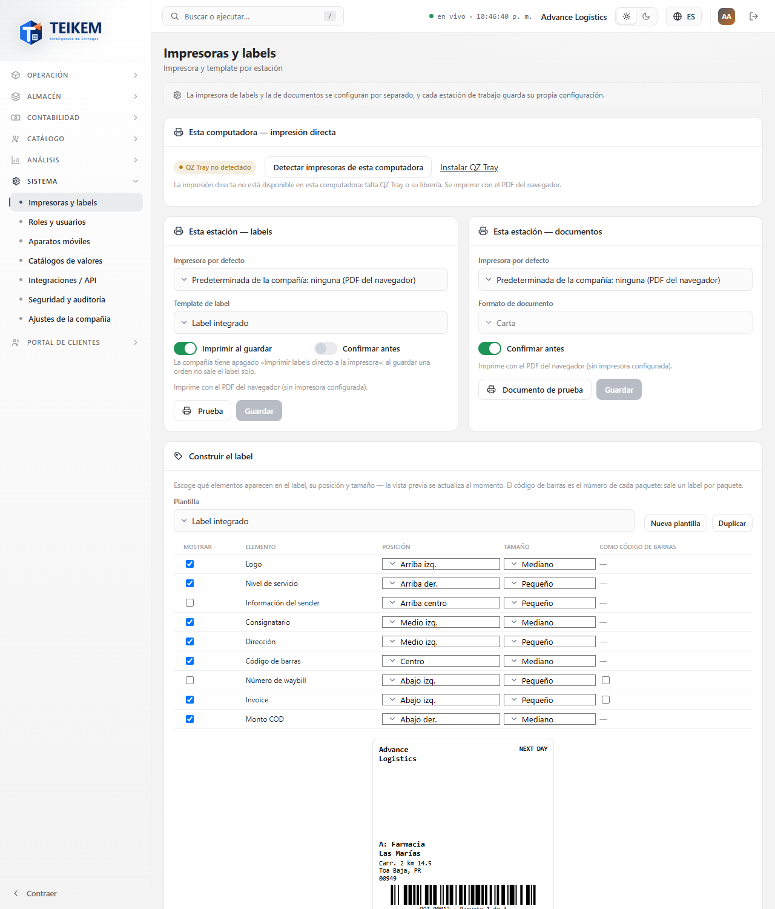
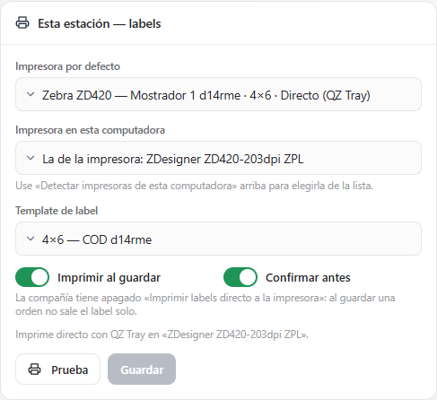
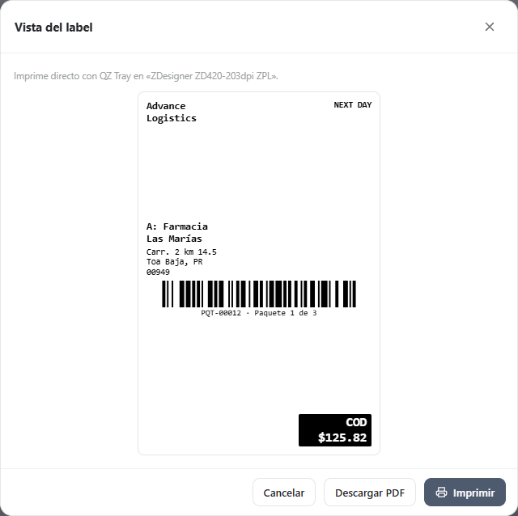
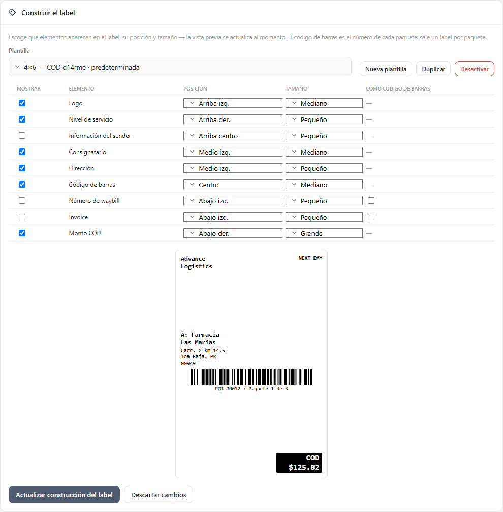
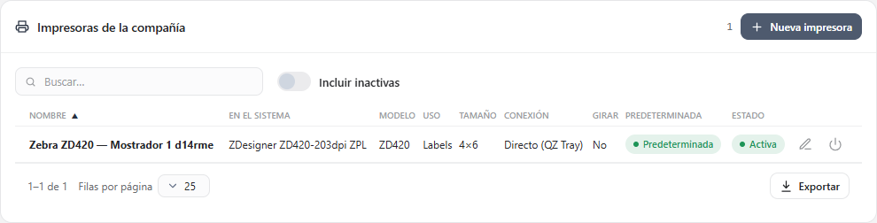
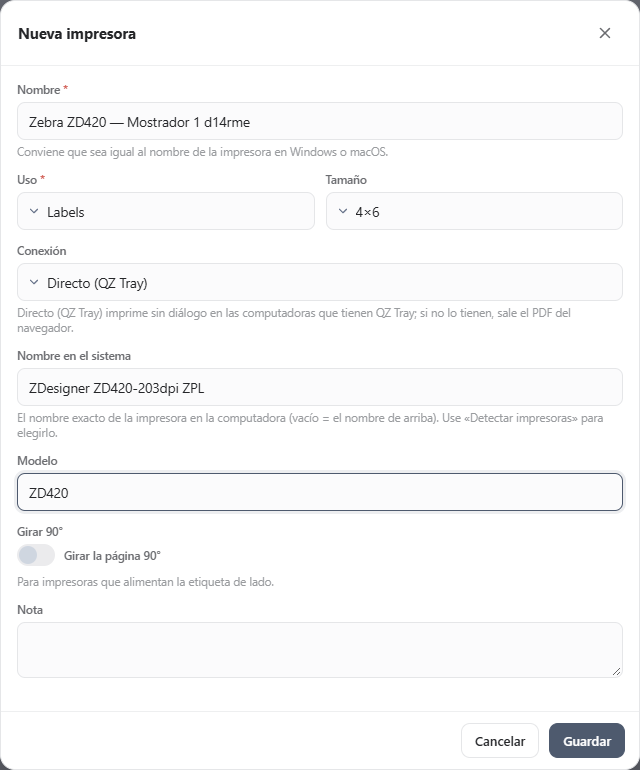

# FG1 — Impresoras y labels

**Sistema → Impresoras y labels** (`/system/printers`). Quién la ve: quien tiene el permiso **`printers.manage`** («Gestionar impresoras
y plantillas de label»; lo trae el rol Admin de compañía). El módulo es Sistema (siempre encendido). Sin el permiso, la entrada no
aparece en el menú y la dirección muestra «Sin permiso».

Aquí se configura **cómo imprime cada estación** (esta computadora con este navegador), se **construye el label** de envío y se
administran las **impresoras de la compañía**. Las reglas del servidor, los mensajes con su código y la instalación del certificado de
QZ Tray (soporte) están en el capítulo [12 — Impresoras y labels](../12-impresoras-y-labels.md).

## 1. Cómo imprime Teikem

- **Directo**: si la impresora es de conexión **«Directo (QZ Tray)»** y esta computadora tiene **QZ Tray** instalado y abierto, el label o
  el documento sale **directo a la impresora, sin diálogo**.
- **Respaldo**: si no (impresora «PDF del navegador», QZ Tray no instalado o cerrado, o falla), se abre el **diálogo de impresión del
  navegador** con el PDF; en un teléfono o tableta se **descarga** el PDF. Siempre se avisa por qué no salió directo.
- El label es **blanco y negro**, del **tamaño exacto** de la etiqueta (4×6, 4×4 o 4×2), **uno por paquete**; su **código de barras es
  el número del paquete**, con «Paquete i de N» debajo.

## 2. Esta computadora — impresión directa

El primer panel dice si **QZ Tray** está disponible en esta computadora:
- **«QZ Tray conectado»**: las impresoras de conexión QZ Tray imprimen sin diálogo.
- **«QZ Tray no detectado»**, con el enlace **Instalar QZ Tray** (qz.io) y el motivo: falta QZ Tray o su librería, o no está abierto.
  Mientras tanto todo se imprime con el PDF del navegador.
- **Detectar impresoras de esta computadora**: le pide a QZ Tray la lista de impresoras instaladas (sus nombres exactos de Windows o macOS)
  y la ofrece en «Impresora en esta computadora» de cada estación y en «Nombre en el sistema» de una impresora.
- Si el servidor no tiene el certificado de Teikem, al imprimir QZ Tray pregunta «Allow / Permitir» (soporte lo instala: capítulo 12 §9).

## 3. Esta estación — labels y documentos

Dos paneles iguales, como en la maqueta. Lo que se elige aquí queda **en este navegador** (cada estación guarda lo suyo) al pulsar
**Guardar**; Guardar se activa solo si hay cambios.

| Campo | Qué hace |
|---|---|
| Impresora por defecto | «Predeterminada de la compañía: …» (la que marque el administrador), una impresora de la lista (su tamaño y si es directa) o «PDF del navegador (sin impresora)». |
| Impresora en esta computadora | Solo con una impresora de conexión QZ Tray: el nombre exacto de la impresora en esta computadora (de «Detectar impresoras»). Vacío = el «Nombre en el sistema» de la impresora. |
| Template de label (labels) | «Predeterminada de la compañía: …», una plantilla o «Label integrado». |
| Formato de documento (documentos) | Solo **Carta** por ahora (factura, BOL y recibo llegan con facturación). |
| Imprimir al guardar (labels) | Si la compañía tiene encendido «Imprimir labels directo a la impresora», al guardar una orden esta estación imprime sus labels; apagado, esta estación no los imprime. |
| Confirmar antes | Antes de imprimir muestra la vista del label (o del documento) con **Imprimir** y **Descargar PDF**. |

- Debajo se lee por dónde imprime: «Imprime directo con QZ Tray en «…».», «Imprime con el diálogo del navegador (…).» o «Imprime con el
  PDF del navegador (sin impresora configurada).».
- **Prueba** (labels) imprime un label de ejemplo (Farmacia Las Marías, paquete PQT-00012, COD $125.82) con la impresora y la plantilla
  elegidas; **Documento de prueba** (documentos), una hoja carta. Con «Confirmar antes» primero sale la vista:

- Si la impresora o la plantilla elegidas en esta estación se desactivan, el panel avisa y usa la predeterminada de la compañía hasta que
  se elija otra y se guarde.

## 4. Construir el label

- **Plantilla**: las plantillas de la compañía (la predeterminada marcada «predeterminada», las inactivas «inactiva») y el **Label
  integrado**. Botones **Nueva plantilla** (parte del label integrado), **Duplicar** (copia lo que se ve), **Hacer predeterminada**,
  **Desactivar** / **Reactivar**.
- La tabla tiene los **9 elementos** de la maqueta: **Mostrar**, **Elemento**, **Posición** (9 zonas: Arriba izq., Arriba centro, Arriba
  der., Medio izq., Centro, Medio der., Abajo izq., Abajo centro, Abajo der.), **Tamaño** (Pequeño, Mediano, Grande) y **Como código de
  barras** (solo Número de waybill e Invoice). En un teléfono cada elemento es una tarjeta.
- La **vista previa** cambia al momento y es la misma que sale en el PDF: tres renglones (arriba, medio, abajo) con tres columnas, y los
  códigos de barras a todo el ancho de su renglón (el **Código de barras** es el número del paquete con «Paquete i de N»). El COD sale en
  caja negra y solo si la orden tiene COD.
- **Actualizar construcción del label** guarda la plantilla elegida (con el Label integrado elegido dice **Guardar como plantilla** y pide
  el nombre). **Descartar cambios** vuelve a lo guardado.
- Sin ningún código de barras visible no se puede guardar: «El label necesita al menos un código de barras para poder escanearlo.».

## 5. Ajustes de la compañía — Imprimir labels directo a la impresora

Interruptor de la compañía (apagado por defecto). Encendido, al guardar una orden de envío (entrada rápida o detallada) sale **un label
por cada paquete** a la impresora de labels de la estación, sin diálogo si la estación imprime con QZ Tray. La impresión al guardar
llega con las pantallas de Órdenes del bloque siguiente (F-G2); el ajuste ya se guarda.

## 6. Impresoras de la compañía

Tabla con **Nombre, En el sistema, Modelo, Uso, Tamaño, Conexión, Girar, Predeterminada y Estado**, buscador libre e **Incluir
inactivas**. Acciones por fila: editar (lápiz), **Hacer predeterminada**, **Desactivar** (pide confirmar; si es la predeterminada, avisa
que su uso queda sin predeterminada) y **Reactivar**.

**Nueva impresora** abre el formulario:

| Campo | Regla y mensaje |
|---|---|
| Nombre | Obligatorio («Escriba el nombre de la impresora.»), hasta 80; no puede repetir el de otra activa (409 «Ya existe una impresora activa con ese nombre.»). Conviene el mismo de Windows. |
| Uso | Labels o Documentos. **Se fija al crearla** (en la edición se ve pero no se cambia). |
| Tamaño | Labels: 4×6, 4×4 o 4×2. Documentos: Carta. |
| Conexión | Directo (QZ Tray) o PDF del navegador. |
| Nombre en el sistema | Con QZ Tray: el nombre exacto en la computadora (lista de «Detectar impresoras»); hasta 200. |
| Modelo / Nota | Opcionales (80 y 300). |
| Girar 90° | Para impresoras que alimentan la etiqueta de lado. |

La primera impresora activa de cada uso queda como predeterminada.

## 7. Casos frecuentes

- **Prueba abrió el diálogo del navegador**: la impresora no es «Directo (QZ Tray)» o esta computadora no tiene QZ Tray abierto (vea el
  primer panel). Instálelo, ábralo y pulse «Detectar impresoras de esta computadora».
- **QZ Tray pregunta «Allow»**: falta el certificado de Teikem en el servidor o en esa computadora (soporte, capítulo 12 §9).
- **El label sale cortado en 4×2**: aparece «El label no cabe en 4×2: quite elementos o use una etiqueta más grande.»; quite elementos o
  use tamaños Pequeño.
- **Desactivé la predeterminada y ahora sale el PDF**: haga otra predeterminada o elija una en la estación.
- **En otra computadora no está mi configuración**: es por estación; configúrela y pulse Guardar en cada computadora.
