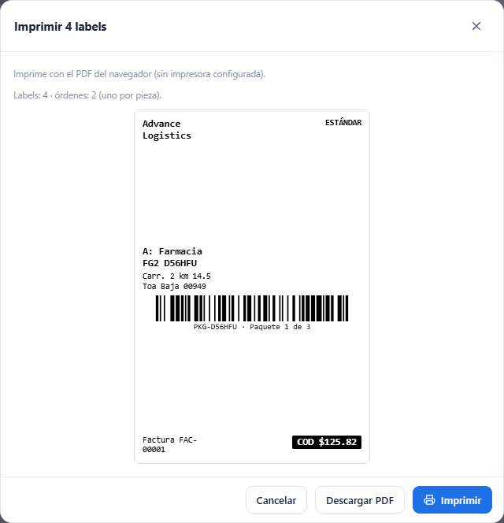
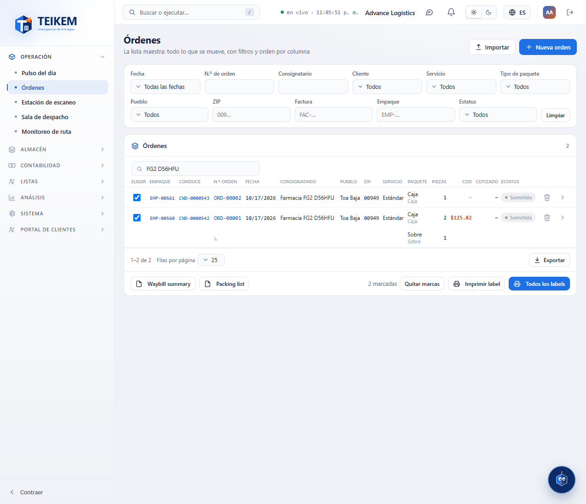

# F-G2 — Labels y documentos de las órdenes

Desde F-G2 se imprimen los **labels** de las órdenes (uno por pieza), el **Waybill summary**, la **Packing list** y el **Informe de
faltantes** de la estación de escaneo. Todo sale por las impresoras de **esta estación** (Sistema → Impresoras y labels, capítulo
[F-G1](fg1-impresoras.md)): directo con **QZ Tray** si la impresora es de esa conexión y QZ Tray está abierto; si no, con el diálogo de
impresión del navegador (en un teléfono se descarga el PDF). Las reglas y los mensajes están en el capítulo
[12 §10](../12-impresoras-y-labels.md). Nunca se imprime el precio de una orden.

## 1. Qué lleva un label

- **Uno por pieza**: la cantidad de cada línea de la orden (de la unidad que sea) es el número de labels de esa línea.
- El **código de barras** es el **número del paquete** de la línea (el mismo en sus piezas), con el número legible y «Paquete i de N» debajo
  (i corre sobre todas las piezas de la orden). La estación de escaneo lo reconoce.
- Además (según la plantilla): el nombre de la compañía, el nivel de servicio, «De:» el cliente, «A:» el consignatario y su dirección, el
  número de waybill (= número de la orden), la factura del cliente y el COD en caja negra si la orden lo tiene.
- No se imprimen las órdenes **canceladas** («{N} órdenes canceladas no se imprimieron.») ni las piezas de una línea **sin número de
  paquete** («{N} piezas sin número de paquete no se imprimieron.»). Desde 500 labels avisa que el PDF será grande; no hay tope.

Con **«Confirmar antes»** encendido en la estación, primero aparece la vista: cuántos labels, por qué impresora sale y el primer label, con
**Imprimir**, **Descargar PDF** y **Cancelar**.

## 2. Lista de Órdenes

- **Elegir**: casilla al inicio de cada orden. Las marcas se recuerdan al cambiar de página; el pie dice «N marcadas» con **Quitar marcas**.
- En el pie de la tabla, como en la maqueta:
  - **Waybill summary** y **Packing list**: de las órdenes **marcadas** o, sin marcas, de **todo lo que dicen los filtros y la búsqueda**
    (todas las páginas). Salen en papel carta por la impresora de documentos de la estación.
    - *Waybill summary*: una fila por orden (Empaque, N.º de envío, Factura, Cliente, Consignatario, Pueblo, ZIP, Servicio, Paquetes, Piezas,
      COD), agrupado por cliente con subtotales y total general.
    - *Packing list*: una sección por orden (empaque, orden, factura, consignatario y dirección) con sus paquetes (tipo, n.º de paquete,
      descripción, piezas, peso) y totales.
  - **Imprimir label**: los labels de las órdenes **marcadas**. Sin marcas está gris: «Para imprimir solo algunas, márquelas en la lista con
    sus casillas.».
  - **Todos los labels**: los labels de todo lo filtrado (todas las páginas).

## 3. Ficha de la orden

**Imprimir label** en la cabecera imprime los labels de esa orden (no aparece en una orden cancelada o eliminada). POD llegará más adelante.

## 4. «Label al guardar» (entrada rápida y detallada)

- **Entrada rápida**: el interruptor está en la franja de arriba, junto a «Enter guardar». Encendido, cada fila guardada imprime los labels de
  su orden.
- **Detallada**: el interruptor está en el ticket, sobre «Guardar borrador / Guardar y confirmar», con la nota «El label sale automático en
  la impresora de esta estación al guardar (uno por pieza)…».
- Viene encendido cuando la compañía tiene **«Imprimir labels directo a la impresora»** y esta estación no apagó su «Imprimir al guardar»;
  se puede cambiar mientras se captura.
- **Un fallo de impresión nunca deshace la orden**: «La orden se guardó, pero no se pudo imprimir el label: {motivo}. Use «Imprimir label» en
  la ficha.».

## 5. Estación de escaneo

- **Informe de faltantes** (junto a «Voz»; necesita `trips.view`): las órdenes que siguen **pendientes por escanear** con los mismos
  filtros de la pantalla (Zona, Cliente, Código postal, Pueblo), todas, agrupadas por **zona** («Sin zona» y «Zona ambigua» al final), con
  Empaque, Orden, Factura, Cliente, Consignatario, Pueblo, ZIP, Piezas y Fecha pedida, y arriba cuántas quedan pendientes y cuántas se
  escanearon en esta sesión. Sale en carta por la impresora de documentos de la estación.
- **Escanear el label**: el número de paquete del label encuentra su orden («Encontrada por número de paquete.»). Si ese número lo tienen
  varias órdenes (cada cliente numera sus paquetes desde PQT-00001): «El número de paquete está en {n} órdenes (de clientes distintos o
  repetido); escanee el empaque o el número de envío.».

## 6. Casos frecuentes

- **Salió el diálogo del navegador en vez de imprimir directo**: la impresora de la estación no es «Directo (QZ Tray)» o QZ Tray no está
  abierto en esta computadora (el aviso dice el motivo). Ver [F-G1](fg1-impresoras.md).
- **Faltan labels de una orden**: sus líneas no tienen número de paquete (el aviso dice cuántas piezas). Póngalo en la ficha y vuelva a
  imprimir.
- **«Imprimir label» está gris**: marque las órdenes; para todas use «Todos los labels».
- **El Waybill summary trae más órdenes de las que quería**: sin marcas usa todo lo filtrado; marque las que quiere o ajuste los filtros.
