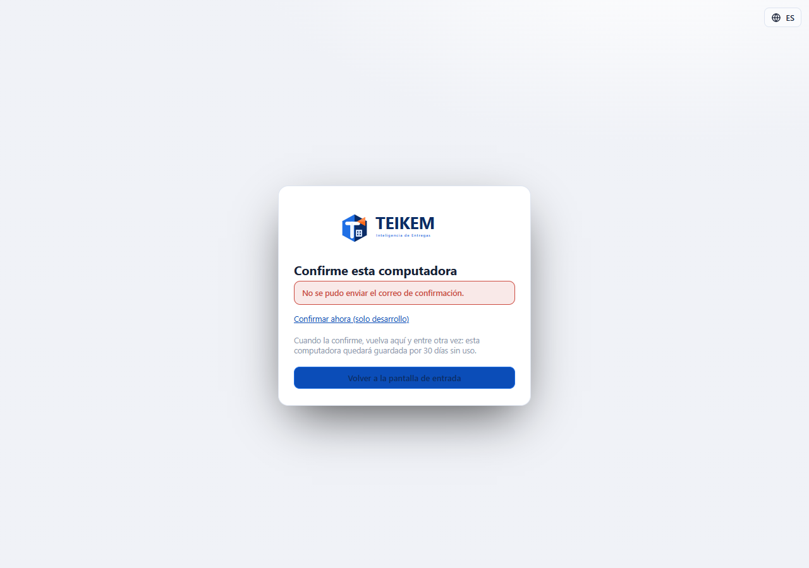
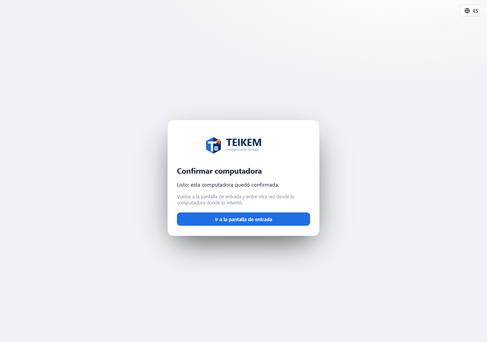
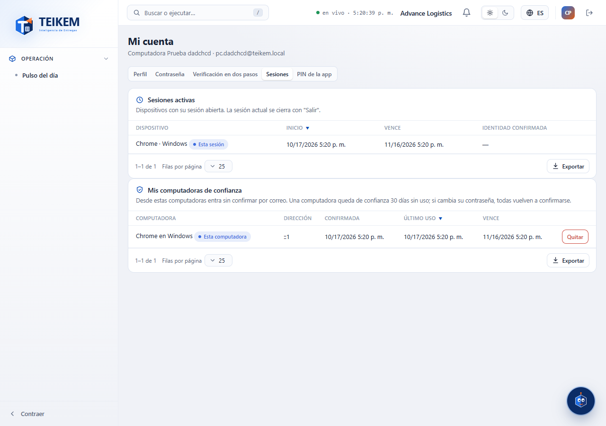

# L100 — Computadoras de confianza (pantallas)

Reglas, mensajes y cómo encenderlo: [capítulo 25](../25-acceso-seguro.md).

## Entrar desde una computadora nueva

Con la función encendida, al entrar bien con la contraseña desde una computadora que no se reconoce sale **«Confirme esta computadora»**: «Le enviamos un correo a j***@empresa.com» y las instrucciones (el enlace vale 24 horas y se puede abrir desde el teléfono). **«Volver a la pantalla de entrada»** regresa al formulario. *(La captura es del ambiente de desarrollo, donde no hay proveedor de correo: dice que no se pudo enviar y ofrece el enlace de confirmación solo para pruebas.)*

## El enlace del correo

`/confirm-browser?token=…` confirma la computadora y dice «Listo: esta computadora quedó confirmada.» con el botón **«Ir a la pantalla de entrada»**; un enlace vencido o usado muestra «El enlace no es válido o venció. Vuelva a intentar entrar para recibir uno nuevo.»

## Mis computadoras de confianza

**Mi cuenta → Sesiones**, debajo de las sesiones activas: computadora («Chrome en Windows», con la etiqueta **Esta computadora** en la actual), dirección, cuándo se confirmó, último uso y cuándo vence. **Quitar** (con confirmación) la manda a confirmar por correo la próxima vez. Funciona de 360 px en adelante (en el celular la tabla se ve como tarjetas), sin scroll horizontal de página.

## Archivos
`kernel/auth/browserToken.ts` (la marca de la computadora), `features/auth/LoginPage.tsx` (pantalla de confirmación), `features/auth/ConfirmBrowserPage.tsx` (`/confirm-browser`), `features/account/TrustedBrowsersPanel.tsx` (+ `api.ts`); textos `auth.browser.*` y `account.trusted.*` (es/en); pruebas `auth/browserConfirm.test.tsx` y el recorrido `e2e/lote100-computadora-confianza.spec.ts` (se salta solo si el API no tiene la función encendida).
