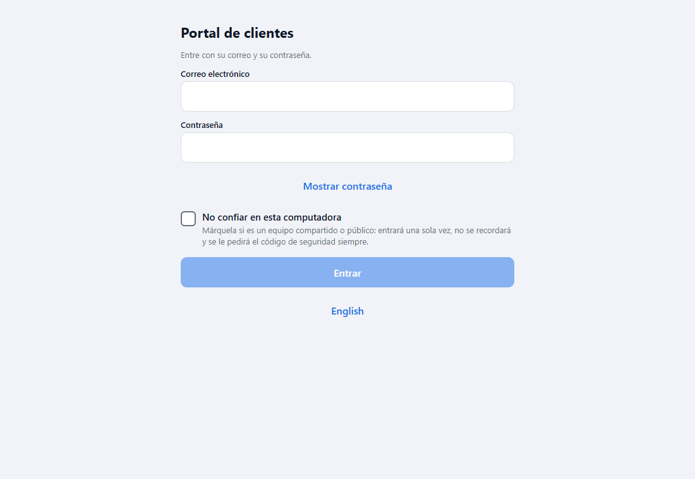
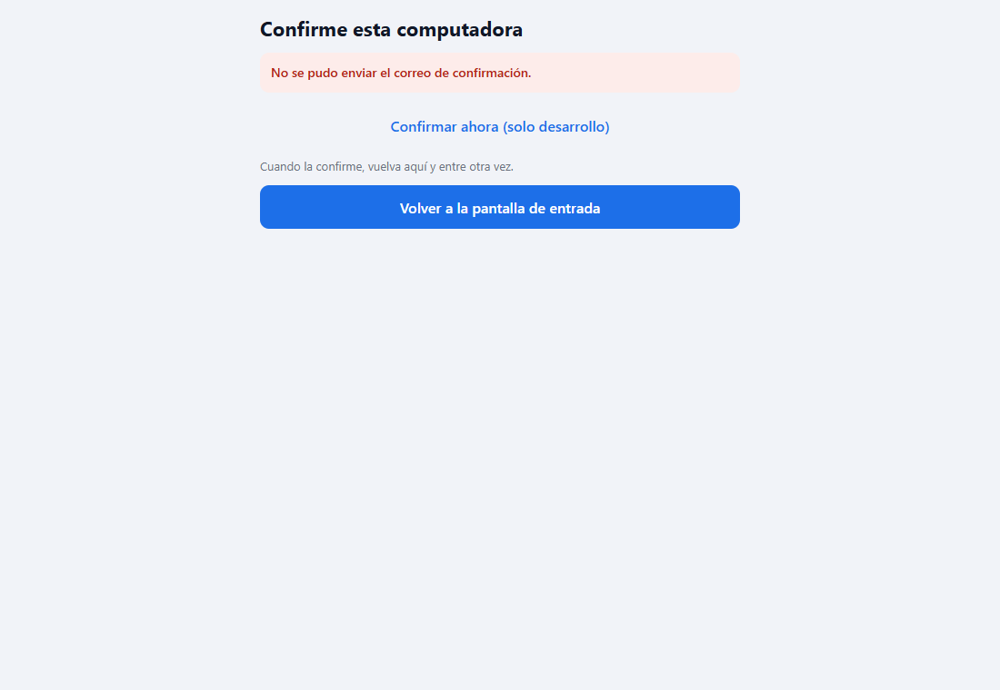
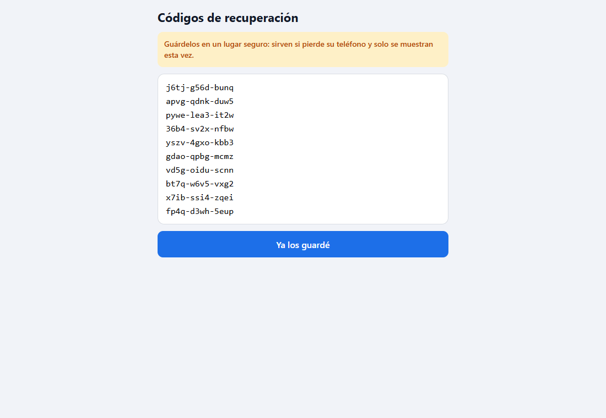
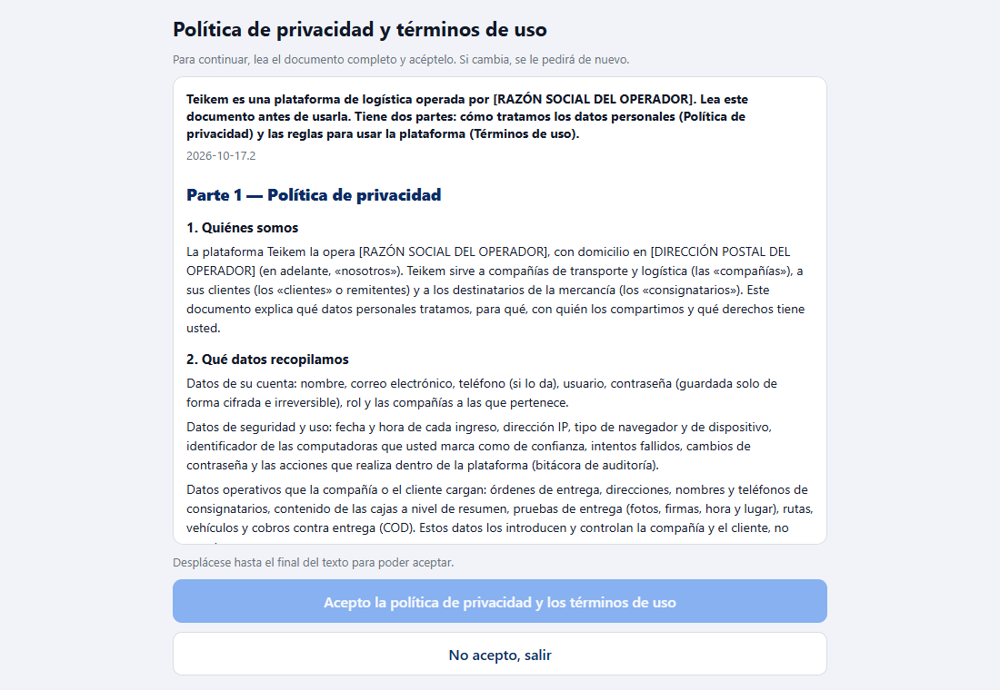
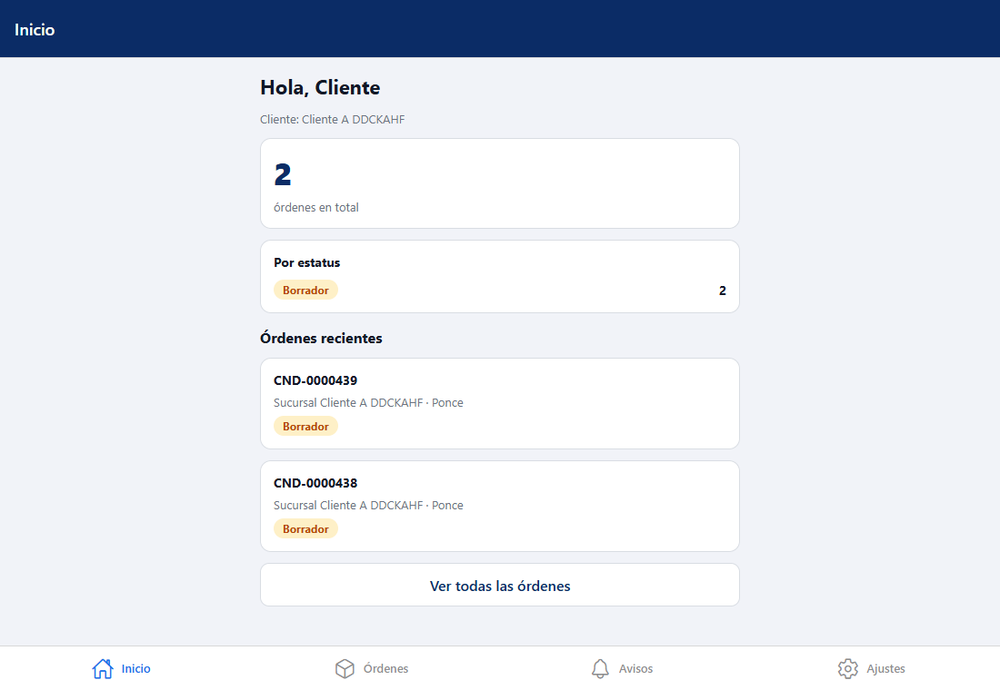
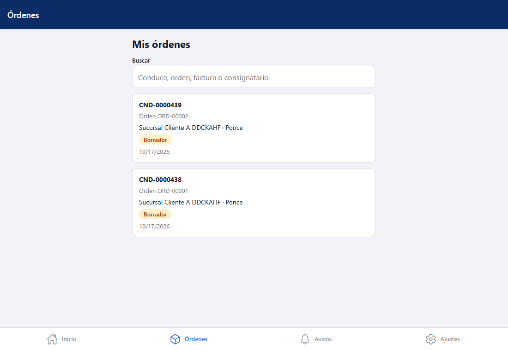
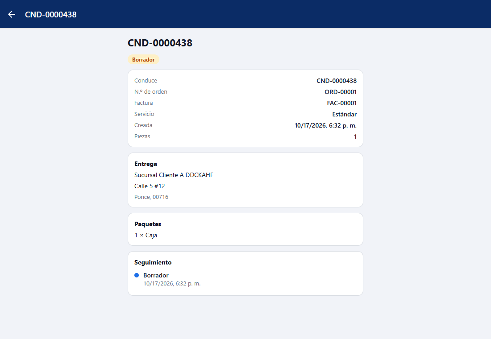
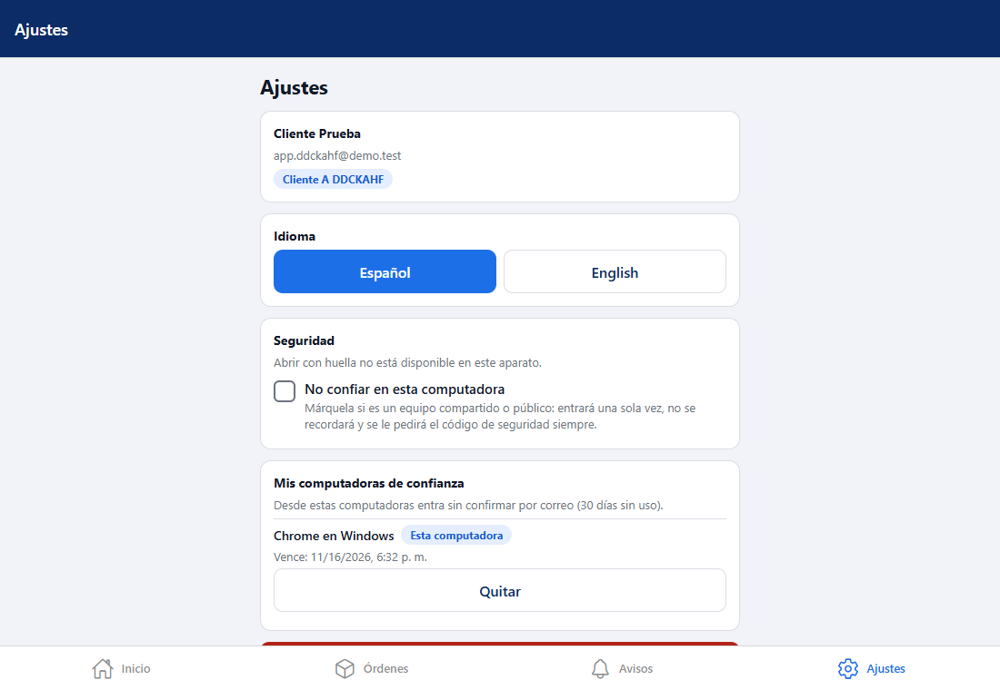
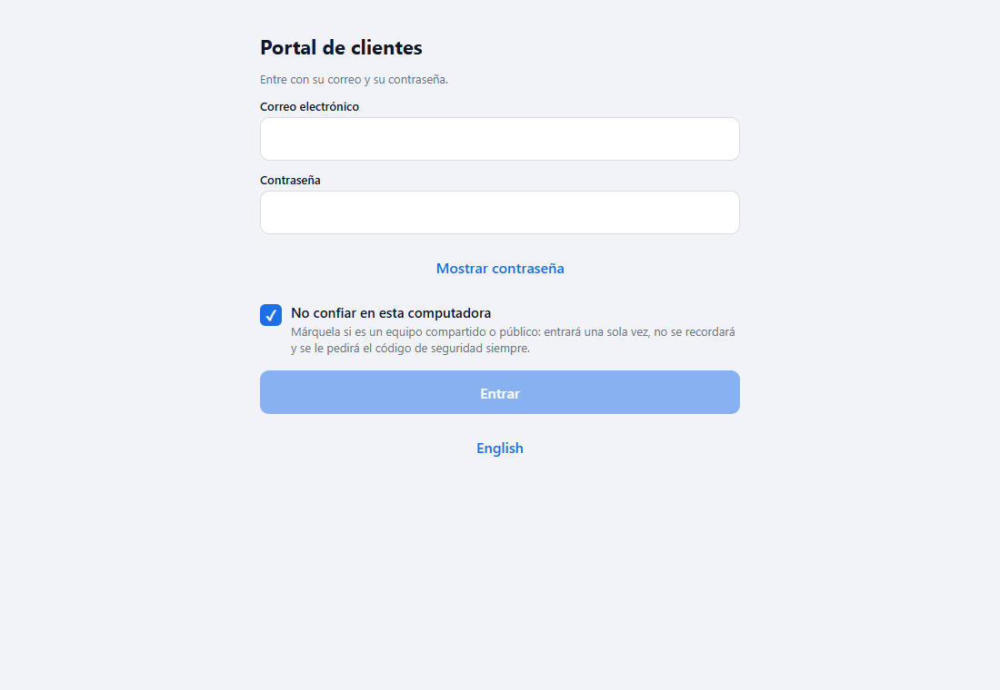

# L102 — App del cliente (pantallas)

Reglas y mensajes: [capítulo 27](../27-app-cliente.md) y [capítulo 26](../26-portal-acceso.md). Las capturas son de la versión **web** a 1100 px; en el teléfono es la misma interfaz en una columna.

## Entrar y confirmar la computadora

Correo, contraseña («Mostrar contraseña») y la casilla **«No confiar en esta computadora»**. La primera vez desde una computadora nueva:

*(La captura es del ambiente de desarrollo, sin proveedor de correo: dice que no se pudo enviar y ofrece el enlace solo para pruebas. Con el correo configurado dice «Le enviamos un correo a a***@cliente.co».)*

## Segundo paso (MFA)

La primera vez se inscribe la app de autenticación (clave de configuración, enlace para abrirla, código) y se muestran los **códigos de recuperación una sola vez**; después viene «Código de seguridad».

## Documento legal

«Acepto» está apagado hasta llegar al final del texto («Desplácese hasta el final del texto para poder aceptar.»).

## Inicio, órdenes, ficha

El inicio muestra el total, las órdenes por estatus y las más recientes; Órdenes busca y carga de 20 en 20; la ficha trae la entrega, los paquetes y el **seguimiento**.

## Ajustes

Cuenta, cambiar de cliente (con varios), idioma, seguridad (**Abrir con huella** solo en el teléfono; en la web explica que no está disponible), «No confiar en esta computadora» y **mis computadoras de confianza**.

La casilla **se recuerda**: al volver al login sale marcada.

## Archivos
`app-cliente/`: `src/app/*` (rutas), `src/features/{login,legal,lock,home,orders,notices,settings}`, `src/kernel/{api,auth,i18n,ui,storage.ts}`; textos es/en; pruebas jest (39) y el recorrido `web-app/e2e/lote102-app-cliente.spec.ts` (contra el API real; se salta si el API no devuelve el token de invitación).
