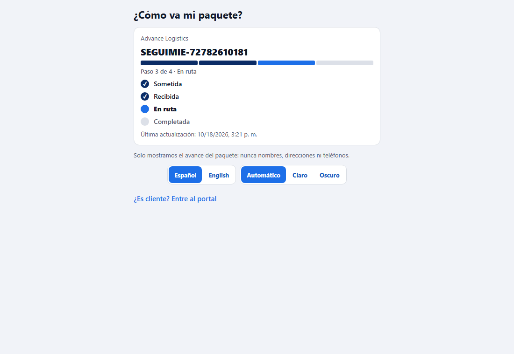
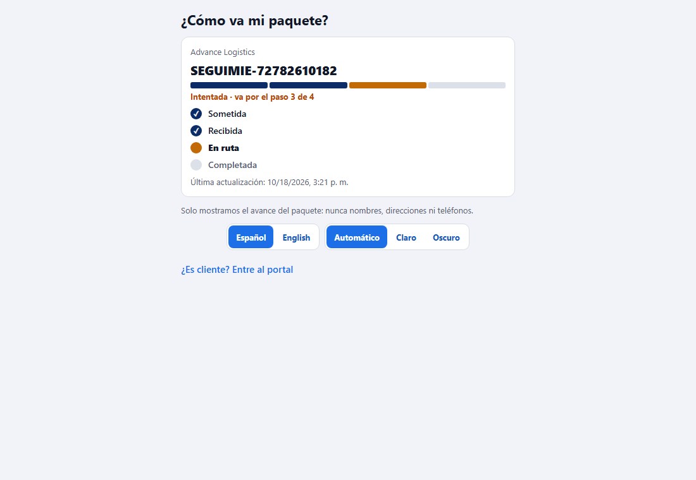
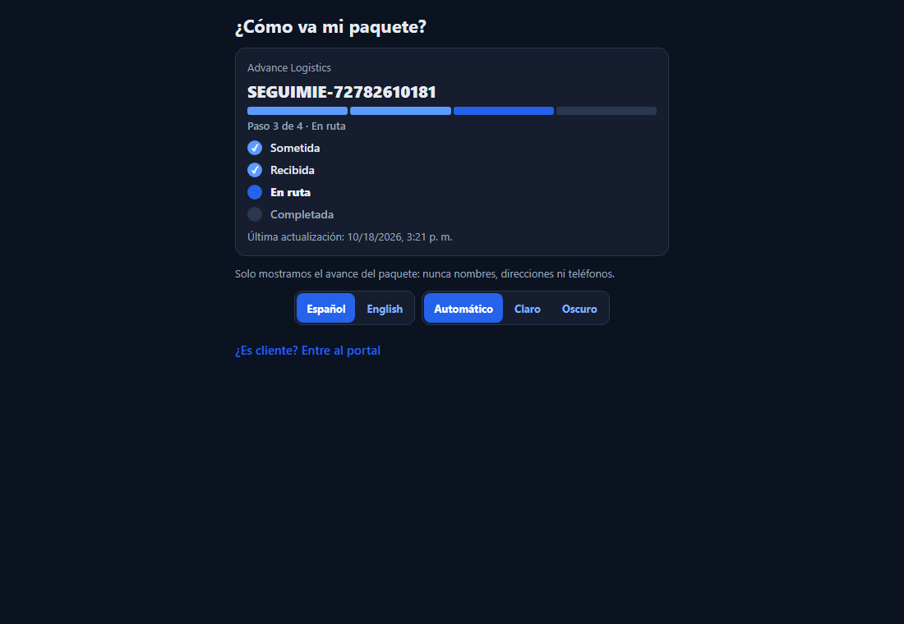
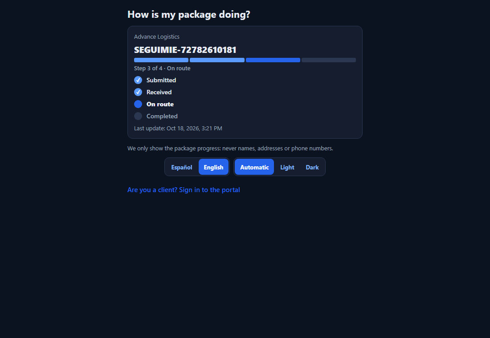
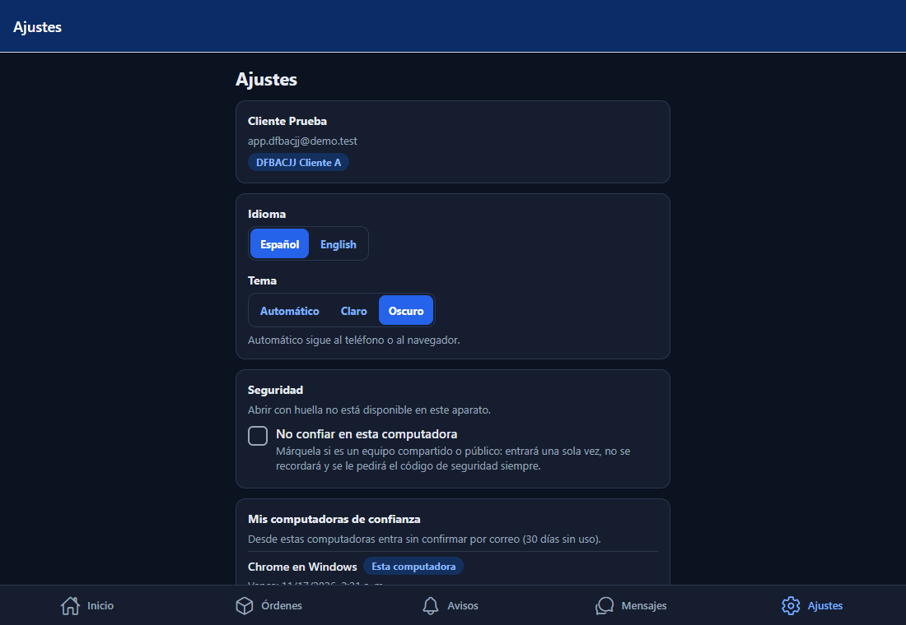
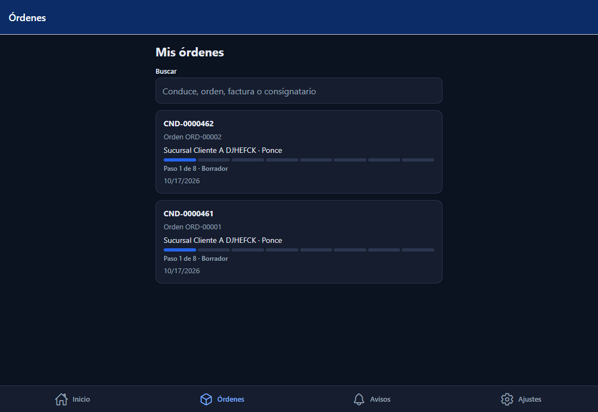

# L103 — «¿Cómo va mi paquete?» y la barra de progreso (pantallas)

Reglas y mensajes: [capítulo 28](../28-como-va-mi-orden.md). **Desde el Lote 116 la página es solo por enlace con token** (se quitaron la búsqueda por número de conduce y el ajuste «Seguimiento público» de la compañía); las capturas de esta página se tomaron con el recorrido `web-app/e2e/lote103-seguimiento.spec.ts`, reescrito para el enlace. Capturas de la versión **web** a 1100 px (en el teléfono es la misma interfaz en una columna).

## La página pública

Sin sesión, al abrir el enlace del aviso se ve el **avance**: el nombre de la compañía, el conduce, la barra de **cuatro etapas** (Sometida, Recibida, En ruta, Completada), «Paso 3 de 4 · En ruta», la lista de etapas con la actual resaltada y la última actualización. Abajo: «Solo mostramos el avance del paquete: nunca nombres, direcciones ni teléfonos» y el enlace al portal.

Una orden con **Intento fallido**: la barra se queda donde iba, la etapa actual sale en ámbar y el texto dice «Intentada · va por el paso 3 de 4». Una **cancelada** sale con todas las etapas apagadas; una **entregada**, toda en verde.

## Tema oscuro e inglés

En la página pública, el login, el documento legal y Ajustes hay dos selectores: **Español / English** y **Automático / Claro / Oscuro**. Automático sigue al aparato; lo que se escoja se recuerda.

## En el portal del cliente

Cada orden de la **lista** (y del inicio) trae su barra baja con «Paso N de M · estatus».

La **ficha** trae la barra y la **lista de etapas**.

## Archivos
`app-cliente/src/features/{progress,track}/` (`ProgressBar`, `ProgressSteps`, reglas, `TrackScreen`) y la ruta pública `src/app/track/[token].tsx` (la compuerta de `_layout.tsx` no la redirige); textos es/en; pruebas jest (`progress.test.tsx`, `TrackScreen.test.tsx`) y el recorrido `web-app/e2e/lote103-seguimiento.spec.ts`.
