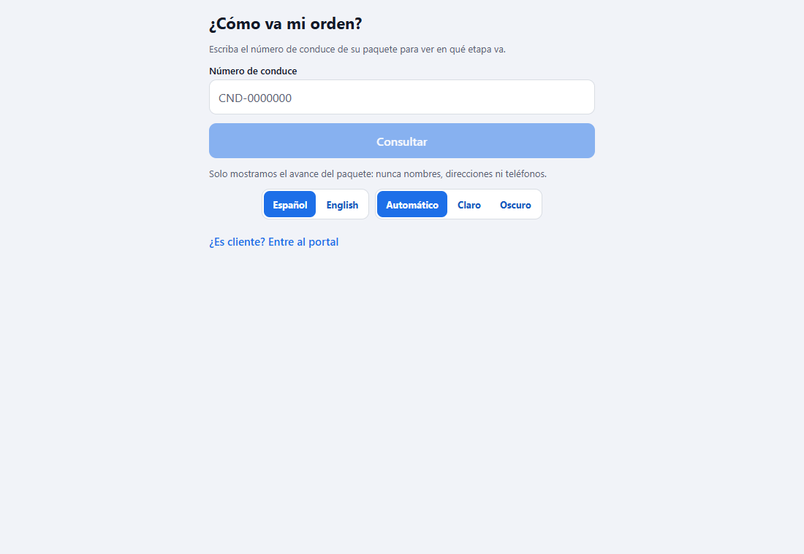
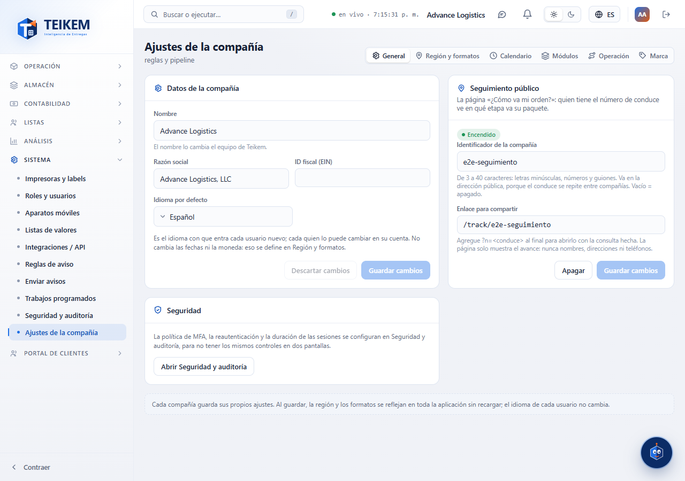
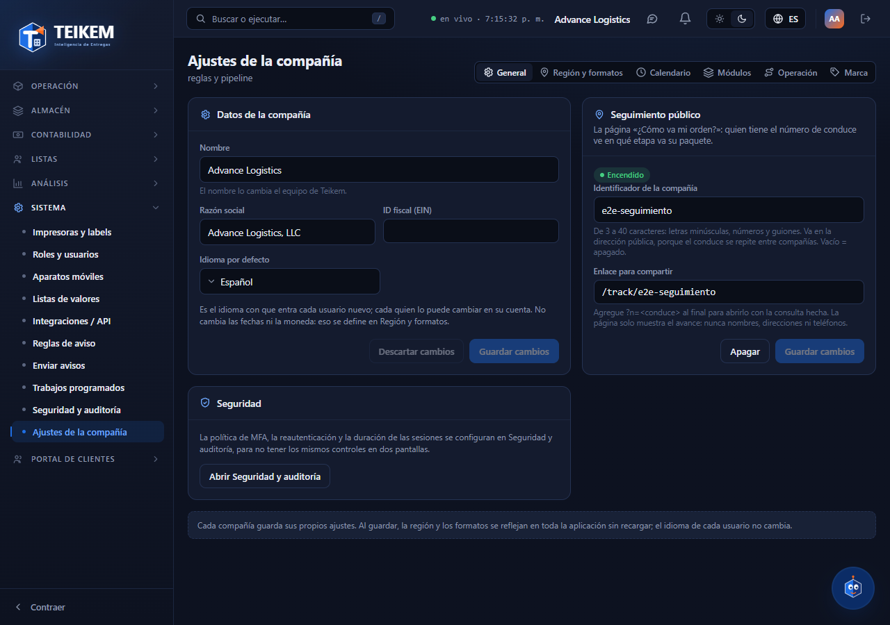

# L103 — «¿Cómo va mi orden?» y la barra de progreso (pantallas)

Reglas y mensajes: [capítulo 28](../28-como-va-mi-orden.md). Capturas de la versión **web** a 1100 px (en el teléfono es la misma interfaz en una columna).

## La página pública

Sin sesión: se escribe el número de conduce y se ve el **avance**: el nombre de la compañía, el conduce, la barra con **una etapa por estatus de la compañía** (aquí 8), «Paso 1 de 8 · Borrador», la lista de etapas con la actual resaltada y la última actualización. Abajo: «Solo mostramos el avance del paquete: nunca nombres, direcciones ni teléfonos» y el enlace al portal.

Una orden **en espera** (o parcial, o fallida): la barra se queda donde iba, la etapa actual sale en ámbar y el texto dice «En espera · va por el paso 1 de 8». Una **cancelada** sale con todas las etapas apagadas; una **entregada**, toda en verde.

## Tema oscuro e inglés

En la página pública, el login, el documento legal y Ajustes hay dos selectores: **Español / English** y **Automático / Claro / Oscuro**. Automático sigue al aparato; lo que se escoja se recuerda.

## En el portal del cliente

Cada orden de la **lista** (y del inicio) trae su barra baja con «Paso N de M · estatus».

La **ficha** trae la barra y la **lista de etapas**.

## En la web de la compañía: encender el seguimiento

**Ajustes de la compañía → General → Seguimiento público**: Encendido/Apagado, el identificador, el enlace para compartir (se agrega `?n=<conduce>` para abrirlo con la consulta hecha) y «Apagar».

La web de la compañía ya trae su selector ☀/🌙 (arriba a la derecha): el panel de Seguimiento público se ve igual en los dos temas.

## Archivos
`app-cliente/src/features/{progress,track}/` (`ProgressBar`, `ProgressSteps`, reglas, `TrackScreen`) y la ruta `src/app/track/[company].tsx` (pública: la compuerta de `_layout.tsx` no la redirige); `web-app/src/features/system/{trackingApi.ts,settings/TrackingPanel.tsx}`; textos es/en; pruebas jest (`progress.test.tsx`, `TrackScreen.test.tsx`), vitest (`TrackingPanel.test.tsx`) y el recorrido `web-app/e2e/lote103-seguimiento.spec.ts`.
