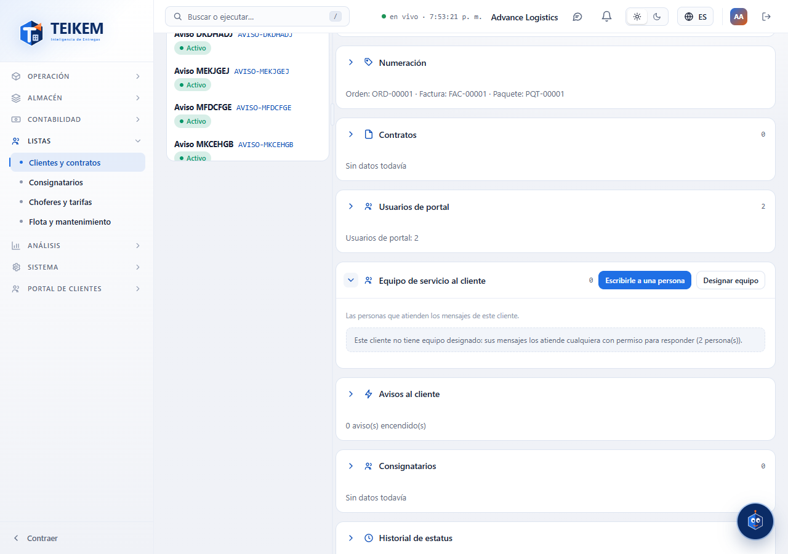
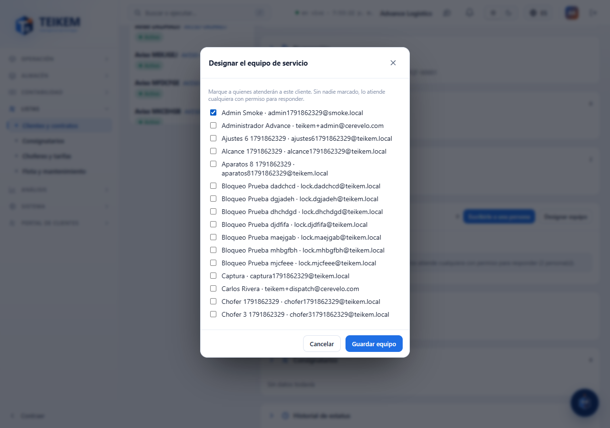
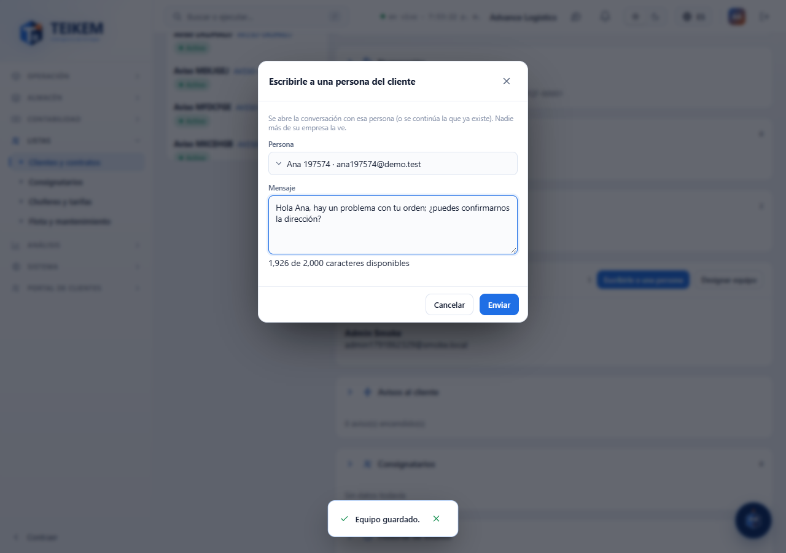
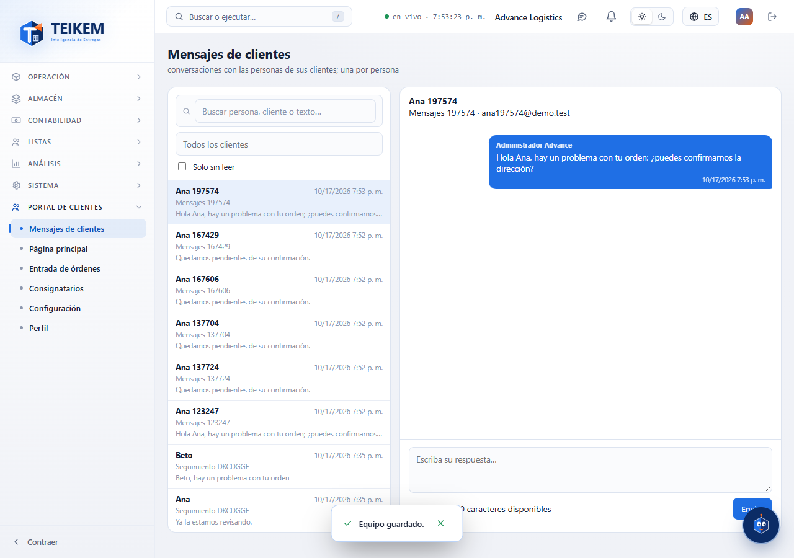
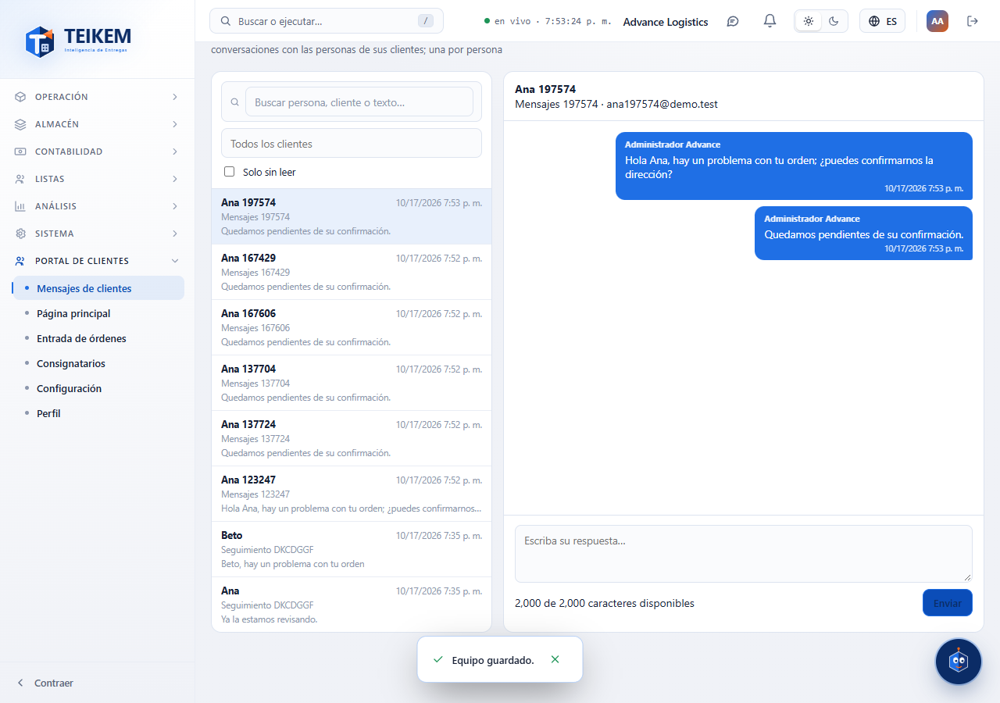
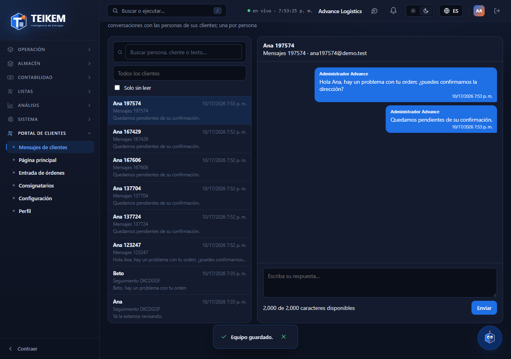

# L104 — Mensajes con el equipo de servicio al cliente (pantallas)

Lote 104 (portal de clientes). Reglas y mensajes de error en el [capítulo 29](../29-mensajes-con-el-cliente.md). Todo con tema **claro y oscuro** y **español / inglés**.

## Web de la compañía
1. **Ficha del cliente → Equipo de servicio al cliente** (módulo CLIENT_PORTAL, `clientmessages.reply`): sin equipo, la nota avisa que lo atiende cualquiera con permiso para responder.
   
2. **Designar equipo** (`clientmessages.manage`): se marcan las personas de la compañía que atienden al cliente y se guarda.
   
3. **Escribirle a una persona**: se elige la persona del cliente y se escribe el primer mensaje; abre la bandeja en esa conversación.
   
4. **Portal de clientes → Mensajes de clientes** (`/portal/messages`): lista a la izquierda (búsqueda, cliente, «Solo sin leer», no leídos) y conversación a la derecha; las del equipo van a la derecha en azul. En móvil se ve una u otra con «Volver».
   
5. **Responder**: vacío → «Escriba el mensaje.»; el contador muestra los caracteres disponibles (2000).
   
6. **Tema oscuro**: 

El menú «Mensajes de clientes» muestra la insignia de conversaciones sin leer (se actualiza cada 30 s).

## App del cliente
Pestaña **Mensajes** (burbujas, «Cargar mensajes anteriores», contador de caracteres, insignia de no leídos en la pestaña). Cubierta por pruebas jest (el recorrido del cliente completo requiere el segundo paso de seguridad y está en las pruebas del servidor y la verificación contra SQL real).
