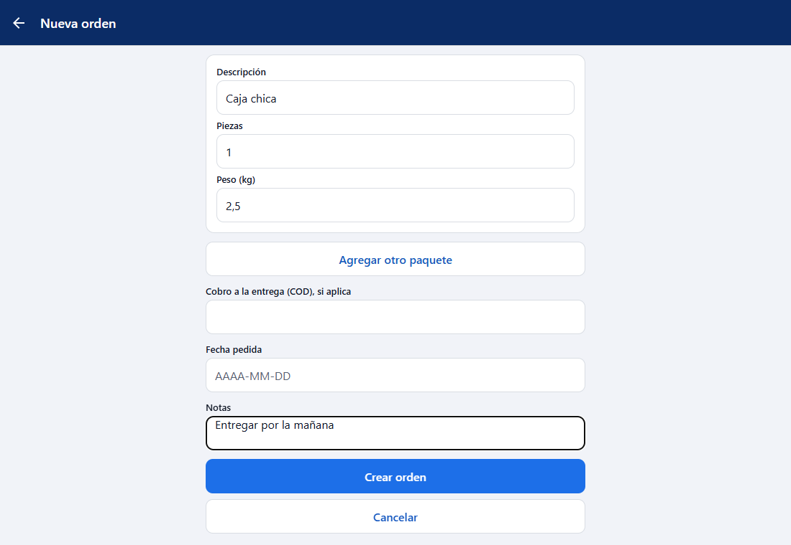
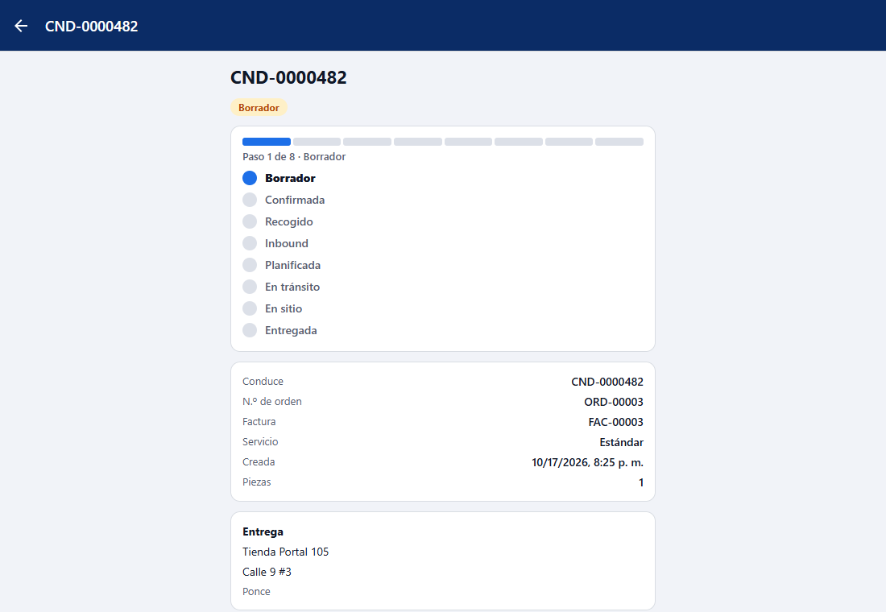

# L105 — Nueva orden en la app del cliente (pantallas)

Reglas y errores en el [capítulo 30](../30-nueva-orden-del-cliente.md). Pestaña **Órdenes → Nueva orden** (solo administradores y operadores del cliente). Tema claro/oscuro y español/inglés.

1. **El formulario:** consignatario (uno de los suyos o «Escribir un consignatario nuevo»), recogida, paquetes, COD, fecha y notas. 
2. **Lleno:** 
3. **Creada:** se abre la ficha de la orden con su seguimiento. 

Enviar vacío avisa «Escoja el consignatario o escriba uno nuevo…» sin mandar nada.
