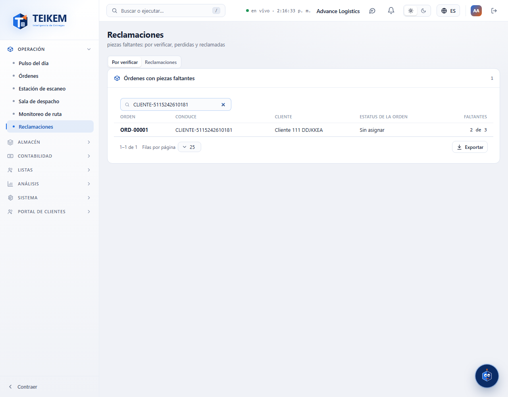
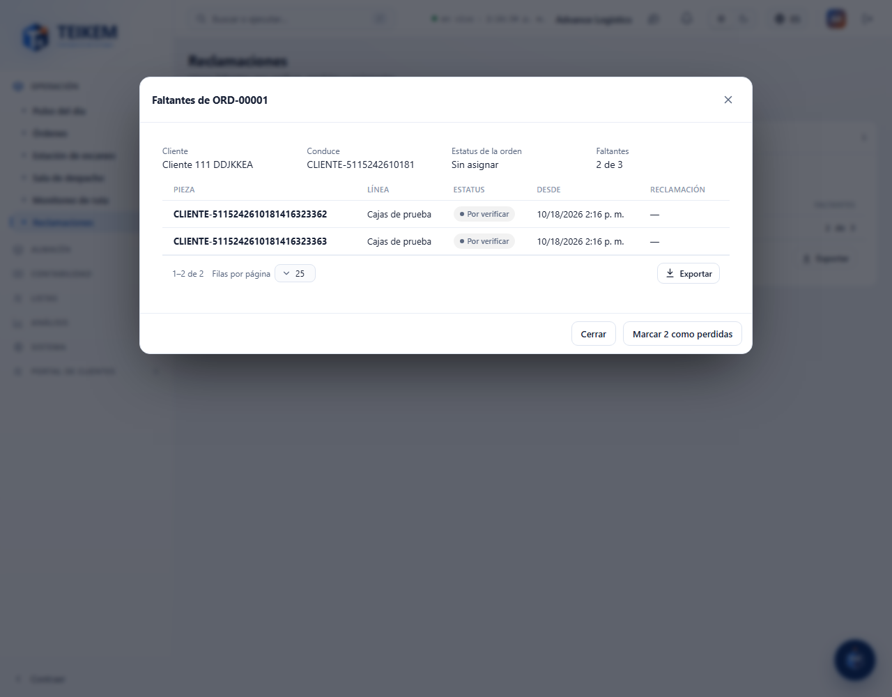
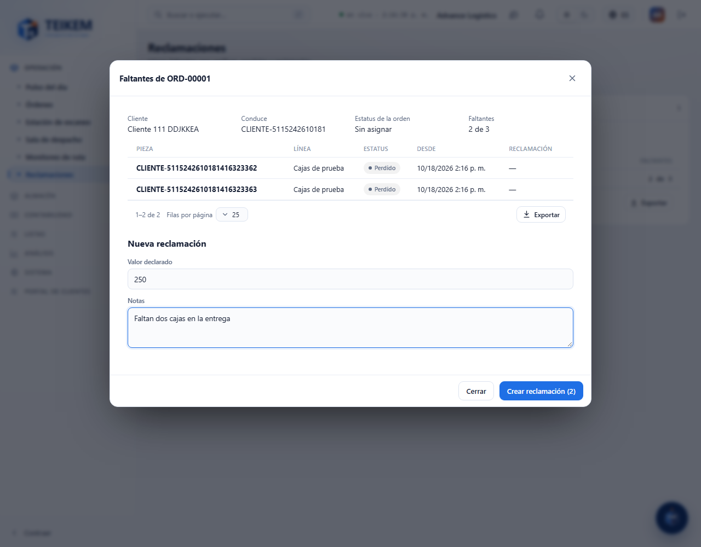
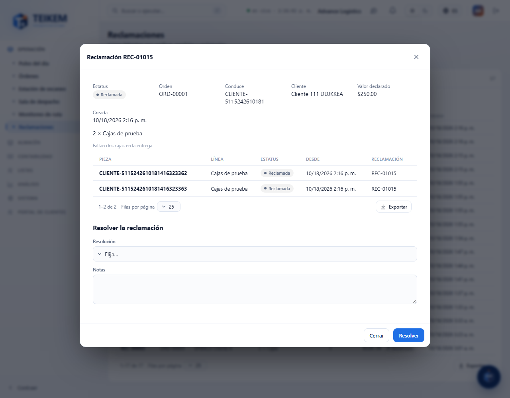
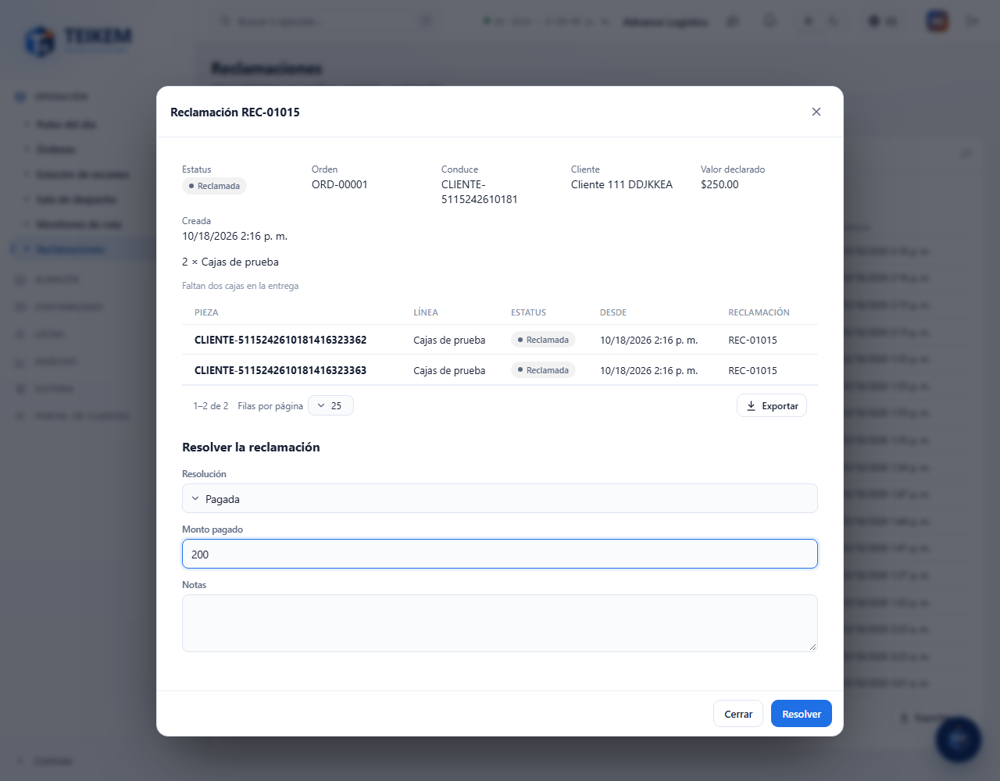
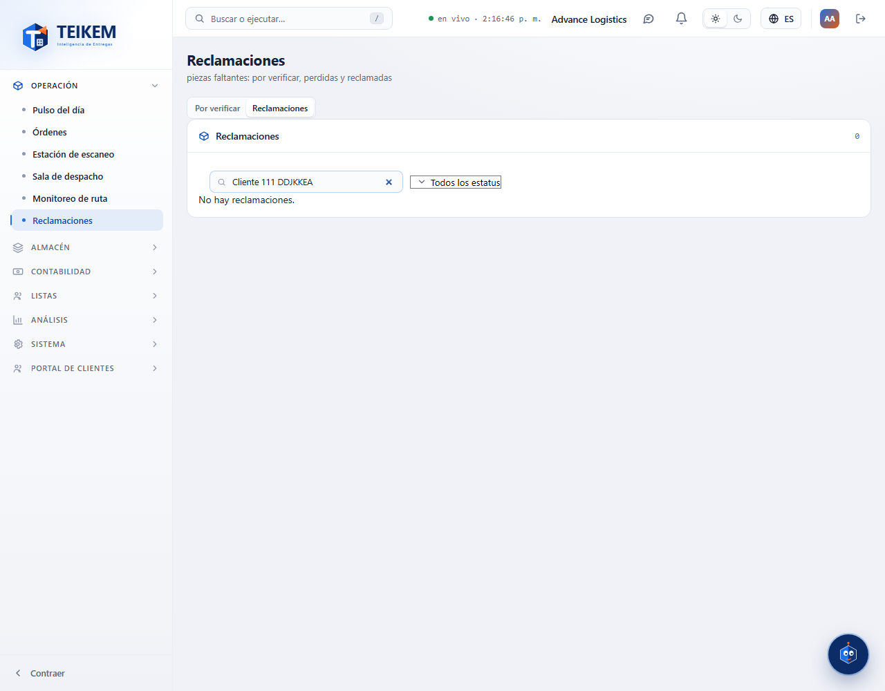
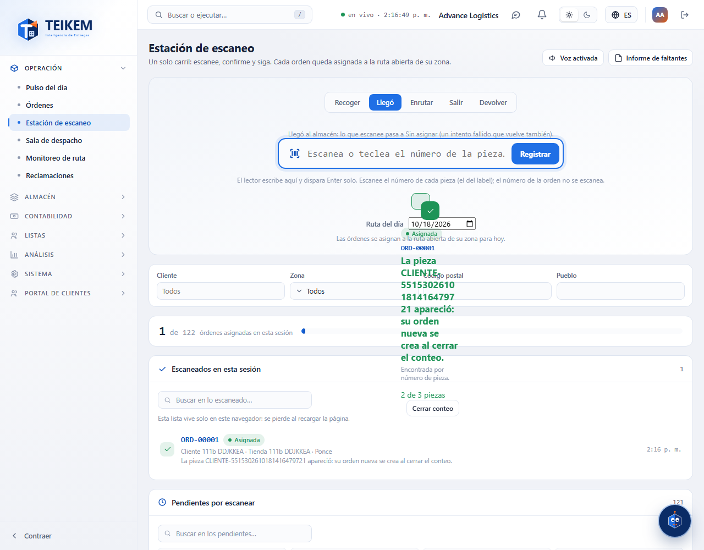
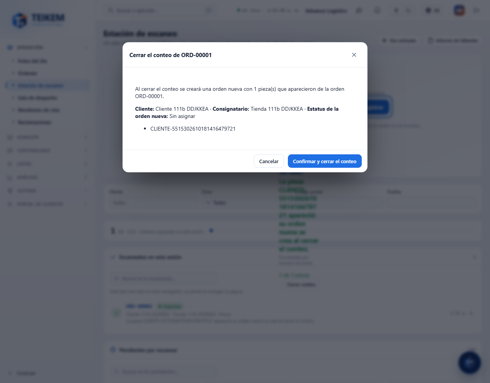

# L111 — Reclamaciones (web del personal)

Pantallas del Lote 111 en la web (**Operación → Reclamaciones**, permisos `claims.view` y `claims.manage`). Capturas tomadas por el recorrido `web-app/e2e/lote111-reclamaciones.spec.ts` contra el API real (escritorio; el mismo recorrido pasa en móvil a 360 px sin scroll horizontal). Reglas y mensajes: [capítulo 31](../31-reclamaciones.md).

## Por verificar
Las órdenes con piezas faltantes (las que no se escanearon en una acción por la que pasó la orden, o al «Cerrar conteo»): cuántas faltan de cuántas, con buscador.

Al abrir una orden se ven sus piezas faltantes con su estatus.

**Marcar N como perdidas** pasa las piezas «Por verificar» a «Perdido»; entonces aparece **Crear reclamación (N)** con el valor declarado y las notas.

## La reclamación
Al crearla (REC-#####) se abre su ficha: orden, conduce, cliente, valor declarado, las piezas y su historial. Se **resuelve** como Pagada (con el monto), Rechazada o Cerrada.

## Reclamaciones
La pestaña Reclamaciones las lista con su estatus (Reclamada, Resuelta), con búsqueda y filtro por estatus.

## Cerrar el conteo cuando aparece una pieza perdida (Lote 111b)
En la **Estación de escaneo**, cuando se escanea una pieza que estaba perdida o reclamada (aparece), el resultado ofrece **Cerrar conteo**.

Cerrar el conteo **no se hace de una vez**: primero se muestra qué va a pasar (se crea una orden nueva con las piezas que aparecieron, con las mismas fechas de Sometida y Recogida, y se listan las piezas que no se escanearon) y hay que **Confirmar y cerrar el conteo**.

Al confirmar nace la orden nueva (conduce nuevo, mismas piezas con sus mismos números).

