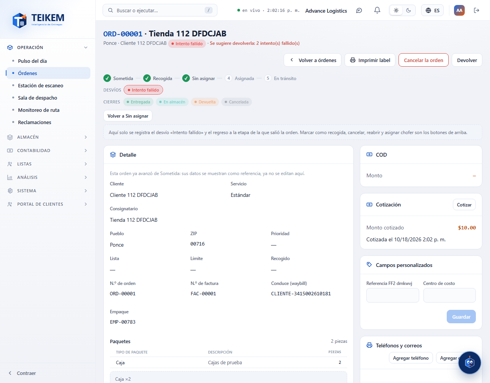
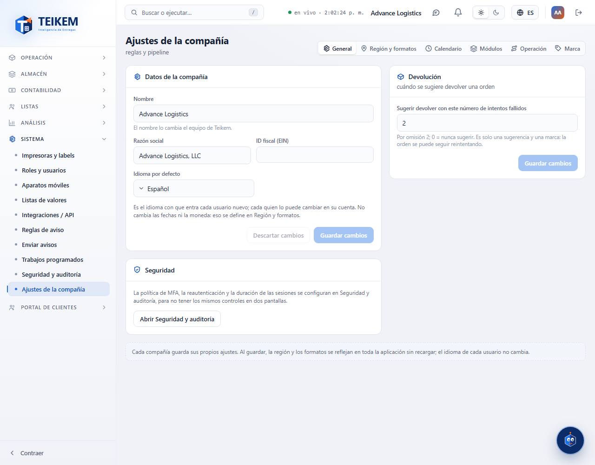
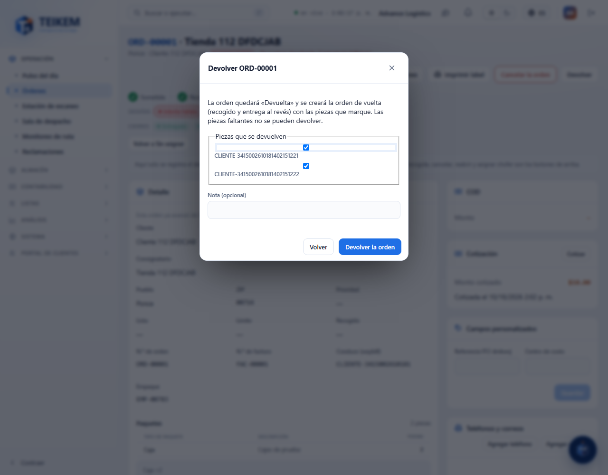
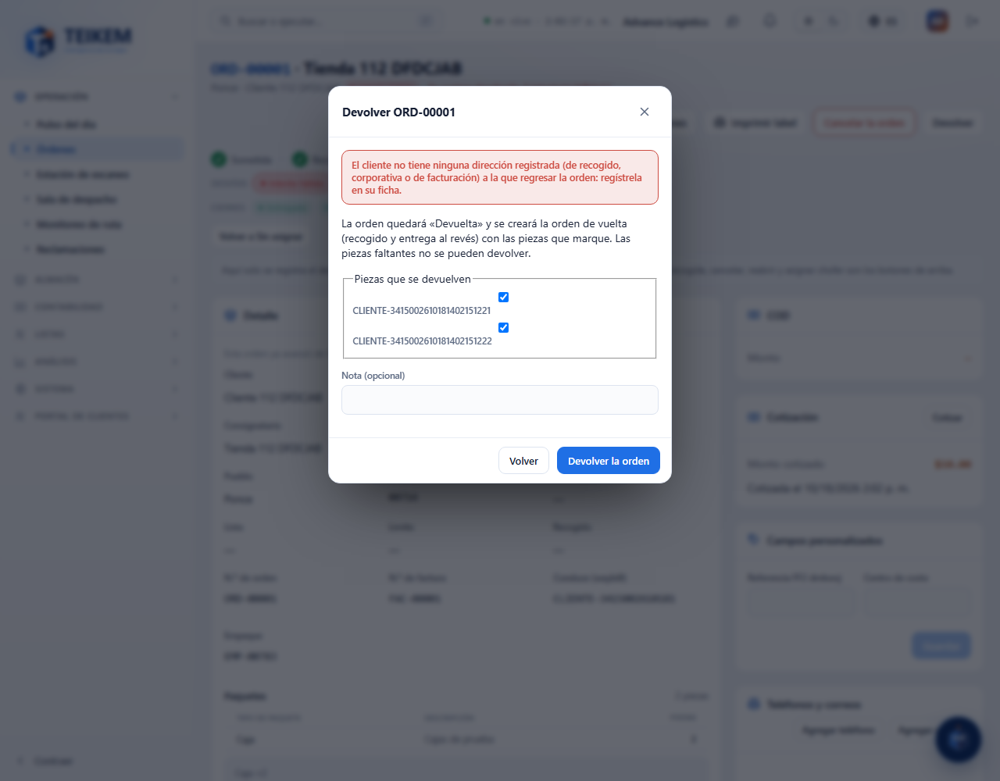
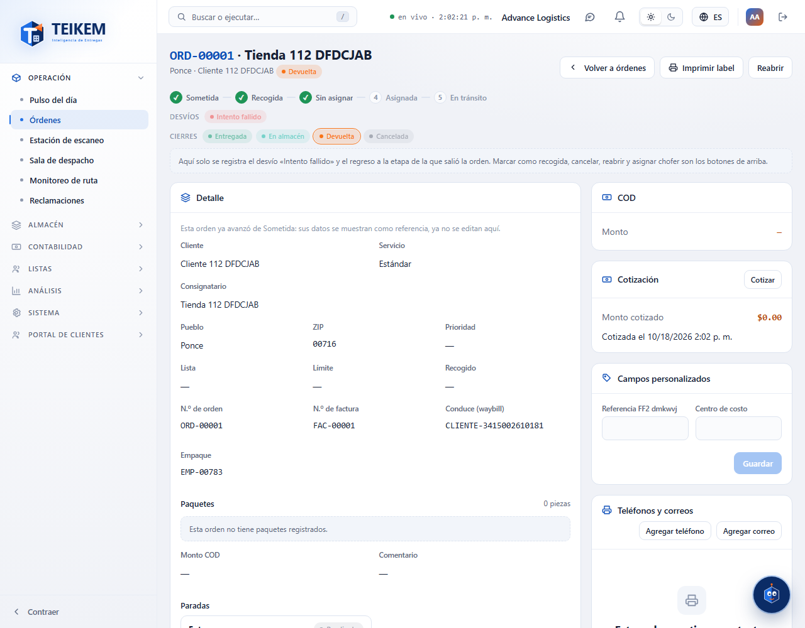
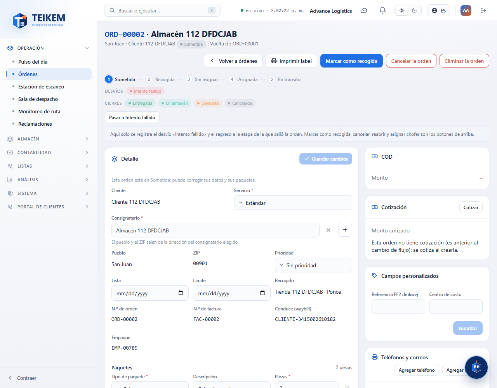

# L112 y L113 — Devolución y «devolver tras N intentos» (web del personal)

Pantallas de los Lotes 112 y 113 en la web (**Operación → Órdenes**, ficha de la orden; **Sistema → Ajustes → General → Devolución**). Capturas tomadas por el recorrido `web-app/e2e/lote112-devolucion.spec.ts` contra el API real (escritorio; el mismo recorrido pasa en móvil a 360 px sin scroll horizontal). Reglas y mensajes: [capítulo 32](../32-devolucion.md).

## La ficha sugiere devolver (Lote 113)
Cuando una orden lleva los intentos fallidos que fija la compañía (por omisión 2), la ficha lo avisa. Es solo una **sugerencia**: la orden se puede seguir reintentando.

El número se cambia en **Sistema → Ajustes → General → Devolución** (0 = nunca sugerir; fuera de 0 a 20 no se manda).

## Devolver (Lote 112)
El botón **Devolver** de la ficha (permiso `orders.return`; en una orden ya recogida y todavía no final) abre el diálogo con las piezas que se devuelven (las faltantes no se pueden devolver) y una nota.

La orden de vuelta regresa **al cliente que puso la orden**. Si el cliente no tiene ninguna dirección registrada, se explica y no se devuelve nada:

Con una dirección registrada, la orden queda **Devuelta** (final) y ya no se puede devolver otra vez.

## La orden de vuelta
Nace con las piezas devueltas (mismos números), recogido y entrega al revés y sin flete; su ficha dice de cuál orden es la vuelta.

