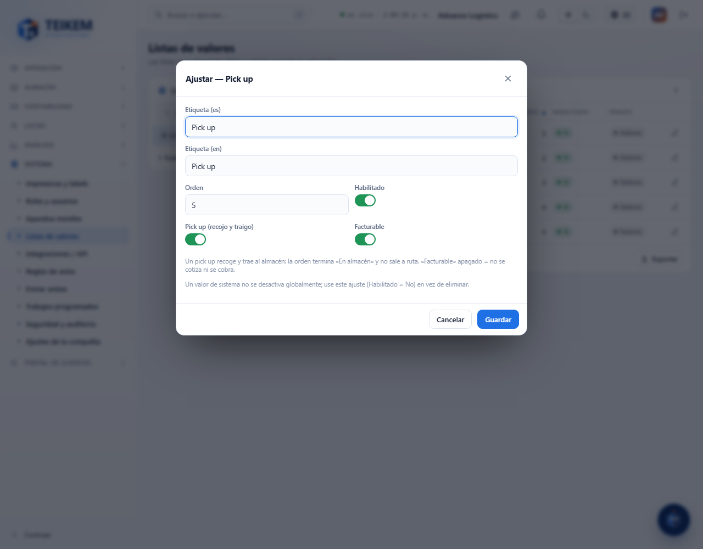
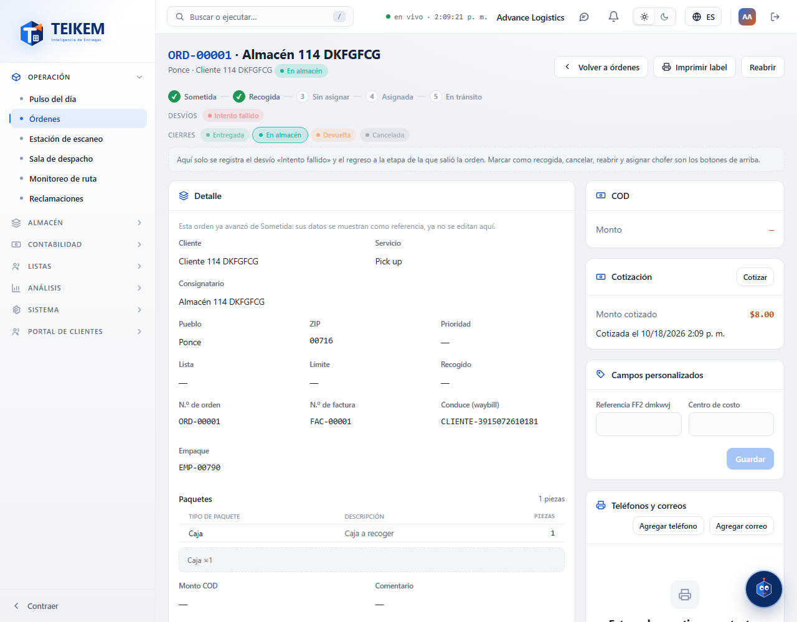

# L114 — Tipo de servicio «Pick up» (web del personal)

Pantallas del Lote 114 en la web (**Sistema → Listas → Tipos de servicio**, y la ficha de la orden). Capturas tomadas por el recorrido `web-app/e2e/lote114-pick-up.spec.ts` contra el API real (escritorio y móvil a 360 px sin scroll horizontal). Reglas y mensajes: [capítulo 33](../33-pick-up.md).

## Las marcas del tipo de servicio
En **Sistema → Listas → Tipos de servicio**, el valor **Pick up** → **Ajustar** muestra dos marcas por compañía: **Pick up (recojo y traigo)** (la orden termina «En almacén» y no sale a ruta) y **Facturable** (apagado = no se cotiza ni se cobra).

## Una orden Pick up
Nace Sometida; al recoger pasa a Recogida y al llegar queda **En almacén** (estatus final): no se enruta ni sale a ruta, y no lleva chofer. Si es facturable, se cobra al llegar a En almacén.

