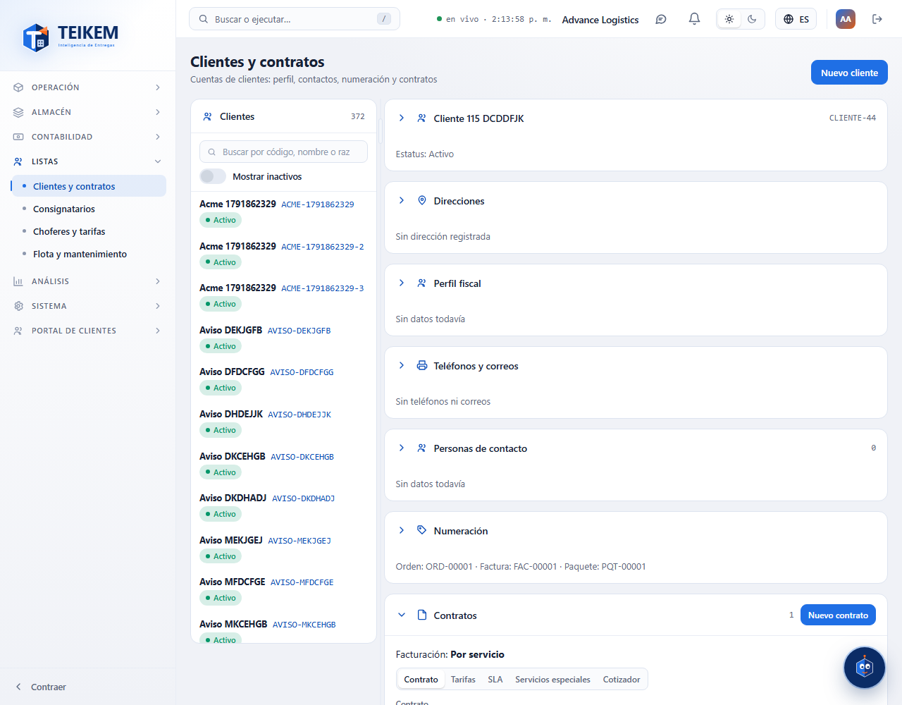
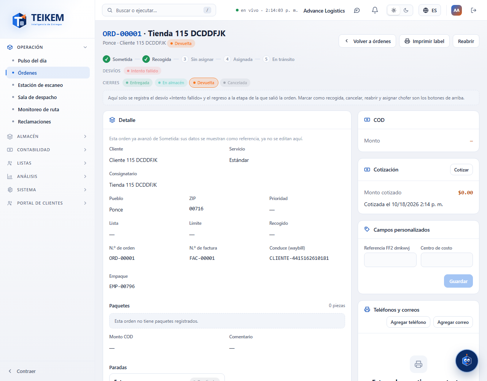

# L115 — Cargo por devolución (web del personal)

Pantalla del Lote 115 en la web (**Listas → Clientes y contratos → ficha del cliente → Contratos → pestaña Contrato → «Cargo por devolución»**). Capturas tomadas por el recorrido `web-app/e2e/lote115-cargo-devolucion.spec.ts` contra el API real (escritorio y móvil a 360 px sin scroll horizontal). Reglas y mensajes: [capítulo 32](../32-devolucion.md).

## En el contrato
El cargo es **opcional**: por omisión, **Sin cargo por devolución**.

Tres modos: **Por orden** (un monto a todos los tipos de paquete), **Por tipo de paquete** (un monto por cada tipo; se agrega con «Agregar tipo de paquete») y **Por pieza devuelta**. Sin monto no se guarda («Indique el monto del cargo por devolución.»).

## Al devolver
Cuando la orden queda **Devuelta** se le suma el cargo (aquí 2 piezas × 3.50 = 7.00) y se factura aparte del flete como «Cargo por devolución».

