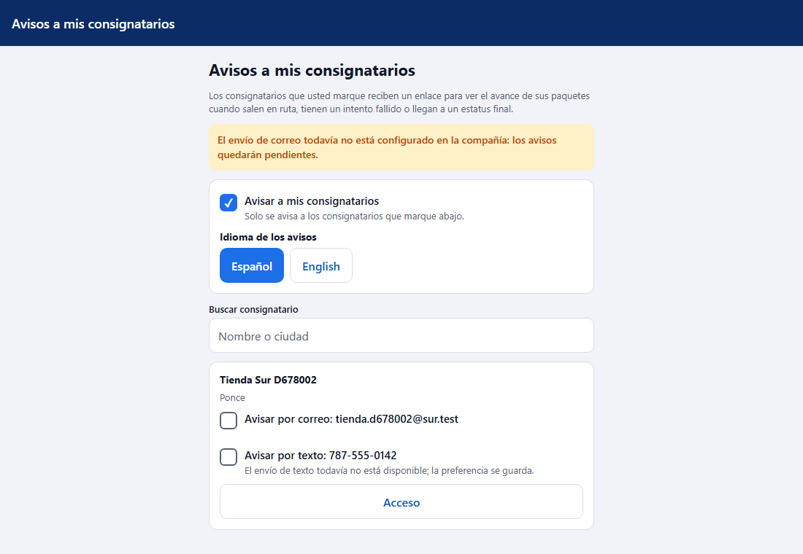
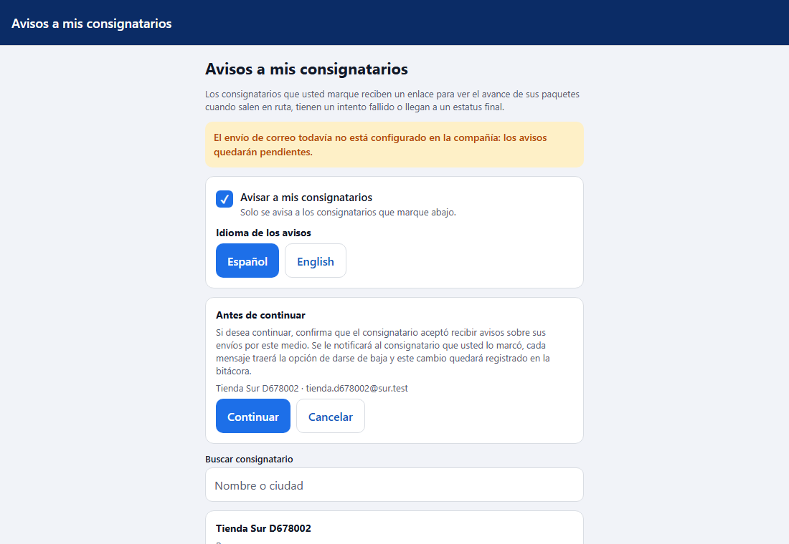
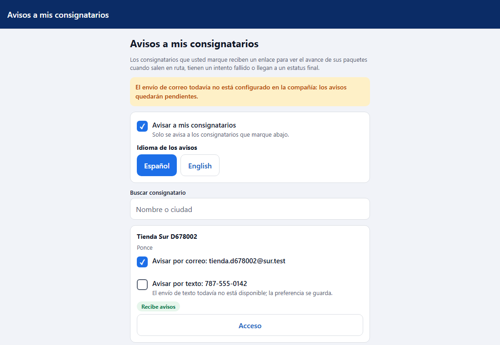
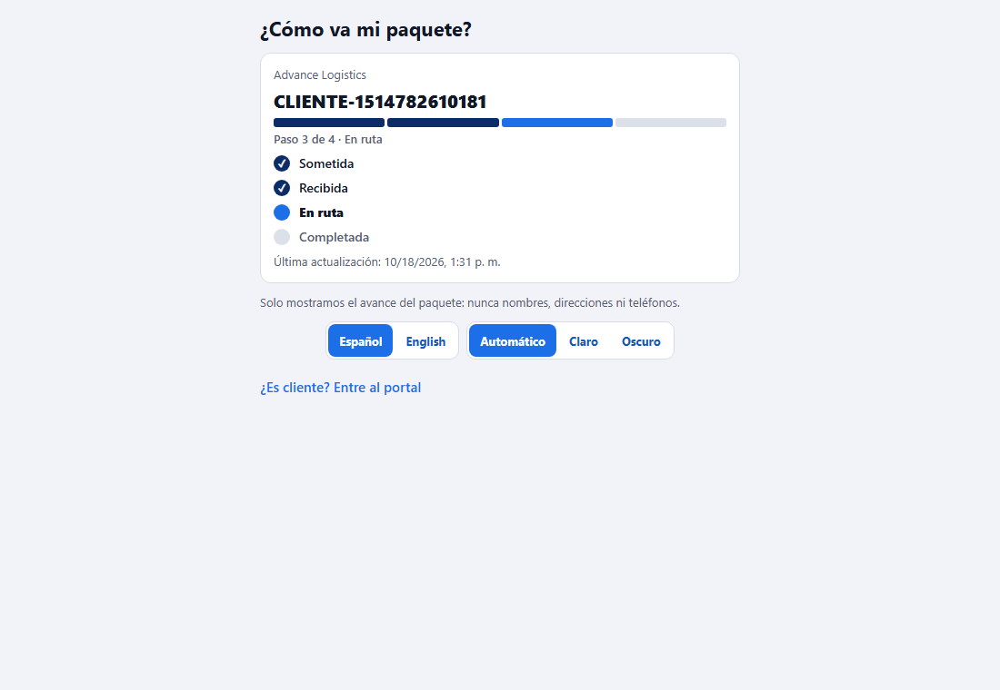
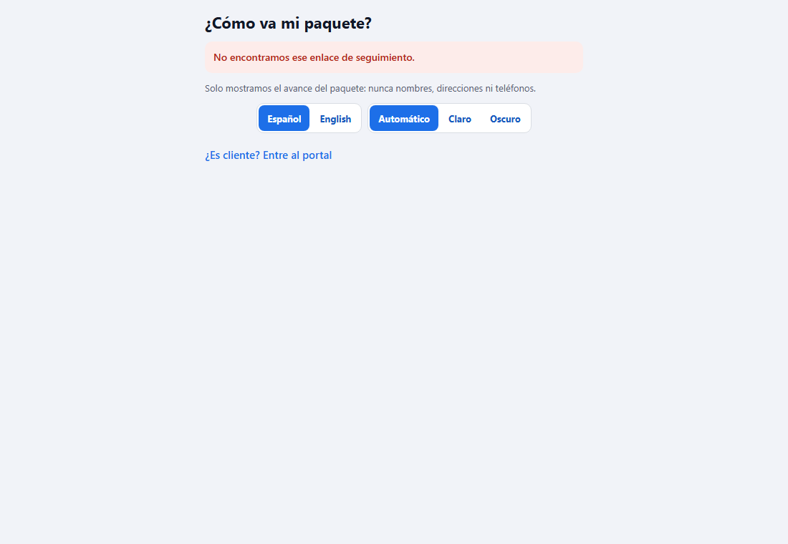
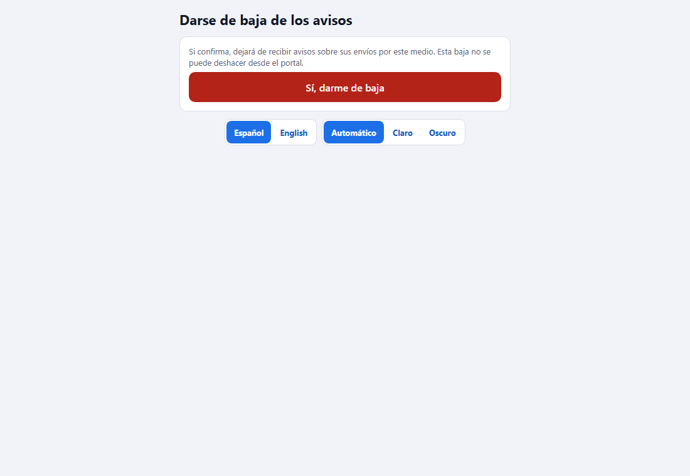

# L116 — Avisos al consignatario (app del cliente)

Pantallas del Lote 116 en la app del cliente (`app-cliente`, web y móvil). Capturas tomadas por el recorrido `web-app/e2e/lote116-avisos-consignatario.spec.ts` contra el API real (escritorio; el mismo recorrido pasa en móvil a 412 px sin scroll horizontal). Reglas y mensajes: [capítulo 34](../34-avisos-al-consignatario.md) y [capítulo 28](../28-como-va-mi-orden.md).

## El cliente prende el aviso y marca a cada consignatario
**Ajustes → Avisos a mis consignatarios → Configurar avisos**: casilla **Avisar a mis consignatarios**, **Idioma de los avisos** y la lista de consignatarios con una casilla por correo y otra por texto (solo se pueden marcar si el consignatario tiene ese medio registrado).

Al marcar un medio sale la **advertencia** de privacidad, con el consignatario y el correo o teléfono que se va a marcar. **Cancelar** no marca nada; **Continuar** lo marca, queda en la bitácora y se le avisa al consignatario.

Marcado, el consignatario muestra «Recibe avisos».

## El consignatario: seguimiento por enlace (sin cuenta)
El aviso que recibe cuando la orden sale En ruta trae un **enlace con un token propio de la orden**. Abre la página pública «¿Cómo va mi paquete?»: solo el avance (nunca nombres, direcciones ni teléfonos) y la última actualización.

Un enlace que no existe responde siempre lo mismo, sin revelar nada.

## Darse de baja
Abrir el enlace de baja **no** da de baja: hay que confirmar con el botón. Un enlace que no sirve se explica («El enlace de baja no es válido.»).

