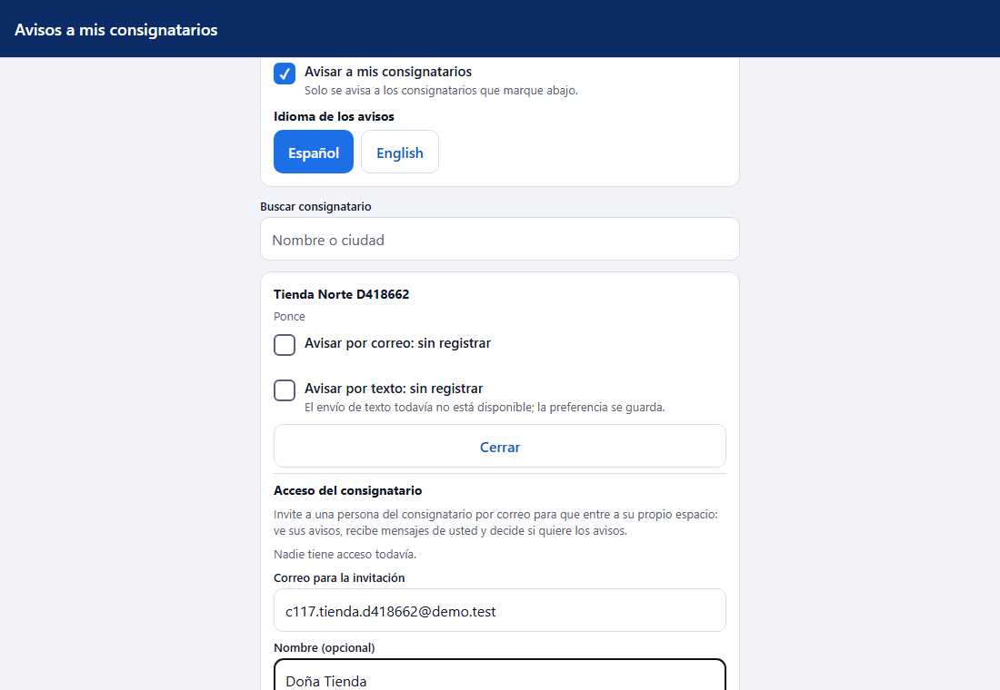
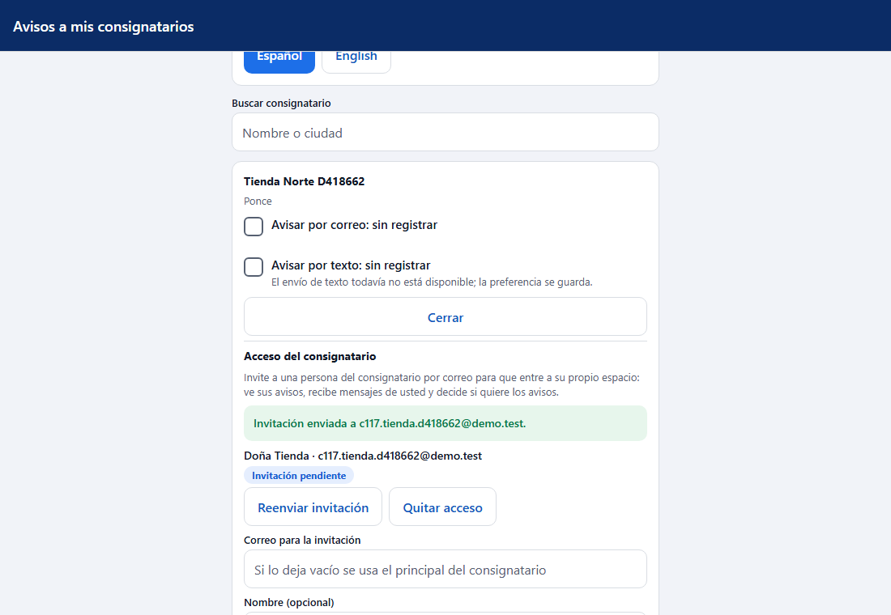
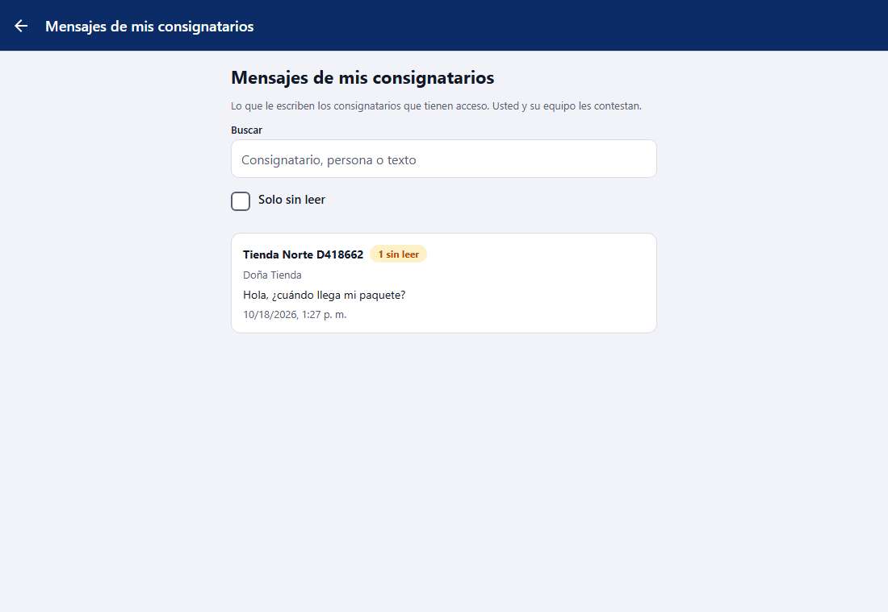
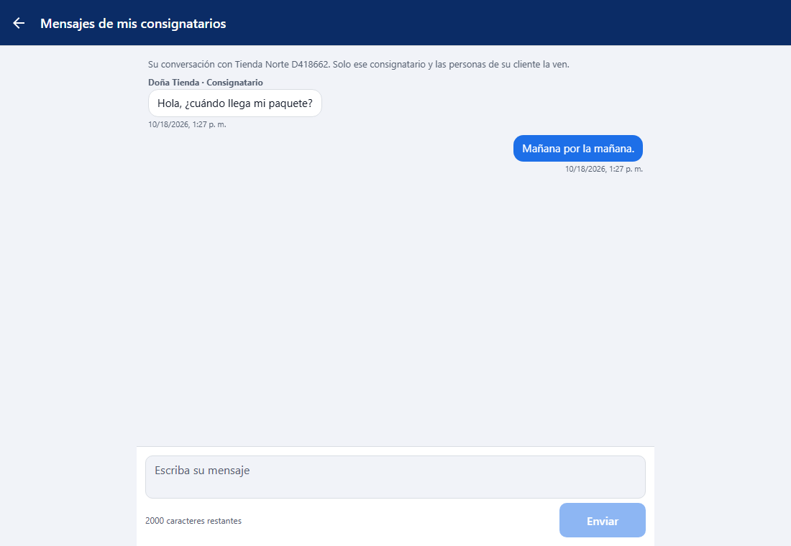
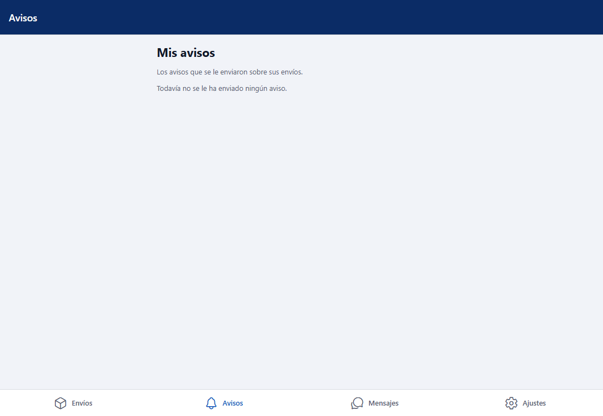
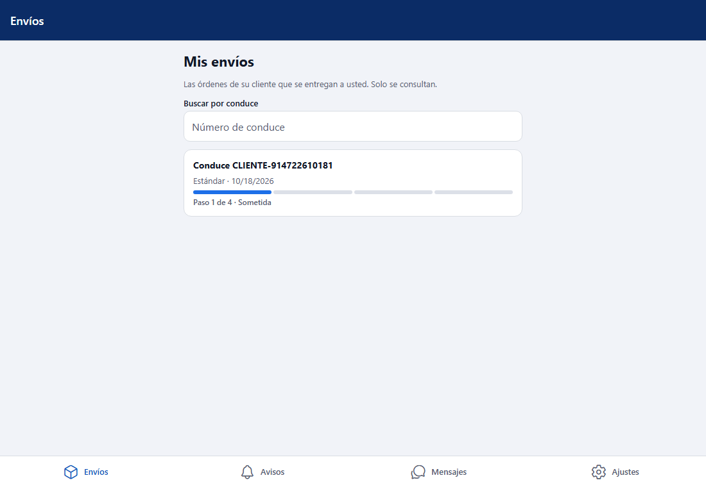
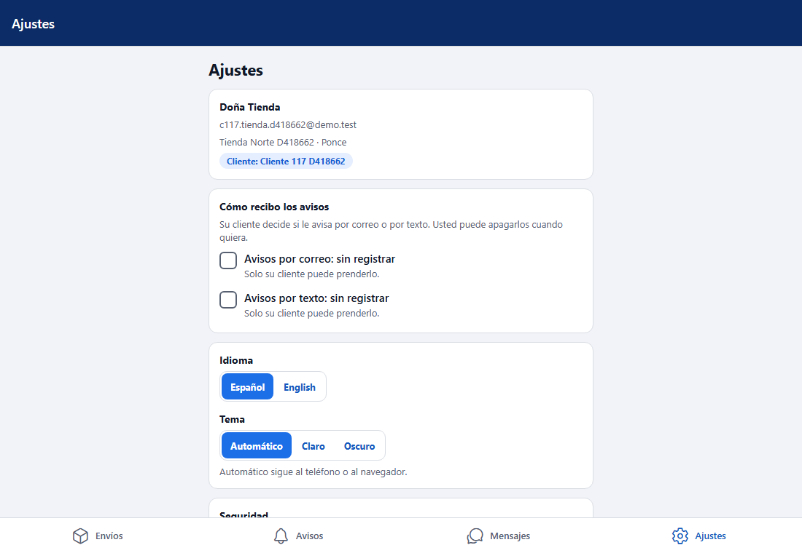
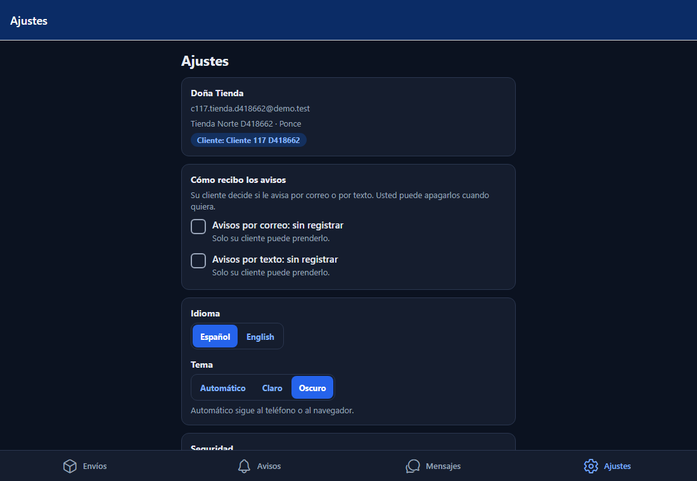

# L117 — Acceso del consignatario (app del cliente)

Pantallas del Lote 117 en la app del cliente (`app-cliente`, web y móvil). Capturas tomadas por el recorrido `web-app/e2e/lote117-consignatario.spec.ts` contra el API real (escritorio; el mismo recorrido pasa en móvil a 412 px sin scroll horizontal). Reglas y mensajes: [capítulo 35](../35-acceso-del-consignatario.md).

## Del lado del cliente (administrador u operador)

### Dar acceso a un consignatario
**Ajustes → Avisos a mis consignatarios → Configurar avisos**, en la tarjeta del consignatario: botón **Acceso**. Se escribe el correo de la invitación (vacío = el principal del consignatario) y el nombre.

Al invitar sale «Invitación enviada a …» y la persona queda **Invitación pendiente**, con **Reenviar invitación** y **Quitar acceso**.

### Mensajes de mis consignatarios
En la pestaña **Mensajes**, arriba, el acceso a las conversaciones con cuántas hay **sin leer** (también suma en la insignia de la pestaña).

La lista (más reciente primero, con búsqueda y «Solo sin leer») y, al tocar una, el hilo donde se contesta.

## Del lado del consignatario
Entra con su correo y contraseña (sin verificación en dos pasos) y solo tiene **cuatro pestañas**: Envíos, Avisos, Mensajes y Ajustes. No hay Inicio ni forma de crear órdenes.

### Avisos (la bandeja)

### Envíos (solo lectura)
Sus envíos con la barra de progreso y búsqueda por conduce; al tocar uno, su ficha (dirección, paquetes, línea de tiempo), sin precios.

### Mensajes con su cliente

### Ajustes
Su cuenta y **Cómo recibo los avisos**: puede apagar el correo o el texto y volver a prender solo lo que apagó él.

