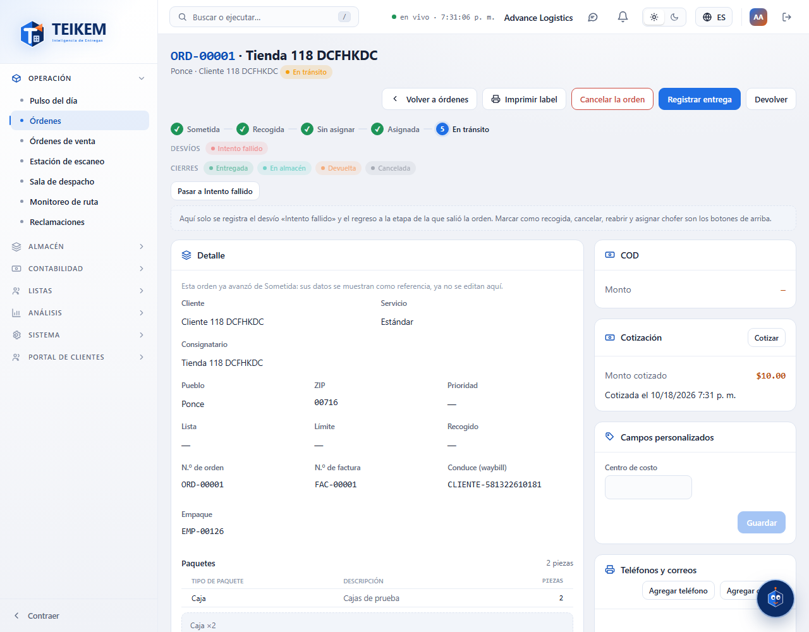
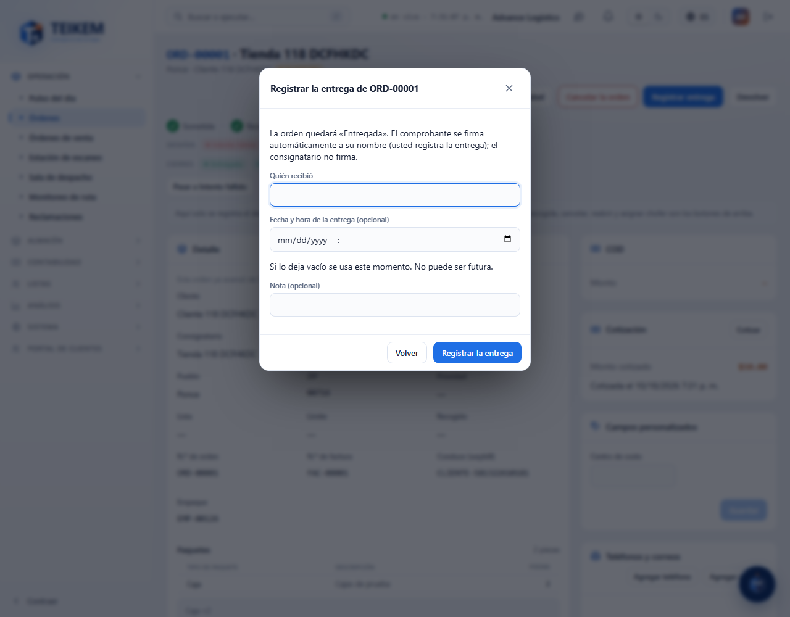
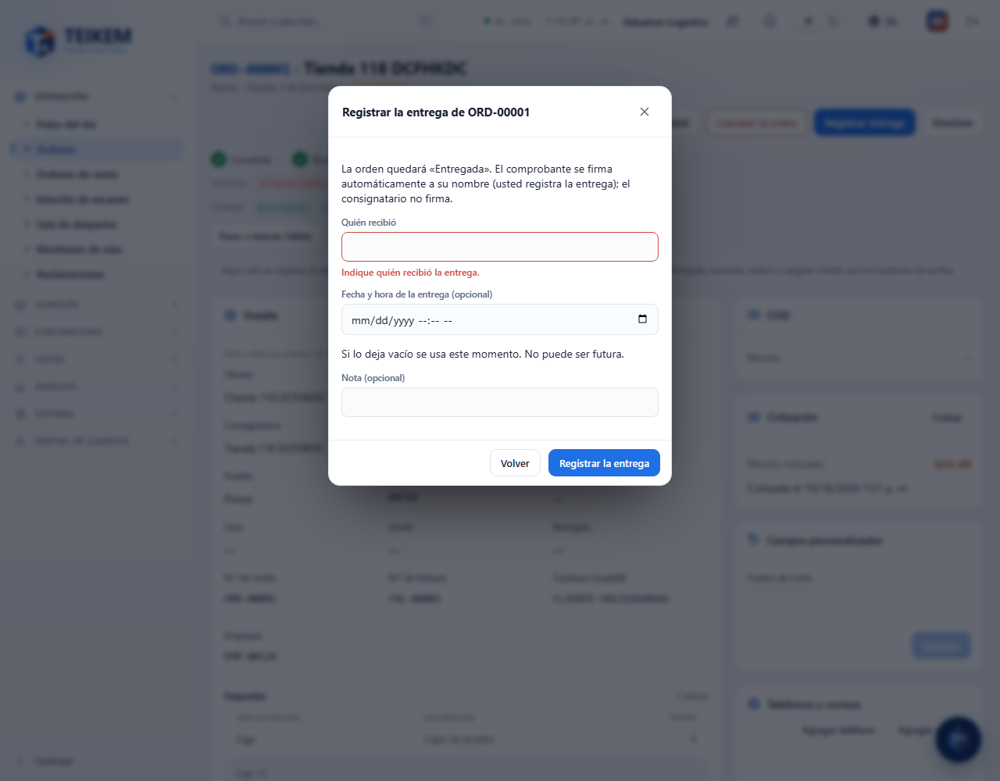
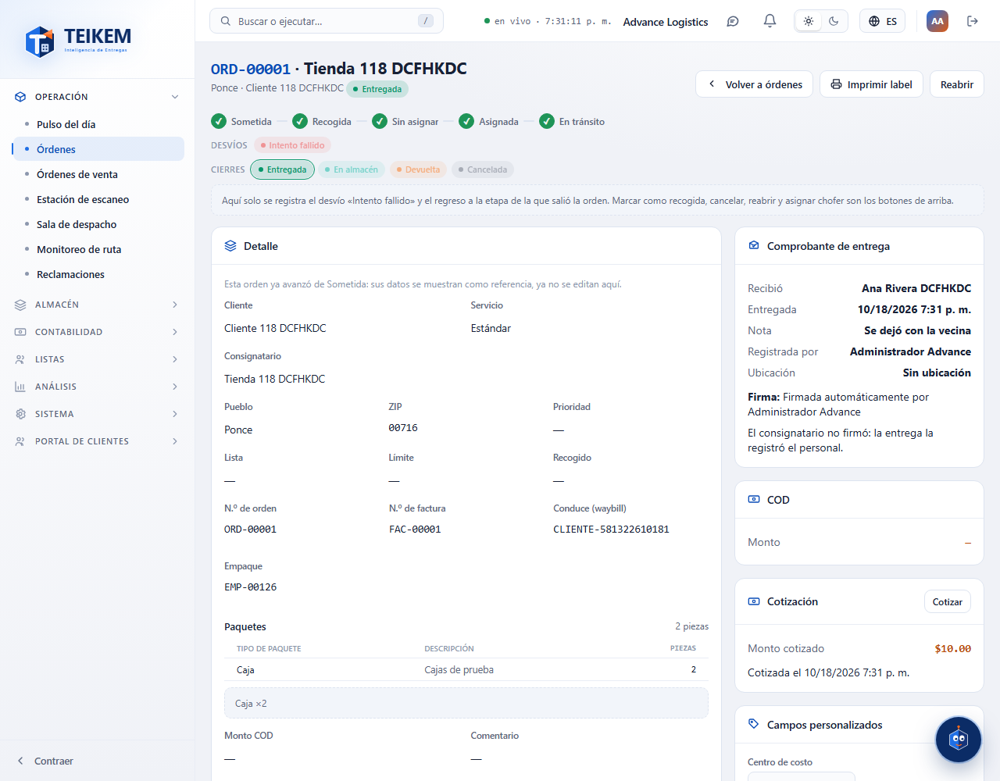

# L118 — Registrar la entrega desde la web (web del personal)

Pantallas del Lote 118 en **Operación → Órdenes → ficha de la orden**. Capturas tomadas por el recorrido `web-app/e2e/lote118-entrega-web.spec.ts` contra el API real (escritorio y móvil a 360 px sin scroll horizontal). Reglas, API y mensajes: [capítulo 36](../36-registrar-entrega-web.md).

## La ficha de una orden en tránsito
Con el permiso `orders.deliver` y la orden en curso aparece el botón **Registrar entrega**.

## El diálogo
Avisa que **el comprobante se firma automáticamente a su nombre** y que el consignatario no firma. **Quién recibió** es obligatorio; la fecha y hora y la nota son opcionales.

Sin quién recibió no se manda nada:

## La orden entregada y su comprobante
La orden queda **Entregada** (los estatus que faltaban quedan «brincados» en el historial) y la columna derecha muestra el **Comprobante de entrega**: quién recibió, cuándo, quién lo registró, «Firmada automáticamente por [usuario]», la ubicación y el aviso «El consignatario no firmó».

