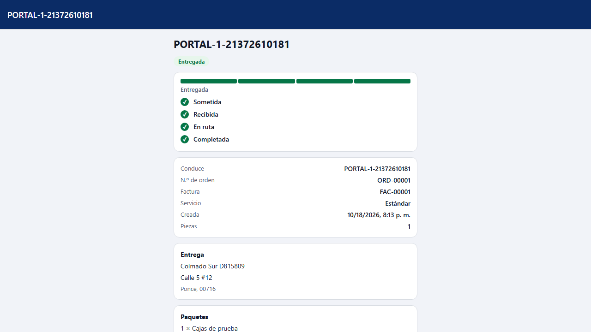
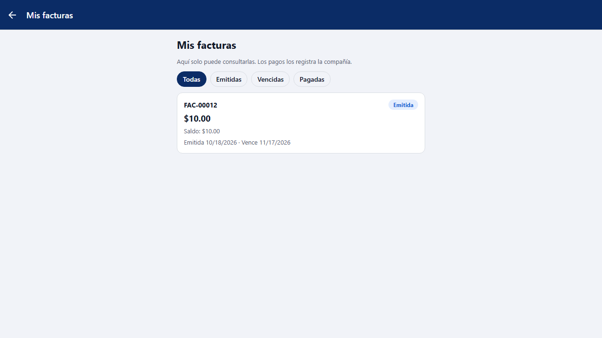
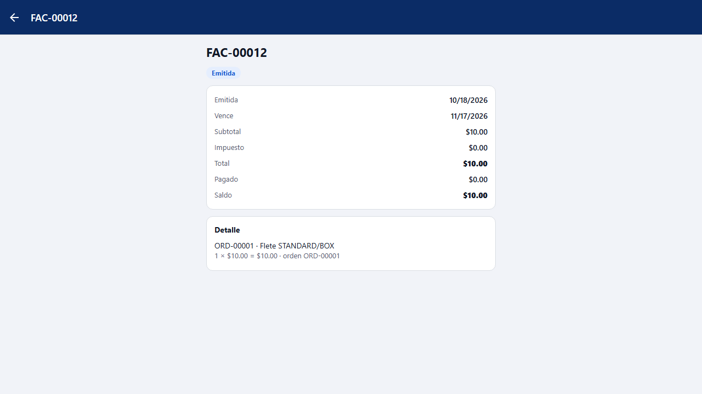
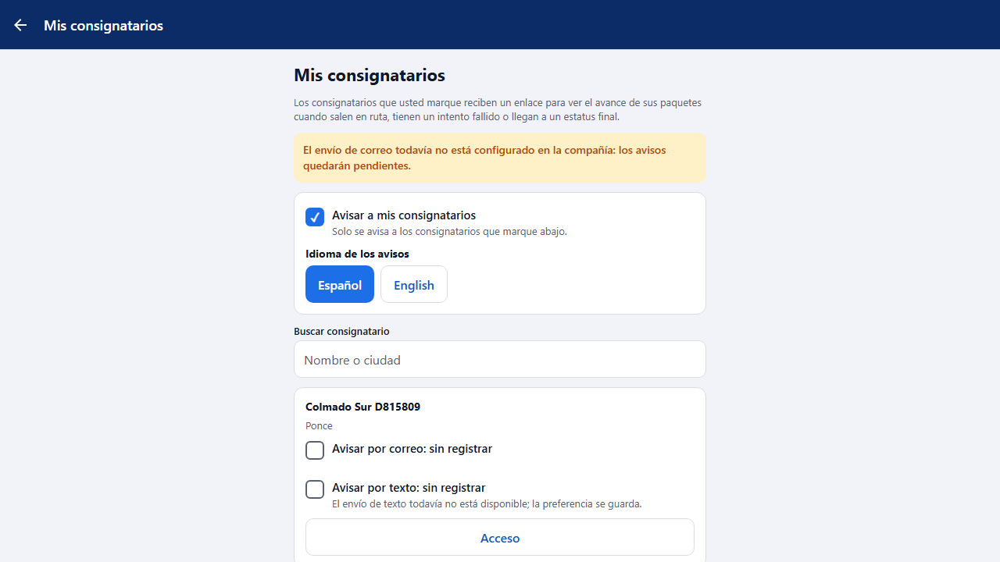

# L119 — Portal del cliente: comprobante, facturas, mis avisos y consignatarios (app del cliente)

Pantallas del Lote 119 en la **app del cliente** (web y teléfono). Capturas tomadas por el recorrido `web-app/e2e/lote119-portal.spec.ts` contra el API real (escritorio y móvil a 360 px sin scroll horizontal). Reglas y API: [capítulo 37](../37-portal-facturas-avisos-comprobante.md).

## Comprobante de entrega en la ficha de la orden
Quién recibió y cuándo, y que la entrega la registró el personal de la compañía (el consignatario no firmó). Sin el nombre del usuario ni notas internas.

## Mis facturas
El Inicio tiene el botón **Mis facturas**. Lista solo de consulta, con filtro por estatus.

La ficha de una factura: detalle, totales, saldo y pagos recibidos. No hay ninguna acción de pago.

## Mis avisos
La compañía manda: lo que no encendió se ve «no disponible»; la persona apaga lo que no quiere.

## Mis consignatarios
La lista de los consignatarios del cliente, con sus avisos y su acceso.

