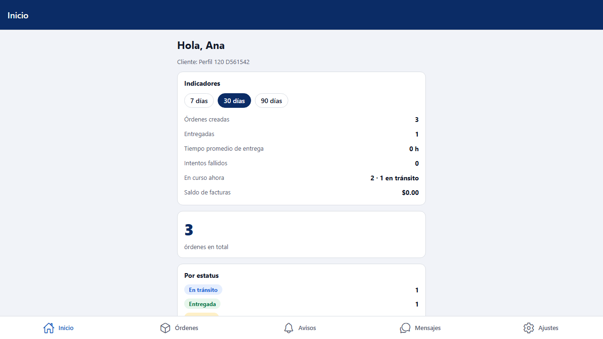

# L120 — Portal del cliente: indicadores, mi perfil y mi contraseña (app del cliente)

Pantallas del Lote 120 en la **app del cliente** (web y teléfono). Capturas tomadas por el recorrido `web-app/e2e/lote120-perfil-indicadores.spec.ts` contra el API real (escritorio y móvil a 360 px sin scroll horizontal). Reglas y API: [capítulo 37, §5 y §6](../37-portal-facturas-avisos-comprobante.md).

## Indicadores en el Inicio
De los últimos 7, 30 o 90 días. Lo que no aplica (sin fecha prometida, sin facturación o sin COD) no se muestra.

## Mi perfil
Mi nombre (editable), mi correo y rol (solo lectura) y los datos de mi empresa (solo lectura: los cambia la compañía).

## Mi contraseña
Contraseña actual, nueva y repetida; los mensajes del servidor salen en el idioma de la persona.

