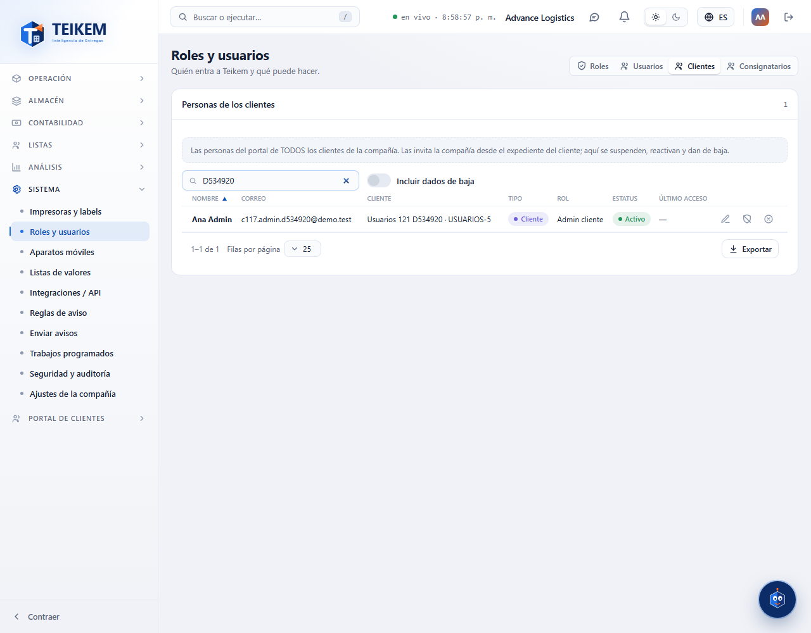
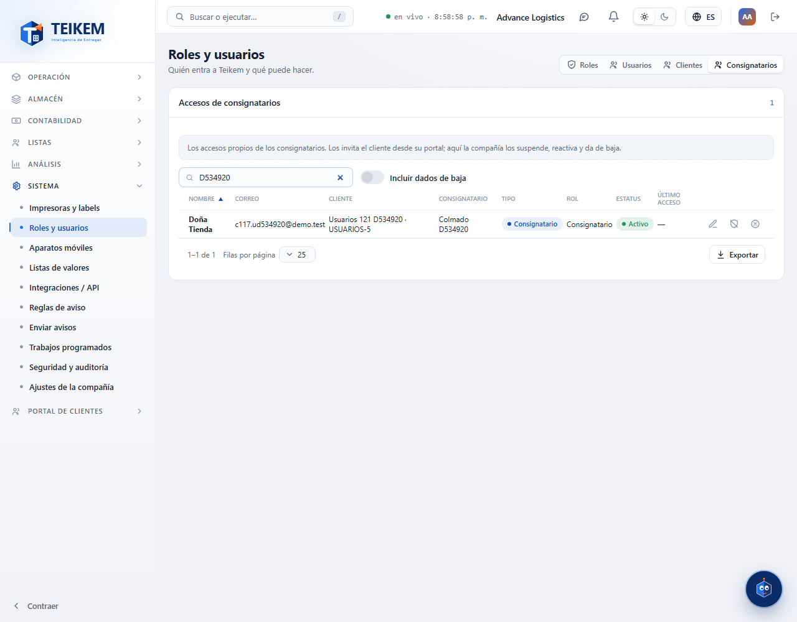
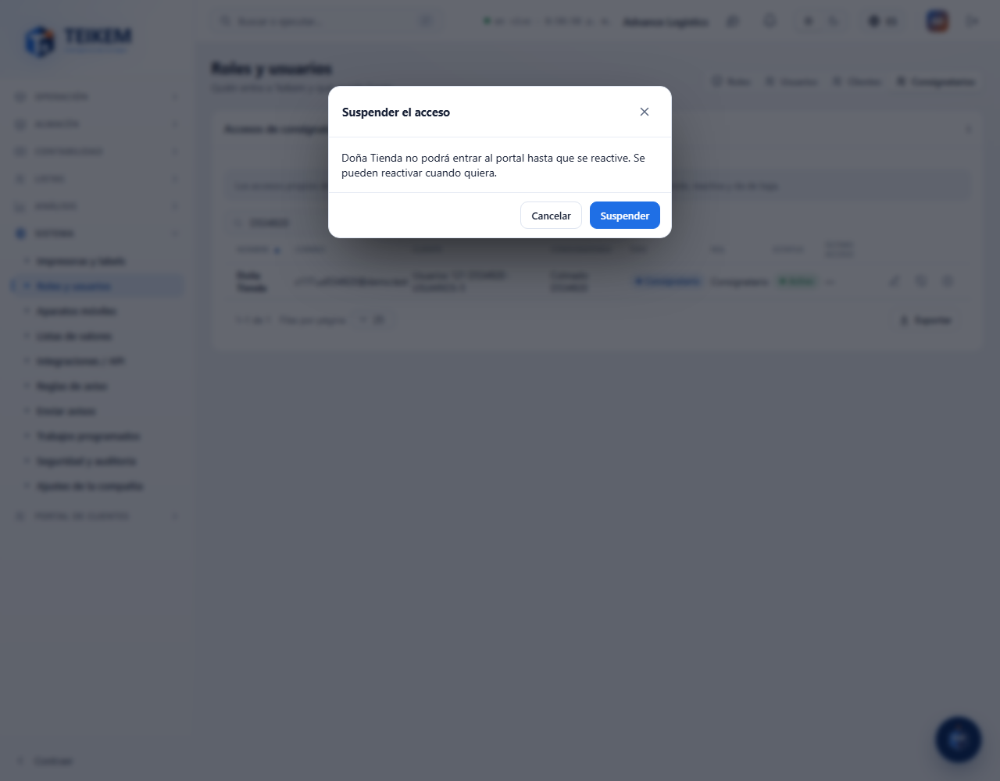
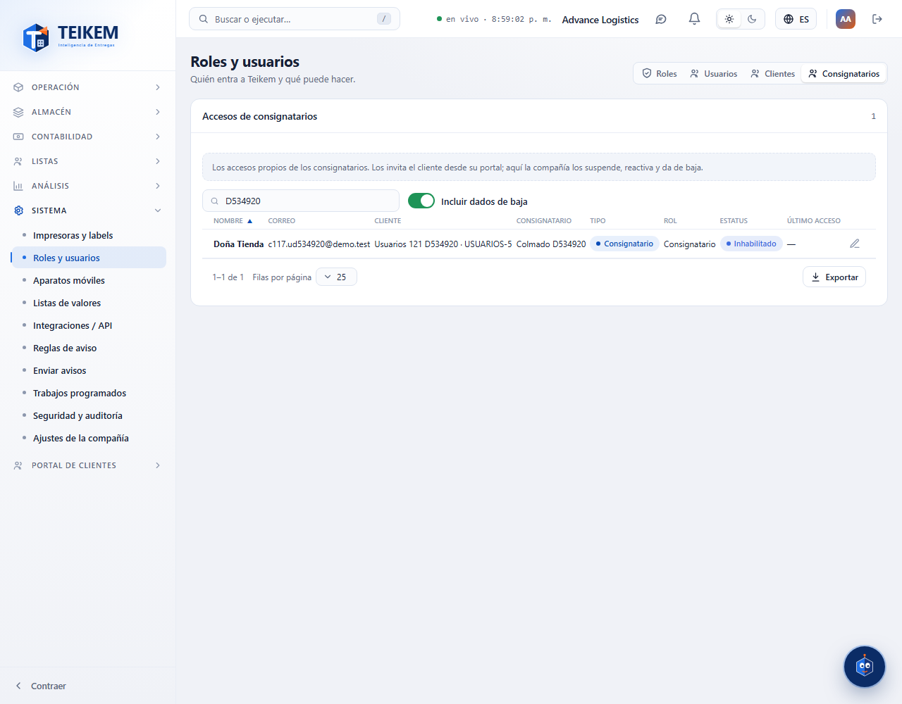

# L121 — Roles y usuarios: pestañas Clientes y Consignatarios (web del personal)

Pantallas del Lote 121 en **Sistema → Roles y usuarios**. Capturas tomadas por el recorrido `web-app/e2e/lote121-usuarios-portal.spec.ts` contra el API real (escritorio y móvil a 360 px sin scroll horizontal). Reglas y API: [capítulo 1, «Clientes y Consignatarios»](../01-plataforma-y-seguridad.md).

## Las pestañas
Roles, Usuarios, **Clientes** y **Consignatarios**: las personas de portal de TODOS los clientes y los accesos de consignatarios, cada una con su tipo y su cliente.

## Suspender un acceso
Pide confirmar; al confirmar, la sesión abierta de esa persona se corta al instante.

## Dados de baja
Salen con **Incluir dados de baja** (estatus «Inhabilitado»).

