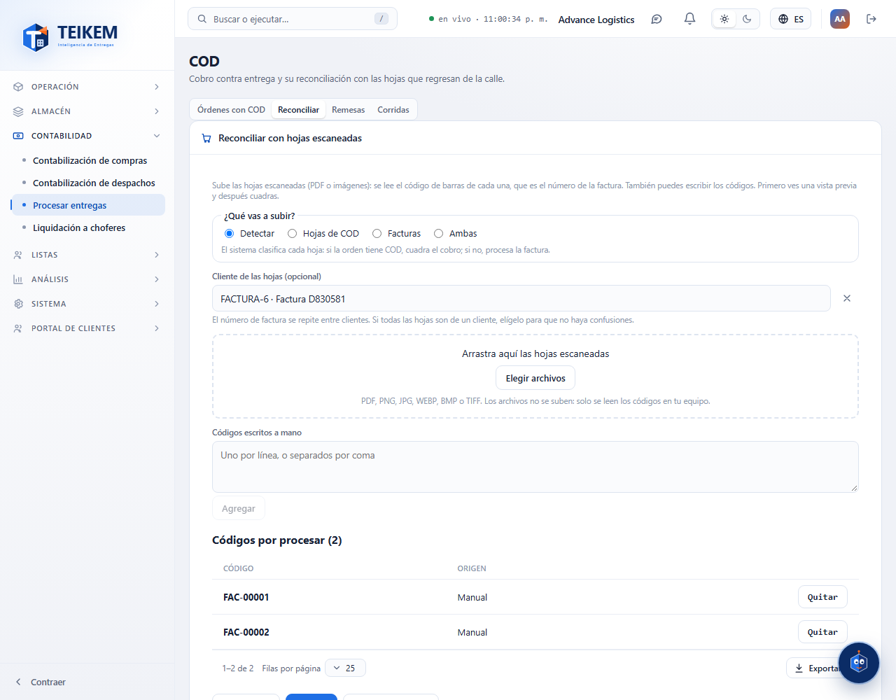
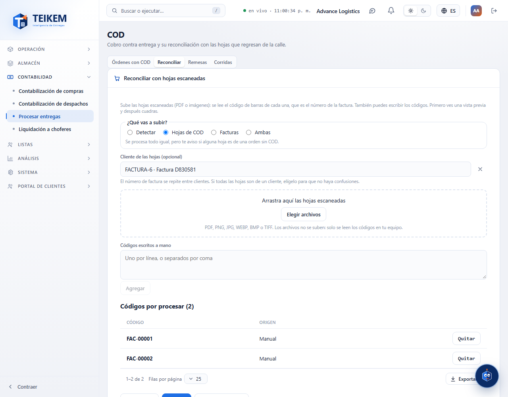
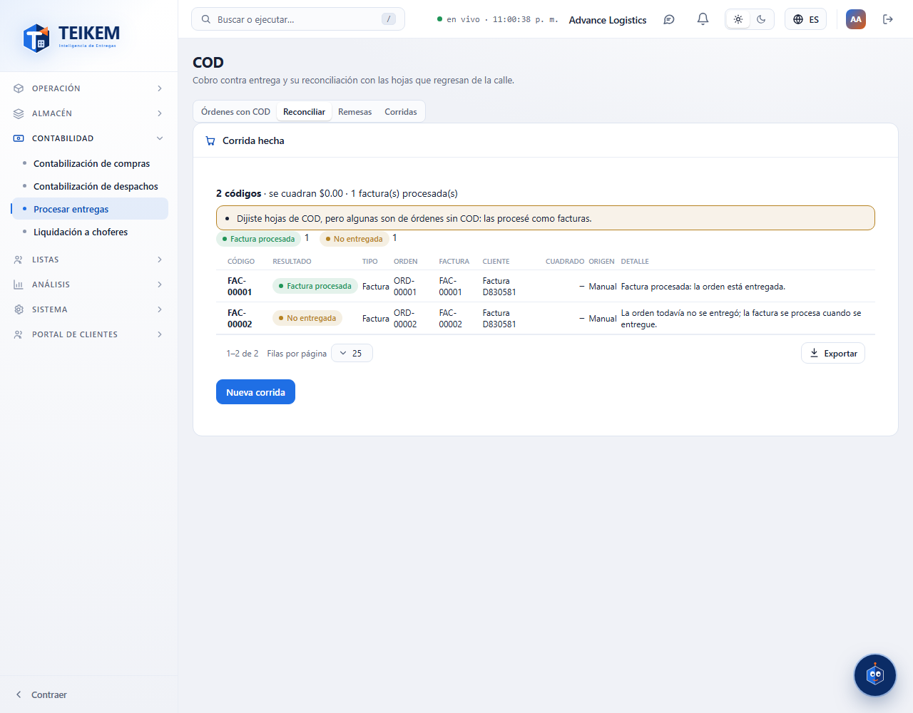
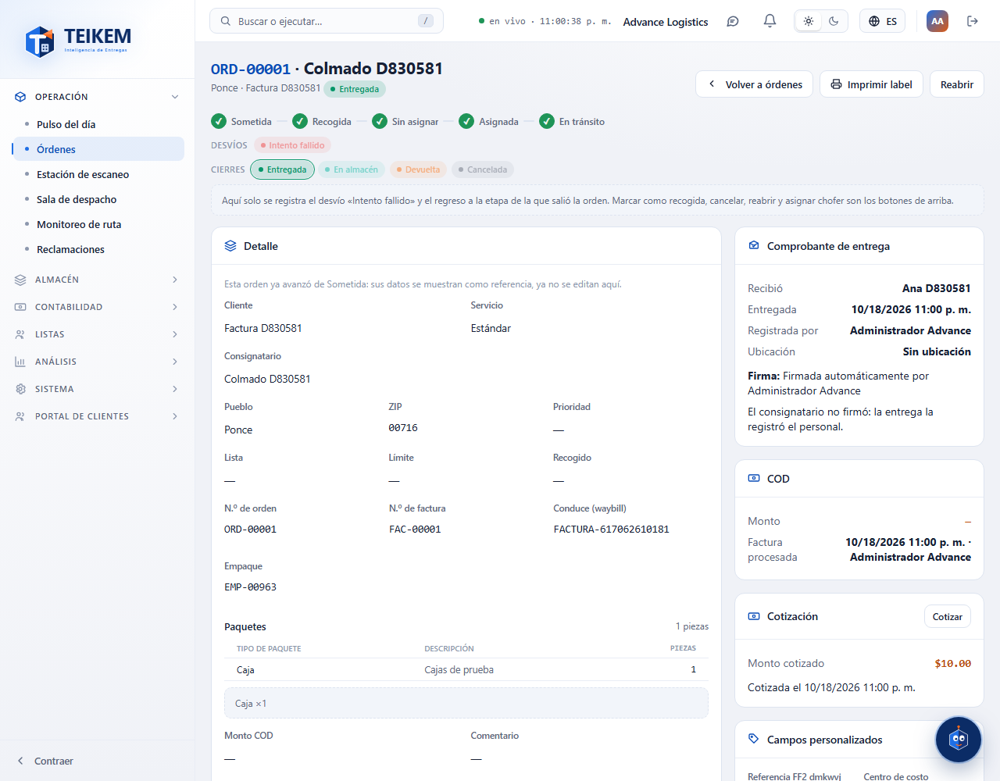

# L126 — Procesar entregas: la factura del cliente (web del personal)

Pantallas del Lote 126 en **Dinero → Procesar entregas → Reconciliar** y en la ficha de la orden. Capturas tomadas por el recorrido `web-app/e2e/lote126-procesar-factura.spec.ts` contra el API real (escritorio y móvil a 360 px sin scroll horizontal). Reglas y API: [capítulo 21, §7](../21-cod.md) y [capítulo 02, §6b](../02-clientes-y-contratos.md).

## ¿Qué vas a subir?
El selector al principio de la pestaña: **Detectar** (por omisión), **Hojas de COD**, **Facturas** o **Ambas**. Se suben las hojas o se teclean los números igual que para COD; en la vista previa cada hoja dice su resultado («Factura procesada», «No entregada», «Ya procesada»…) y su **Tipo** (Hoja de COD o Factura), y el resumen cuenta las facturas procesadas.

## La advertencia del modo
Si dijiste «Hojas de COD» y alguna es de una orden sin COD (o al revés), el sistema la procesa igual y lo avisa.

## La corrida
«Cuadrar» procesa todo: cuadra los cobros y deja procesadas las facturas; la corrida queda en Corridas con su detalle.

## En la ficha de la orden
El panel COD muestra **Factura procesada: fecha · quién** (o «Todavía no»).

