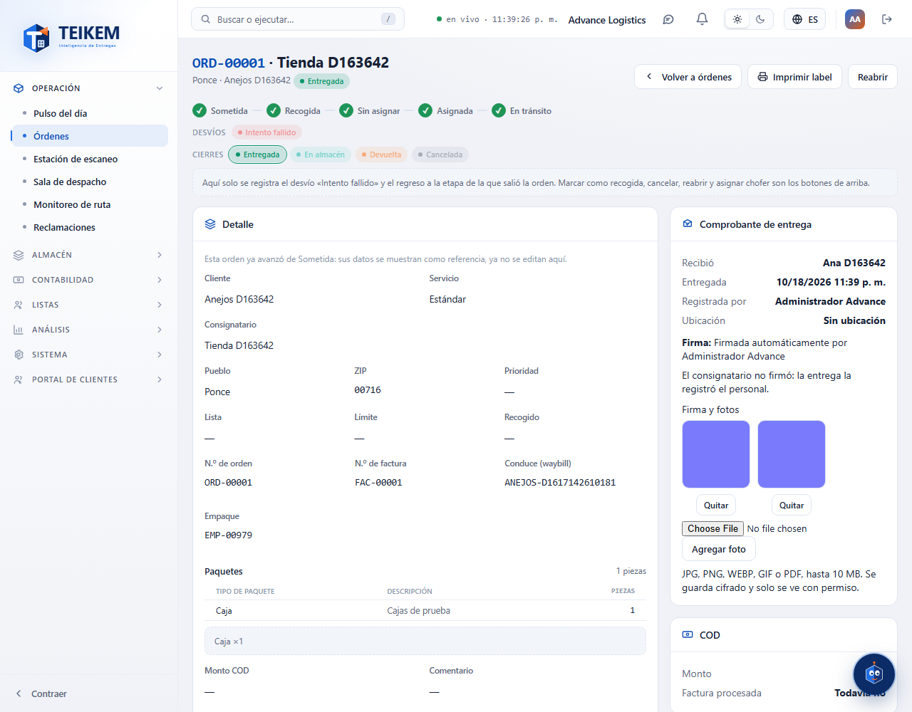

# L127 — Comprobante de entrega: firma y fotos (web del personal)

Pantallas del Lote 127 en la ficha de la orden → panel **Comprobante de entrega**. Capturas tomadas por el recorrido `web-app/e2e/lote127-anejos-comprobante.spec.ts` contra el API real (escritorio y móvil a 360 px sin scroll horizontal). Reglas y API: [capítulo 38](../38-almacen-de-archivos.md).

## Firma y fotos
Las miniaturas de la firma y de las fotos (se abren en grande con un clic); los PDF salen como enlace.

## Agregar y quitar
Con `orders.deliver`: **Agregar foto** sube otra (JPG, PNG, WEBP, GIF o PDF, hasta 10 MB) y **Quitar** la saca de la lista.

