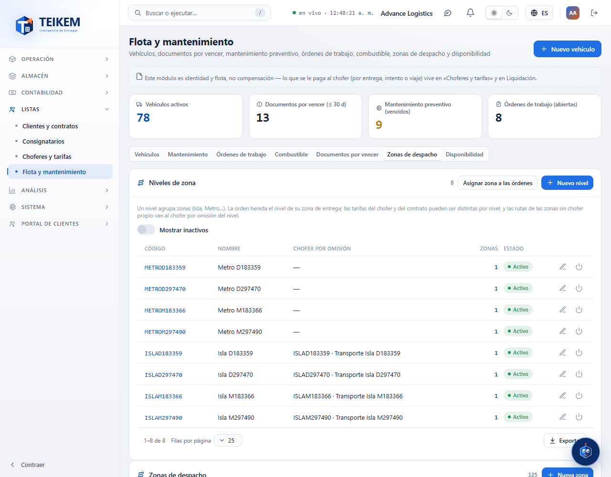
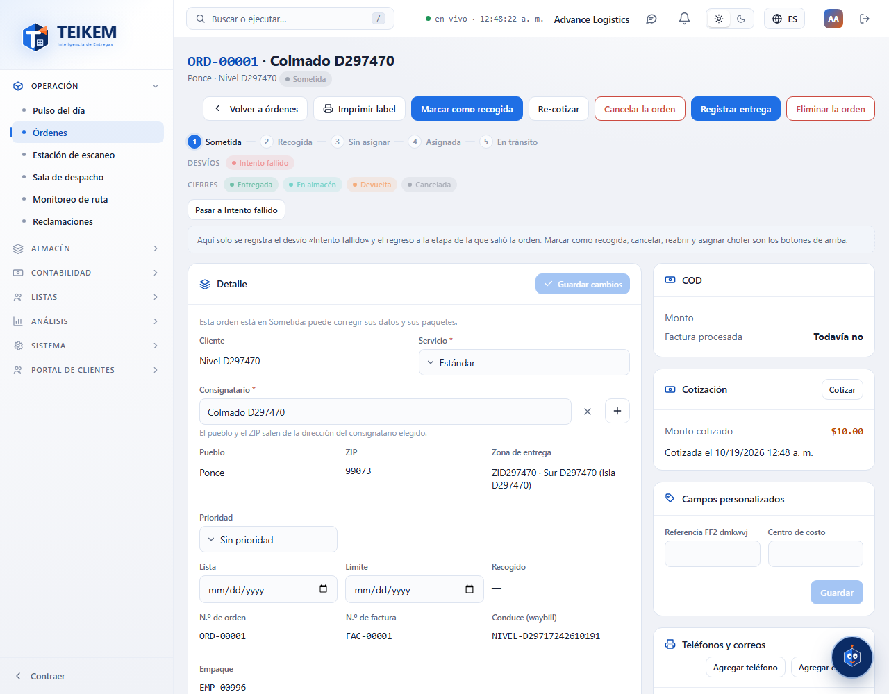
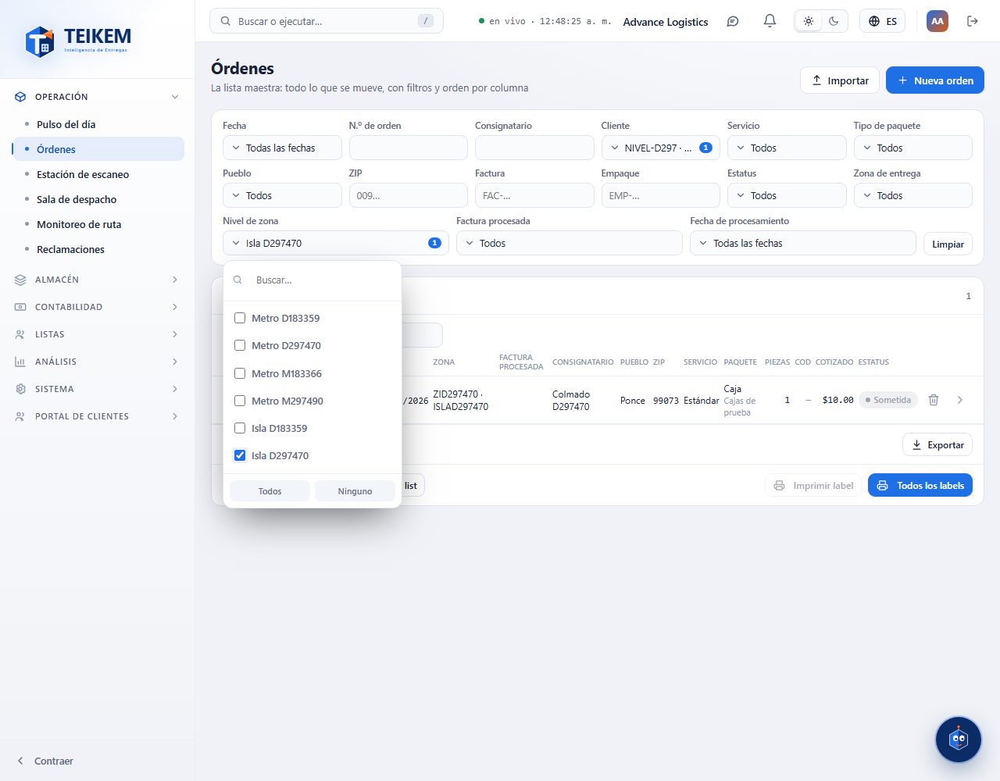

# L129 — Niveles de zona: Isla y Metro (web del personal)

Pantallas del Lote 129. Capturas tomadas por el recorrido `web-app/e2e/lote129-nivel-de-zona.spec.ts` contra el API real (escritorio y móvil a 360 px sin scroll horizontal). Reglas y API: [capítulo 04, «Niveles de zona»](../04-flota-choferes-mantenimiento.md).

## Flota → Zonas de despacho
El panel **Niveles de zona** (código, nombre, chofer por omisión, zonas) y las zonas con su **Nivel**.

## Ficha de la orden
**Zona de entrega**: zona · nombre (nivel).

## Lista de Órdenes
Filtros **Zona de entrega** y **Nivel de zona**; columna Zona (zona · nivel).

