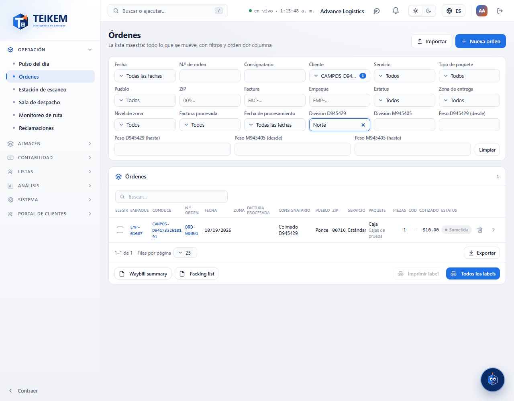
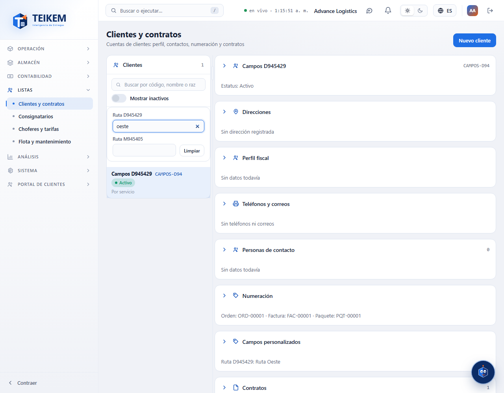

# L130 — Campos personalizados en la búsqueda (web del personal)

Capturas del recorrido `web-app/e2e/lote130-campos-en-busqueda.spec.ts` contra el API real (escritorio y móvil a 360 px sin scroll horizontal). Reglas y API: [capítulo 01, §7.x](../01-plataforma-y-seguridad.md).

## Órdenes
Los campos con «Mostrar en la búsqueda» aparecen en la fila de filtros, cada uno del tipo del campo (texto, «desde/hasta» para números, rangos para fechas, listas, sí/no). «Limpiar» los quita.

## Clientes
Bajo el buscador de la lista, con su propio «Limpiar» (igual en Consignatarios, Choferes y Vehículos). Si la entidad no tiene campos habilitados, no aparece nada.

