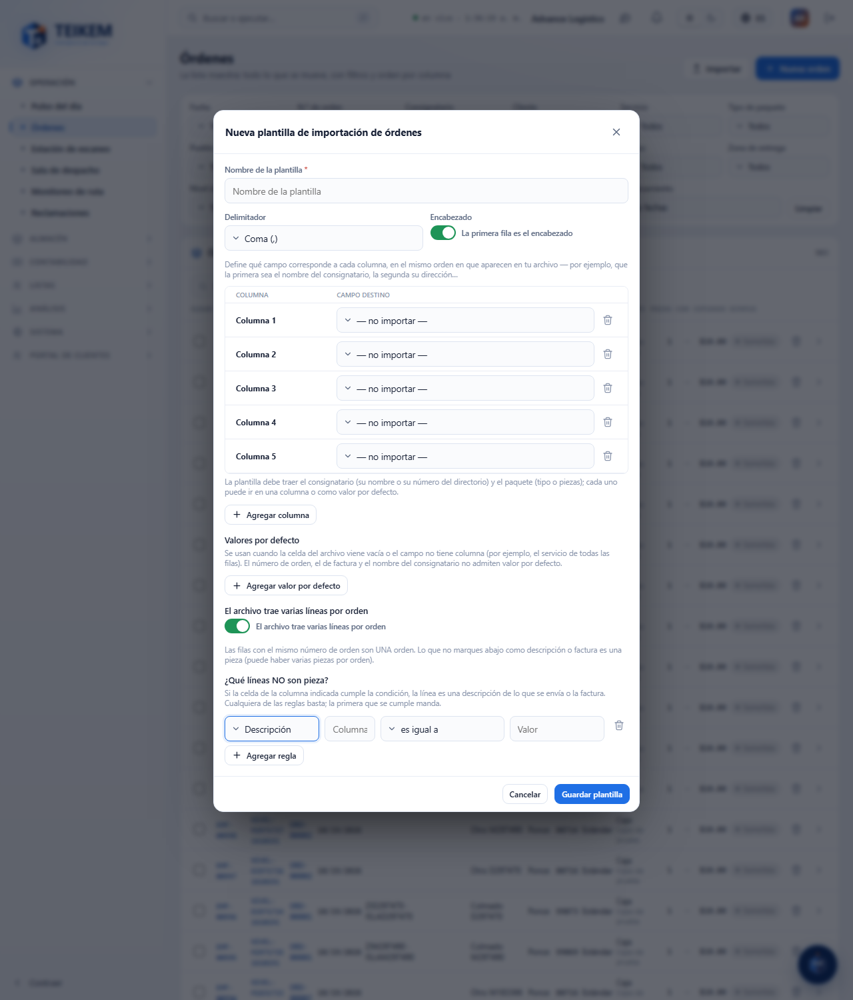
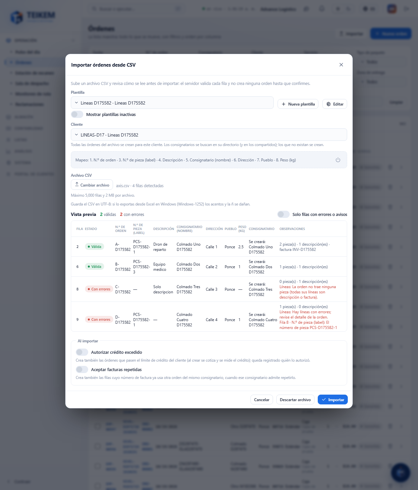

# L131 — Archivos con varias líneas por orden (web del personal)

Capturas del recorrido `web-app/e2e/lote131-lineas-por-orden.spec.ts` contra el API real (escritorio y móvil a 360 px sin scroll horizontal). Reglas y errores: [capítulo 03, §7.5](../03-ordenes-de-transporte.md).

## Plantilla de órdenes
**«El archivo trae varias líneas por envío»** abre las reglas de línea: qué NO es pieza (descripción o factura) por una columna del archivo; todo lo demás es pieza. El campo nuevo **N.º de pieza (label)** se mapea como cualquier otro.

## Vista previa
Una fila por **orden** con su resumen de líneas («2 pieza(s) · 1 descripción(es) · factura …») y los errores de cada línea; una orden sin ninguna pieza o con un número de pieza repetido queda con error y no se crea.

