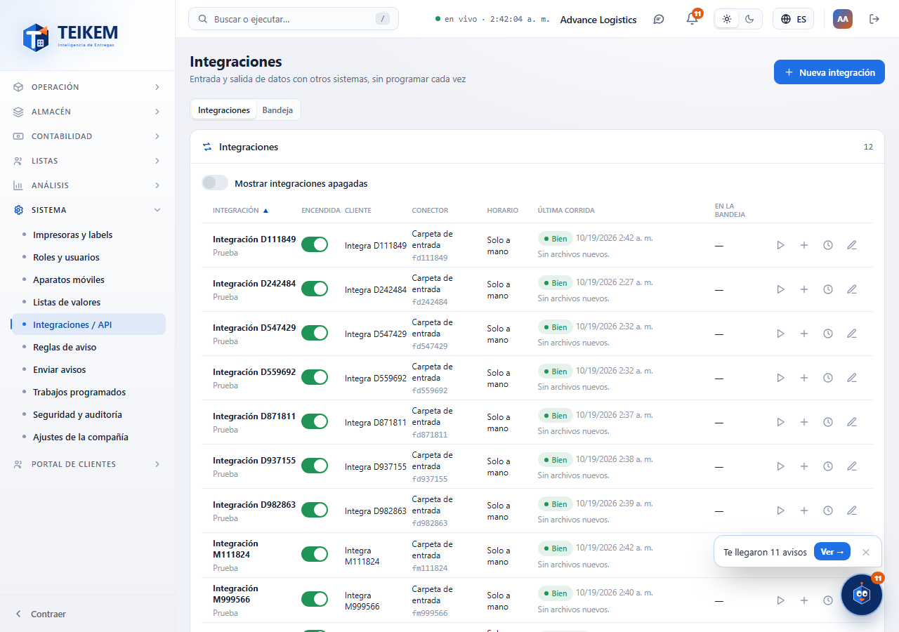
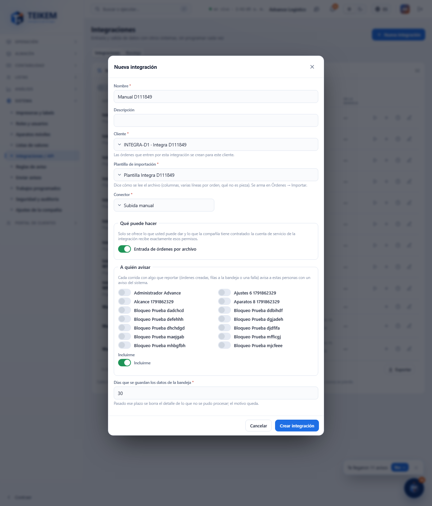
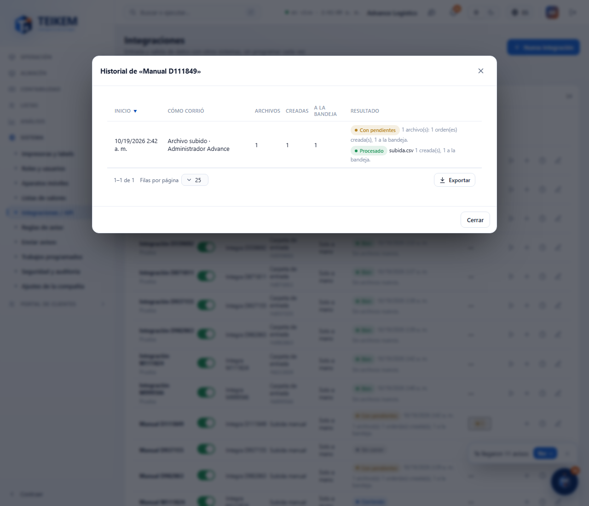
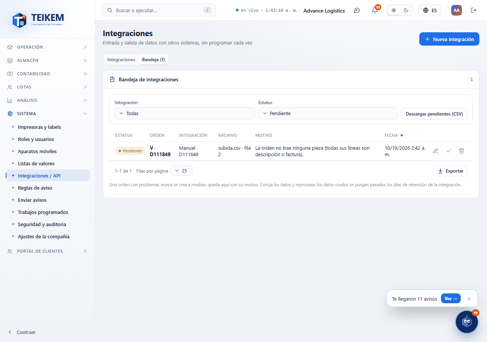

# L132 — Integraciones (web del personal)

Capturas del recorrido `web-app/e2e/lote132-integraciones.spec.ts` contra el API y SQL reales (escritorio y móvil a 360 px sin scroll horizontal). Reglas y API: [capítulo 39](../39-integraciones.md).

## Lista (Sistema → Integraciones / API)
Por integración: interruptor, cliente, conector, horario, última corrida y pendientes en la bandeja; acciones **Correr ahora** (carpeta), **Subir archivo**, **Historial** y **Editar**.

## Nueva integración
Cliente, plantilla de importación, conector, horario, **qué puede hacer** (solo lo que quien crea puede dar), **a quién avisar** con «Incluirme» y la retención de la bandeja.

## Historial
Cada corrida con sus archivos (Procesado, Repetido, Con error), órdenes creadas y enviadas a la bandeja.

## Bandeja
El motivo exacto de cada orden que no se pudo procesar, con **Corregir**, **Reprocesar** y **Descartar**.

## Corregir
Las filas tal como llegaron; se corrigen las celdas y «Guardar y reprocesar».

