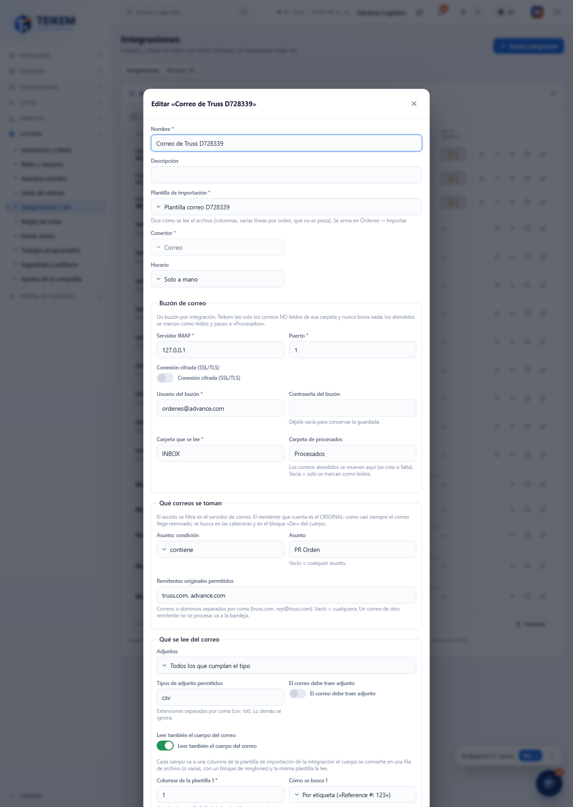

# L133 — Integración por correo (web del personal)

Captura del recorrido `web-app/e2e/lote133-correo.spec.ts` contra el API real (escritorio y móvil a 360 px sin scroll horizontal). Reglas y errores: [capítulo 39, §6](../39-integraciones.md).

## Formulario (conector Correo)
**Buzón de correo** (IMAP, usuario, contraseña que no se vuelve a mostrar, carpeta y procesados), **qué correos se toman** (asunto y remitentes originales permitidos) y **qué se lee** (adjuntos por modo, nombre y tipo; el cuerpo con campos a leer por etiqueta, expresión regular o bloque de renglones, cada uno a su columna de la plantilla). En la lista, **Probar conexión**; **Subir archivo** acepta `.eml` para probar la configuración sin buzón.

