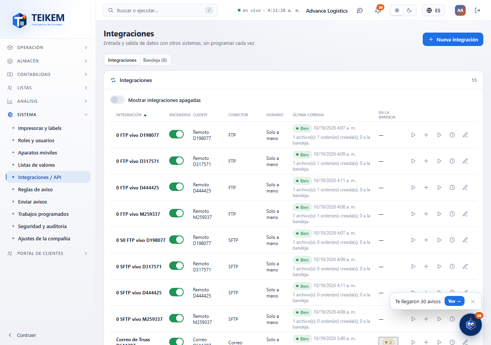
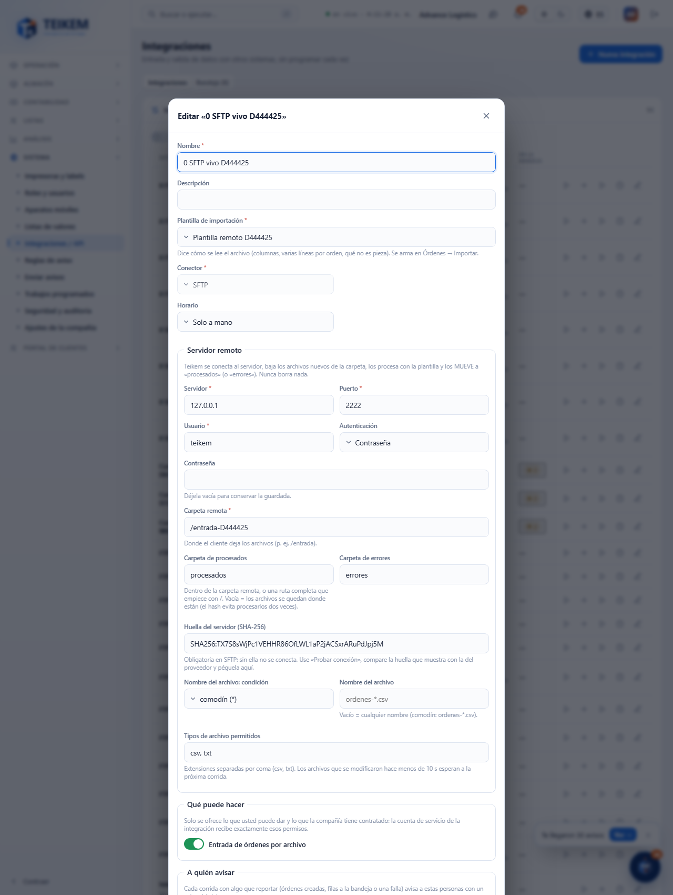

# L134 — Integraciones por SFTP y FTP (web del personal)

Capturas del recorrido `web-app/e2e/lote134-sftp-ftp.spec.ts` contra el API real y servidores SFTP/FTP de prueba (escritorio y móvil a 360 px sin scroll horizontal). Reglas y errores: [capítulo 39, §7](../39-integraciones.md).

## Lista
Los conectores SFTP y FTP con **Probar conexión**, **Correr ahora**, **Subir archivo** e **Historial**.

## Formulario (conector SFTP)
Servidor, puerto, usuario, autenticación (contraseña o llave privada; los secretos no se vuelven a mostrar), carpeta remota, procesados y errores, **huella del servidor fijada**, y el filtro de archivos por nombre y tipo. En FTP, en lugar de la huella, la casilla **FTPS**.

