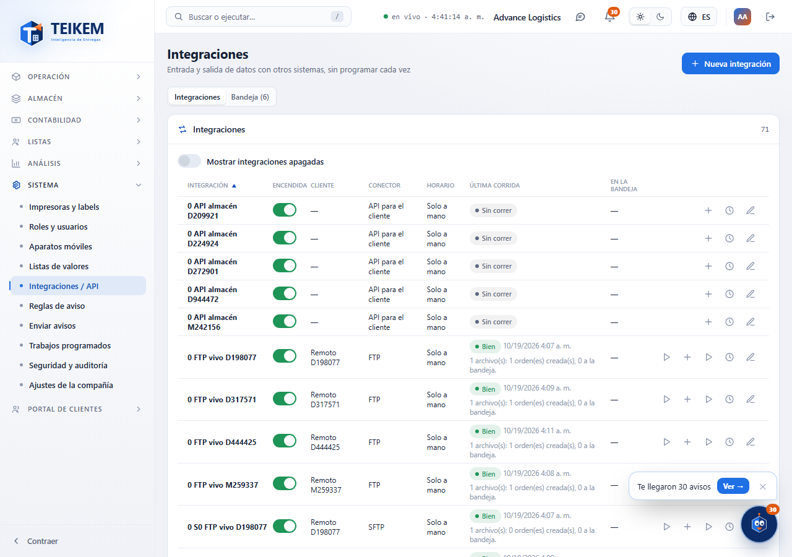
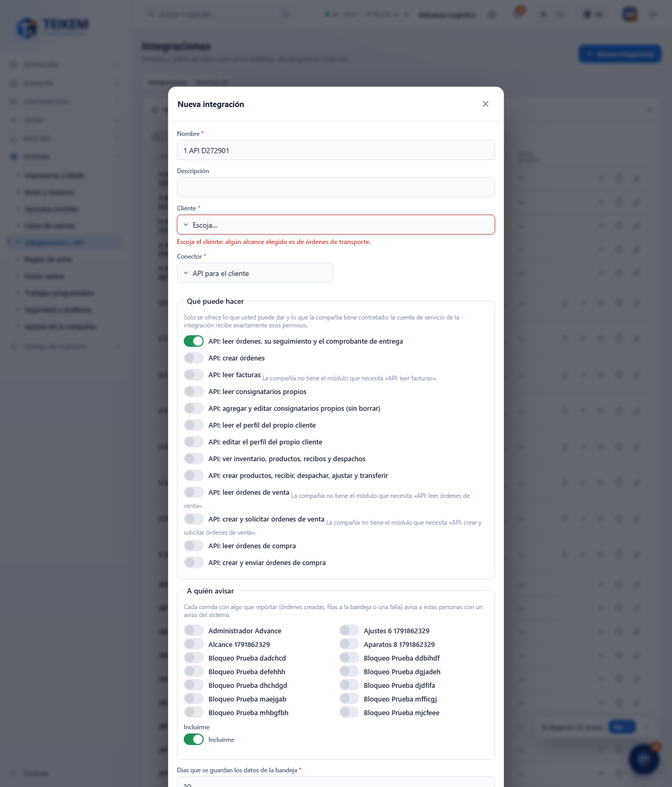
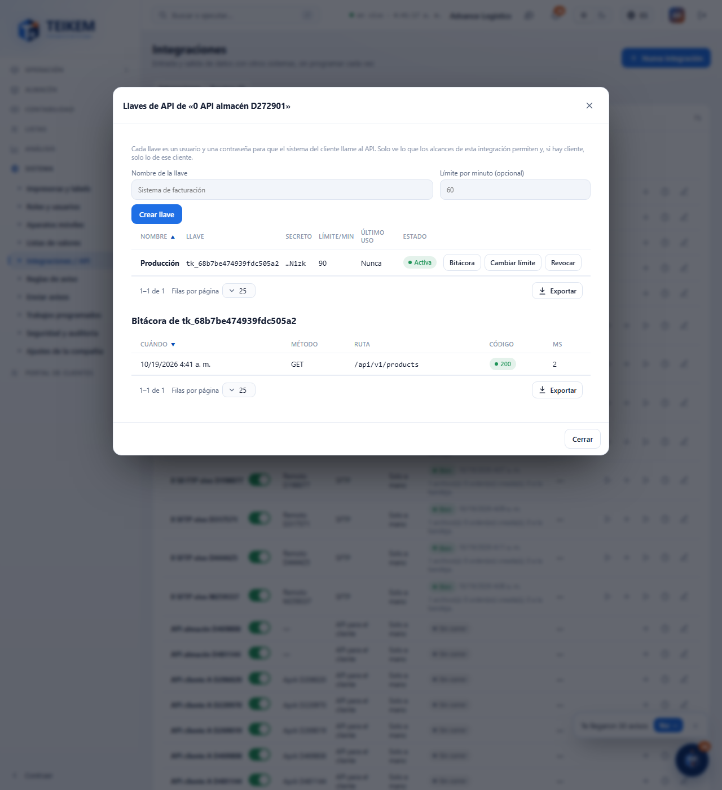

# L135 — API para los clientes (web del personal)

Capturas del recorrido `web-app/e2e/lote135-api-clientes.spec.ts` contra el API real (escritorio y móvil a 360 px sin scroll horizontal). Rutas, alcances y errores: [capítulo 39, §8](../39-integraciones.md).

## Lista
El conector **API para el cliente** no tiene «Correr ahora» ni «Subir archivo»; en su lugar, **Llaves de API**.

## Formulario
Con el conector API desaparecen la plantilla, la carpeta y el horario; solo se ofrecen los alcances de la API. El cliente se pide únicamente si hay un alcance de transporte.

## Llaves
Crear una llave muestra el **secreto una sola vez** (Copiar); luego solo queda la llave y los últimos 4 caracteres. Se puede cambiar el límite, revocar o abrir la bitácora.

## Bitácora de una llave
Método, ruta, código y duración de cada llamada (30 días).

