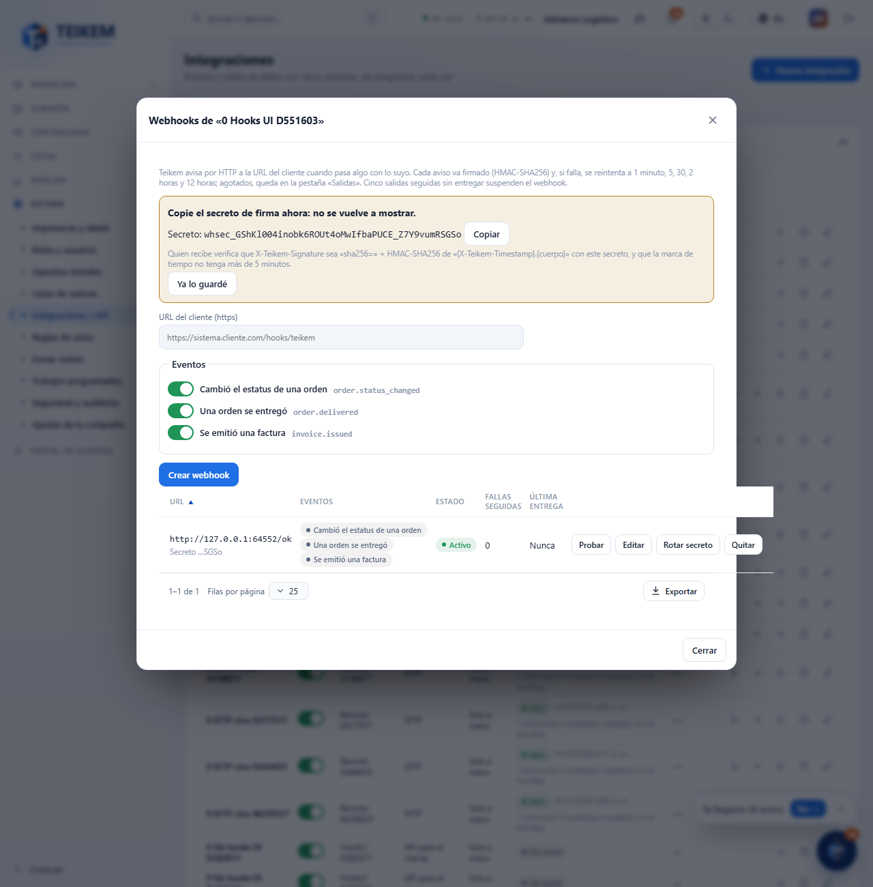
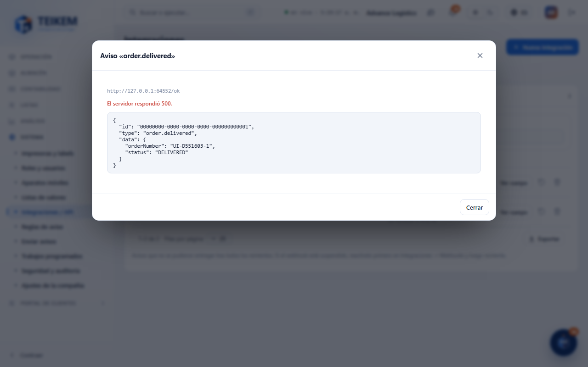

# L136 — Webhooks de salida y bandeja de salidas (web del personal)

Capturas del recorrido `web-app/e2e/lote136-webhooks.spec.ts` contra el API real y un receptor de prueba (escritorio y móvil a 360 px sin scroll horizontal). Reglas, firma y errores: [capítulo 39, §9](../39-integraciones.md).

## Webhooks de una integración
La acción **Webhooks** (solo en integraciones API con el alcance `webhooks:manage`) abre la gestión: URL del cliente, eventos, estado (Activo / Suspendido / Apagado), fallas seguidas y última entrega. Al crear (o rotar) se muestra el **secreto de firma una sola vez**.

## Salidas (no entregadas)
La pestaña **Salidas** (con el contador de no entregadas) lista los avisos que agotaron los reintentos, con el motivo exacto; filtros por integración y estatus; **Ver cuerpo**, **Reintentar** y **Descartar**.

## Cuerpo de una salida
El cuerpo mínimo que se mandó (id, tipo, fecha y datos).

