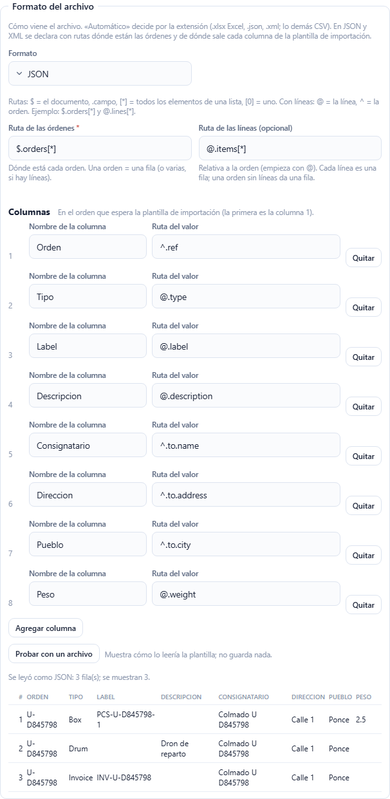
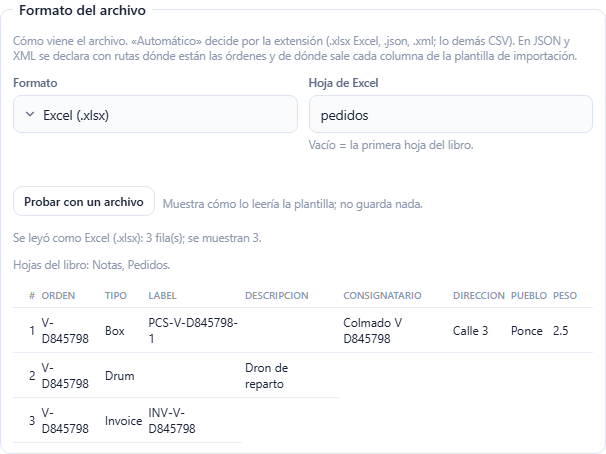

# L137 — Formato del archivo: Excel, JSON y XML (web del personal)

Capturas del recorrido `web-app/e2e/lote137-formatos.spec.ts` contra el API real (escritorio y móvil a 360 px sin scroll horizontal). Reglas y errores: [capítulo 39, §10](../39-integraciones.md).

## Formato JSON/XML con mapeo por ruta
En el formulario de la integración (cualquier conector de archivos), la sección **Formato del archivo**: la ruta de las órdenes, la de las líneas (opcional) y el mapeo ruta → columna, en el orden de la plantilla. **Probar con un archivo** muestra cómo lo leería la plantilla, sin guardar nada.

## Hoja de Excel
Con el formato Excel se escribe la hoja (vacío = la primera); la prueba muestra las hojas del libro y las primeras filas.

