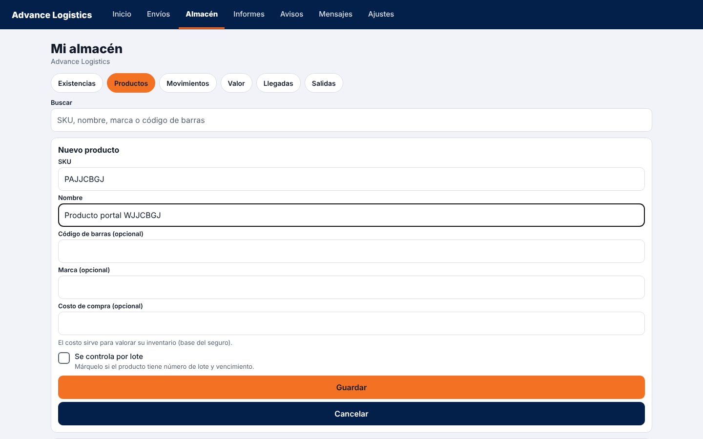
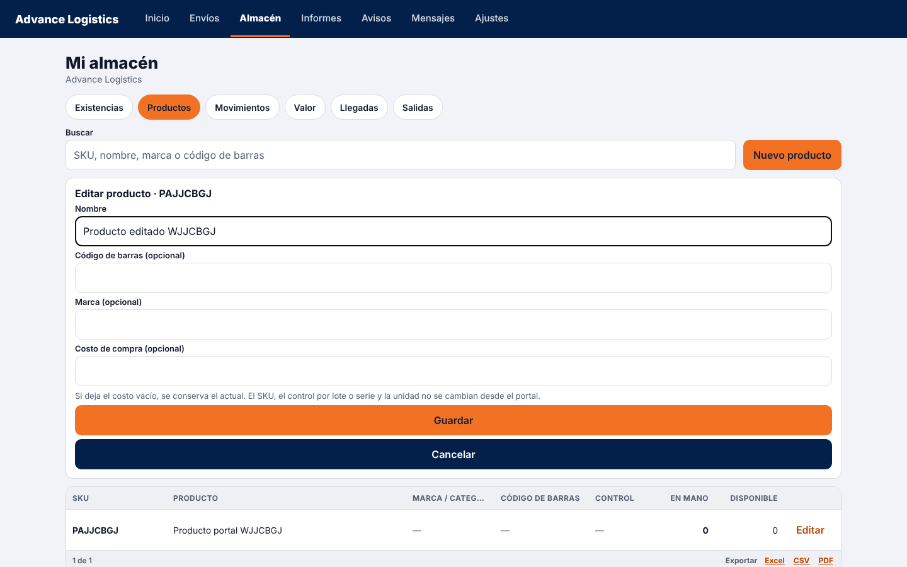
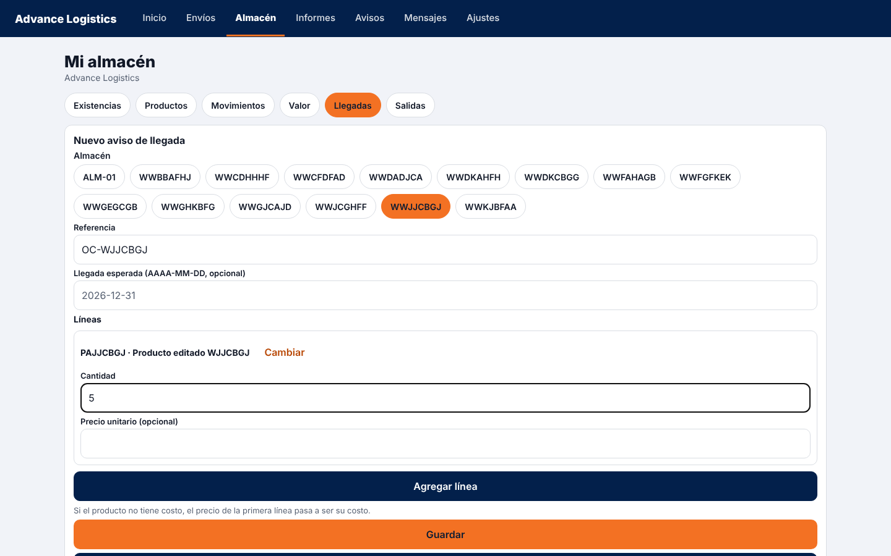
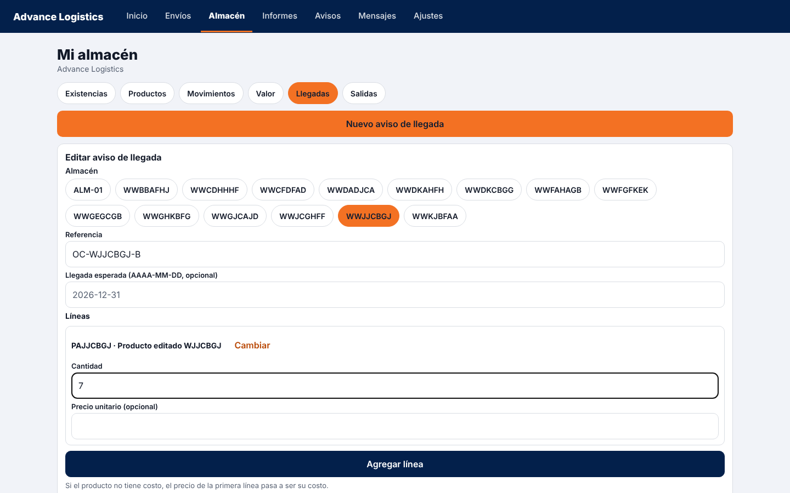
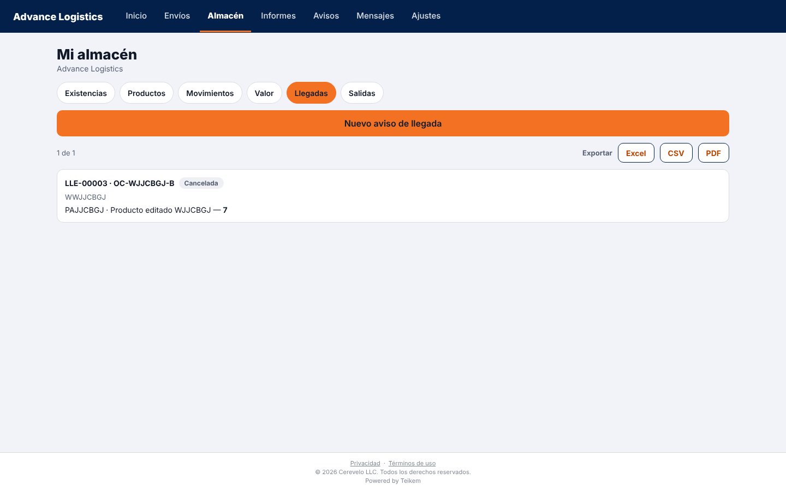
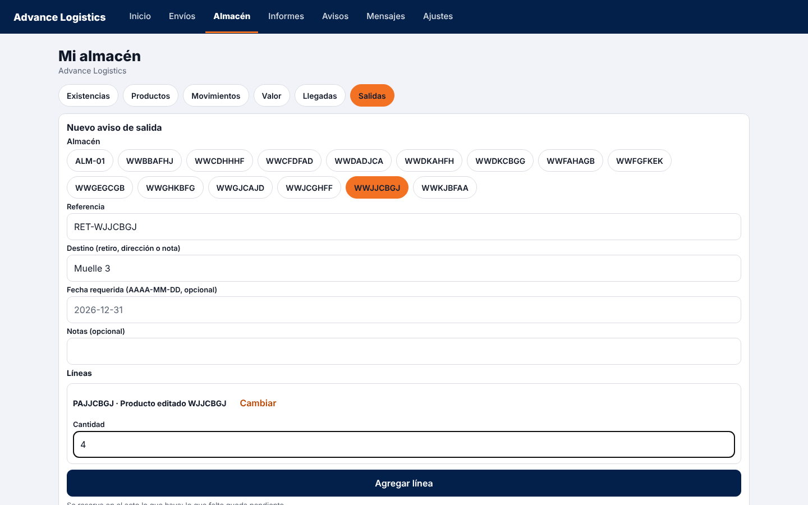
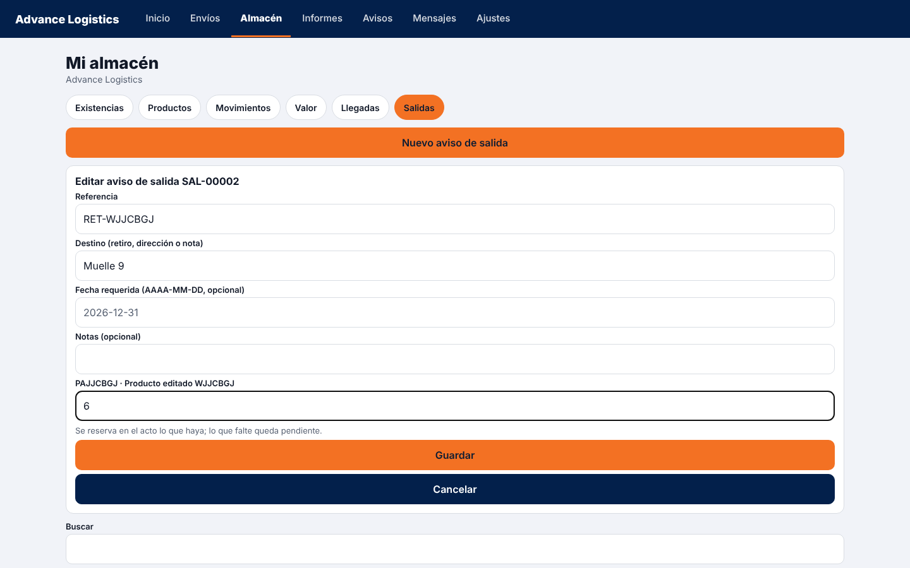
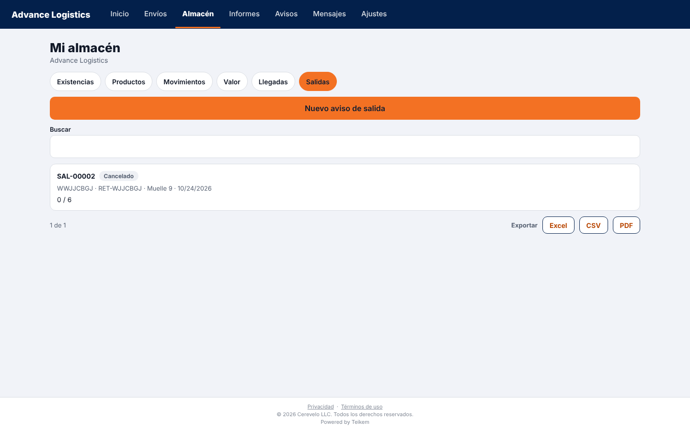

# L154 — Portal del cliente de almacén: producto, llegada y salida, de crear a cancelar

Capturas de la verificación con Playwright del 2026-10-24 (`web-app/e2e/lote154-portal-almacen.spec.ts`, contra el API real y la app del cliente en `CLIENT_APP_URL`; escritorio y móvil). Funcionalidad: capítulo [27](../27-app-cliente.md) y decisiones en [lote154](../../lote154-decisiones.md), [lote156](../../lote156-decisiones.md), [lote157](../../lote157-decisiones.md) y [lote158](../../lote158-decisiones.md). La persona del cliente (administradora) necesita las banderas del cliente «crear productos / llegadas / salidas» encendidas por el personal.

## Producto: crear y editar

En **Productos**: «Nuevo producto» (SKU y nombre obligatorios) y, en cada fila, **Editar** (nombre, código de barras, marca y costo; el SKU, el control por lote o serie y la unidad no cambian).

## Aviso de llegada: crear, editar y cancelar

Mientras el aviso sigue **esperado** se puede **Editar** (referencia, fecha, líneas) o **Cancelar aviso**. Editar no duplica el aviso; el servidor guarda la cantidad nueva.

## Aviso de salida: crear, editar (con reserva) y cancelar

Al crear, el sistema **reserva** lo disponible (con 10 en existencia y un aviso por 4, quedan 6 disponibles). Al **editar** se cambian referencia, destino, fecha, notas y la cantidad de cada línea, y la reserva se **reajusta** (a 6 pedidas, quedan 4 disponibles). Al **cancelar** se libera todo (vuelven las 10). Solo se edita o cancela mientras el aviso sigue «Solicitado».

## Lo que verifica el recorrido
Cada paso se comprueba también por el API del portal (lo que la pantalla muestra es lo que quedó guardado) y que **otro cliente no puede ver ni editar** estos avisos (403/404).
