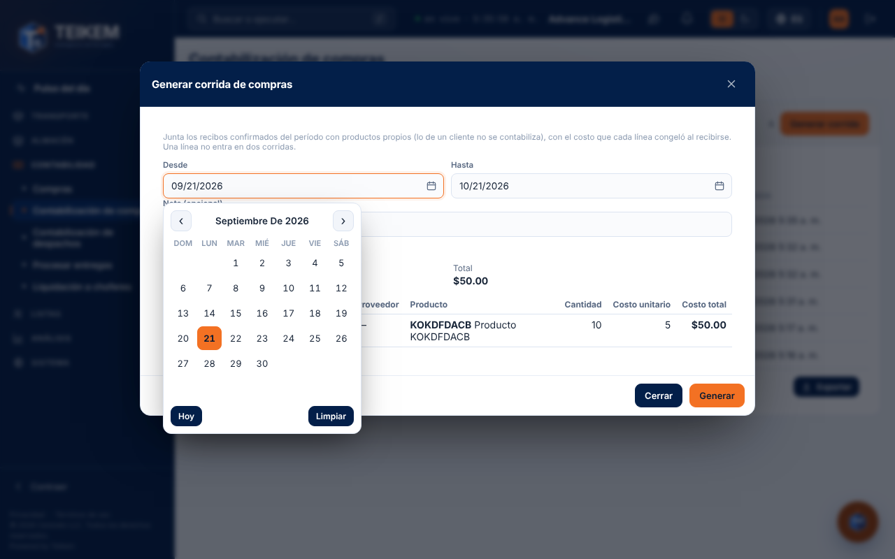
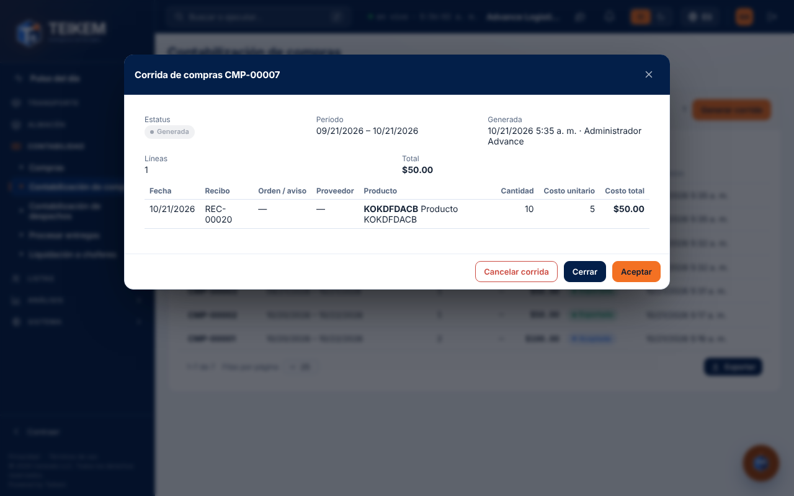
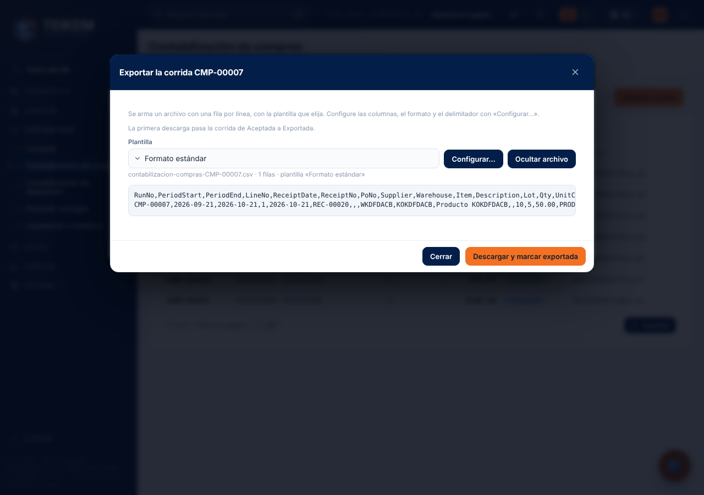
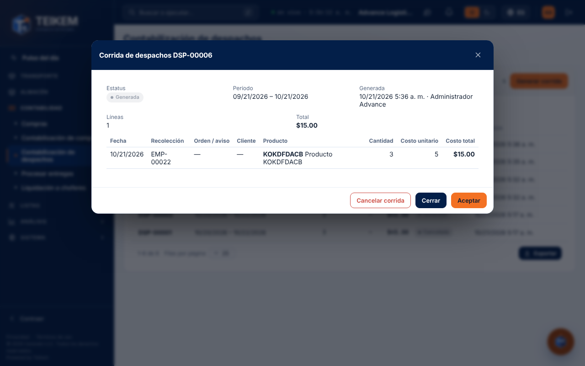

# L181 — Contabilización de compras y de despachos (pantalla)

Dónde: **Contabilidad → Contabilización de compras** (`/money/purchases`; permiso de acceso `purchaseaccounting.view`, módulo `PURCHASING`) y **Contabilidad → Contabilización de despachos** (`/money/dispatch`; `dispatchaccounting.view`, módulo `WMS_LOTSERIAL`). Las reglas, los endpoints y los mensajes de error están en el [capítulo 43](../43-contabilizacion.md); aquí, cómo se usan las pantallas. Funcionan de 360 px en adelante, sin scroll horizontal de página (las líneas se desplazan dentro de su recuadro).

## Generar una corrida

**Generar corrida** abre la ventana con el período (por omisión, los últimos 30 días) y una nota opcional. Antes de generar muestra **lo que entraría**: el número de líneas, el total, un aviso si hay líneas **sin costo** y el detalle. Lo de un cliente no aparece. **Generar** crea la corrida y abre su ficha.

## La ficha

Estatus, período, quién la generó, aceptó y exportó, total y las líneas con su costo congelado (las que no tienen costo se marcan y quedan en blanco). Los botones dependen del estatus y de sus permisos: **Aceptar** (generada), **Exportar** (aceptada o exportada) y **Cancelar corrida** (generada o aceptada, con confirmación).

## Exportar

Elija la **plantilla**, ajústela con **Configurar…** (la misma ventana de Facturación: formato, delimitador, fecha, encabezado y columnas), mire el archivo con **Ver archivo** y descárguelo. La primera descarga marca la corrida como **Exportada**; después se puede volver a descargar.

## Contabilización de despachos

Igual que la de compras, pero sobre lo que **salió**: las líneas traen la recolección o el despacho, la orden de venta o el aviso de salida y el cliente.
