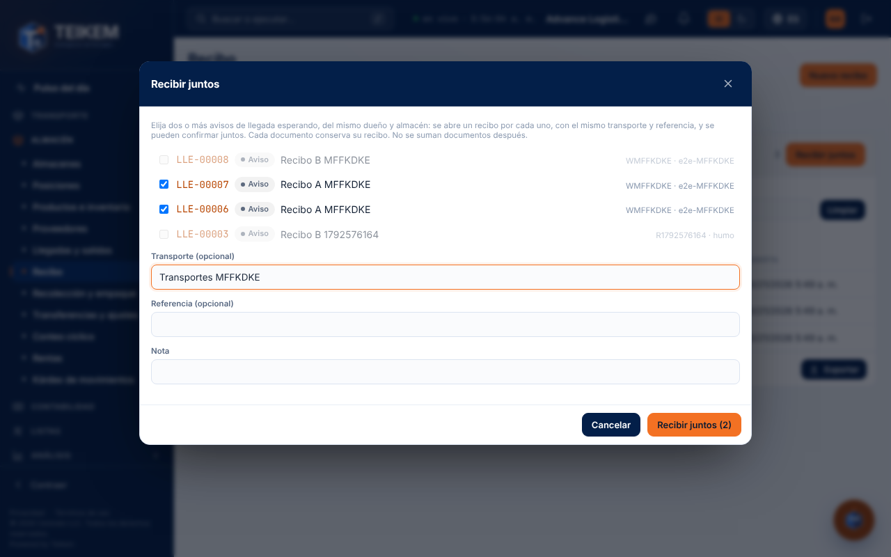
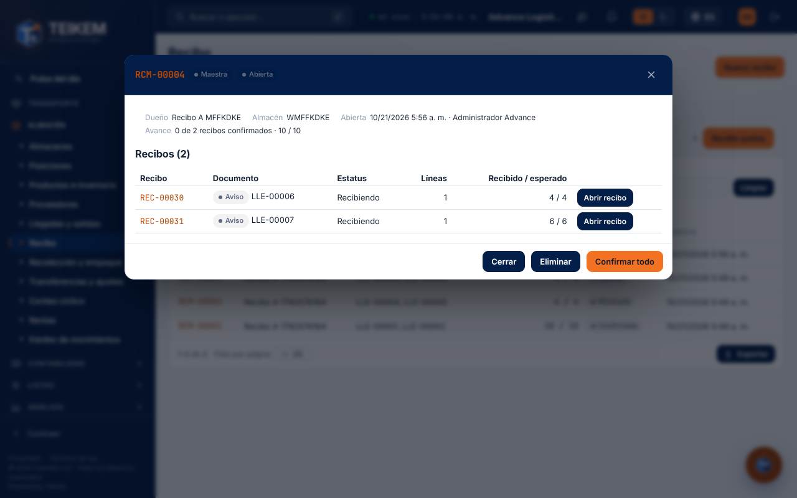

# L183 — Recepción maestra (pantalla)

Dónde: **Almacén → Recibo → pestaña «Maestros»** (`/warehouse/receipts?tab=groups`; permiso `inventory.view`, módulo `WMS_LOTSERIAL`; abrir, confirmar y eliminar piden `warehouse.receive`). Las reglas, los endpoints y los mensajes de error están en el [capítulo 44](../44-recepcion-maestra.md). Funciona de 360 px en adelante, sin scroll horizontal de página.

## Recibir juntos

**Recibir juntos** lista los avisos de llegada esperando y sin recibo. Al elegir el primero, los de otro dueño u otro almacén quedan bloqueados. Se eligen dos o más, se escribe (si se quiere) el transporte, la referencia y una nota, y **Recibir juntos (n)** abre un recibo por aviso.

## La ficha de la maestra

Dueño, almacén, quién y cuándo la abrió, el avance y la tabla de recibos (documento, estatus, líneas y recibido / esperado). **Abrir recibo** lleva a la pantalla de siempre de ese recibo; **Confirmar todo** confirma juntos los que faltan (todo o nada); **Eliminar** (mientras ninguno esté confirmado) elimina la maestra y sus recibos.

## Confirmada

Con todos los recibos confirmados la maestra queda **Confirmada** y ya no ofrece confirmar ni eliminar; cada recibo sigue su camino (acomodo) como siempre.
