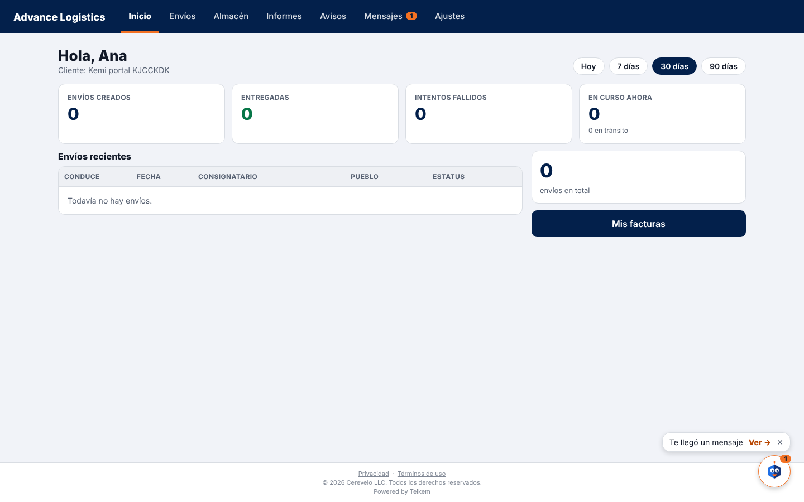
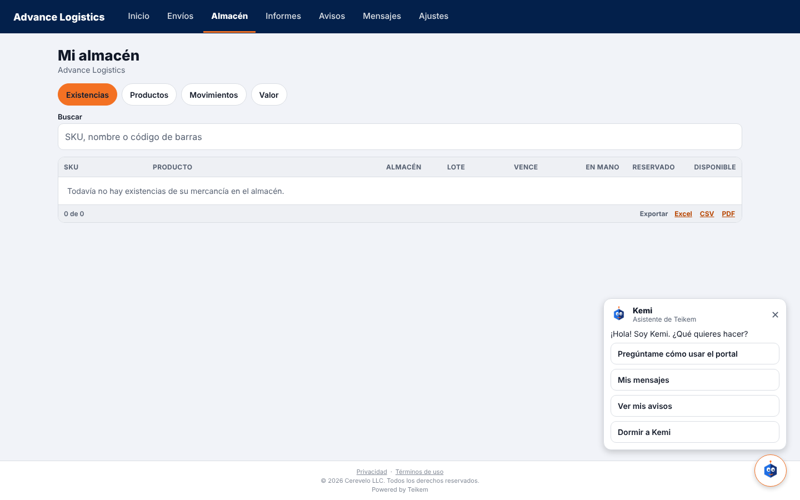
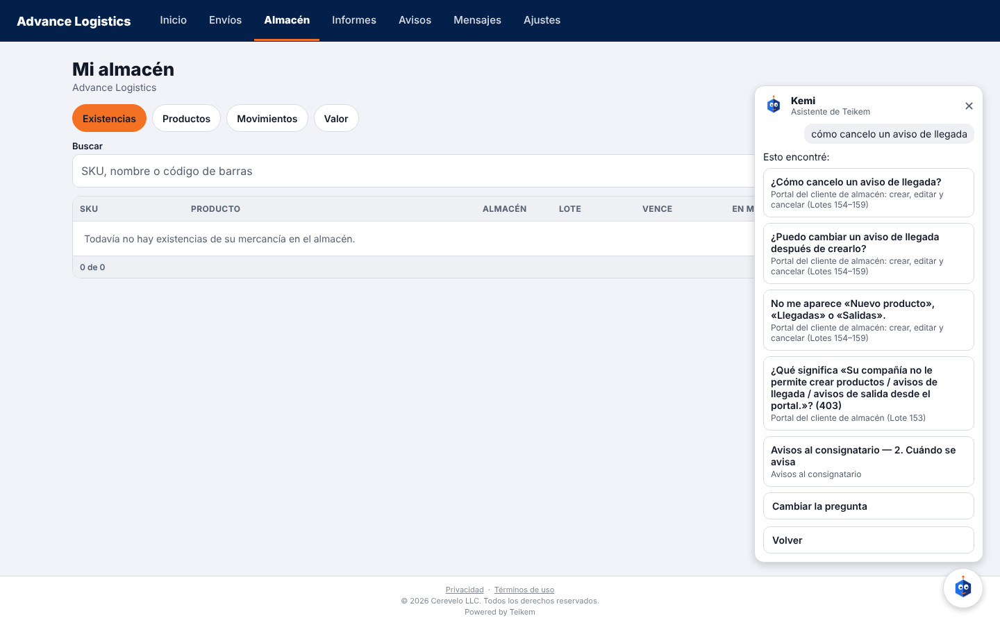
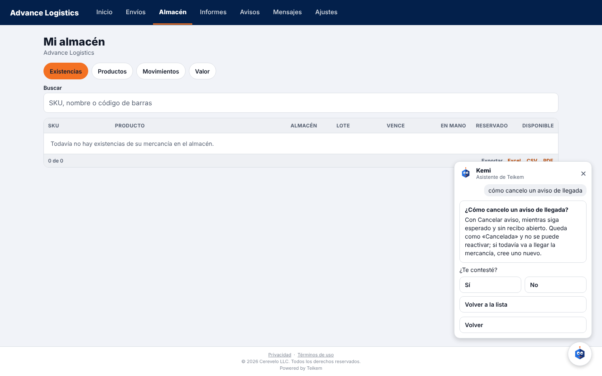
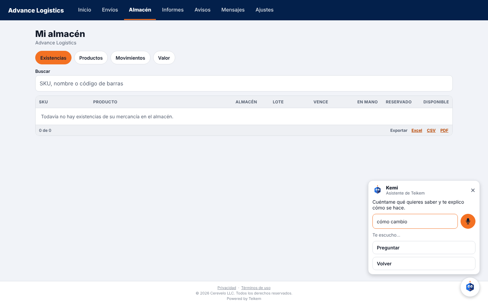
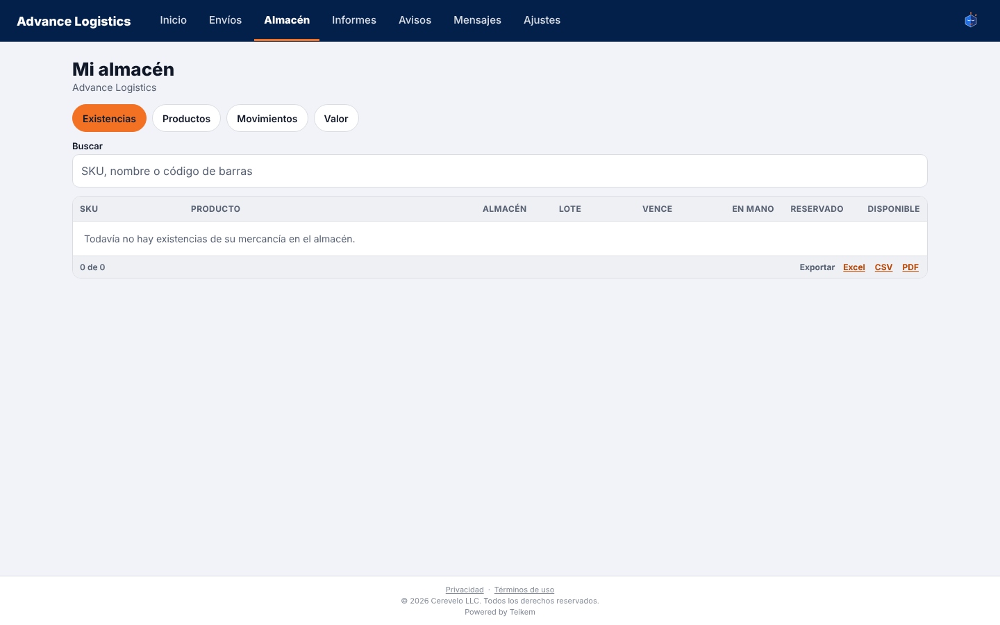
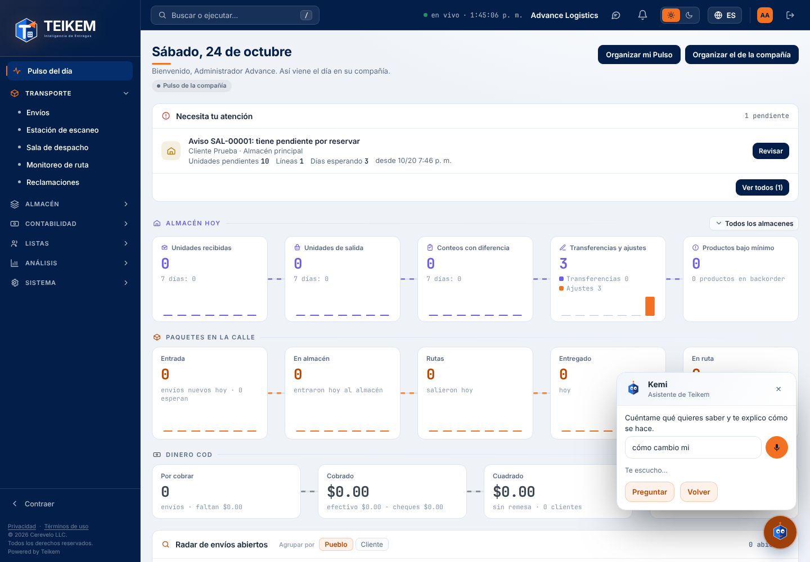

# L218 — Kemi en el portal del cliente y hablarle (web y portal)

Capturas de la verificación con Playwright del 2026-10-24: `web-app/e2e/lote218-kemi-portal.spec.ts` (app del cliente con el API real) y `lote218-kemi-web.spec.ts` (web del personal, escritorio y móvil). El reconocimiento de voz del navegador se **simula** (un navegador de pruebas no tiene micrófono). Funcionalidad y reglas: capítulo [46](../46-kemi.md); decisiones en [lote218-decisiones.md](../../lote218-decisiones.md).

## Kemi en el portal: el globo del mensaje nuevo

Al entrar, Kemi anuncia el mensaje del equipo de servicio sin leer («Te llegó un mensaje → Ver»). **Ver** abre Mensajes.

## El panel de opciones

Pregúntame cómo usar el portal · Mis mensajes (con su cuenta) · Ver mis avisos · Dormir a Kemi (y «Llevar a Kemi a su esquina» si la movió).

## Preguntarle escribiendo

La pregunta «cómo cancelo un aviso de llegada» trae opciones del manual del cliente; al abrir una sale la respuesta con «¿Te contesté?».

## Preguntarle hablando

El micrófono (naranja mientras escucha) llena el campo con lo que va entendiendo; al terminar de hablar, Kemi pregunta sola.

## Dormida

Dormida se esconde junto al menú; un toque la despierta y se acuerda al recargar.

## En la web del personal también se le habla

El mismo micrófono en la caja de pregunta de la web (con el índice de todo el manual).
