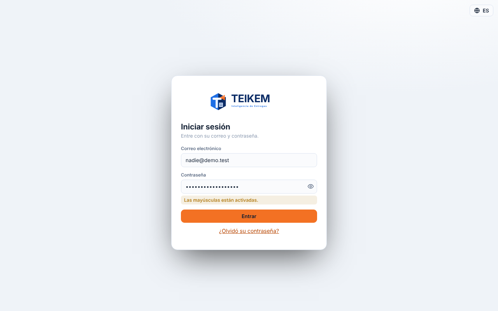
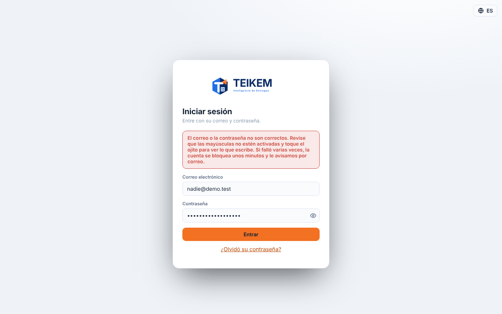
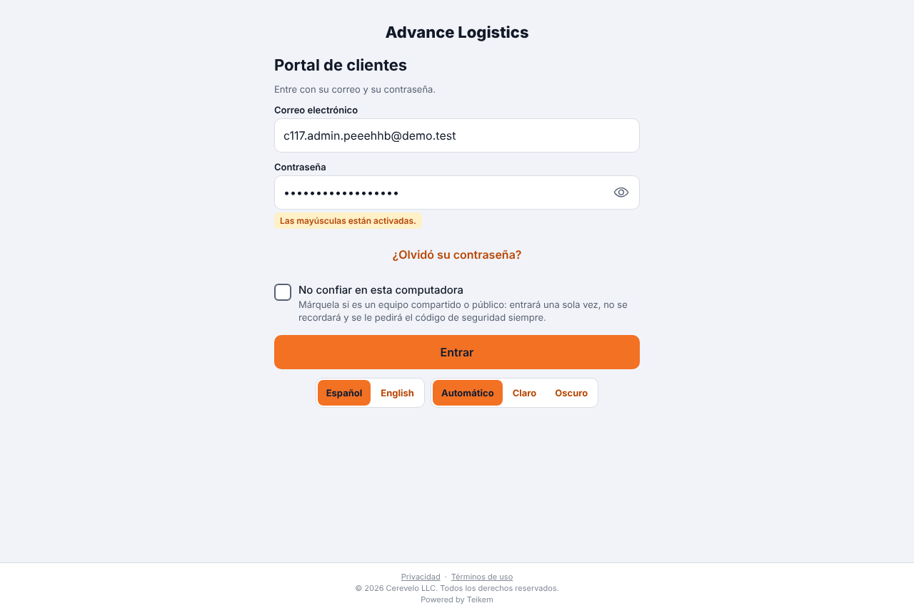
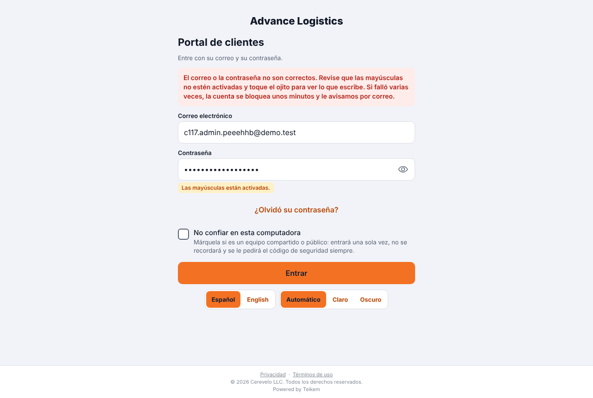
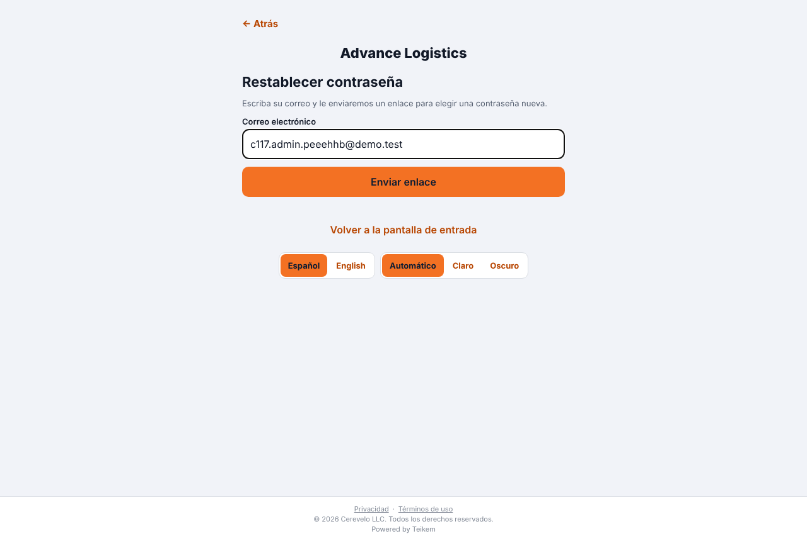
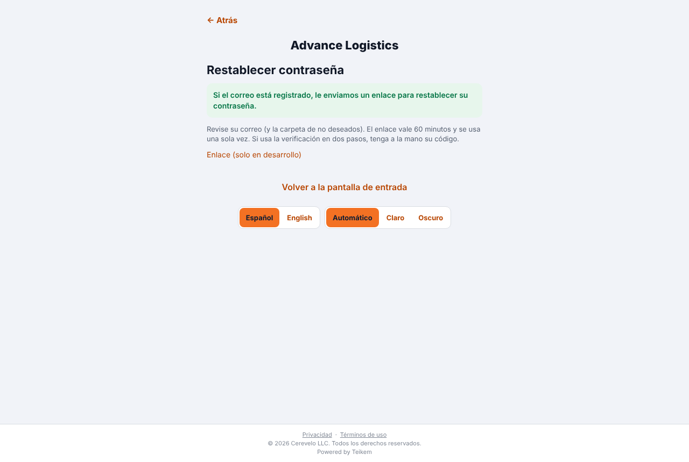
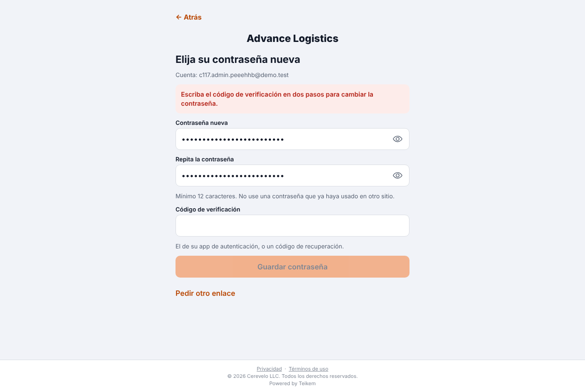
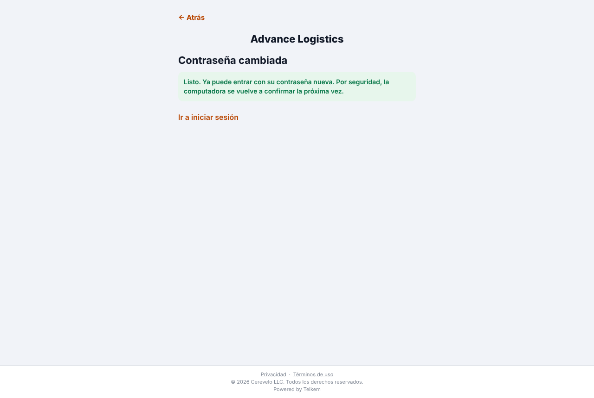

# L219 — Contraseñas: ojito, mayúsculas, mensajes claros, marca y «¿Olvidó su contraseña?»

Capturas de la verificación con Playwright del 2026-10-25 (`web-app/e2e/lote219-contrasenas.spec.ts`, contra el API real; la web del personal y el portal del cliente). Reglas y mensajes exactos: capítulo [25 §7](../25-acceso-seguro.md); decisiones: [lote219-decisiones.md](../../lote219-decisiones.md).

## Web del personal: aviso de mayúsculas y mensaje claro

El ojito (ver/ocultar), «Las mayúsculas están activadas.» al teclear con Bloq Mayús, y, con una contraseña mala, el mensaje que dice qué revisar.

## Portal: logo arriba, ojito, aviso de mayúsculas y mensaje claro

Arriba la marca (el logo de la compañía, su nombre si no subió logo, o el de Teikem); debajo de la contraseña, el ojito dentro del campo y el aviso de mayúsculas; y «¿Olvidó su contraseña?».

## Recuperar la contraseña (portal)

Se escribe el correo; la respuesta es la misma exista o no el correo («Si el correo está registrado, le enviamos un enlace…»). (El «enlace de desarrollo» solo sale en un API de pruebas.)

## Elegir la contraseña nueva: el enlace no basta si hay verificación en dos pasos

Quien tiene la verificación en dos pasos ve el campo «Código de verificación» y no puede guardar sin él; con un código malo no cambia nada y el enlace sigue sirviendo; con uno bueno la contraseña cambia, la vieja deja de entrar y la nueva sí (con su código y la computadora confirmada otra vez).
