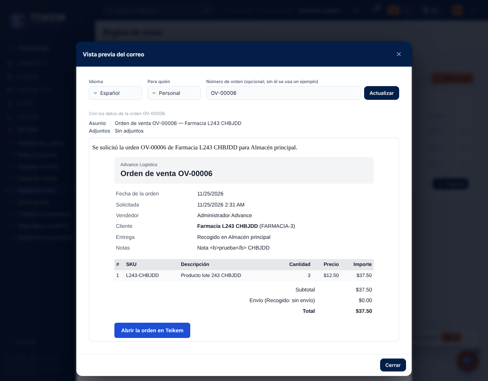
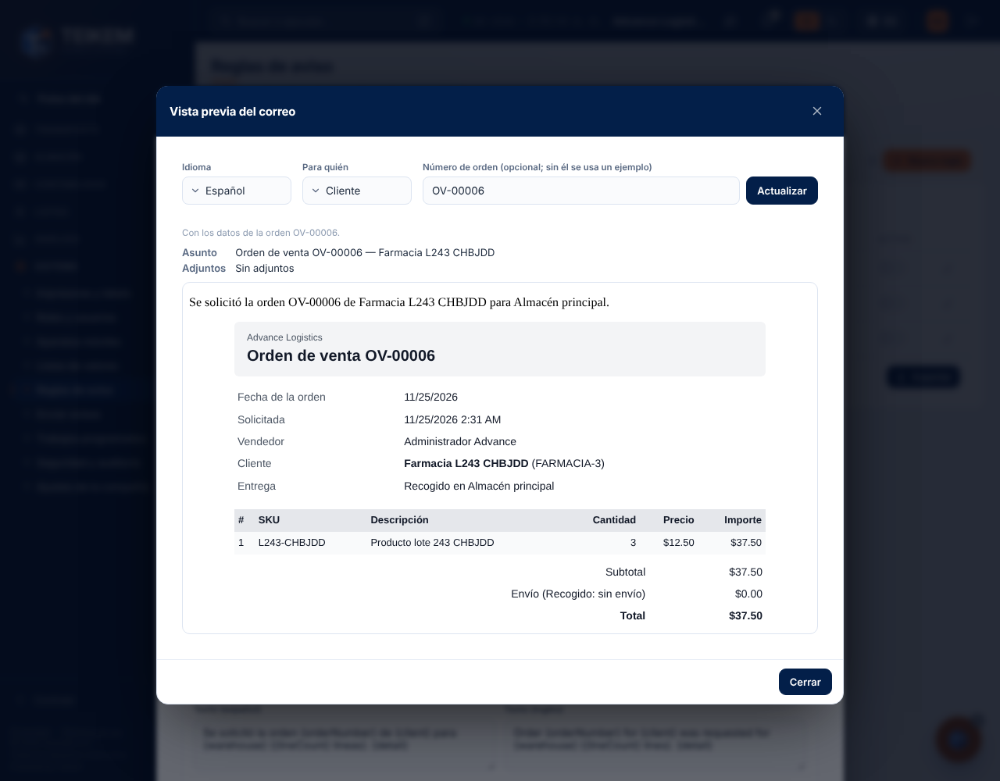
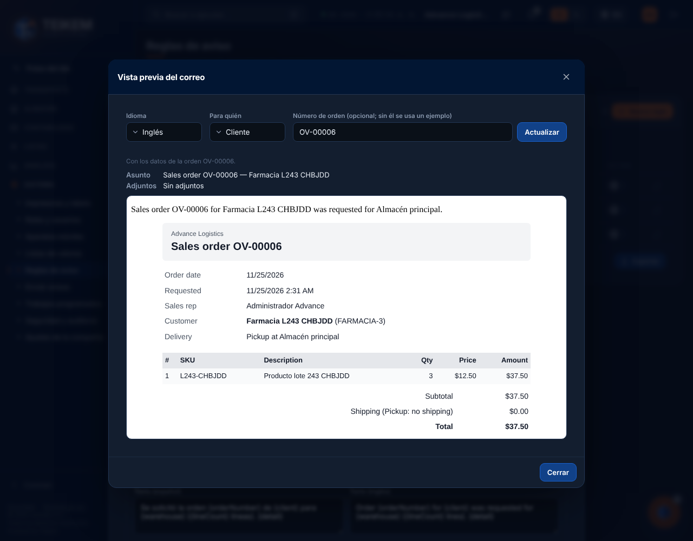
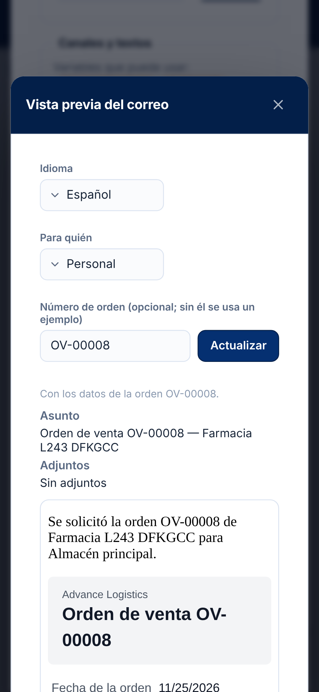
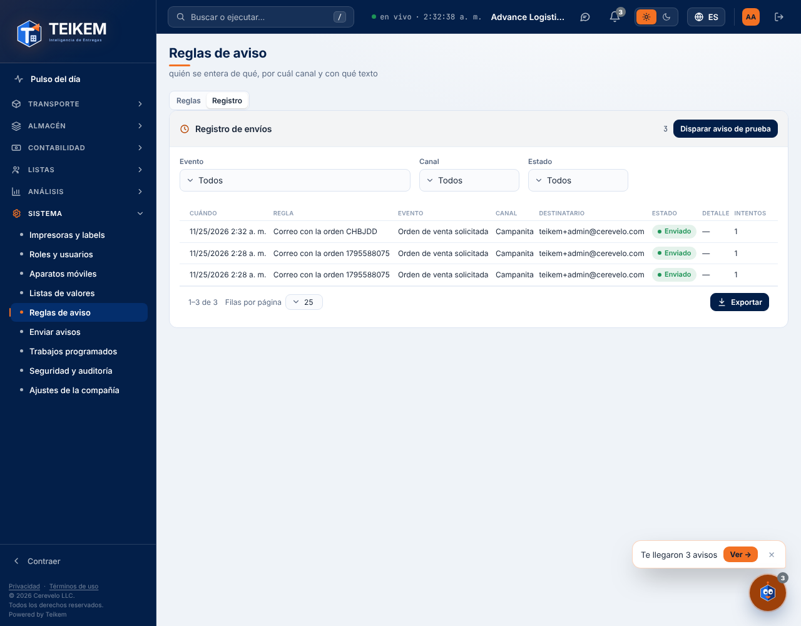
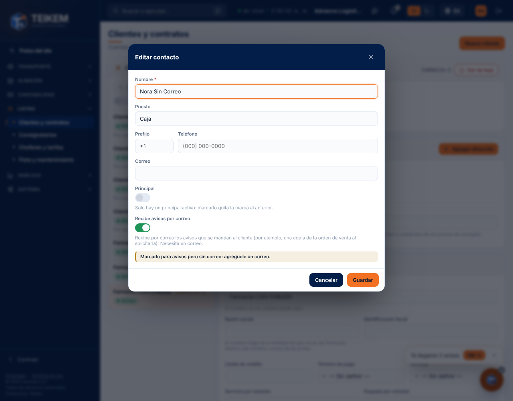
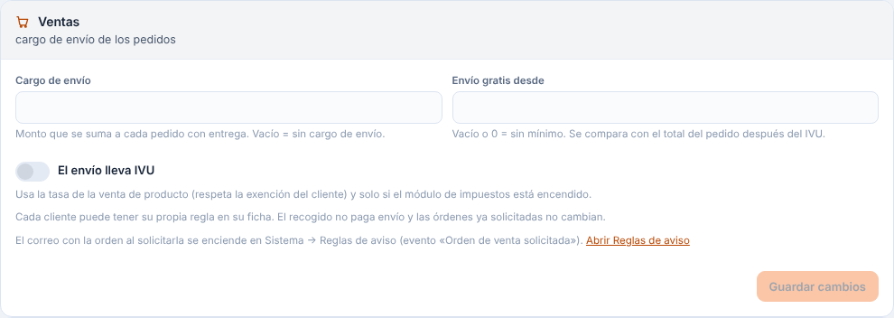

# L243 — Correo con la orden de venta completa al solicitarla (web del personal)

Lote 243 (2026-11-25). Tres pantallas cambian: **Sistema → Reglas de aviso** (destinatario «Del evento», variable bloque y **Vista previa**), la **ficha del cliente** (casilla «Recibe avisos por correo») y **Ajustes → Operación → Ventas** (una línea de ayuda). Backend y reglas: [14 — Avisos §3.1 bis](../14-avisos.md#31-bis-el-correo-con-la-orden-de-venta-completa-lote-243-2026-11-25), [02 §1.5](../02-clientes-y-contratos.md#15-personas-de-contacto) y [18 §29](../18-ordenes-de-venta.md#29-correo-con-la-orden-al-solicitarla-lote-243). Decisiones: `docs/lote243-decisiones.md`.

Capturas del recorrido `web-app/e2e/lote243-correo-orden-venta.spec.ts`, con el API de pruebas **sin correo** (por eso el Registro muestra el canal «Campanita»; el correo real con Mailpit queda por verificar, ver las decisiones del lote). Están en `img/l243-*.png`.

## 1. Reglas de aviso: «Vista previa»

**Quién puede.** Permiso **`notifications.manage`** (módulo Sistema). Para ver el correo con los datos de **una orden real** hace falta además `sales.view` y el módulo **Órdenes de venta** encendido; sin ellos el servidor responde con el error (por ejemplo «Falta el permiso 'sales.view'.», HTTP 403).

**Cómo se usa.**
1. Sistema → **Reglas de aviso** → abra o cree la regla del evento «Orden de venta solicitada». La regla nueva ya trae el destinatario **«Vendedor de la orden»** y el texto del correo con la variable `{orderDetail}` (marcada «bloque · solo en el texto del correo»).
2. En destinatarios, el tipo **«Del evento»** ofrece «Vendedor de la orden» y «Cliente de la orden».
3. En el canal EMAIL, pulse **«Vista previa»**. Se abre la ventana **«Vista previa del correo»** con tres controles: **Idioma** (Español o Inglés), **Para quién** (Personal o Cliente) y **Número de orden** (opcional; sin él se usa un ejemplo). Pulse **«Actualizar»** para volver a armarla.
4. La ventana dice si usó el ejemplo («Con datos de ejemplo.») o la orden («Con los datos de la orden OV-00006.»), muestra **Asunto** y **Adjuntos**, y debajo el correo tal como llegará, en un marco aparte con fondo claro (también con el tema oscuro). **«Cerrar»** la cierra. No envía nada ni escribe en el Registro.

En la versión del **personal** se ven las notas (en la captura, la nota `<b>prueba</b>` sale como texto, no como formato) y el botón azul **«Abrir la orden en Teikem»**.

La **copia al cliente** es la misma orden sin las notas, sin el botón y sin marcas internas.

En **inglés** cambian las etiquetas del correo («Sales order», «Order date», «Sales rep», «Customer», «Delivery», «Amount», «Total»); los datos de la orden (nombre del almacén, producto) salen como están guardados. El tema oscuro cambia la ventana, no el correo.

En el **celular** los controles se apilan en una columna y la ventana cabe en el ancho de la pantalla; el correo se desplaza hacia abajo dentro de la ventana.

**Mensajes que puede ver aquí** (cada uno explicado en la [FAQ](../faq.md)):

| Situación | Mensaje exacto | HTTP |
|---|---|---|
| Variable bloque en el asunto | `La variable {orderDetail} es un bloque y solo puede ir en el texto, no en el asunto.` | 400 |
| Número de orden que no existe | `Orden de venta 'OV-X' no encontrada.` | 404 |
| Orden cancelada o en borrador | `La orden OV-00012 se canceló antes de enviar el aviso.` / `La orden OV-00012 sigue en borrador.` | 400 |
| Sin `sales.view` | `Falta el permiso 'sales.view'.` | 403 |
| Módulo apagado | `El módulo 'SALES_ORDERS' no está habilitado para esta compañía.` | 403 |
| El destinatario del evento no existe | `Este evento no tiene el destinatario 'X'.` | 400 |

## 2. Registro de avisos

Reglas de aviso → pestaña **Registro**. Cada correo, campanita o SMS queda con su regla, evento, canal, destinatario, estado y detalle. Lo que no se pudo enviar sale `SKIPPED` con el motivo en «Detalle» (por ejemplo `El cliente no tiene correo principal ni contactos marcados con correo.`).

## 3. Ficha del cliente: «Recibe avisos por correo»

**Quién puede.** `clients.update` para marcar la casilla; `contacts.manage` (además de `clients.update`) para agregar o cambiar el correo de la persona.

**Cómo se usa.** Listas → Clientes → ficha → **Personas de contacto** → Agregar o Editar. Apareció la casilla **«Recibe avisos por correo»** (apagada por omisión) con su ayuda: «Recibe por correo los avisos que se mandan al cliente (por ejemplo, una copia de la orden de venta al solicitarla). Necesita un correo.» En la lista de personas, las marcadas llevan el chip **«Avisos por correo»**.

Si se marca a alguien sin correo, el formulario avisa **«Marcado para avisos pero sin correo: agréguele un correo.»** y el chip de la lista sale en tono de advertencia. Se puede guardar igual; esa persona no recibe nada hasta tener un correo.

## 4. Ajustes → Operación → Ventas

Debajo del cargo de envío, quien tiene `notifications.manage` ve una línea de ayuda: «El correo con la orden al solicitarla se enciende en Sistema → Reglas de aviso (evento «Orden de venta solicitada»).» con el enlace **«Abrir Reglas de aviso»**. No hay interruptor nuevo: el correo se enciende en la regla.

## 5. Preguntas frecuentes de estas pantallas

- **El botón «Vista previa» me dice «Falta el permiso 'sales.view'.»** Solo pasa al poner un número de orden. Sin número se usa un ejemplo y no hace falta ese permiso.
- **La vista previa en inglés deja el nombre del almacén en español.** Es el nombre tal como está guardado; solo las etiquetas del correo cambian de idioma.
- **No veo la línea de ayuda en Ajustes → Ventas.** Solo la ve quien tiene `notifications.manage`.
- **Marqué «Recibe avisos por correo» y el cliente no recibió nada.** Revise que la persona esté activa y tenga correo, y que la regla tenga el destinatario «Cliente de la orden» y el canal EMAIL encendido.
