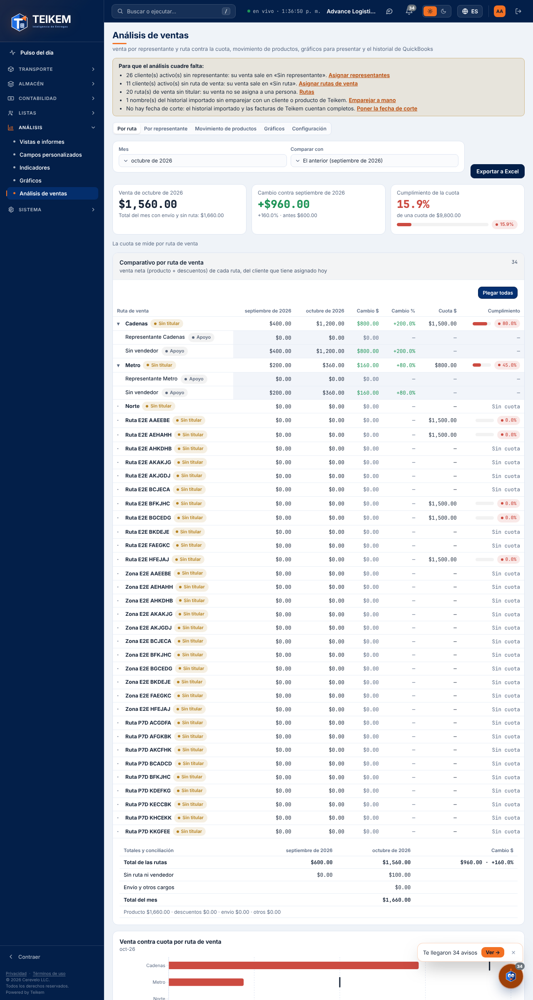
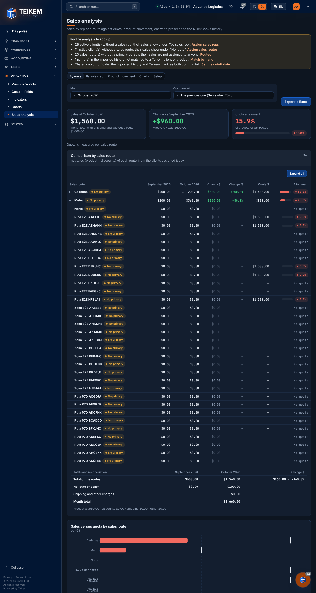
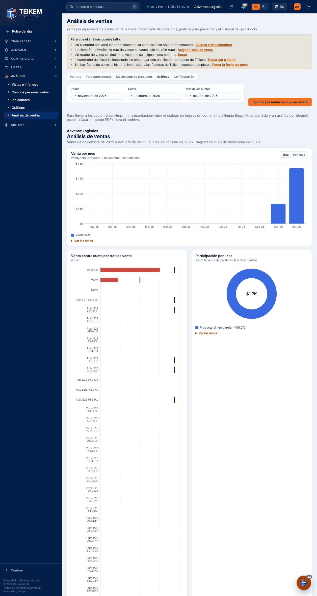
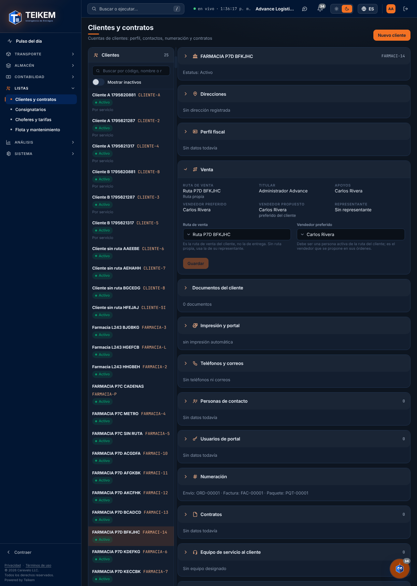
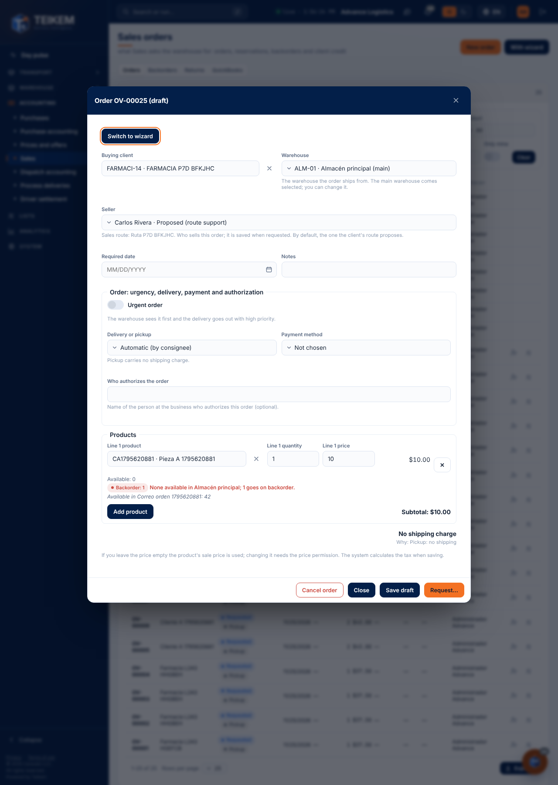

# L244 — Rutas de venta: «Por ruta», ficha del cliente y vendedor de la orden (web del personal)

Lote 244 (2026-11-25). Cuatro pantallas cambian: **Análisis → Análisis de ventas** (la pestaña **«Por ruta»** pasa a ser la de por omisión y «Gráficos» mide contra la cuota por ruta), la **ficha del cliente** (panel **«Venta»**), la **orden de venta** (campo **«Vendedor»**, columnas y filtros) y **Configuración → Rutas** (personas de la ruta, «Pasar rutas desde representantes»). Reglas, permisos y mensajes: [capítulo 52](../52-rutas-de-venta.md). Cada mensaje de error: [FAQ](../faq.md).

Capturas del recorrido de `web-app/e2e` (`lote244-*.spec.ts`) con el API de pruebas **sin correo**; están en `img/l244-*.png`. La base de pruebas tiene decenas de rutas «E2E» y «P7D» creadas por los propios recorridos, por eso las listas salen largas.

## 1. Análisis de ventas → «Por ruta»

**Quién puede.** `sales.analysis.view` o `sales.analysis.manage`, módulo Órdenes de venta.

**Cómo se usa.** Menú Análisis → Análisis de ventas. Abre en **«Por ruta»**; **«Por representante»** sigue en la pestaña de al lado (sin `?tab=` abre «Por ruta»; con `?tab=rep`, «Por representante»). Arriba, **Mes** y **Comparar con** (por omisión el mes anterior) y **«Exportar a Excel»**.

Qué se ve, de arriba abajo:
- El aviso **«Para que el análisis cuadre falta:»** con enlaces («Asignar rutas de venta», «Rutas», …).
- Tres tarjetas: **Venta de octubre de 2026**, **Cambio contra septiembre de 2026** y **Cumplimiento de la cuota** (en la captura, 15.9 % de una cuota de $9,800.00), y la línea «La cuota se mide por ruta de venta».
- **Comparativo por ruta de venta**: una fila por ruta con su **Titular** (la etiqueta ámbar «Sin titular» cuando no hay), septiembre, octubre, Cambio $, Cambio %, Cuota $ y Cumplimiento. El triángulo de la izquierda despliega a las personas de la ruta; **«Desplegar todas» / «Plegar todas»** lo hace de una vez. «Cadenas» y «Metro» aparecen como cualquier otra ruta.
- **Totales y conciliación**: Total de las rutas + «Sin ruta ni vendedor» + «Envío y otros cargos» = Total del mes (en la captura $1,560.00 + $100.00 + $0.00 = $1,660.00).
- Más abajo: «Venta contra cuota por ruta de venta».

En **inglés** y **tema oscuro** son las mismas pantallas («By route», «Sales route», «No primary», «Comparison by sales route», «Totals and reconciliation»). Plegadas, cada ruta ocupa **una sola fila** (el recorrido exige que no pase de 48 px) y no hay scroll horizontal de página.

**Qué mirar en las capturas** (defectos conocidos, ver las [decisiones del lote](../../lote244-decisiones.md)):
- En la captura desplegada, la fila **«Sin vendedor»** dentro de «Cadenas» y «Metro» lleva la etiqueta **«Apoyo»**. El dinero está bien; la etiqueta no debería salir en esa fila.
- Con cuota por ruta, las filas de personas no muestran cuota (la tiene la ruta), por eso salen «—».

## 2. Gráficos

La pestaña **Gráficos** conserva su hoja para imprimir («Imprimir presentación o guardar PDF») y cambia «Venta contra cuota» a **«Venta contra cuota por ruta de venta»** cuando el ajuste dice que la cuota se mide por ruta (por persona, «Venta contra cuota por representante»). La barra roja es la venta; la marca oscura vertical es la cuota; una ruta sin cuota no tiene marca («Norte» en la captura).

## 3. Ficha del cliente: panel «Venta»

**Quién puede.** Ver: `sales.analysis.view|manage`. Cambiar la ruta y el preferido: `sales.analysis.manage`.

**Cómo se usa.** Listas → Clientes y contratos → el cliente → sección **Venta** (se despliega con un clic). Muestra **Ruta de venta** (con «Ruta propia» o «Heredada del representante {rep}»), **Titular**, **Apoyos**, **Vendedor preferido**, **Vendedor propuesto** (con «preferido del cliente», «titular de la ruta» o «apoyo de la ruta») y **Representante**. Debajo, los dos selectores y **Guardar**.

- **Ruta de venta** («Es la ruta de venta del cliente, no la de entrega. Sin ruta propia, usa la de su representante.») y **Vendedor preferido** («Debe ser una persona activa de la ruta del cliente; es el vendedor que se propone en sus órdenes.»).
- Sin ruta, el preferido no se puede asignar: «El cliente necesita una ruta antes de asignarle un vendedor preferido.». Con una persona que no es de la ruta: «El vendedor preferido debe ser una persona activa de la ruta del cliente.».
- Si el preferido ya no es de la ruta, el panel no se bloquea: muestra la etiqueta **«El vendedor preferido ya no pertenece a la ruta del cliente.»** y la ayuda «No se bloquea nada: elija otro vendedor o déjelo así.». Esa etiqueta **no está en las capturas**: el cliente de la captura tiene un preferido que sí es de su ruta.
- «Quitar la ruta propia» y «Quitar el vendedor preferido» deshacen cada campo. Al guardar: «Se guardó la venta del cliente.».

## 4. Orden de venta: campo «Vendedor», columnas y filtros

**Quién puede.** El campo «Vendedor» sale a quien crea o edita el borrador (`sales.create`). Los filtros **Ruta de venta** y **Vendedor** salen a quien tiene `sales.analysis.view|manage`.

**Cómo se usa.** Ventas → Órdenes de venta → abra un borrador. El campo **Seller / Vendedor** lista a las personas de la ruta del cliente (titular y apoyos) y al preferido, marca la propuesta con **«Propuesto»** e indica la ruta debajo («Ruta de venta: …. Quien vende esta orden; se guarda al solicitarla. Por omisión, el que propone la ruta del cliente.»). Al **solicitar**, la orden guarda ruta y vendedor.

- En la lista hay dos columnas nuevas, **Ruta de venta** y **Vendedor**; en un borrador salen «—» porque la copia se toma al solicitar. Las órdenes anteriores al lote tampoco la tienen.
- En la captura, la opción dice «(route support)» aunque esa persona es también la **preferida** del cliente (así la propone la ficha). La etiqueta dice de dónde sale la opción en la ruta, no por qué se propone: queda señalado en las decisiones del lote.
- Sin opciones: «No hay vendedores para escoger.»; sin ruta: «El cliente no tiene ruta de venta».
- Una persona que no es el preferido ni de la ruta se rechaza con «El vendedor debe ser el vendedor preferido del cliente o una persona vigente de su ruta.» (400). En una orden ya solicitada el vendedor no se puede cambiar («Solo se puede editar una orden en borrador.», 422).
- El recorrido comprueba que el campo cabe dentro de la ventana y que la fila de la lista no pasa de 64 px.

## 5. Configuración → Rutas, personas y «Pasar rutas desde representantes»

**Quién puede.** Ver: `sales.analysis.view|manage`. Agregar, cerrar, anular y pasar rutas: `sales.analysis.manage`.

**Cómo se usa.**
- Configuración → **Rutas**: la lista trae **Titular** («Sin titular» / «Titular inactivo»), **Apoyos**, **Clientes** y **Cuota vigente**. El botón **«Personas»** de cada fila abre **«Personas de {ruta}»** (agregar persona con papel Titular o Apoyo y «Desde»; **Cerrar** con «Fecha de cierre»; **Anular**; «Mostrar el historial» y «Mostrar las anuladas»).
- El botón **«Pasar rutas desde representantes»** abre «Crear las rutas desde los representantes»: **«Simular»** muestra los conteos sin guardar y **«Aplicar»** pide confirmar.
- Configuración → **Clientes sin representante** trae arriba el panel **«Clientes sin ruta de venta»** para asignar ruta en bloque.
- Configuración → **Representantes**: el usuario es obligatorio, hay un filtro «Representantes sin usuario» y una etiqueta «Sin usuario» en las filas.
- Configuración → **Ajustes**: **«La cuota se mide por»**. Configuración → **Cuotas**: «Cuotas por ruta de venta» / «Cuotas por persona».

> **Sin capturas por ahora.** Las pantallas de este apartado y la fila de «Necesita tu atención» («Ruta de venta sin titular: {ruta}») no tienen captura copiada a `img/`. Las comprobó el recorrido `lote244-rutas-configuracion.spec.ts`, cuyas capturas no se copiaron al manual. Pendiente.

## 6. Mensajes que se ven aquí

| Situación | Mensaje exacto | HTTP |
|---|---|---|
| Preferido en un cliente sin ruta | `El cliente necesita una ruta antes de asignarle un vendedor preferido.` | 400 |
| Preferido que no es de la ruta | `El vendedor preferido debe ser una persona activa de la ruta del cliente.` | 400 |
| Vendedor de la orden no permitido | `El vendedor debe ser el vendedor preferido del cliente o una persona vigente de su ruta.` | 400 |
| Representante sin usuario | `Escoja el usuario del representante: el vendedor siempre es un usuario de Teikem.` | 400 |
| Titular que se quiere poner de apoyo | `La persona es la titular de esta ruta: cierre su asignación antes de ponerla de apoyo.` | 409 |
| Dos personas editan la ruta a la vez | `Otra persona cambió las personas de la ruta al mismo tiempo: recargue e intente de nuevo.` | 409 |
| Desactivar una ruta con clientes | `La ruta tiene clientes asignados: páselos a otra ruta antes de desactivarla.` | 409 |
| Cuota por un valor que no es ROUTE ni REP | `La cuota se lleva por ruta (ROUTE) o por persona (REP).` | 400 |

La lista completa, con su causa y qué hacer, está en la [FAQ](../faq.md) (sección «Lote 244») y en el [capítulo 52 §12](../52-rutas-de-venta.md#12-validaciones-y-mensajes).

## 7. Cómo se revisó

Recorridos Playwright con el API de pruebas sin correo y sin Brevo, en tema claro y oscuro y en español e inglés. Comprueban: fila de ruta ≤ 48 px, personas plegables sin desbordar, sin scroll horizontal de página, el campo «Vendedor» dentro de la ventana y la fila de orden ≤ 64 px. Las capturas de esta página son de escritorio; **las de celular no se copiaron al manual**.
