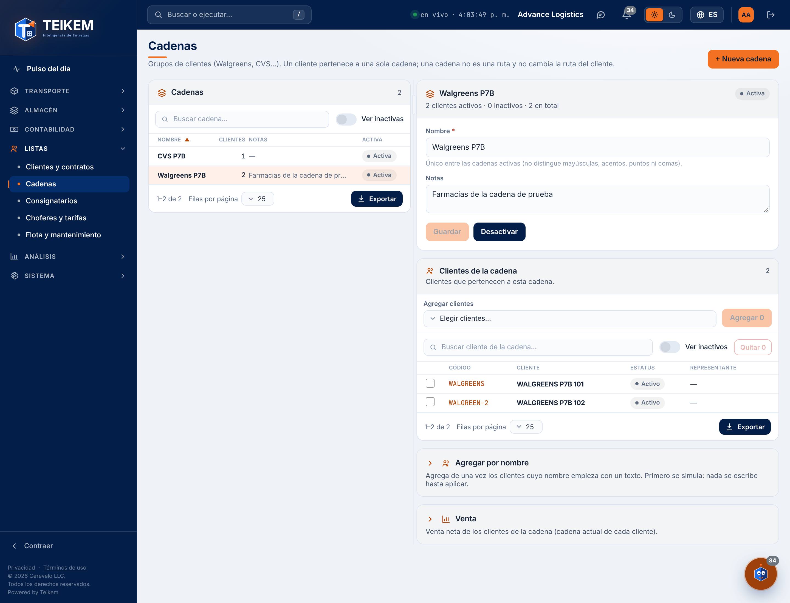
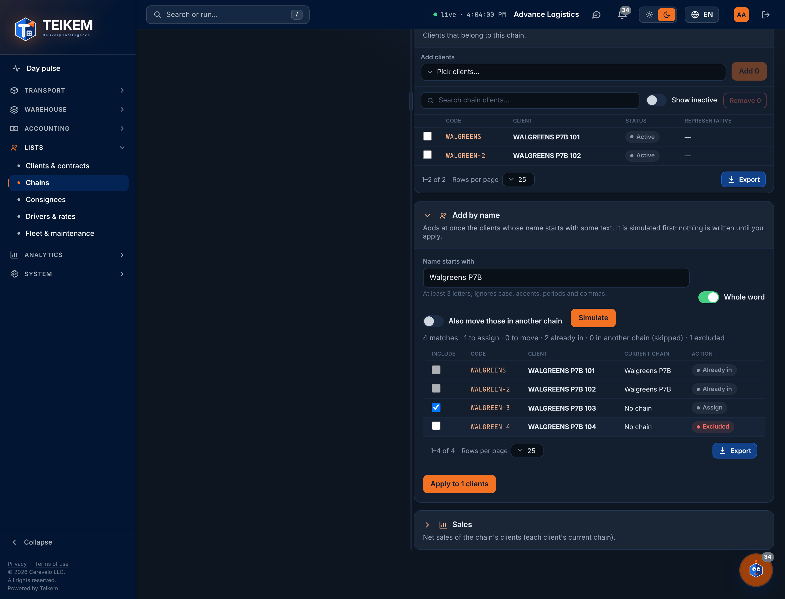
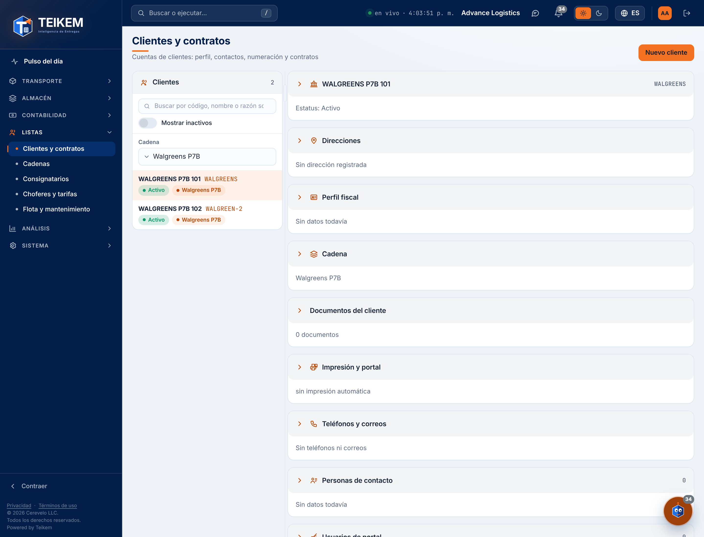
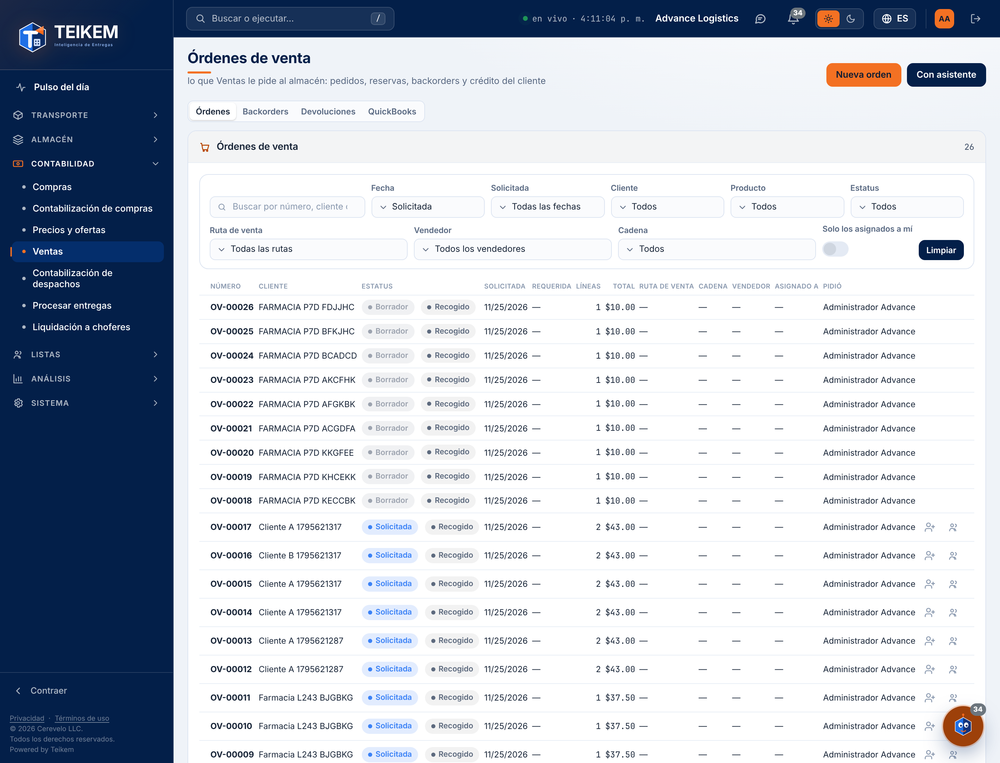
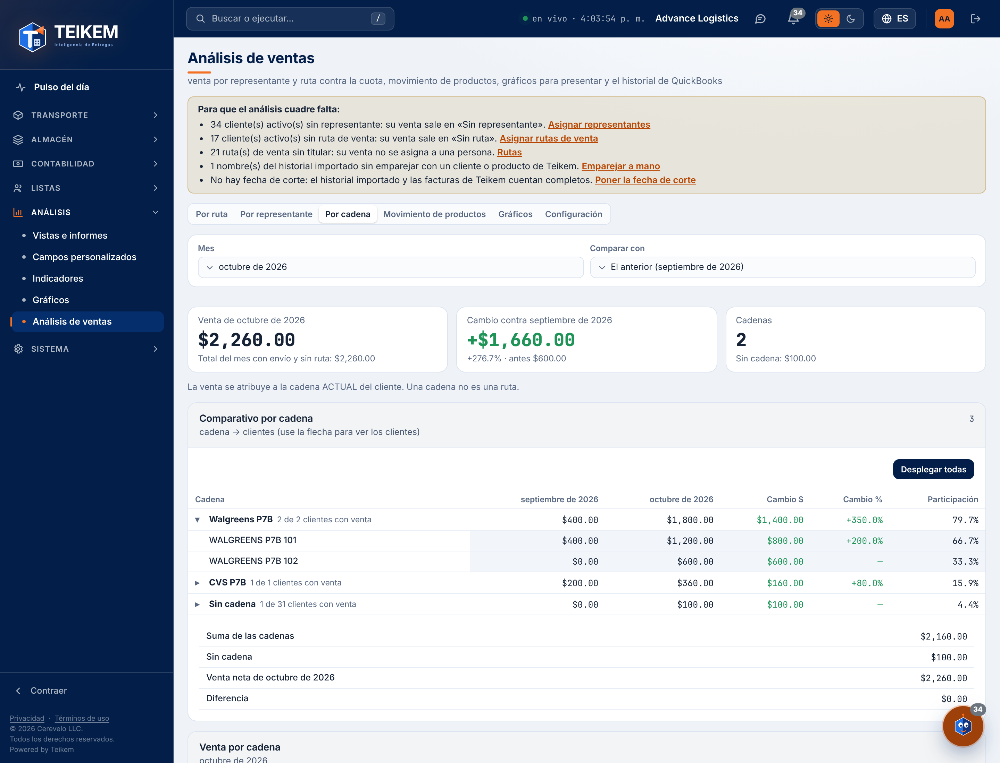
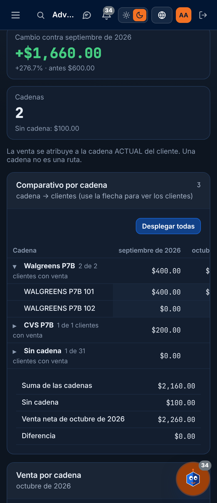

# L245 — Cadenas de clientes: lista y ficha, «Agregar por nombre», filtros y «Por cadena» (web del personal)

Lote 245 (2026-11-25). Cuatro pantallas cambian: **Listas → Cadenas** (nueva), **Listas → Clientes y contratos** (filtro y etiqueta «Cadena», panel «Cadena» en la ficha), **Contabilidad → Ventas / Órdenes de venta** (filtro y columna «Cadena») y **Análisis → Análisis de ventas** (pestaña **«Por cadena»**). Reglas, permisos y mensajes: [capítulo 53](../53-cadenas.md). Cada mensaje de error: [FAQ](../faq.md).

Capturas del recorrido de `web-app/e2e/lote245-cadenas.spec.ts` con el API de pruebas **sin correo**; están en `img/l245-*.png`. Los datos son los que crea el propio recorrido: las cadenas «Walgreens P7B» y «CVS P7B», sus clientes «WALGREENS P7B 101…104» y «CVS P7B CENTRO», y un historial de septiembre y octubre de 2026. El recorrido se corre en cuatro combinaciones: escritorio 1440 px en español/claro y en inglés/oscuro, y celular 390 px en español/oscuro y en inglés/claro; comprueba que no haya scroll horizontal de página, que las filas de la lista de cadenas midan 56 px o menos y que la ficha no se desborde.

## 1. Listas → Cadenas: lista y ficha

**Quién puede.** Ver: `sales.chain`, `clients.read` o `sales.view` (para entrar al menú: `sales.chain` o `clients.read`). Administrar: `sales.chain`. Módulo Órdenes de venta.

**Cómo se usa.** El menú **Listas → Cadenas** queda justo debajo de «Clientes y contratos». Elija una cadena de la lista: su ficha se abre a la derecha.

Qué se ve, de arriba abajo:
- Título **«Cadenas»**, la frase que recuerda que «una cadena no es una ruta y no cambia la ruta del cliente» y, a la derecha, el botón **«+ Nueva cadena»** (solo con `sales.chain`).
- **Lista (izquierda):** buscador «Buscar cadena…», el interruptor **«Ver inactivas»** y la tabla con **Nombre** (ordenable), **Clientes**, **Notas** y **Activa**. En la captura hay dos cadenas, «CVS P7B» (1 cliente) y «Walgreens P7B» (2); la elegida va resaltada. Cada fila mide una sola línea de alto. Abajo, la paginación y **«Exportar»**.
- **Ficha (derecha),** en paneles independientes:
  - **Datos:** encabezado con el nombre, la etiqueta «Activa» y el resumen «2 clientes activos · 0 inactivos · 2 en total»; los campos **Nombre** (con la ayuda «Único entre las cadenas activas (no distingue mayúsculas, acentos, puntos ni comas).») y **Notas**; y los botones **«Guardar»** (apagado mientras no haya cambios) y **«Desactivar»**.
  - **Clientes de la cadena:** «Agregar clientes» con el selector «Elegir clientes…» y el botón **«Agregar 0»** (se enciende al escoger clientes); el buscador «Buscar cliente de la cadena…», **«Ver inactivos»** y **«Quitar 0»**; y la tabla con casilla, **Código**, **Cliente**, **Estatus** y **Representante** (en la captura, «—»). Tiene su propia paginación y «Exportar».
  - **Agregar por nombre** y **Venta:** plegados al abrir; se despliegan con la flecha.

Sin `sales.chain` la ficha se ve igual pero sin botones de escritura. Con el módulo Órdenes de venta apagado, la pantalla no está disponible.

## 2. «Agregar por nombre»: simulación con un cliente excluido

**Quién puede.** `sales.chain`, módulo Órdenes de venta.

**Cómo se usa.** Ficha de la cadena → **Agregar por nombre** → escriba el texto → **«Simular»** → desmarque a quien no quiera → **«Aplicar a N clientes»**.

La captura está en **inglés y tema oscuro** (en español es la misma pantalla: «El nombre empieza con», «Palabra completa», «Mover también los que están en otra cadena», «Simular», «Aplicar a 1 clientes»). Es la ficha desplazada hasta ese panel. Qué se ve:
- El campo **«Name starts with»** con «Walgreens P7B» y su ayuda («At least 3 letters; ignores case, accents, periods and commas.»).
- El interruptor **«Whole word»** encendido (verde) y **«Also move those in another chain»** apagado, y el botón **«Simulate»**.
- El resumen: «4 matches · 1 to assign · 0 to move · 2 already in · 0 in another chain (skipped) · 1 excluded».
- La tabla con **Include**, **Code**, **Client**, **Current chain** y **Action**:
  - «WALGREENS P7B 101» y «102» ya están en «Walgreens P7B»: acción **«Already in»**, con la casilla gris y apagada (no hay nada que decidir).
  - «WALGREENS P7B 103» no tiene cadena («No chain»): acción **«Assign»**, con la casilla marcada.
  - «WALGREENS P7B 104» tiene la casilla **desmarcada** y su fila pasó a **«Excluded»** (etiqueta roja), sin volver a simular.
- El botón **«Apply to 1 clients»** (encendido): aplica solo al cliente 103. En esta captura **no se aplicó**: el recorrido solo simula, para poder repetirse.

Si cambia el texto o un interruptor, la simulación deja de valer y «Aplicar» se apaga hasta volver a simular. Al pulsar «Aplicar» se pide confirmar («Se agregarán N clientes a «{nombre}» (N de ellos se mueven desde otra cadena).»).

## 3. Clientes y contratos: filtro y etiqueta «Cadena»

**Quién puede.** Quien ve la lista de clientes; el filtro y las etiquetas solo salen con el módulo Órdenes de venta encendido.

**Cómo se usa.** Encima de la lista de clientes está el select **«Cadena»** (opciones: «Todas las cadenas», «Sin cadena» y cada cadena activa).

En la captura, el filtro está en «Walgreens P7B» y la lista queda con los **2** clientes de esa cadena. Cada fila lleva, además del estatus («Activo», en verde), una **etiqueta naranja con el nombre de la cadena**. A la derecha se ve la ficha abierta de «WALGREENS P7B 101», con el panel **«Cadena»** (plegado, con la cadena «Walgreens P7B» como resumen) entre «Perfil fiscal» y «Documentos del cliente». Al desplegarlo, con `sales.chain` se escoge otra cadena o se quita; el texto de ayuda recuerda que cambiarla no cambia la ruta de venta.

## 4. Órdenes de venta: filtro «Cadena»

**Quién puede.** Quien ve las órdenes de venta, con el módulo encendido.

En la segunda fila de filtros, después de «Ruta de venta» y «Vendedor», está **«Cadena»** (selector múltiple: «Todos» por omisión; vale cualquiera de las escogidas). La lista de órdenes tiene además la columna **«Cadena»** (la cadena **actual** del cliente; «—» si no tiene).

> La captura se toma con las filas ya cargadas: se ve el filtro «Cadena» y la columna «Cadena» (vacía en estas órdenes, cuyos clientes no tienen cadena). El recorrido comprueba la columna y que haya filas.

## 5. Análisis de ventas → «Por cadena»

**Quién puede.** `sales.analysis.view` o `sales.analysis.manage`, módulo Órdenes de venta.

**Cómo se usa.** Menú Análisis → Análisis de ventas → pestaña **«Por cadena»** (con `?tab=chain`). Arriba, **Mes** y **Comparar con** (por omisión el mes anterior).

Qué se ve, de arriba abajo:
- El aviso «Para que el análisis cuadre falta:» y las seis pestañas: **Por ruta**, **Por representante**, **Por cadena** (activa), **Movimiento de productos**, **Gráficos** y **Configuración**.
- Tres tarjetas: **Venta de octubre de 2026** ($2,260.00), **Cambio contra septiembre de 2026** (+$1,660.00, +276.7 %, «antes $600.00») y **Cadenas** (2, con «Sin cadena: $100.00»), y la línea «La venta se atribuye a la cadena ACTUAL del cliente. Una cadena no es una ruta.».
- **Comparativo por cadena:** una fila por cadena con septiembre, octubre, **Cambio $**, **Cambio %** y **Participación**. «Walgreens P7B» está desplegada (triángulo hacia abajo) y muestra a sus clientes: «WALGREENS P7B 101» ($400.00 → $1,200.00, +200.0 %, 66.7 % de la cadena) y «WALGREENS P7B 102» ($0.00 → $600.00, 33.3 %). «CVS P7B» y «Sin cadena» están plegadas; **«Desplegar todas»** abre las tres. Cada fila dice «N de M clientes con venta» (en «Sin cadena»: «1 de 31»).
- **Conciliación:** Suma de las cadenas $2,160.00 + Sin cadena $100.00 = Venta neta de octubre de 2026 $2,260.00; **Diferencia $0.00**.
- Más abajo, el gráfico **«Venta por cadena»**.

En **celular (390 px)** y tema oscuro la página no tiene scroll horizontal: las tarjetas se apilan una bajo otra y la tabla del comparativo **se desplaza dentro de su propio recuadro** (en la captura la columna de octubre queda cortada en el borde, a propósito; se llega con el dedo). Los nombres de las cadenas pasan a dos líneas («2 de 2 clientes con venta» baja debajo del nombre). La conciliación se ve completa, con Diferencia $0.00.

## 6. Qué cubren las capturas y qué no

- Cubren: lista y ficha (español/claro), simulación con un excluido (inglés/oscuro), filtro de Clientes (español/claro), filtro de Órdenes (español/claro, sin filas), y «Por cadena» en escritorio (español/claro) y en celular (español/oscuro).
- El recorrido tomó también las demás combinaciones de idioma, tema y ancho (las cuatro corridas), pero **no se copiaron al manual**. Ficha en celular, simulación en español, panel «Cadena» desplegado, ventana «+ Nueva cadena», «Quitar» y la pregunta «¿moverlos a esta?» **no tienen captura**.
